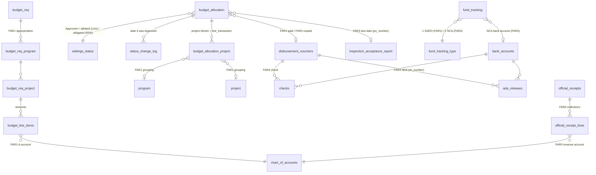

# FAR Reports — ERD

The DBM **Financial Accountability Reports** are built from existing FIMS tables. There are no SQL views and no new
tables: every query is in `app/services/FarReportService.php` (using `LEFT JOIN`), exposed by
`app/routes/far_report.php`. Nothing is written to the database.

| Report | What it shows | API |
|---|---|---|
| **FAR 1** | Appropriations, Allotments, Obligations, Disbursements and Balances, per Program / Project (by quarter) | `GET /api/far_report/far1?fiscal_year=2026` |
| **FAR 1-A** | Same as FAR 1, per Object of Expenditure (PS / MOOE / CO / Others) and account | `GET /api/far_report/far1a?fiscal_year=2026` |
| **FAR 3** | Aging of unpaid obligations from any fiscal year: 0–30, 31–90, 91–365, over 365 days | `GET /api/far_report/far3?as_of=2026-11-30` |
| **FAR 4** | Monthly Report of Disbursements: checks + ADA per bank account, against NCAs received | `GET /api/far_report/far4?fiscal_year=2026&month=11` |
| **FAR 5** | Quarterly Report of Revenues and Other Receipts: Official Receipts per revenue account | `GET /api/far_report/far5?fiscal_year=2026&quarter=4` |

## Diagram

## Where each number comes from

| Figure | Source |
|---|---|
| Appropriation | Approved `budget_req` → `budget_line_items` (`suggested_amount`, else `proposed_amount`) |
| Allotment | Approved LAAs in `budget_allocation`; SARO total from `fund_tracking` type 1 |
| Obligation | Approved RFAs in `budget_allocation`: the sum of `requested_amount` in their `budget_allocation_project.line_transaction` |
| Obligation date | When the RFA was Approved (`status_change_log`), else `updated_at` |
| Disbursement | The RFA's DV is released by Treasury (`disbursement_vouchers.treasury_released_at`) |
| FAR 3 unpaid | Approved RFAs of **any fiscal year**, obligated on or before `as_of`, whose DV is missing or not released by `as_of` |
| FAR 3 due date | The IAR date for the RFA's PO, else the obligation date; days are counted up to `as_of` |
| FAR 4 | `checks` (`check_date`) + `ada_releases` (`ada_date`); NCAs = `fund_tracking` type 2 |
| FAR 5 | `official_receipts` + `official_receipt_lines` (credited accounts) |
| PS / MOOE / CO | From the account code: `5-01` PS, `5-02`/`5-03` MOOE, `1-06`/`1-07` CO, anything else Others |

## Notes
- Obligation = Approved RFA (FIMS has no separate ORS table).
- FAR 3 has no fiscal year filter: it is a snapshot of every unpaid obligation on the `as_of` date, so older
  unpaid obligations (including ones over 1 year) are included.
- All appropriations count as "current" (FIMS does not mark continuing appropriations yet).
- FAR 1, 1-A and 3 follow the user's RC scope (their RC and the RCs under it; FMD and admins see all).
  FAR 4 and 5 are agency-wide.
