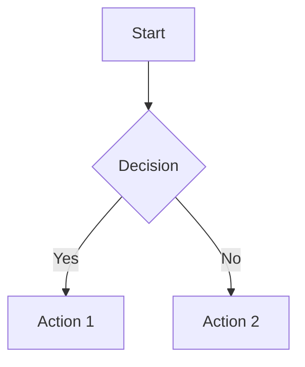

# Bootstrap Chat Widget

A comprehensive, reusable chat widget with FAB (Floating Action Button) that includes file upload, voice input, OpenAI integration, session management, and advanced features like markdown rendering and Mermaid diagrams.

## Features

- 🎯 **FAB Design**: Floating Action Button with customizable position
- 💬 **Real-time Chat**: OpenAI integration with conversation history
- 🎤 **Voice Input**: Speech recognition with Web Speech API and Microsoft Speech SDK fallback
- 📎 **File Upload**: Drag & drop support with file preview and validation
- 🎨 **Customizable Themes**: Bootstrap themes (primary, secondary, success, etc.)
- 📱 **Responsive Design**: Works on desktop and mobile
- 🔧 **Minimize/Maximize**: Popup-style controls with maximize/restore functionality
- 💾 **Auto-save**: Local storage for conversation history
- ⌨️ **Keyboard Shortcuts**: Quick access controls
- 📊 **Analytics**: Event tracking and usage statistics
- 🔄 **Session Management**: Multiple conversation sessions with server-side persistence
- 📝 **Markdown Support**: Rich text rendering with syntax highlighting
- 📊 **Mermaid Diagrams**: Support for rendering Mermaid diagrams in chat
- 🛡️ **Security**: HTTPS requirement for voice features, input sanitization
- 🔧 **Function Tools**: Integration with server-side function tools for advanced operations

## Quick Start

### 1. Load the Module

```html
<!-- Load CSS and JS -->
<link rel="stylesheet" href="/_shared/chat-widget/css/chat-widget.css">
<script src="/_shared/chat-widget/js/chat-display-tools.js"></script>
<script src="/_shared/chat-widget/js/chat-widget.js"></script>
<script src="/_shared/chat-widget/js/chat-operations.js"></script>
```

### 2. Initialize the Widget

```javascript
// Basic initialization
const chatWidget = new ChatWidget({
    title: 'AI Assistant',
    theme: 'primary',
    apiBase: '/UAC/api/chat'
});

// Advanced configuration
const chatWidget = new ChatWidget({
    // Position
    position: 'bottom-right', // 'bottom-right', 'bottom-left', 'top-right', 'top-left'
    
    // Appearance
    theme: 'primary', // 'primary', 'secondary', 'success', 'danger', 'warning', 'info', 'light', 'dark'
    title: 'Chat Assistant',
    avatar: '🤖',
    userAvatar: '👤',
    
    // API Configuration
    microsoftSpeechKey: 'your-microsoft-speech-key',
    microsoftSpeechRegion: 'eastus',
    apiBase: '/UAC/api/chat',
    
    // Features
    enableVoice: true,
    enableUpload: true,
    enableMinimize: false,
    enableMaximize: true,
    
    // File settings
    maxFileSize: 10 * 1024 * 1024, // 10MB
    allowedFileTypes: ['image/*', 'application/pdf', 'text/*'],
    
    // Callbacks
    onMessage: (message) => console.log('New message:', message),
    onError: (error) => console.error('Chat error:', error),
    onUpload: (files) => console.log('Files uploaded:', files),
    
    // Behavior
    autoOpen: false,
    minimized: false
});
```

## Configuration Options

### Position Options
```javascript
position: 'bottom-right' // 'bottom-right', 'bottom-left', 'top-right', 'top-left'
```

### Theme Options
```javascript
theme: 'primary' // 'primary', 'secondary', 'success', 'danger', 'warning', 'info', 'light', 'dark'
```

### File Upload Settings
```javascript
maxFileSize: 10 * 1024 * 1024, // 10MB
allowedFileTypes: ['image/*', 'application/pdf', 'text/*', 'application/msword']
```

### Voice Recognition Settings
```javascript
microsoftSpeechKey: 'your-microsoft-speech-key',
microsoftSpeechRegion: 'eastus'
```

## API Methods

### Basic Controls
```javascript
chatWidget.open();           // Open the chat
chatWidget.close();          // Close the chat
chatWidget.toggle();         // Toggle open/close
chatWidget.maximize();       // Maximize the widget
chatWidget.restore();        // Restore from maximized
chatWidget.toggleMaximize(); // Toggle maximize/restore
```

### Message Management
```javascript
chatWidget.clearMessages();  // Clear all messages
chatWidget.saveMessages();   // Save to localStorage
chatWidget.loadMessages();   // Load from localStorage
```

### Session Management
```javascript
chatWidget.createNewChat();           // Start a new conversation
chatWidget.showSessionsOverlay();     // Show session list
chatWidget.loadSessionHistory(key);   // Load specific session
chatWidget.deleteSessionNow();       // Delete current session
```

### Configuration
```javascript
chatWidget.setTheme('secondary');           // Change theme
chatWidget.setPosition('bottom-left');      // Change position
chatWidget.updateConfig({ title: 'New Title' }); // Update options
```

## Advanced Usage

### With Operations Class
```javascript
const operations = new ChatWidgetOperations(chatWidget);

// Export/Import chat history
operations.exportChatHistory();
operations.importChatHistory(file);

// Search messages
const results = operations.searchMessages('keyword');
operations.highlightSearchResults('keyword');

// Analytics
operations.trackEvent('message_sent', { length: 50 });
const analytics = operations.getAnalytics();

// Custom themes
operations.setCustomTheme('dark');

// File processing
const processedFiles = await operations.processUploadedFiles(files);
```

### Keyboard Shortcuts
```javascript
// Setup keyboard shortcuts
operations.setupKeyboardShortcuts();

// Available shortcuts:
// Ctrl/Cmd + Enter: Send message
// Ctrl/Cmd + /: Toggle chat
// Escape: Close chat
```

### Voice Commands
```javascript
// Setup voice commands
operations.setupVoiceCommands();

// Available commands:
// "send message", "close chat", "open chat", 
// "clear messages", "maximize", "restore"
```

## Session Management

The chat widget includes comprehensive session management:

### Session Features
- **Server-side persistence**: Conversations are stored on the server
- **Session switching**: Switch between multiple conversations
- **Session titles**: Custom titles for each conversation
- **Session deletion**: Delete individual or all sessions
- **Auto-session creation**: Sessions are created automatically

### Session API
```javascript
// Create new session
await chatWidget.createNewChat();

// Load session history
await chatWidget.loadSessionHistory(sessionKey);

// Delete session
await chatWidget.deleteSessionNow();

// Set session title
await chatWidget.setSessionTitle('My Conversation');
```

## Markdown and Mermaid Support

### Markdown Features
- **Rich text rendering**: Bold, italic, links, lists
- **Code highlighting**: Syntax highlighting for code blocks
- **Image support**: Responsive image rendering
- **Security**: Input sanitization with DOMPurify

### Mermaid Diagrams
```markdown

```

### Supported Libraries
- **markdown-it**: Markdown parsing
- **highlight.js**: Code syntax highlighting
- **mermaid**: Diagram rendering
- **DOMPurify**: HTML sanitization

## Voice Recognition

### Web Speech API
- **Primary method**: Uses browser's built-in speech recognition
- **HTTPS requirement**: Requires secure context for security
- **Language support**: Configurable language settings

### Microsoft Speech SDK Fallback
- **Fallback option**: When Web Speech API is not available
- **Cloud-based**: Uses Microsoft's cloud speech services
- **Higher accuracy**: Better recognition quality

### Voice Configuration
```javascript
// Enable voice features
enableVoice: true,

// Microsoft Speech SDK (optional fallback)
microsoftSpeechKey: 'your-key',
microsoftSpeechRegion: 'eastus'
```

## File Upload Features

### Supported Features
- **Drag & drop**: Drag files directly into the chat
- **File preview**: Image previews and file information
- **File validation**: Size and type validation
- **Multiple files**: Upload multiple files at once
- **File removal**: Remove files before sending

### File Processing
```javascript
// Process uploaded files
const processedFiles = await operations.processUploadedFiles(files);

// File information includes:
// - name, type, size
// - content (base64 or text)
// - validation status
```

## Integration with PHPMaker

### Add to Config
```php
// In UAC/src/config.development.php
"OPENAI" => [
    "API_KEY" => "your-openai-api-key",
    "ENDPOINT" => "https://api.openai.com/v1/chat/completions"
],
"MICROSOFT_SPEECH" => [
    "API_KEY" => "your-microsoft-speech-key",
    "REGION" => "eastus"
]
```

### Load in Page
```html
<!-- In your page -->
<script>
loadjs([
    '/_shared/chat-widget/css/chat-widget.css',
    '/_shared/chat-widget/js/chat-display-tools.js',
    '/_shared/chat-widget/js/chat-widget.js',
    '/_shared/chat-widget/js/chat-operations.js'
], 'chat-widget', {
    async: false
});

loadjs.ready('chat-widget', function() {
    // Initialize chat widget
    const chatWidget = new ChatWidget({
        title: 'UAC Assistant',
        theme: 'primary',
        position: 'bottom-right',
        microsoftSpeechKey: '<?= Config("MICROSOFT_SPEECH.API_KEY") ?>',
        microsoftSpeechRegion: '<?= Config("MICROSOFT_SPEECH.REGION") ?>',
        enableVoice: true,
        enableUpload: true,
        enableMaximize: true,
        apiBase: '/UAC/api/chat',
        onMessage: function(message) {
            console.log('New message:', message);
        },
        onError: function(error) {
            console.error('Chat error:', error);
            ew.alert('Chat Error: ' + error);
        }
    });
    
    // Initialize operations
    const operations = new ChatWidgetOperations(chatWidget);
});
</script>
```

## Function Tools Integration

The chat widget integrates with server-side function tools for advanced operations:

### Available Tools
- **chatservice_getchathistory**: Retrieve chat history
- **chattoolsservice_toolsettitle**: Set session title
- **chatservice_getsessions**: Get user sessions
- **chatservice_deletesession**: Delete specific session
- **searchPSGC**: Search Philippine Standard Geographic Code locations

## Widget System

The chat widget includes a powerful widget system for displaying interactive content:

### Widget Architecture
- **Server-side tools**: Generate widget parameters wrapped in code blocks
- **Client-side rendering**: Execute API calls and render widgets
- **Display tools**: Centralized widget rendering system
- **History management**: Store original responses, re-execute widgets on load

### Widget Types

#### PSGC Search Widget
```javascript
// Server returns widget parameters in code block
```search_psgc
{
    "widget_type": "search_psgc",
    "endpoint": "/UAC/api/psgc/search",
    "method": "GET",
    "parameters": {
        "q": "pampanga",
        "level": "",
        "parent_code": "",
        "limit": 50
    },
    "display_options": {
        "show_geojson_path": true,
        "show_population": true,
        "show_level": true,
        "enable_drill_down": true
    }
}
```

### Display Tools

The `ChatDisplayTools` class handles widget rendering:

```javascript
// Initialize display tools
const displayTools = new ChatDisplayTools();

// Register custom widget
displayTools.registerWidget('my_widget', (widgetData) => {
    return `<div class="my-widget">${widgetData.content}</div>`;
});

// Render widget
const html = displayTools.renderWidget(widgetData);
```

### Widget Features
- **Interactive tables**: PSGC results with drill-down capabilities
- **Real-time data**: Fresh API calls when loading from history
- **Error handling**: Graceful fallbacks for API failures
- **Loading states**: Visual feedback during widget execution
- **Responsive design**: Mobile-friendly widget layouts

### ChatToolsService Integration

The server-side `ChatToolsService` provides function tools for the AI:

```php
// Register PSGC search tool
$tools->add($this, 'searchPSGC', 'Search location on our PSGC', [
    'type' => 'object',
    'properties' => [
        'query' => ['type' => 'string', 'description' => 'Search term for location name'],
        'level' => ['type' => 'string', 'description' => 'Geographic level: Reg, Prov, City, Mun, Bgy'],
        'parent_code' => ['type' => 'string', 'description' => 'Parent location code for drill-down search'],
    ],
    'required' => ['query']
], function(array $args) {
    return $this->searchPsgcWidget($args);
}, ['direct_return' => true]);
```

### Widget Execution Flow

1. **User asks**: "search for pampanga on psgc"
2. **AI calls tool**: `searchPSGC` with `{query: "pampanga"}`
3. **Server returns**: Widget parameters in code block
4. **Client extracts**: Widget parameters from code block
5. **Client executes**: API call to PSGC endpoint
6. **Client renders**: Interactive widget with results

### Tool Testing
```javascript
// Test function tools
const apiCall = (url, method = 'POST', data = null) => {
    return $.ajax({
        url: url,
        method: method,
        data: data ? JSON.stringify(data) : null,
        contentType: 'application/json',
        dataType: 'json',
        headers: { 'Authorization': 'Bearer ' + ew.API_JWT_TOKEN }
    });
};

// Fetch available tools
apiCall('/UAC/api/chat/tools/registry', 'POST')
    .done(function(res) {
        console.log('Available tools:', res.tools);
    });

// Dispatch tool
apiCall('/UAC/api/chat/tools/dispatch', 'POST', {
    name: 'searchPSGC',
    arguments: { query: 'pampanga' }
});
```

## Customization

### Custom CSS Variables
```css
:root {
    --chat-bg: #ffffff;
    --chat-text: #333333;
    --chat-border: #e9ecef;
    --chat-input-bg: #ffffff;
    --chat-message-bg: #ffffff;
}
```

### Custom Themes
```javascript
operations.setCustomTheme('custom', {
    '--chat-bg': '#your-color',
    '--chat-text': '#your-color',
    '--chat-border': '#your-color'
});
```

### Theme Classes
The widget applies theme classes to the container:
- `theme-primary`
- `theme-secondary`
- `theme-success`
- `theme-danger`
- `theme-warning`
- `theme-info`
- `theme-light`
- `theme-dark`

## Security Features

### HTTPS Requirement
- **Voice features**: Require HTTPS for security
- **Localhost exception**: Works on localhost for development
- **Security warnings**: Clear warnings when HTTPS is not available

### Input Sanitization
- **DOMPurify**: Sanitizes HTML content
- **XSS protection**: Prevents cross-site scripting
- **Safe rendering**: Secure markdown and HTML rendering

### API Security
- **JWT tokens**: Authentication via Bearer tokens
- **CORS protection**: Proper cross-origin handling
- **Input validation**: Server-side validation

## Browser Support

- ✅ Chrome 66+
- ✅ Firefox 60+
- ✅ Safari 12+
- ✅ Edge 79+

**Note**: Voice recognition requires HTTPS in production.

## Dependencies

- Bootstrap 5
- FontAwesome 5+
- jQuery (for PHPMaker integration)
- markdown-it (loaded dynamically)
- highlight.js (loaded dynamically)
- mermaid (loaded dynamically)
- DOMPurify (loaded dynamically)

## API Endpoints

The chat widget communicates with these API endpoints:

- `POST /UAC/api/chat/send` - Send message
- `GET /UAC/api/chat/history` - Get chat history
- `POST /UAC/api/chat/session/init` - Initialize session
- `POST /UAC/api/chat/session/analyze` - Analyze session
- `GET /UAC/api/chat/sessions` - Get user sessions
- `DELETE /UAC/api/chat/session` - Delete session
- `POST /UAC/api/chat/tools/registry` - Get available tools
- `POST /UAC/api/chat/tools/dispatch` - Execute tool

## Error Handling

### Error Types
- **Network errors**: API communication failures
- **Speech errors**: Voice recognition failures
- **File errors**: Upload and processing errors
- **Validation errors**: Input validation failures

### Error Callbacks
```javascript
const chatWidget = new ChatWidget({
    onError: function(error) {
        console.error('Chat error:', error);
        // Custom error handling
        ew.alert('Chat Error: ' + error);
    }
});
```

## Performance Optimization

### Lazy Loading
- **Dynamic libraries**: Markdown and Mermaid libraries loaded on demand
- **Conditional loading**: Only load what's needed
- **CDN fallbacks**: Multiple CDN sources for reliability

### Memory Management
- **Message limits**: Configurable message history limits
- **Cleanup**: Proper cleanup of event listeners and resources
- **Efficient rendering**: Optimized DOM updates

## Troubleshooting

### Common Issues

1. **Voice not working**
   - Check HTTPS requirement
   - Verify microphone permissions
   - Check browser compatibility

2. **File upload fails**
   - Check file size limits
   - Verify file type restrictions
   - Check network connectivity

3. **Markdown not rendering**
   - Check if libraries loaded successfully
   - Verify content is valid markdown
   - Check console for errors

4. **Session issues**
   - Check API authentication
   - Verify session key persistence
   - Check server-side session storage

5. **Widget loading errors**
   - Check API endpoint availability
   - Verify widget parameters are valid
   - Check network connectivity for API calls
   - Ensure display tools are loaded before widget rendering

### Debug Mode
```javascript
// Enable debug logging
const chatWidget = new ChatWidget({
    debug: true,
    onError: function(error) {
        console.error('Chat Widget Error:', error);
    }
});
```

