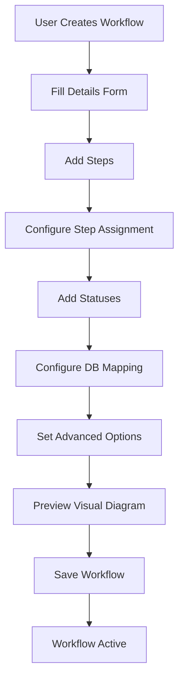
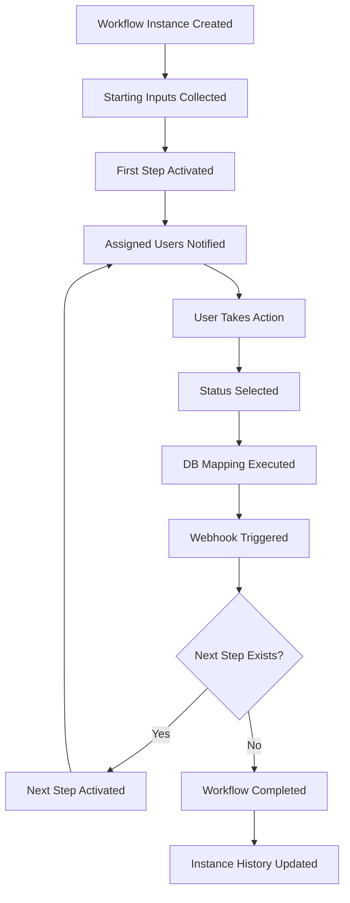

# Workflow Manager v2.0 - Complete Technical Documentation

A comprehensive, mobile-friendly workflow management system built with vanilla Bootstrap 5 and JavaScript for the AFIMS Pampanga project.

## Table of Contents

1. [Overview](#overview)
2. [Architecture](#architecture)
3. [Data Structures & Shapes](#data-structures--shapes)
4. [Forms Documentation](#forms-documentation)
5. [Workflow Flow](#workflow-flow)
6. [Variable System](#variable-system)
7. [Integration Guide](#integration-guide)
8. [Installation & Setup](#installation--setup)

## Overview

### System Purpose
The Workflow Manager is a comprehensive document workflow management system designed for government operations. It enables users to create, configure, and execute complex multi-step processes with database integration, user assignments, and external system connectivity.

### Key Features
- ✨ **Modern UI**: Bootstrap 5 offcanvas editor with responsive design
- 🔍 **Real-time Search**: Filter workflows by name, category, and status
- 📱 **Mobile Responsive**: Touch-friendly interface for all devices
- 🎨 **Visual Workflows**: Mermaid flowchart diagrams with zoom controls
- 🗄️ **Database Integration**: Automatic database updates via configurable mappings
- 👥 **User Assignment**: Department, user level, and specific user assignments
- 🔔 **Webhook Support**: External system integration with test connectivity
- 📊 **Status Management**: Configurable statuses with next step routing
- 🎭 **Starting Inputs**: Dynamic form fields for workflow initialization
- ♿ **Accessible**: Keyboard navigation and screen reader support

### Technology Stack
- **Frontend**: Bootstrap 5.3, Font Awesome 6.4, Vanilla JavaScript
- **Visualization**: Mermaid 10 for flowchart generation
- **Drag & Drop**: SortableJS for step reordering
- **Backend**: PHP with PostgreSQL database
- **Architecture**: Modular JavaScript classes with separation of concerns

## Architecture

### Component Structure

```
WorkflowManager (Main Controller)
├── WorkflowData (Data Management)
│   ├── loadMockData()
│   ├── getAllWorkflows()
│   ├── getWorkflowDetail()
│   ├── addWorkflow()
│   ├── updateWorkflow()
│   └── deleteWorkflow()
├── WorkflowUI (User Interface)
│   ├── renderWorkflowList()
│   ├── renderDetailsForm()
│   ├── renderStepsForm()
│   ├── renderAdvancedForm()
│   └── renderVisualView()
├── WorkflowVisual (Mermaid Integration)
│   ├── generateDiagram()
│   ├── renderFlowchart()
│   └── updateDiagram()
├── WorkflowWebhook (Webhook Management)
│   ├── testConnection()
│   ├── validateUrl()
│   └── getAvailableVariables()
└── WorkflowTooltips (Help System)
    ├── initializeBootstrapTooltips()
    ├── getWebhookHelpContent()
    └── getDBMappingHelpContent()
```

### Data Flow Diagram

```
User Action → WorkflowUI → WorkflowData → Database
     ↓              ↓           ↓
Visual Update ← WorkflowVisual ← Data Processing
     ↓
Toast Notification
```

### File Organization

```
_shared/workflow-manager/
├── css/
│   └── workflow-manager.css          # Custom styles and themes
├── js/
│   ├── workflow-manager.js          # Main controller and initialization
│   ├── workflow-data.js             # Data management and API calls
│   ├── workflow-ui.js               # UI rendering and form management
│   ├── workflow-ui-extensions.js    # Advanced features (webhooks, starting inputs)
│   ├── workflow-visual.js           # Mermaid diagram generation
│   ├── workflow-webhook.js          # Webhook functionality
│   ├── workflow-tooltips.js         # Help system and tooltips
│   ├── workflow-variables.js        # Variable system management
│   └── workflow-db-mapping.js       # Database mapping functionality
├── data/
│   └── api-responses/               # Mock data for development
└── README.md                        # This documentation
```

## Data Structures & Shapes

### Core Tables

#### workflow_workspaces
```sql
workspace_id     UUID PRIMARY KEY
name            VARCHAR(255) NOT NULL
description     TEXT
icon            VARCHAR(100)
status          ENUM('active', 'inactive') DEFAULT 'active'
workflow_count  INT DEFAULT 0
created_at      TIMESTAMP DEFAULT CURRENT_TIMESTAMP
updated_at      TIMESTAMP DEFAULT CURRENT_TIMESTAMP
created_by      INT REFERENCES users(user_id)
updated_by      INT REFERENCES users(user_id)
```

#### workflow_workflows
```sql
workflow_id     UUID PRIMARY KEY
workspace_id    UUID REFERENCES workflow_workspaces(workspace_id)
name            VARCHAR(255) NOT NULL
category        VARCHAR(100) NOT NULL
description     TEXT
icon            VARCHAR(100) DEFAULT 'fa-cogs'
status          ENUM('active', 'draft') DEFAULT 'draft'
step_count      INT DEFAULT 0
advanced_config JSONB DEFAULT '{}'
created_at      TIMESTAMP DEFAULT CURRENT_TIMESTAMP
updated_at      TIMESTAMP DEFAULT CURRENT_TIMESTAMP
created_by      INT REFERENCES users(user_id)
updated_by      INT REFERENCES users(user_id)
```

**advanced_config JSONB Structure:**
```json
{
  "webhook": {
    "enabled": false,
    "url": "",
    "method": "POST",
    "headers": {},
    "testStatus": "untested",
    "lastTested": null
  },
  "startingInput": {
    "enabled": false,
    "fields": [
      {
        "id": "starting-input-001",
        "variable": "application_id",
        "title": "Application ID",
        "type": "text"
      }
    ]
  }
}
```

#### workflow_steps
```sql
step_id         UUID PRIMARY KEY
workflow_id     UUID REFERENCES workflow_workflows(workflow_id) ON DELETE CASCADE
name            VARCHAR(255) NOT NULL
step_order      INT NOT NULL
days_limit      INT DEFAULT 3
auto_advance    BOOLEAN DEFAULT FALSE
assigned_to     JSONB DEFAULT '{}'
db_mapping      JSONB DEFAULT '{}'
outputs         JSONB ARRAY DEFAULT '{}'
created_at      TIMESTAMP DEFAULT CURRENT_TIMESTAMP
updated_at      TIMESTAMP DEFAULT CURRENT_TIMESTAMP
```

**assigned_to JSONB Structure:**
```json
{
    "userLevel": "Staff",
  "department": "Business Permits",
  "users": ["user-001", "user-002"]
}
```

**db_mapping JSONB Structure:**
```json
{
  "schema": "licensing",
  "table": "business_permits",
  "keyField": "application_id",
  "keyValue": "${input.application_id}",
  "statusField": "application_status",
  "statusValueSource": "status_caption",
  "updateFields": [
    {
      "field": "submitted_by",
      "value": "${user.id}",
      "sendToWebhook": true
    },
    {
      "field": "submitted_date",
      "value": "${timestamp}",
      "sendToWebhook": true
    }
  ]
}
```

**outputs JSONB ARRAY Structure:**
```json
[
  {
    "id": "output-001",
    "variable": "submission_date",
    "title": "Submission Date",
    "value": "${db.submitted_date}",
    "source": "db_field"
  },
  {
    "id": "output-002",
    "variable": "submitted_by_name",
    "title": "Submitted By",
    "value": "${user.name}",
    "source": "custom"
  }
]
```

**Output Variable Types:**
- **db_field**: Variables that reference database fields from the step's DB mapping
- **custom**: Variables with custom values that can use variable picker syntax

#### workflow_statuses
```sql
status_id       UUID PRIMARY KEY
step_id         UUID REFERENCES workflow_steps(step_id) ON DELETE CASCADE
name            VARCHAR(255) NOT NULL
is_default      BOOLEAN DEFAULT FALSE
next_steps      JSONB ARRAY DEFAULT '[]'
color           VARCHAR(50) DEFAULT 'primary'
created_at      TIMESTAMP DEFAULT CURRENT_TIMESTAMP
updated_at      TIMESTAMP DEFAULT CURRENT_TIMESTAMP
```

**next_steps JSONB ARRAY Structure:**
```json
["step-002", "step-003"]
```

#### workflow_instances (Runtime Data)
```sql
instance_id     UUID PRIMARY KEY
workflow_id     UUID REFERENCES workflow_workflows(workflow_id)
current_step_id UUID REFERENCES workflow_steps(step_id)
starting_inputs JSONB DEFAULT '{}'
status          ENUM('active', 'completed', 'cancelled') DEFAULT 'active'
started_at      TIMESTAMP DEFAULT CURRENT_TIMESTAMP
completed_at    TIMESTAMP
started_by      INT REFERENCES users(user_id)
```

#### workflow_instance_history (Audit Trail)
```sql
history_id      UUID PRIMARY KEY
instance_id     UUID REFERENCES workflow_instances(instance_id)
step_id         UUID REFERENCES workflow_steps(step_id)
status_id       UUID REFERENCES workflow_statuses(status_id)
action_by       INT REFERENCES users(user_id)
action_at       TIMESTAMP DEFAULT CURRENT_TIMESTAMP
notes           TEXT
variables       JSONB DEFAULT '{}'
```

### Data Relationships

```
workflow_workspaces (1) ──→ (N) workflow_workflows
workflow_workflows (1) ──→ (N) workflow_steps
workflow_steps (1) ──→ (N) workflow_statuses
workflow_workflows (1) ──→ (N) workflow_instances
workflow_instances (1) ──→ (N) workflow_instance_history
```

## Forms Documentation

### Workflow Details Form

**Location**: Details tab in workflow editor offcanvas

**Fields**:
- **Workflow Name** (text, required): Unique identifier for the workflow
- **Category** (select, required): Predefined categories (Licensing, Document Management, Legislative, Financial, Administrative)
- **Description** (textarea): Detailed description of workflow purpose
- **Icon** (picker): Font Awesome icon selection with search functionality
- **Status** (select): Draft (development) or Active (live)

**Validation Rules**:
- Name: Required, max 255 characters, unique within workspace
- Category: Required, must be from predefined list
- Description: Optional, max 1000 characters
- Icon: Required, must be valid Font Awesome class

**Form Behavior**:
- Auto-saves on field blur
- Real-time validation feedback
- Icon picker modal with search and preview

### Step Editor Form

**Location**: Modal dialog triggered from Steps tab

**Tab Structure**:

#### Basic Info Tab
- **Step Name** (text, required): Descriptive name for the step
- **Days Limit** (number): Maximum days to complete step
- **Auto Advance** (checkbox): Automatically advance to next step when completed

#### Assignment Tab
- **User Level** (select): Staff, Supervisor, Manager, Director, Mayor, Treasurer
- **Department** (select): Dynamic list from system departments
- **Specific Users** (multi-select): Search and select specific users

#### DB Mapping Tab
- **Schema** (select): Database schema selection
- **Table** (select): Table within selected schema
- **Key Field** (select): Field used for WHERE clause
- **Key Value** (text): Value or variable for key field
- **Status Field** (select): Field updated when status changes
- **Status Value Source** (select): What value to store (caption vs value)
- **Update Fields** (dynamic list): Additional fields to update

#### Statuses Tab
- **Status List** (dynamic): Add/edit/delete statuses
- **Status Properties**: Name, color, default status, next steps

**Form Behavior**:
- Tab-based navigation with validation per tab
- Dynamic field updates based on selections
- Real-time preview of database mapping
- Drag-and-drop for status reordering

### Assignment Modal

**Location**: Modal triggered from Assignment tab in step editor

**Features**:
- **Department Checkboxes**: Select multiple departments
- **User Level Radio Buttons**: Single user level selection
- **Specific Users Search**: Real-time user search with filters
- **Assignment Preview**: Summary of current assignment configuration

**User Search Functionality**:
- Search by name, position, or department
- Real-time filtering as user types
- Selected users displayed as removable badges
- Search results in scrollable container

### Status Editor Modal

**Location**: Modal triggered from Statuses tab in step editor

**Fields**:
- **Status Name** (text, required): Display name for status
- **Color** (select): Bootstrap color classes (primary, success, danger, warning, info)
- **Default Status** (checkbox): Whether this is the default status for the step
- **Next Steps** (multi-select): Which steps can be reached from this status

**Validation**:
- Status name must be unique within step
- At least one status must be marked as default
- Next steps must reference valid step IDs

### Output Variables Tab

**Location**: Outputs tab in step editor modal

**Purpose**: Define variables that this step produces for use in subsequent steps and webhooks

**Two-Tab Interface**:

#### From DB Fields Tab
- **Purpose**: Select database fields from the step's DB mapping configuration
- **Requirements**: DB Mapping must be configured with schema and table
- **Interface**: 
  - Shows available fields as checkboxes with field name and type
  - Displays field descriptions when available
  - "Add Selected Fields" button to create outputs from checked fields
- **Auto-Generated Outputs**: 
  - Variable name: field name
  - Title: formatted field name (e.g., "submitted_date" → "Submitted Date")
  - Value: `${db.field_name}`
  - Source: "db_field"

#### Custom Variables Tab
- **Purpose**: Create custom output variables with manual values
- **Fields**:
  - **Title** (text, required): Display label for the output
  - **Variable Name** (text, required): Variable identifier (letters, numbers, underscores only)
  - **Value** (text, required): Value or variable expression with picker button
- **Variable Picker Integration**: 
  - Button opens variable picker modal
  - Shows previous step outputs grouped by step
  - Includes starting inputs, system variables, and current step DB fields
- **Output Structure**:
  - Variable name: user-defined
  - Title: user-defined display label
  - Value: user-defined value or variable expression
  - Source: "custom"

**Output Display**:
- Grouped by source type (DB Fields vs Custom)
- Shows variable name, title, value preview, and source badge
- Edit and delete buttons for each output
- Tab count updates automatically

**Variable Picker Enhancements**:
- **Previous Step Outputs**: Grouped by step name and order
- **Starting Inputs**: From workflow starting input configuration
- **System Variables**: `${user.*}`, `${workflow.*}`, `${timestamp}`, `${date}`
- **Current Step DB Fields**: Fields from current step's DB mapping
- **Context-Aware**: Only shows variables available up to current step

### Advanced Configuration

**Location**: Advanced tab in workflow editor

#### Starting Input Configuration
- **Enable Starting Inputs** (toggle): Master switch for starting input functionality
- **Starting Input Fields** (dynamic list):
  - Variable Name (text): Variable identifier
  - Title (text): Display label
  - Type (select): text, number, date, email

#### Webhook Configuration
- **Enable Webhook** (toggle): Master switch for webhook functionality
- **Webhook URL** (url, required if enabled): Target endpoint URL
- **HTTP Method** (select): POST, PUT, PATCH
- **Custom Headers** (dynamic list): Key-value pairs for authentication
- **Test Connection** (button): Validates webhook connectivity

**Webhook Test Process**:
1. Validates URL format
2. Sends test payload with sample data
3. Displays success/failure status
4. Stores test results and timestamp

## Workflow Flow

### Main Configuration Flow



### Step Execution Flow



### Detailed Step Execution Process

1. **Workflow Initialization**:
   - User provides starting input values
   - Workflow instance created with unique ID
   - First step activated based on step_order

2. **Step Activation**:
   - Current step determined by step_order
   - Assigned users notified (email, dashboard, etc.)
   - Step timer started (if days_limit configured)

3. **User Action**:
   - Assigned user opens workflow instance
   - User reviews step requirements
   - User selects appropriate status

4. **Status Processing**:
   - Status validation performed
   - Database mapping executed:
     - Key field/value used for WHERE clause
     - Status field updated with selected status
     - Additional fields updated per configuration
   - Output variables generated

5. **Webhook Execution** (if configured):
   - Payload constructed with:
     - Workflow instance data
     - Step information
     - Status details
     - User information
     - Database field values (marked for webhook)
   - HTTP request sent to configured URL
   - Response logged for debugging

6. **Next Step Determination**:
   - Next steps retrieved from selected status
   - If multiple next steps: user chooses or system determines
   - If no next steps: workflow marked as completed

7. **History Tracking**:
   - Action recorded in workflow_instance_history
   - Variables and notes stored
   - Audit trail maintained

## Variable System

### Variable Categories

#### Input Variables
Access starting input values provided when workflow begins:
- `${input.application_id}` - Application ID from starting form
- `${input.applicant_name}` - Applicant name from starting form
- `${input.business_type}` - Business type from starting form
- `${input.document_id}` - Document ID from starting form
- `${input.priority}` - Priority level from starting form

#### User Variables
Current user context information:
- `${user.id}` - Current user ID
- `${user.name}` - Current user full name
- `${user.email}` - Current user email address
- `${user.department}` - Current user department
- `${user.level}` - Current user level (Staff, Supervisor, etc.)
- `${user.position}` - Current user position title

#### Workflow Variables
Current workflow and step context:
- `${workflow.id}` - Current workflow ID
- `${workflow.name}` - Current workflow name
- `${workflow.category}` - Current workflow category
- `${step.id}` - Current step ID
- `${step.name}` - Current step name
- `${step.order}` - Current step order number

#### Status Variables
Selected status information:
- `${status.id}` - Selected status ID
- `${status.name}` - Selected status name
- `${status.color}` - Selected status color

#### System Variables
Dynamic system-generated values:
- `${timestamp}` - Current ISO 8601 timestamp (2024-03-20T10:30:00Z)
- `${date}` - Current date (YYYY-MM-DD format)
- `${time}` - Current time (HH:mm:ss format)
- `${datetime}` - Current date and time (YYYY-MM-DD HH:mm:ss)

### Variable Usage Examples

#### Database Mapping
```sql
-- Key Value field
${input.application_id}

-- Status Field Value
${status.name}

-- Additional Field Values
submitted_by = ${user.id}
submitted_date = ${timestamp}
reviewer_notes = "Reviewed by ${user.name} on ${date}"
```

#### Webhook Payload
```json
{
  "workflow_id": "${workflow.id}",
  "workflow_name": "${workflow.name}",
  "step_name": "${step.name}",
  "status": "${status.name}",
  "user": {
    "id": "${user.id}",
    "name": "${user.name}",
    "department": "${user.department}"
  },
  "application_id": "${input.application_id}",
  "timestamp": "${timestamp}",
  "data": {
    "submitted_by": "${user.id}",
    "submitted_date": "${timestamp}"
    }
}
```

#### Starting Input Form
```html
<!-- Dynamic form fields generated from starting input configuration -->
<input name="application_id" placeholder="Application ID" required>
<input name="applicant_name" placeholder="Applicant Name" required>
<input name="business_type" placeholder="Business Type" required>
```

### Variable Resolution Process

1. **Variable Detection**: System scans text for `${variable}` patterns
2. **Context Resolution**: Variables resolved based on current execution context
3. **Type Conversion**: Values converted to appropriate data types
4. **Validation**: Resolved values validated against expected formats
5. **Substitution**: Variables replaced with actual values in final output

### Enhanced Variable Picker System

The Variable Picker provides context-aware variable selection with grouped categories:

#### Variable Categories

**1. Starting Inputs**
- Variables from workflow starting input configuration
- Syntax: `${startingInput.field_name}`
- Example: `${startingInput.application_id}`

**2. Previous Step Outputs**
- Grouped by step name and order
- Only shows outputs from steps with order < current step
- Syntax: `${variable_name}` (from step outputs)
- Example: `${submission_date}`, `${approval_date}`

**3. System Variables**
- Built-in system variables
- Syntax: `${system_variable}`
- Available variables:
  - `${user.id}` - Current user ID
  - `${user.name}` - Current user name
  - `${user.department}` - User's department
  - `${workflow.id}` - Current workflow ID
  - `${workflow.name}` - Current workflow name
  - `${timestamp}` - Current timestamp
  - `${date}` - Current date
  - `${time}` - Current time

**4. Current Step DB Fields**
- Fields from current step's DB mapping configuration
- Syntax: `${db.field_name}`
- Example: `${db.submitted_date}`, `${db.status}`

#### Variable Picker Interface

**Search Functionality**:
- Real-time search across all variable categories
- Filters by name, type, or description
- Case-insensitive matching

**Grouped Display**:
- Starting Inputs (expanded by default)
- Previous Step Outputs (nested by step)
- System Variables
- Current Step DB Fields

**Context Awareness**:
- Only shows variables available up to current step
- Filters previous steps based on step order
- Shows current step context in header

#### Variable Usage Examples

**In Output Values**:
```json
{
  "variable": "approved_by_name",
  "title": "Approved By",
  "value": "${user.name}",
  "source": "custom"
}
```

**In DB Mapping**:
```json
{
  "field": "submitted_by",
  "value": "${user.id}",
  "sendToWebhook": true
}
```

**In Webhook Data**:
```json
{
  "workflow_id": "${workflow.id}",
  "step_name": "${current_step.name}",
  "user": "${user.name}",
  "timestamp": "${timestamp}"
}
```

## Integration Guide

### API Endpoints Required

#### Workflow Management
```
GET    /api/workflows                    # List all workflows
GET    /api/workflows/{id}               # Get workflow details
POST   /api/workflows                    # Create new workflow
PUT    /api/workflows/{id}               # Update workflow
DELETE /api/workflows/{id}               # Delete workflow
```

#### Step Management
```
GET    /api/workflows/{id}/steps         # Get workflow steps
POST   /api/workflows/{id}/steps         # Add step to workflow
PUT    /api/steps/{id}                   # Update step
DELETE /api/steps/{id}                   # Delete step
```

#### Status Management
```
GET    /api/steps/{id}/statuses          # Get step statuses
POST   /api/steps/{id}/statuses          # Add status to step
PUT    /api/statuses/{id}                # Update status
DELETE /api/statuses/{id}                # Delete status
```

#### Instance Management
```
POST   /api/workflows/{id}/instances     # Start workflow instance
GET    /api/instances/{id}               # Get instance details
PUT    /api/instances/{id}/status        # Update instance status
GET    /api/instances/{id}/history       # Get instance history
```

#### Metadata Endpoints
```
GET    /api/metadata/workspaces          # Get workspaces
GET    /api/metadata/departments          # Get departments
GET    /api/metadata/user-levels          # Get user levels
GET    /api/metadata/schemas              # Get database schemas
GET    /api/metadata/tables/{schema}      # Get tables in schema
GET    /api/metadata/fields/{schema}/{table} # Get fields in table
```

### Authentication Requirements

#### Session-Based Authentication
```javascript
// Include session cookie with all requests
fetch('/api/workflows', {
  credentials: 'include',
  headers: {
    'Content-Type': 'application/json',
    'X-Requested-With': 'XMLHttpRequest'
  }
})
```

#### Token-Based Authentication
```javascript
// Include Bearer token with all requests
const token = localStorage.getItem('auth_token');
fetch('/api/workflows', {
    headers: {
        'Authorization': `Bearer ${token}`,
        'Content-Type': 'application/json'
    }
})
```

### Webhook Payload Structure

#### Standard Webhook Payload
```json
{
  "event": "workflow.status_changed",
  "timestamp": "2024-03-20T10:30:00Z",
  "workflow": {
    "id": "wf-001",
    "name": "Business Permit Application",
    "category": "Licensing"
  },
  "instance": {
    "id": "inst-001",
    "status": "active",
    "started_at": "2024-03-20T09:00:00Z"
  },
  "step": {
    "id": "step-001",
    "name": "Initial Review",
    "order": 1
  },
  "status": {
    "id": "status-001",
    "name": "Approved",
    "color": "success"
  },
  "user": {
    "id": 123,
    "name": "John Doe",
    "email": "john.doe@pampanga.gov.ph",
    "department": "Business Permits"
  },
  "starting_inputs": {
    "application_id": "BP-2024-001",
    "applicant_name": "Jane Smith",
    "business_type": "Retail"
  },
  "database_fields": {
    "submitted_by": 123,
    "submitted_date": "2024-03-20T10:30:00Z",
    "reviewer_notes": "Application approved"
  }
}
```

#### Webhook Response Handling
```javascript
// Expected webhook response
{
  "success": true,
  "message": "Webhook processed successfully",
  "data": {
    "processed_at": "2024-03-20T10:30:01Z"
    }
}
```

### Database Integration

#### Connection Configuration
```php
// Database connection for workflow operations
$workflow_db = [
    'host' => 'localhost',
    'database' => 'afims_workflow',
    'username' => 'workflow_user',
    'password' => 'secure_password',
    'charset' => 'utf8mb4'
];
```

#### Transaction Management
```php
// Example workflow instance update with transaction
DB::beginTransaction();
try {
    // Update workflow instance
    $instance = WorkflowInstance::find($instanceId);
    $instance->current_step_id = $nextStepId;
    $instance->save();
    
    // Execute database mapping
    $this->executeDatabaseMapping($step, $status, $variables);
    
    // Create history record
    WorkflowInstanceHistory::create([
        'instance_id' => $instanceId,
        'step_id' => $currentStepId,
        'status_id' => $statusId,
        'action_by' => $userId,
        'variables' => $variables
    ]);
    
    DB::commit();
} catch (Exception $e) {
    DB::rollback();
    throw $e;
}
```

## API Endpoints

The Workflow Manager uses a RESTful API pattern with the base path `/api/wf-manager/` for easy integration with other systems.

### Core Workflow Endpoints

#### List Workflows
```
GET /api/wf-manager/workflows
```
**Response**:
```json
{
  "success": true,
  "message": "Workflows retrieved successfully",
  "data": [
    {
      "id": "wf-001",
      "name": "Business Permit Application",
      "category": "Licensing",
      "status": "active",
      "stepCount": 3,
      "createdDate": "2025-01-15",
      "updatedDate": "2025-03-20"
    }
  ]
}
```

#### Get Workflow Details
```
GET /api/wf-manager/workflows/{id}
```
**Response**:
```json
{
  "success": true,
  "message": "Workflow details retrieved successfully",
  "data": {
    "id": "wf-001",
    "name": "Business Permit Application",
    "steps": [...],
    "advancedConfig": {...}
  }
}
```

#### Create Workflow
```
POST /api/wf-manager/workflows
```
**Request Body**:
```json
{
  "name": "New Workflow",
  "category": "Administrative",
  "description": "Workflow description",
  "icon": "fa-file",
  "status": "draft"
}
```

#### Update Workflow
```
PUT /api/wf-manager/workflows/{id}
```
**Request Body**: Same as create workflow

#### Delete Workflow
```
DELETE /api/wf-manager/workflows/{id}
```

### Metadata Endpoints

#### List Workspaces
```
GET /api/wf-manager/workspaces
```

#### Get Schema Metadata
```
GET /api/wf-manager/metadata/schemas
```
**Response**:
```json
{
  "success": true,
  "data": [
    {
      "name": "licensing",
      "tables": [
        {
          "name": "business_permits",
          "fields": [
            {
              "name": "application_status",
              "type": "varchar",
              "description": "Current status of the application"
            }
          ]
        }
      ]
    }
  ]
}
```

#### Get Departments
```
GET /api/wf-manager/metadata/departments
```

#### Get User Levels
```
GET /api/wf-manager/metadata/user-levels
```

### Workflow Instance Endpoints

#### Start Workflow Instance
```
POST /api/wf-manager/workflows/{id}/instances
```
**Request Body**:
```json
{
  "startingInputs": {
    "application_id": "APP-001",
    "applicant_name": "John Doe"
  }
}
```

#### Get Instance Status
```
GET /api/wf-manager/instances/{id}
```

#### Take Action on Instance
```
POST /api/wf-manager/instances/{id}/actions
```
**Request Body**:
```json
{
  "action": "complete_step",
  "statusId": "status-001",
  "notes": "Application approved"
}
```

### Authentication

All API endpoints require authentication. Include the authentication token in the request headers:

```
Authorization: Bearer {your-token}
Content-Type: application/json
```

### Error Responses

All endpoints return consistent error responses:

```json
{
  "success": false,
  "message": "Error description",
  "error": "Detailed error information",
  "code": "ERROR_CODE"
}
```

### Rate Limiting

- **Standard endpoints**: 100 requests per minute per user
- **Instance actions**: 50 requests per minute per user
- **Metadata endpoints**: 200 requests per minute per user

## Installation & Setup

### Dependencies

#### Frontend Dependencies
```html
<!-- Bootstrap 5.3 -->
<link href="https://cdn.jsdelivr.net/npm/bootstrap@5.3.0/dist/css/bootstrap.min.css" rel="stylesheet">
<script src="https://cdn.jsdelivr.net/npm/bootstrap@5.3.0/dist/js/bootstrap.bundle.min.js"></script>

<!-- Font Awesome 6.4 -->
<link rel="stylesheet" href="https://cdnjs.cloudflare.com/ajax/libs/font-awesome/6.4.0/css/all.min.css">

<!-- Mermaid 10 -->
<script src="https://cdn.jsdelivr.net/npm/mermaid@10/dist/mermaid.min.js"></script>

<!-- SortableJS -->
<script src="https://cdn.jsdelivr.net/npm/sortablejs@latest/Sortable.min.js"></script>
```

#### Backend Dependencies
- PHP 8.0+
- PostgreSQL 13+
- PDO PostgreSQL extension
- JSON extension

### File Structure Setup

```
AFIMS/app/pages/
└── workflow-manager.php              # Main integration file

_shared/workflow-manager/
├── css/
│   └── workflow-manager.css          # Custom styles
├── js/
│   ├── workflow-manager.js           # Main controller
│   ├── workflow-data.js              # Data management
│   ├── workflow-ui.js                 # UI rendering
│   ├── workflow-ui-extensions.js      # Advanced features
│   ├── workflow-visual.js             # Mermaid integration
│   ├── workflow-webhook.js            # Webhook functionality
│   ├── workflow-tooltips.js           # Help system
│   ├── workflow-variables.js          # Variable system
│   └── workflow-db-mapping.js         # Database mapping
└── data/
    └── api-responses/                # Mock data
```

### Configuration

#### Database Schema Setup
```sql
-- Run the SQL files in order:
-- 1. workflow - create db.sql
-- 2. workflow - preset values.sql
-- 3. workflow - sample data.sql
```

#### Environment Configuration
```php
// config/workflow.php
return [
    'database' => [
        'connection' => 'workflow',
        'schema' => 'workflow'
    ],
    'webhook' => [
        'timeout' => 30,
        'retry_attempts' => 3,
        'retry_delay' => 5
    ],
    'security' => [
        'allowed_webhook_domains' => [
            'api.example.com',
            'webhooks.service.com'
        ]
    ]
];
```

### First-Time Setup

#### 1. Database Initialization
```bash
# Create database
createdb afims_workflow

# Run schema creation
psql -d afims_workflow -f "_assets/sql/12-workflow/workflow - create db.sql"

# Add preset values
psql -d afims_workflow -f "_assets/sql/12-workflow/workflow - preset values.sql"

# Add sample data
psql -d afims_workflow -f "_assets/sql/12-workflow/workflow - sample data.sql"
```

#### 2. Application Integration
```php
// Include in your main application
require_once '_shared/workflow-manager/workflow-manager.php';
```

#### 3. User Permissions
```sql
-- Grant necessary permissions to application user
GRANT SELECT, INSERT, UPDATE, DELETE ON ALL TABLES IN SCHEMA workflow TO afims_user;
GRANT USAGE ON ALL SEQUENCES IN SCHEMA workflow TO afims_user;
```

#### 4. Testing Setup
1. Navigate to workflow manager page
2. Verify mock data loads correctly
3. Test workflow creation
4. Test step configuration
5. Test visual diagram generation
6. Test webhook connectivity (if configured)

### Troubleshooting

#### Common Issues

**Mock data not loading**:
- Ensure page is served through web server (not file://)
- Check browser console for CORS errors
- Verify data files exist in correct paths

**Mermaid diagrams not rendering**:
- Check if Mermaid library loaded correctly
- Verify workflow data structure
- Check browser console for JavaScript errors

**Database mapping not working**:
- Verify schema and table names exist
- Check field names match database structure
- Ensure proper database permissions

**Webhook tests failing**:
- Verify URL is accessible
- Check SSL certificate validity
- Ensure proper headers configuration
- Test with curl or Postman first

#### Debug Mode
```javascript
// Enable debug logging
localStorage.setItem('workflow_debug', 'true');
// Refresh page to see detailed console logs
```

---

## Support

For technical support or questions about the Workflow Manager:

1. Check browser console for error messages
2. Review this documentation for configuration details
3. Verify all dependencies are loaded correctly
4. Ensure proper database setup and permissions
5. Test with sample data before production use

## License

This Workflow Manager is part of the AFIMS Pampanga project and is intended for government use.
