# Entity-Relationship Diagrams — FIMS NHA (by sidebar module)

> **Status:** rewritten 2026-11-17 against the code in `app/` and the effective database structure in
> `_assets/sql/` (base tables **plus every alter** in `03 - alter_table`, `03 - alter` and `02 - alter_table`).
> Organized the way users see the system: **one section per sidebar group and menu item** (`views/menu.php`),
> each listing the page, routes and services behind it, the tables it writes and reads, its status workflow,
> and an ER diagram of its own tables. Tables shared by many modules are described once, in
> [Shared reference tables](#shared-reference-tables) and [Platform & cross-cutting tables](#platform--cross-cutting-tables).
> The previous version (organized by schema, last updated 2026-11-16) is in git history.

## Scope

| Schema | Tables | Notes |
|---|---|---|
| `fims` | **62** tables + 3 views (`v_journals`, `v_trial_balance`, `v_journal_entry_vouchers`) | 68 tables are created by the SQL, 10 are later dropped (`sl_masters`, `sl_details`, the 4 old check-release tables, `iar_module`, `po_delivery_receipt`, `po_delivery_receipt_entry`; `property_records`' DROP is commented out, so it stays) |
| `uac` | **30** tables + 1 view (`aggregated_audit_logs`) + 1 function (`generate_next_id`) | 24 in the base dump `00 - uac/01 - table/01 - uac_structure_data.sql`, 6 added later. The base dump declares **no foreign keys**; after the alters only 6 real FKs exist (see [Platform](#platform--cross-cutting-tables)) |
| `fmd`, `workflow` | 0 | Schemas exist (`00 - public`), nothing is created in them — but `fmd.supplemental_fund_details` is **read by code without any DDL** (see [Known gaps](#known-gaps--open-questions)) |

## How to read the diagrams

- Each module's diagram shows only **its own core tables** and their relationships, with the **key columns**
  (PK, FKs, status, amounts, business columns) — not every column. Lookups owned by another module appear only
  as an edge.
- Cardinality: `||--o{` one-to-many (optional), `||--|{` one-to-many (at least one).
- **`soft:`** in a relationship label = the column holds the other table's key but there is **no FK constraint**
  (checked only by the service, or not at all). `cross-schema:` = a link between `uac` and `fims`.
- "Tables written / read" come from the services' SQL (`app/services/*.php`), not from the page.
- Status: **Built** (page + API + tables), **Partial**, **Empty placeholder** (the page file is 0 bytes — the
  menu item opens a blank page), **PHPMaker-generated**.

## Sidebar index

| Sidebar group | Menu item | Status |
|---|---|---|
| Dashboard & notifications | [Dashboard](#dashboard) | Built |
| Dashboard & notifications | [Notification reads](#notification-reads) | PHPMaker-generated |
| COB Preparation | [Budget Proposal](#budget-proposal) | Built |
| COB Preparation | [Budget Request](#budget-request) | Built |
| COB Preparation | [Budget Revision](#budget-revision) | Built |
| COB Preparation | [Ledger](#ledger) | Empty placeholder (0-byte page) |
| Budget Process | [Request for Allocation (CBA)](#request-for-allocation-cba) | Built |
| Budget Process | [Request for Allocation (RFA/LAA)](#request-for-allocation-rfalaa) | Built |
| DV Processing | [Disbursement Voucher](#disbursement-voucher) | Built |
| DV Processing | [Liquidation Voucher](#liquidation-voucher) | Empty placeholder (0-byte page) |
| DV Processing | [Journal Entry Voucher](#journal-entry-voucher) | Built |
| DV Processing | [Disbursement Preparation](#disbursement-preparation) | Built, with stubs |
| Inventory | [IAR Module](#iar-module) | Partial |
| Monitoring | [COB Monitoring](#cob-monitoring) | Built |
| Monitoring | [RFA / LAA Monitoring](#rfa--laa-monitoring) | Empty placeholder (0-byte page) |
| Registry/NCA | [SARO Registry](#saro-registry) | Built |
| Registry/NCA | [Check Registry](#check-registry) | Empty placeholder (0-byte page) |
| Registry/NCA | [Accountable Forms Registry](#accountable-forms-registry) | Empty placeholder (0-byte page) |
| Reports | [FMR](#fmr) | Empty placeholder (0-byte page) |
| Reports | [Remittance List (Deductions)](#remittance-list-deductions) | Empty placeholder (0-byte page) |
| Ledgers | [General Ledger](#general-ledger) | Built |
| Ledgers | [Subsidiary Ledger](#subsidiary-ledger) | Built (read-only) |
| Ledgers | [Journals](#journals) | Built (read-only) |
| Ledgers | [Trial Balance](#trial-balance) | Built (read-only) |
| Accounts Set-up | [Program](#program) | Built |
| Accounts Set-up | [Sub Program](#sub-program) | Built |
| Accounts Set-up | [Chart of Accounts](#chart-of-accounts) | Built |
| Accounts Set-up | [Responsibility Center](#responsibility-center) | Built |
| Accounts Set-up | [Banks Accounts](#banks-accounts) | Built |
| Accounts Set-up | [Vendors](#vendors) | Built |
| Accounts Set-up | [Fund Source](#fund-source) | Empty placeholder (0-byte page) |
| Accounts Set-up | [Program Sources](#program-sources) | Empty placeholder (0-byte page) |
| Accounts Set-up | [Accountable Officer](#accountable-officer) | Empty placeholder (0-byte page) |
| Accounts Set-up | [Payroll Setup](#payroll-setup) | Built |
| Accounts Set-up | [Payroll Management](#payroll-management) | Built (import only) |
| Accounts Set-up | [Fidelity Bond](#fidelity-bond) | Empty placeholder (0-byte page) |
| Fund Sourcing | [Fund Sourcing Dashboard](#fund-sourcing-dashboard) | Partial |
| Fund Sourcing | [Supplemental Funds](#supplemental-funds) | Built |
| Fund Sourcing | [Trust Funds](#trust-funds) | Built |
| Fund Sourcing | [Pricing](#pricing) | Partial |
| Administration | [Position Management](#position-management) | Built |
| Administration | [User Access Management](#user-access-management) | Built |
| Administration | [User Level Management](#user-level-management) | Built |
| Administration | [Department Management](#department-management) | Built |
| Administration | [Change Password](#change-password) | Built |

## Dashboard & notifications

### Dashboard

- **Status:** Built — `views/MainDashboard.php` includes `app/pages/main-dashboard.php`, which runs its SQL inline (no route/service); it is a UAC/user-activity dashboard, not a budget one.
- **Code:** page `app/pages/main-dashboard.php` (inline `ExecuteScalar` / `ExecuteRowsAssociative` on connection "DB", unqualified table names, lines ~19-235). No API route, no service. Also calls external `ipapi.co` + `api.open-meteo.com` (weather widget) from JS.
- **Tables written:** none. **Tables read:** `uac.users`, `uac.systems`, `uac.user_levels`, `uac.user_level_assignments`, `uac.aggregated_audit_logs` (VIEW over `uac.audit_logs`, `_assets/sql/00 - uac/03 - views/01 - aggregated_audit_logs.sql`).
- **Status workflow:** none.

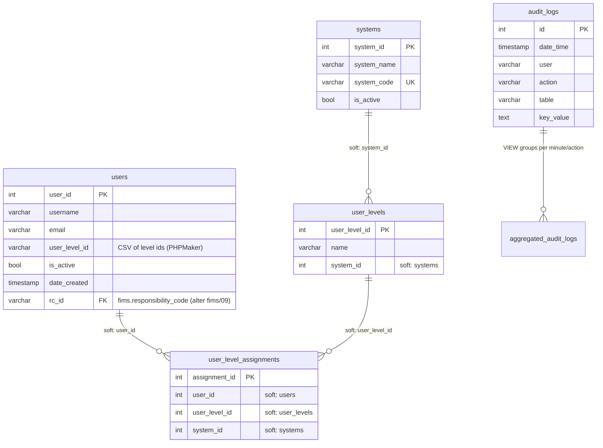
- **Table notes:**
  - `uac.users` — login users; `user_level_id` is a VARCHAR comma list (PHPMaker); `rc_id` added by `01 - fims/03 - alter_table/09 - users_replace_rc_code_with_rc_id.sql` (real FK to fims.responsibility_code); `position_id/employee_id/rc_code/must_change_password` added by `00 - uac/02 - alter_table/03`.
  - `uac.user_levels` / `uac.systems` / `uac.user_level_assignments` — PHPMaker security tables; `00 - uac/01 - table/01 - uac_structure_data.sql` declares **zero** FOREIGN KEYs in uac, so every edge above is soft.
  - `uac.aggregated_audit_logs` — VIEW (not a table): groups `uac.audit_logs` rows by script/user/action/table/key_value/minute; created because PHPMaker scaffolded an entity for it.

### Notification reads

- **Status:** PHPMaker-generated — list/add/edit/view/delete scaffold over `uac.notification_reads`; the real feature is the bell API.
- **Code:** menu `views/menu.php:11` → `NotificationReadsList` (`models/NotificationReads.php`, `UpdateTable = uac.notification_reads`, Dbid `DB`; `models/NotificationReads{List,Add,Edit,View,Delete}.php`). Live code: routes `app/routes/notifications.php` (`GET /notifications/recent`, `GET /notifications/count`, `POST /notifications/mark-read`, `POST /notifications/mark-all-read`, `POST /notifications/send`) → `app/services/NotificationService.php` (also MQTT publish). Legacy `app/lib/NotificationManager.php` is not called anywhere.
- **Tables written:** uac.notification_reads (PHPMaker CRUD; `NotificationService::markRead/markAllRead` insert), uac.notifications (`NotificationService::insert`, `ON CONFLICT (event_key) DO NOTHING`). **Tables read:** uac.notifications, uac.notification_reads, uac.user_level_assignments, uac.user_offices, uac.users (audience resolution).
- **Status workflow:** none.

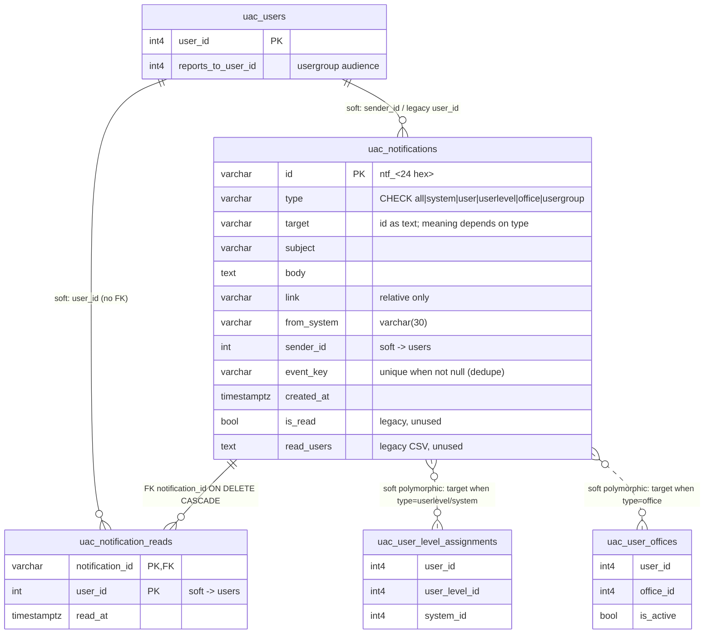
- **Table notes:**
  - uac.notifications — hub table upgraded in place by `00 - uac/02 - alter_table/06 - notifications_hub.sql` (+sender_id, event_key, NOT NULLs, type CHECK, audience index); legacy `timestamp`, `user_id`, `is_read`, `read_users` stay but are unused. The alter aborts if legacy rows with old types exist. `NotificationManager.php` would violate the CHECK (old types) — dead code.
  - uac.notification_reads — per-user read state (composite PK); it is in **uac**, not fims, despite the `{FIMS}notification_reads` permission key (`src/userlevelsettings.php:157-158,285`).

## COB Preparation

### Budget Proposal

- **Status:** Built — FMD-side review list of every Regional/District office's budget request (Budget Processing = endorse, Budget Preview = approve/return).
- **Code:** `views/BudgetPropPage.php` → `app/pages/budget-prop-page.php` (+ `readone/budget-req-readone.php`, `form/budget-req-form.php` [helpers only], `form/budget-processing-form.php`, `readone/budget-preview-readone.php`). Routes: `app/routes/fmd_budget_req.php` (`GET /fmd/budget_req/list` — central-review RC only), `app/routes/budget_req.php` (`GET /budget_req/all`, `/budget_req/grand-total`, `/budget_req/read/{id}`, `PUT /budget_req/endorse/{id}`, `PUT /budget_req/approve/{id}`, `PUT /budget_req/return/{id}`, `DELETE /budget_req/delete/{id}`, `GET /budget_req_project_attachment/list`), plus lookups `/type_of_fund/all`, `/component_type/all`, `/chart_of_accounts/all`. Services: `app/services/BudgetReqService.php` (both routes use it), `app/services/BudgetLineItemService.php::applyProcessing()`, `app/lib/GlobalService.php::logStatusChange()`.
- **Tables written:** `fims.budget_req` (status_id), `fims.budget_line_items` (endorse: `type_of_fund_id`, `component_id`, `suggested_amount`, `account_id`), `fims.status_change_log`; delete cascades the whole tree. **Tables read:** `fims.budget_req_program`, `fims.budget_req_project`, `fims.budget_req_project_attachment`, `fims.settings_status`, `fims.responsibility_code`, `fims.program`, `fims.sub_program`, `fims.project`, `fims.chart_of_accounts`, `fims.type_of_fund`, `fims.component_type`, `fims.fiscal_year`, `uac.users`, `uac.user_levels`.
- **Status workflow:** (`settings_status.status_for='budget_req'`, `BudgetReqService::REVIEW_STEPS`) For Review →(Budget Officer endorses)→ Endorsed →(Budget Head approves)→ Approved; returns go one step back: Endorsed → Returned to Budget Officer, For Review/Returned to Budget Officer → Returned (to the office).

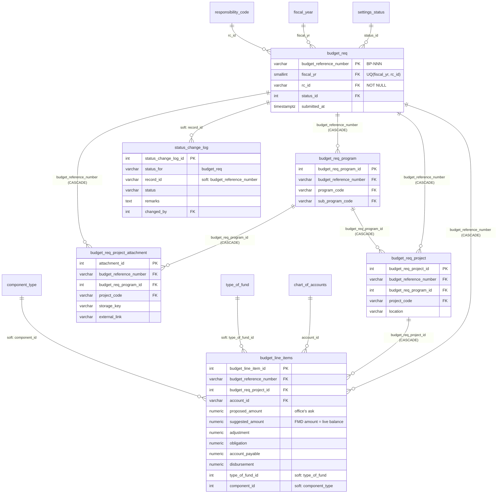
- **Table notes:**
  - `fims.budget_req` — header, one per (fiscal_yr, rc_id) (`03 - alter_table/10`); PK became VARCHAR "BP-NNN" in alter 15; `expense_class_id/program_code/project_code/amount/location` dropped (alters 02, 04); `rc_id` added (10); `submitted_at` added (16); `remarks` added (13) then dropped (36).
  - `fims.budget_req_program` — program (+ optional sub-program) block of a request.
  - `fims.budget_req_project` — project row under a program block; `budget_req_program_id` added by alter 05, `location` by alter 11; keeps its own redundant `budget_reference_number`.
  - `fims.budget_line_items` — COA lines; `requested_amount` renamed `proposed_amount` (03); `adjustment/obligation/disbursement/account_payable/component_id/type_of_fund_id` added (06, **no FK** on component/fund); `suggestion_amount` (07) renamed `suggested_amount` (12); `program_source_code`/`program_uses` added (17/18) and dropped (22). `budget_reference_number` is denormalised (also reachable via project→program).
  - `fims.budget_req_project_attachment` — supporting docs per (program block, project); S3 key or link (base table 16 + duplicate CREATE in `03 - alter_table/16`).
  - `fims.status_change_log` — shared polymorphic audit of status moves (status_for + record_id as text); written by `GlobalService::logStatusChange()`; Return remarks live here.

### Budget Request

- **Status:** Built — originating office's (RC-scoped) create/edit/submit page over the same tables as Budget Proposal.
- **Code:** `views/BudgetReqPage.php` → `app/pages/budget-req-page.php` (+ `readone/budget-req-readone.php`, `form/budget-req-form.php`, `form/budget-processing-form.php`, `readone/budget-preview-readone.php`). Route `app/routes/budget_req.php`: `GET /budget_req/list`, `/budget_req/all`, `/budget_req/read/{id}`, `POST /budget_req/add` (creates header or appends a Program to a Draft), `PUT|POST /budget_req/program/update/{budget_req_program_id}`, `PUT /budget_req/submit-for-review/{id}`, `DELETE /budget_req/delete/{id}`, `DELETE /budget_req/program/delete/{id}`, `GET /budget_req_project_attachment/list`, `DELETE /budget_req_project_attachment/delete/{id}`; lookups `/program/all`, `/sub_program/all`, `/project/all`, `/project/next-code`, `/fiscal_year/all`, `/chart_of_accounts/all?for_budget_proposal=1`. Services: `BudgetReqService`, `BudgetLineItemService::create()`, `ProjectService::findOrCreateByName()`, `GlobalService`.
- **Tables written:** `fims.budget_req`, `fims.budget_req_program`, `fims.budget_req_project`, `fims.budget_line_items` (account_id, proposed_amount, particulars), `fims.budget_req_project_attachment` (+ S3 upload), `fims.project` (typed new project via ProjectService), `fims.status_change_log`. **Tables read:** `fims.settings_status`, `fims.fiscal_year`, `fims.responsibility_code`, `fims.program`, `fims.sub_program`, `fims.project`, `fims.chart_of_accounts`, `uac.users`.
- **Status workflow:** Draft (default on create) → For Review (submit-for-review; locks the request) → then the FMD chain described under Budget Proposal; Returned brings it back to the office.

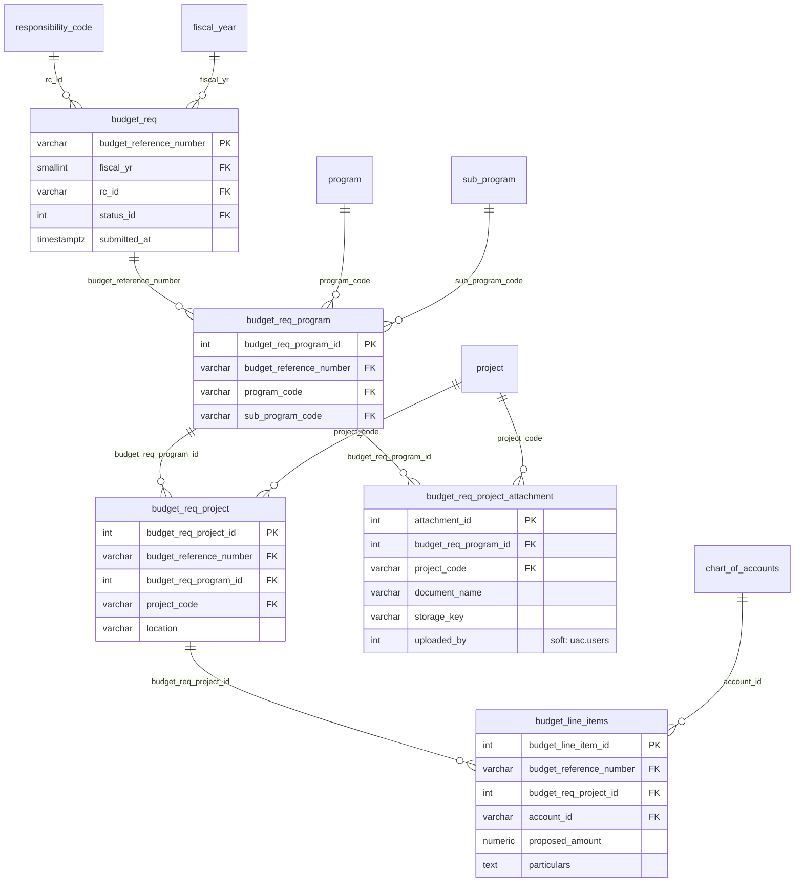
- **Table notes:** same tables as Budget Proposal (see notes there). Office side only writes `proposed_amount`/`particulars`/`account_id`; FMD later fills `suggested_amount`, `type_of_fund_id`, `component_id`. Editing a Draft program deletes and re-creates its project/line-item rows (hence budget_revision has no FK to line items). Attachment↔project link is a composite soft match (`budget_req_program_id`, `project_code`), not an FK to `budget_req_project`.

### Budget Revision

- **Status:** Built — file/edit/approve/decline revisions that move amounts between approved budget lines.
- **Code:** `views/BudgetRevisionPage.php` → `app/pages/budget-revision-page.php` (+ `form/budget-rev-form.php`, `form/budget-rev-review.php`). Route `app/routes/budget_revision.php`: `GET /budget_revision/all|list|read/{id}`, `POST /budget_revision/add`, `PUT /budget_revision/update/{id}`, `PUT /budget_revision/review/{id}`, `DELETE /budget_revision/delete/{id}`; also `GET /budget_req/all` (line picker) and `/fiscal_year/all`. Service `app/services/BudgetRevisionService.php`.
- **Tables written:** `fims.budget_revision`; `fims.budget_line_items` (on approval: `adjustment` and `suggested_amount` of the From and To lines). **Tables read:** `fims.budget_req`, `fims.budget_req_project`, `fims.budget_req_program`, `fims.program`, `fims.project`, `fims.chart_of_accounts`, `fims.responsibility_code`, `fims.settings_status`, `uac.users`.
- **Status workflow:** (`status_for='budget_revision'`, seed `04 - seed_data/08`) Pending → Approved | Declined (soft delete via `deleted_at`).

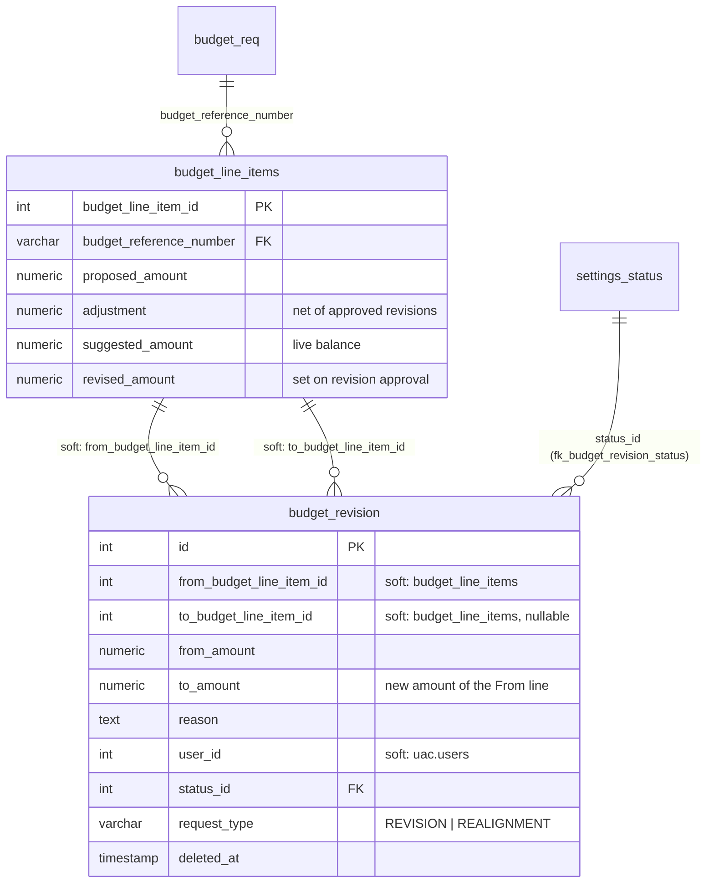
- **Table notes:**
  - `fims.budget_revision` — base `01 - table/05 - budget_rev.sql`; `budget_req_id`→`from_budget_req_id` + `to_budget_req_id` in `02 - alter_table/03` (note: a separate `02 - alter_table` folder); `from/to_budget_line_item_id` added and `from_budget_req_id` made nullable in `03 - alter_table/23 - budget_revision_on_budget_reference_number.sql` (no FK by design: Draft edits recreate lines); `status_id` FK added by `04 - seed_data/08`. Column is `update_at` (sic). `request_type` (`03 - alter_table/42`, `CHECK IN ('REVISION','REALIGNMENT')`, default REVISION): REVISION = no To line, REALIGNMENT = has a To line (the API keeps it in step); the same alter dropped the legacy `from_budget_req_id` / `to_budget_req_id`.
  - `fims.budget_line_items` — approval: From line `adjustment, suggested_amount += to_amount − (proposed+adjustment)`; To line gets the opposite delta; `proposed_amount` never changes. Each touched line's `revised_amount` (plain column, migration "43 - budget_line_items_add_revised_amount" — not in the repo yet) is set to its new `proposed_amount + adjustment`; the COB reads its Revised Amount from it.

### Ledger

- **Status:** Empty placeholder (0-byte page) — `views/LedgerPage.php` includes `app/pages/ledger-page.php`, which is 0 bytes.
- **Code:** none — the page file is 0 bytes.
- **Tables:** No tables yet.

## Budget Process

### Request for Allocation (CBA)

- **Status:** Built — `cba-memo-request-page.php` sets `$alloc_type='CBA'` and includes `memo-req-page.php`; CBA-only list + create/edit form + FMD Process modal.
- **Code:** `views/CbaMemoRequestPage.php` → `app/pages/cba-memo-request-page.php` → `app/pages/memo-req-page.php` (+ `form/budget-allocation-form.php`, `readone/memo-process-readone.php`, `form/caf-form.php`, `readone/print-preview-readone.php`). Route `app/routes/budget_allocation.php`: `GET /budget_allocation/departments|statuses|all|list|read/{id}`, `POST /budget_allocation/add`, `PATCH /budget_allocation/update/{id}` (also Submit for Review = PATCH status_id), `PATCH /budget_allocation/process/{id}` (approve/return), `DELETE /budget_allocation/delete/{id}`; `GET /budget_line_item/approved`, `/budget_line_item/approved/type_of_fund`, `/budget_line_item/{id}/earmarks`; lookups `/program/all`, `/sub_program/all`, `/project/all`, `/vendors/all|read`, `/budget_category/all`; `/upload/multi-upload` (attachments); `/print/payload/...`. Services: `BudgetAllocationService.php`, `BudgetLineItemService.php` (earmarks), `ProgramService`/`SubProgramService`/`ProjectService` (typed new entities), `file_uploadServices.php`, `GlobalService::logStatusChange()`, print: `MemoRequestPrintService`, `CbaPrintService`, `CfaPrintService`.
- **Tables written:** `fims.budget_allocation`, `fims.budget_line_item_earmark`, `fims.budget_line_items` (suggested_amount −, obligation +, account_payable + on CBA approval; reversed on delete), `fims.status_change_log`, `fims.file_attachments` + `fims.ip_filemeta`, `fims.program`/`fims.sub_program`/`fims.project` (when typed instead of picked). **Tables read:** `fims.settings_status`, `fims.fiscal_year`, `fims.vendors`, `fims.budget_category`, `fims.responsibility_code`, `uac.users`, `uac.departments`, `uac.user_levels`, `fims.budget_req*`, `fims.chart_of_accounts`, `fims.type_of_fund`.
- **Status workflow:** (`status_for='budget_allocation'`, `BudgetAllocationService::REVIEW_STEPS`) Draft → For Review →(FMD Section Chief)→ For Division Manager →(FMD Division Manager)→ For Department Manager →(FMD Department Manager)→ Approved (allocation_number stamped, earmark created); returns: Returned to Division Manager / Returned to Section Chief / Returned. Earmark status: active → converted | released.

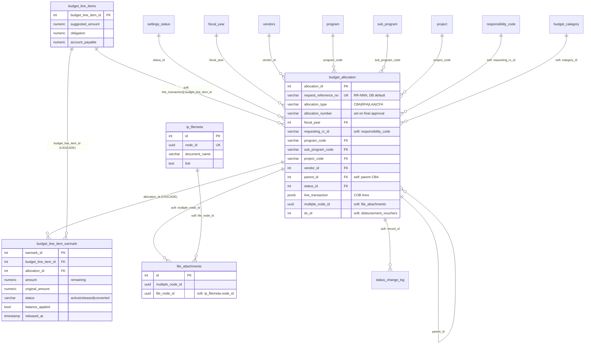
- **Table notes:**
  - `fims.budget_allocation` — one table for CBA/RFA/LAA/CFA memo requests (`allocation_type` discriminator), soft delete `deleted_at`. FKs from `03 - alter_table/08` (fiscal_year, program, sub_program, project, vendor, parent, status). `requesting_department_id`→`requesting_rc_id` VARCHAR(50) (alter 14, no FK); `program_id/sub_program_id/project_id` int columns dropped (09); `request_referrence_no` sequence/default/unique (19, misspelt on purpose); `memo_ref_no` dropped (20); `dv_id` added (23, no FK — RFA→DV link lives here); `remarks` added (28, Return reason). Other columns: `requesting_district_id` (soft → uac.departments), `document_type` (CO/COE), `pr_number/pr_amount/po_number/po_amount`, `workflow_route`, `category_id` (soft → budget_category.budget_category_id), `is_bidding`, `description`, `user_id`.
  - `line_transaction` (JSONB) — array of COB lines: `budget_line_item_id, type_of_fund_id, type_of_fund, account_code, account_title, fiscal_yr, proposed_amount, suggested_amount, requested_amount, allocated_amount` (denormalised copies of the line item at save time); parsed by `BudgetLineItemService::parseLineTransaction()`.
  - `fims.budget_line_item_earmark` — reservation ledger: one 'active' row per (CBA/CFA, COB) on approval (`balance_applied=TRUE`); `original_amount` added by alter 23, `balance_applied` by alter 29. RFA/LAA approvals shrink/convert the parent's row and insert their own 'converted' row.
  - `fims.file_attachments` / `fims.ip_filemeta` — generic attachment group (`multiple_node_id`) → file meta (`node_id`); no FKs.
  - `fims.status_change_log` — see Budget Proposal; status_for='budget_allocation', record_id = allocation_id.

### Request for Allocation (RFA/LAA)

- **Status:** Built — `rfa-laa-memo-request-page.php` sets `$alloc_type='RFA/LAA'` and includes the same `memo-req-page.php`; RFA rows additionally get Create CAF / Print CAF. CFA cannot be created from either sidebar page (`$_mrq_allowedTypes = ['CBA','RFA','LAA']` in memo-req-page.php line 13 feeds `$cbaAllowedTypes`), but the CFA option, CFA print and CFA earmark/COB logic remain in `budget-allocation-form.php`, `BudgetLineItemService`, `CobService`.
- **Code:** `views/RfaLaaMemoRequestPage.php` → `app/pages/rfa-laa-memo-request-page.php` → `memo-req-page.php` (same includes/routes/services as CBA) + `app/pages/form/caf-form.php` → `app/routes/caf.php` (`GET /caf/all|list|read/{id}`, `POST /caf/add`, `PATCH /caf/update/{id}`, `DELETE /caf/delete/{id}`) → `app/services/CafService.php`; print `RfaPrintService`, `LaaPrintService`, `CafPrintService` (`/print/payload/caf/{id}`).
- **Tables written:** `fims.budget_allocation` (type RFA/LAA, `parent_id` = CBA), `fims.budget_line_item_earmark` (convert parent CBA earmark + own 'converted' row), `fims.budget_line_items.obligation` (only for legacy parent earmarks with `balance_applied=FALSE`), `fims.caf`, `fims.status_change_log`, `fims.file_attachments`/`fims.ip_filemeta`. **Tables read:** same lookups as CBA, plus `fims.fiscal_year` (CAF validation).
- **Status workflow:** same `budget_allocation` chain as CBA (Draft → For Review → For Division Manager → For Department Manager → Approved / Returned*); final approval requires a `parent_id` CBA with enough active earmark. `fims.caf` has no status (soft delete only).

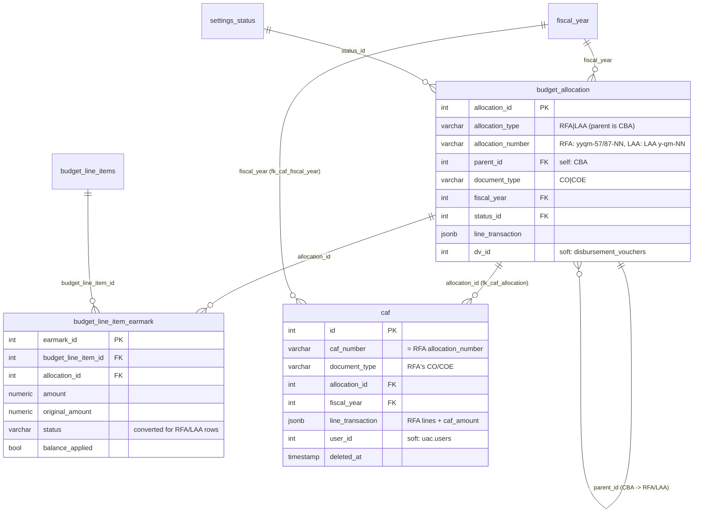
- **Table notes:**
  - `fims.budget_allocation` — see CBA. RFA/LAA rows point to their CBA through `parent_id`; `dv_id` (alter 23) is set from the DV side (`DisbursementVoucherService`), DV's own `rfa_allocation_id/number` were dropped (alter 26).
  - `fims.caf` — `01 - table/38 - fims_caf.sql`; FKs to budget_allocation and fiscal_year added by `03 - alter_table/30 - caf_add_fk.sql`; `line_transaction` JSONB = each RFA line copied + `caf_amount`; UI creates CAFs only from RFA rows, but `CafService` does not enforce allocation_type = 'RFA' or one CAF per RFA.
  - `fims.budget_line_item_earmark` — see CBA; COB columns `rfa_approved` / `laa_issued` sum the 'converted' rows attributed to RFA/LAA allocation_ids.

## DV Processing

### Disbursement Voucher

- **Status:** Built — Full CRUD, the 9-status pipeline, the Accounting Entries (SETUP JEV) editor, ATC and deduction lines, RFA linking, and "Prepare Payment JEV" are all wired to real SQL.
- **Code:** `views/Voucher.php` → `app/pages/voucher.php` (list) + `app/pages/voucher/form.php` (create/edit) + `app/pages/voucher/readone.php` (view, Accounting Entries, status actions). Route `app/routes/voucher.php`: `GET /voucher/list|all|fiscal-years|dv-number|atc-codes|deduction-types|sl-codes|sl-codes/{sl_code}/details|rfa/all|rfa/read/{id}|read/{id}`, `POST /voucher/add`, `PUT /voucher/update/{id}`, `POST /voucher/{id}/status`, `POST /voucher/{id}/journal-entry` (save the SETUP JEV, ATC lines, and deductions), `POST /voucher/{id}/prepare-payment-jev`, `POST /voucher/journal-entry/{id}/jev-status`, `DELETE /voucher/delete/{id}`. Service: `app/services/DisbursementVoucherService.php`, which calls `GeneralLedgerService::postJev()/reverseJev()/createPaymentJev()`. Print: `DvPrintService`/`JevPrintService` through `/print-preview-readone`.
- **Tables written:** fims.disbursement_vouchers, fims.disbursement_voucher_deductions, fims.disbursement_voucher_atc_lines, fims.journal_entry_vouchers, fims.journal_entry_voucher_lines, fims.budget_allocation (only `dv_id`, in `linkRfas()`), fims.payroll_records (only `disbursement_voucher_id` — a payroll DV, see [Payroll Management](#payroll-management)), fims.general_ledger (indirectly, through postJev/reverseJev), fims.status_change_log (JEV status only, through `GlobalService::logStatusChange`). **Tables read:** fims.settings_status (`status_for='disbursement_voucher'` and `'journal_entry_voucher'`), fims.vendors (joins `vendors.sl_code` → `chart_of_accounts.account_id` for the vendor AP sub-ledger), fims.chart_of_accounts (also the source of the SL list: leaf accounts with `parent_account_id`), fims.responsibility_code, fims.fiscal_year, fims.books, fims.atc_codes, fims.deduction_types, fims.budget_allocation (`allocation_type='RFA'`), fims.budget_category, fims.budget_line_items (the account of the RFA's first line), fims.checks (the latest non-cancelled check by `dv_number`, for the payment JEV), fims.bank_accounts (`account_code`, the Cr Cash line), fims.file_attachments (by `multiple_node_id`), fims.v_journal_entry_vouchers, uac.users (`rc_id` for stage authorization).
- **Status workflow:** `DRAFT → FOR_FMD_REVIEW (RC 013) → FOR_ACCOUNTING (RC 012, Section Chief saves a balanced JEV) → FOR_DIVISION_MANAGER (012) → FOR_DEPARTMENT_MANAGER (012) → FOR_TREASURY (014; this step POSTS the SETUP JEV to the GL) → RELEASED` (set by Check Disbursements `saveCheck`). Any non-terminal status can go to `REJECTED` (reason required) or `CANCELLED`. `FOR_TREASURY→CANCELLED` reverses the GL entries. `REJECTED→CANCELLED` only. Source: `DisbursementVoucherService::TRANSITIONS` (l.100) and `STAGE_HOLDER_RC`. Seeds: `02 - sample_data/01 - fims_settings_status.sql`.

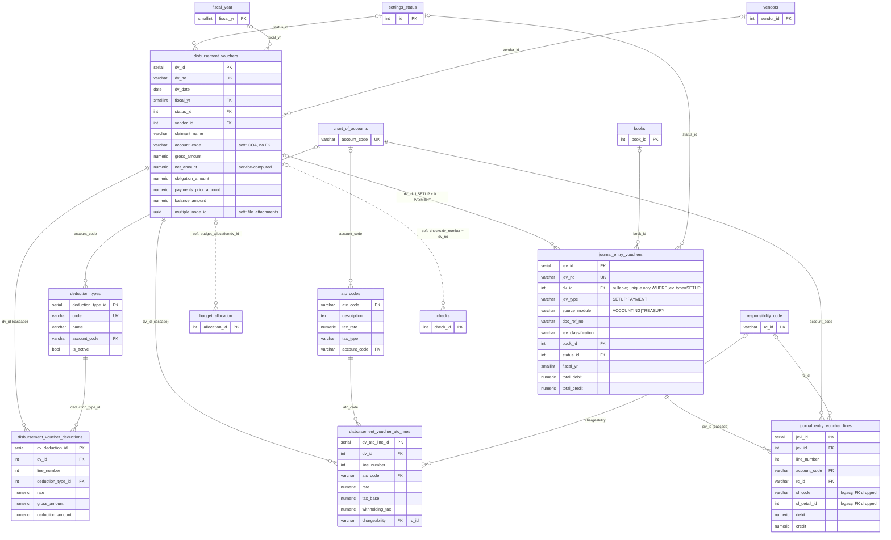

- **Table notes:**
  - `fims.disbursement_vouchers` (`01 - table/16`) is the voucher header. Alter 11 added the FKs to fiscal_year and vendors. Alter 13 added `atc_code`, then alter 17 dropped `vat_rate/vat_amount/wtax_rate/wtax_amount/atc_code` and turned `net_amount` from a generated column into a service-computed snapshot. Alter 16 added `payments_prior_amount`. Alter 21 replaced the free-text `status` column with `status_id`, an FK to settings_status. Alter 24 added `multiple_node_id`. Alter 26 dropped `rfa_allocation_id/rfa_allocation_number`. Alter 34 added `division_reviewed_by/at` and `department_approved_by/at`. The per-stage actor columns remain: `submitted_*`, `fmd_approved_*`, `accounting_processed_*`, `treasury_released_*`, `rejected_*`. `requesting_department_id` is always written NULL (service l.280). `expense_class` is derived from `account_code`. There is no `book_id` column, by design (see the header of alter 30).
  - `fims.disbursement_voucher_deductions` (`01 - table/21`) holds the non-tax deductions (e.g. RETENTION). The whole set is replaced on save (`replaceDeductions`).
  - `fims.deduction_types` (`01 - table/20`) is the lookup. Seeds include RETENTION, plus `04 - seed_data/08` (other/recoupment/penalty/VAT). Alter 18 added `account_code`, an FK to COA, used as the default credit account.
  - `fims.disbursement_voucher_atc_lines` (`01 - table/22`) holds the BIR withholding lines, which Accounting prepares together with the JEV. `chargeability` is an FK to responsibility_code. These lines replaced the dropped single `dv.atc_code`.
  - `fims.atc_codes` (`01 - table/17`) is the lookup. Alter 18 added `account_code` (default `2-02-01-010`). Alter 25 widened `description` to TEXT, added `tax_type` (EWT/OPT/WG), and seeded the full BIR list.
  - `fims.journal_entry_vouchers` (`01 - table/18`) is the JEV header. It started as 1:1 with the DV. Alter 29 added `status_id/posted_by/posted_at`. Alter 30 added `book_id`. Alter 31 dropped the UNIQUE on `dv_id`, added `jev_type` (SETUP|PAYMENT), `source_module`, and `doc_ref_no`, and created the partial unique index `(dv_id) WHERE jev_type='SETUP'`. Alter 32 added `jev_classification` (CHECK: REGULAR|ACCRUAL|DEPRECIATION|PREPAYMENTS|CLOSING). Alter 33 made `dv_id` nullable (standalone JEVs). Alter 35 added `multiple_node_id`. A PAYMENT JEV is created by `GeneralLedgerService::createPaymentJev()` (Dr AP `2-01-01-010` / Cr the bank's `account_code`) at FOR_SECTION_CHIEF.
  - `fims.journal_entry_voucher_lines` (`01 - table/19`) holds the JEV lines. Alter 17 added `sl_code/sl_detail_id` with FKs to sl_masters/sl_details. Alter 37 (`DROP ... CASCADE`) dropped those FKs, but the columns remain and are still written. Alter 27 added `rc_id`, an FK to responsibility_code.
  - `fims.budget_allocation` is shared and covered elsewhere. Alter 23 added `dv_id` as a soft link with no FK. One RFA points to at most one active DV. A DV can cite many RFAs. The link is maintained by `linkRfas()` and cleared on DV delete.

### Liquidation Voucher

- **Status:** Empty placeholder (0-byte page) — `app/pages/liquidation-voucher-page.php` is 0 bytes (`views/LiquidationVoucherPage.php` includes it). Only a print form exists: `app/services/LvPrintService.php`, which prints from a payload and says "There is no LV module in this repo yet".
- **Code:** `views/LiquidationVoucherPage.php` → `app/pages/liquidation-voucher-page.php` (empty). No route, no service.
- **Tables:** No tables yet.

### Journal Entry Voucher

- **Status:** Built — a JEV register for every JEV (SETUP, PAYMENT, and standalone), plus create/edit/delete of standalone (no-DV) JEVs and their review/post chain.
- **Code:** `views/JournalEntryVoucher.php` → `app/pages/journal-entry-voucher.php`. Route `app/routes/voucher.php`: `GET /voucher/journal-entries` (from v_journal_entry_vouchers), `GET /voucher/journal-entry/{id}`, `POST /voucher/journal-entry/add`, `PUT /voucher/journal-entry/update/{id}`, `DELETE /voucher/journal-entry/delete/{id}`, `POST /voucher/journal-entry/{id}/post`, `POST /voucher/journal-entry/{id}/jev-status`. It also uses `/books/all`, `/chart_of_accounts/all`, `/voucher/fiscal-years`, `/upload/multi-upload`, and `/voucher/read/{id}` for DV-linked rows. Service: `DisbursementVoucherService` (`fetchJevList`, `create/update/delete/postStandaloneJev`, `changeJevStatus`), which calls `GeneralLedgerService::postJev()`.
- **Tables written:** fims.journal_entry_vouchers, fims.journal_entry_voucher_lines, fims.general_ledger (on POSTED), fims.status_change_log. **Tables read:** fims.v_journal_entry_vouchers (view over journal_entry_vouchers + disbursement_vouchers + books + settings_status×2), fims.chart_of_accounts, fims.books, fims.fiscal_year, fims.responsibility_code, fims.settings_status, fims.file_attachments.
- **Status workflow:** (`status_for='journal_entry_voucher'`, seeds in `02 - sample_data/11`) values are DRAFT, APPROVED, FOR_SECTION_CHIEF, FOR_DIVISION_MANAGER, FOR_DEPARTMENT_MANAGER, POSTED, REVERSED. PAYMENT and standalone JEVs follow `DRAFT → FOR_SECTION_CHIEF → FOR_DIVISION_MANAGER → FOR_DEPARTMENT_MANAGER → POSTED` (`changeJevStatus`, l.1870; PAYMENT JEVs start at FOR_SECTION_CHIEF). SETUP JEVs ride the DV chain: they become POSTED on DV→FOR_TREASURY and REVERSED on FOR_TREASURY→CANCELLED. APPROVED is seeded but no code writes it.

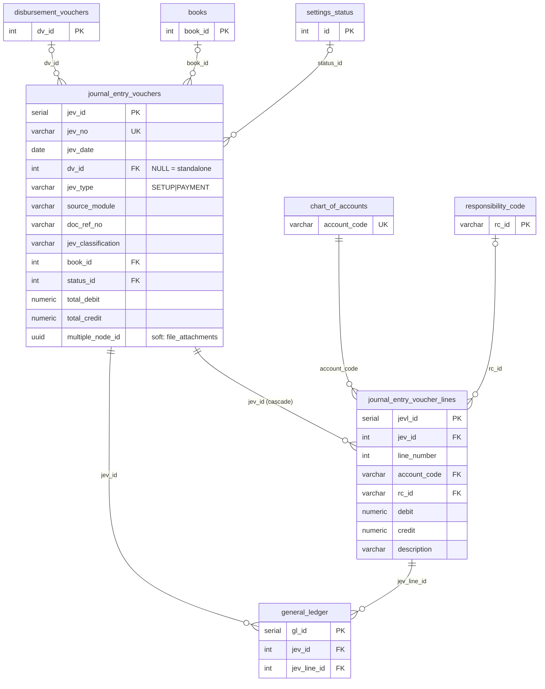

- **Table notes:**
  - `fims.journal_entry_vouchers` and `fims.journal_entry_voucher_lines`: see the Disbursement Voucher section. Standalone JEVs have `dv_id` NULL and `jev_type` SETUP, and are inserted with `status_id` = DRAFT. DV-linked SETUP JEVs are inserted by `persistJournalEntry` without a `status_id` (NULL until postJev sets POSTED).
  - `fims.v_journal_entry_vouchers` (`05 - views/02`) is the read-only register view and includes `jev_status`, `dv_status`, and `jev_classification`.

### Disbursement Preparation

- **Status:** Built, with stubs — Check preparation, registry (blank stock), releases (unified, with real SMTP), cancellation/replacement, and inventory/RAF are wired. `getSubsidyReport`, `getReleaseDocuments`, and `saveDriveLink` are stubs ("schema migration pending").
- **Code:** `views/CheckDisbursements.php` → `app/pages/check-disbursement-voucher-page.php`. Route `app/routes/check-processing.php` (`/check-processing/...`): `preparation/{bank-accounts,dvs-for-prep,checks,unused-checks/{bankId},cash-availability,check/{id},check/{id}/history,check/{id}/mark-printed,check/{id}/set-status,save}`, `registry/{list,summary,series-list,booklets,add-batch,update-status,{id}}`, `releases/{save,unclaimed,email-log,departments,pending/{deptId},acknowledgment-list,dv-monitoring,bulk-send-notice,bulk-resend-email/{logId},{id}/send-notice|follow-up|set-claimant|acknowledge|update-status|mark-stale|record-dv-return}`, `cancellation/{kpis,lookups,list,cancel,replace,{id},{id}/history}`, `raf/{summary,years,list}`, `print-agent-package`. Service: `app/services/CheckProcessingService.php`. `saveCheck` calls `DisbursementVoucherService::changeStatus(dv,'RELEASED')`.
- **Tables written:** fims.checks, fims.check_register, fims.check_cancellations, fims.check_releases, fims.check_release_email_log, fims.cash_position (`saveCheck` deducts from today's row or inserts one), fims.disbursement_vouchers (status → RELEASED, through the DV service). **Tables read:** fims.bank_accounts, fims.disbursement_vouchers (only FOR_TREASURY rows for preparation), fims.settings_status, fims.budget_allocation + fims.program (program names of a DV's RFAs), fims.cash_position (available_balance), uac.departments.
- **Status workflow:** `checks.status` goes `PREPARED → RELEASED → ENCASHED | OUTSTANDING → STALE`, with `CANCELLED`/`VOIDED` also possible (alter 25 uppercased the values). Release status changes are pushed onto the check (RELEASED or ACKNOWLEDGED → RELEASED, UNCLAIMED → STALE). `check_releases.status` is `PENDING → NOTIFIED → RELEASED → ACKNOWLEDGED`, or `UNCLAIMED`. `check_register.current_status` is one of `UNUSED|ISSUED|ENCASHED|OUTSTANDING|CANCELLED|VOIDED|SPOILED|STALE` (`REGISTER_STATUSES`). Preparing a check moves the DV from FOR_TREASURY to RELEASED.

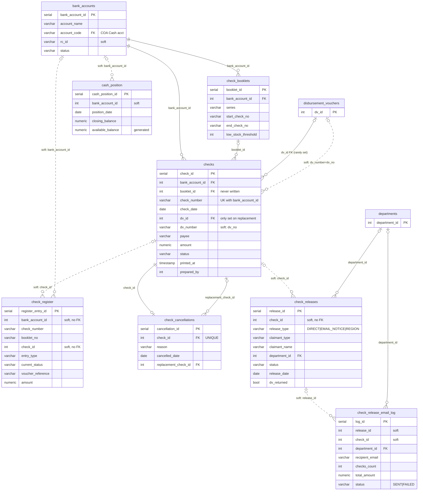

- **Table notes:**
  - `fims.checks` (`01 - table/28`) is one row per issued check. Alter 21 added FKs to bank_accounts, check_booklets, and disbursement_vouchers. Alter 25 uppercased the status values (default PREPARED). Alter 27 added `printed_at`. `saveCheck` writes only `dv_number` (soft) and leaves `dv_id`/`booklet_id` NULL. `dv_id` is copied only when a replacement is created.
  - `fims.check_booklets` (`01 - table/27`) has its FK added by alter 21 but is never written. The service comment (l.2040) says RAF is computed from check_register instead.
  - `fims.check_register` (`01 - table/34`) is the blank check stock ported from TREASURY. It has no FKs, and its unique key is `(bank_account_id, check_number, COALESCE(booklet_no,''))`. Preparing a check flips the matching UNUSED row to ISSUED and sets its `check_id`.
  - `fims.check_cancellations` (`01 - table/29`) is 1:1 with the cancelled check. `replacement_check_id` points to the new check. Both FKs were added by alter 21.
  - `fims.check_releases` and `fims.check_release_email_log` (`01 - table/38`) are the unified replacement for check_claimant_releases, check_region_releases, and their email logs, which alter 29 (`drop_old_split_release_tables`) drops. The only FK is `department_id` → uac.departments. `check_id`/`release_id` are soft.
  - `fims.bank_accounts` (`01 - table/26`) is shared with Bank Management. Alter 23 added management fields plus bank_account_documents and bank_account_audit_log. Alter 24 renamed `department_id` to `rc_id` VARCHAR(50) with no FK. Alter 31 added `account_code`, an FK to COA (the Cash account for the payment JEV).
  - `fims.cash_position` (`01 - table/35`) is owned by Cash Position. Here it is only read for sufficiency and written as a deduction. `available_balance` is a generated column (`closing_balance - restricted_amount`).
  - `fims.ada_releases` and `fims.official_receipts` are not touched by this module. They are read only by the Journals page (ADADJ/CRDJ).

## Inventory

### IAR Module

- **Status:** Partial — The "Deliveries" tab (PO → DR, IAR, SI, pro-forma JEV) is built. The "Infrastructure" tab shows "coming soon" (`iar-module.php` l.147–150).
- **Code:** `views/IarModule.php` → `app/pages/iar-module.php`. Route `app/routes/po_dr.php`: `GET /po-dr/list|pos|accounts|read|proforma`, `POST /po-dr/add`, `PUT /po-dr/update`, `DELETE /po-dr/delete`. Service: `app/services/PoDrService.php`. Print: `IarPrintService` and the pro-forma JEV print through `/print-preview-readone`.
- **Tables written:** fims.inspection_acceptance_report (only this one). **Tables read:** fims.budget_allocation (`allocation_type='RFA'`, `deleted_at IS NULL`, `po_number`, `line_transaction[].requested_amount` = PO amount, `requesting_rc_id`, `vendor_id`, `created_at` as PO date), fims.responsibility_code, fims.vendors, fims.chart_of_accounts (DR entry accounts, plus the AP `2-01-01-010` title for the pro-forma). It does **not** read fims.purchase_orders.
- **Status workflow:** none. There is no status column. The rules are: DR total ≤ PO balance (PO amount − other DRs), `dr_number` is unique within the PO, serial numbers are unique across all DRs, and items are kept only when the DR total is ≥ 50,000.

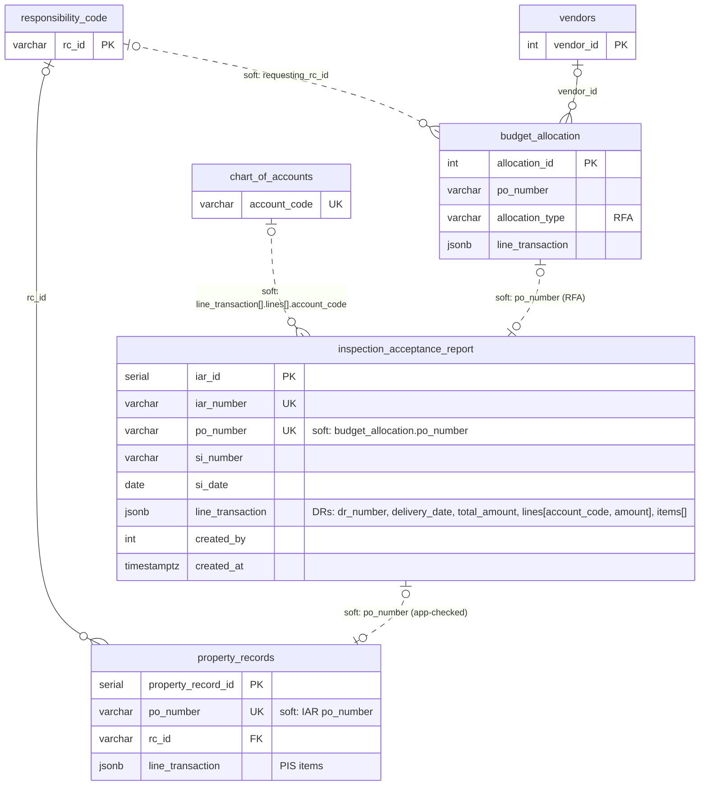

- **Table notes:**
  - `fims.inspection_acceptance_report` (`01 - table/25`) has one row per PO. `iar_number` and `po_number` are each UNIQUE. A CHECK requires `line_transaction` to be an array, and there is a GIN index on it. No alters apply.
  - The pro-forma JEV (`GET /po-dr/proforma`) is computed (Dr DR accounts / Cr AP `2-01-01-010`) and is **not** saved to journal_entry_vouchers.
  - `fims.property_records` (`01 - table/34`) belongs to the separate Property Record page (`PropertyRecordService`). It links to the IAR only by `po_number` and an app-side check ("PO is not in the IAR module"). IAR items carry `property_no`/`par_no` text but there is no reverse link.
  - `fims.purchase_orders` and `fims.purchase_order_items` (`01 - table/09`) exist but are not used by this module. Despite its name, "PO" here means an RFA's `budget_allocation.po_number`.

## Monitoring

### COB Monitoring

- **Status:** Built — read-only monitoring of Approved budget requests vs. memo-request drawdowns, with tree views and PDF/XLSX report.
- **Code:** `views/CobPage.php` → `app/pages/cob-page.php` (+ `readone/cob-readone.php`, `readone/cob-report-readone.php`). Route `app/routes/cob.php`: `GET /cob/filters`, `/cob/summary`, `/cob/rollup`, `/cob/read/{id}`, `/cob/report` (json/pdf/xlsx). Services `app/services/CobService.php`, `app/services/CobReportService.php` (Dompdf + `XlsxWriter.php`), RC scope via `GlobalService::resolveBudgetReqRcFilter()`.
- **Tables written:** none. **Tables read:** `fims.budget_req`, `fims.budget_req_program`, `fims.budget_req_project`, `fims.budget_line_items`, `fims.budget_req_project_attachment`, `fims.budget_line_item_earmark`, `fims.budget_allocation`, `fims.settings_status`, `fims.program`, `fims.sub_program`, `fims.project`, `fims.type_of_fund`, `fims.component_type`, `fims.chart_of_accounts`, `fims.responsibility_code` (self-join to parent for region), `uac.users` (scope).
- **Status workflow:** none written; only `budget_req` rows with status 'Approved' (status_for='budget_req') are included; earmarks of soft-deleted allocations excluded.

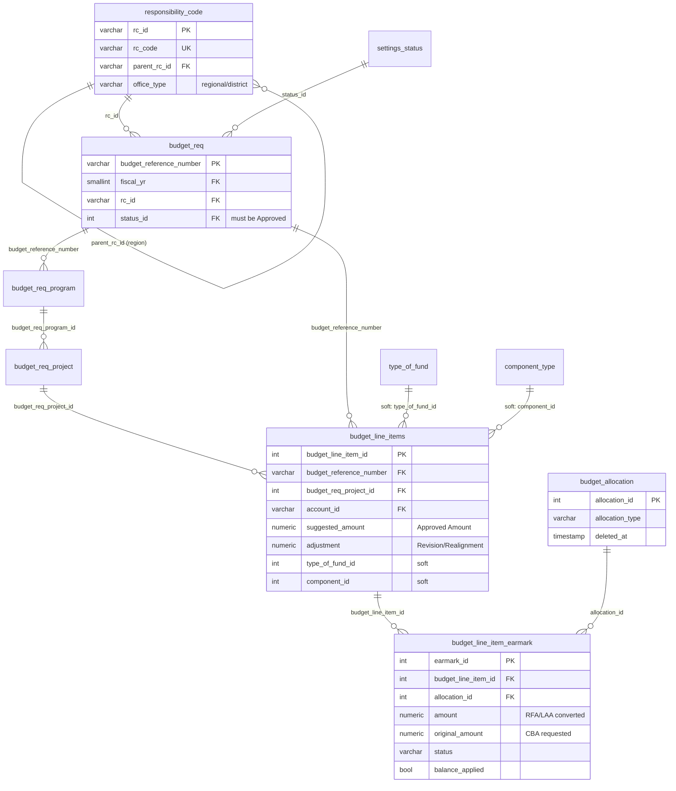
- **Table notes:** no own tables. Per line: approved = `suggested_amount`; revision = `adjustment`; revised = `budget_line_items.revised_amount`; cba_requested = Σ`original_amount` of CBA/CFA earmarks with `balance_applied` and status active/converted; rfa_approved / laa_issued = Σ`amount` of 'converted' rows of RFA / LAA allocations; available = revised − cba; remaining = revised − rfa − laa (`CobService::earmarkSql()`/`lineAmountExprs()`). Attachments joined by (`budget_req_program_id`, `project_code`) for a count.

### RFA / LAA Monitoring

- **Status:** Empty placeholder (0-byte page) — `views/RfaLaaMonitoringPage.php` includes `app/pages/rfa-laa-monitoring-page.php`, which is 0 bytes.
- **Code:** none — the page file is 0 bytes.
- **Tables:** No tables yet.

## Registry/NCA

### SARO Registry

- **Status:** Built — The 77 KB page has SARO and NCA tabs (a tree of each SARO with its NCAs) and uses the shared `form/saro-processing-form.php` modal.
- **Code:** `app/pages/saro-registry-page.php` (view `views/SaroRegistryPage.php`) + `app/pages/form/saro-processing-form.php`; routes `app/routes/fund_tracking.php` (`GET /fund_tracking/list`, `GET /fund_tracking/read/{id}`, `POST /fund_tracking/add`, `PATCH /fund_tracking/update/{id}`, `DELETE /fund_tracking/delete/{id}`, `GET /fund_tracking/fund_sourcing_determination`, `POST /fund_tracking/import`), `app/routes/fund_tracking_type.php` (`GET /fund-tracking-type/all`), `app/routes/fiscal_year.php` (`/fiscal_year/all`), upload `POST /upload/file`, `/upload/multi-upload`; services `app/services/fund_trackingServices.php` (FundTrackingServices), `fund_tracking_typeServices.php`, `file_uploadServices.php`.
- **Tables written:** fims.fund_tracking (soft delete via deleted_at), fims.ip_filemeta, fims.file_attachments (supporting docs), fims.agency (it auto-inserts an agency name if missing, `fund_trackingServices.php:503`). **Tables read:** fims.fund_tracking_type, fims.nature_of_fund, fims.agency, fims.settings_status, fims.fiscal_year, fmd.supplemental_fund_details (no SQL in the repo).
- **Status workflow:** none on this page. `status_id` is an optional settings_status id. The list filters to type SARO/NCA and leaves out nature_of_fund = SUPPLEMENTAL.

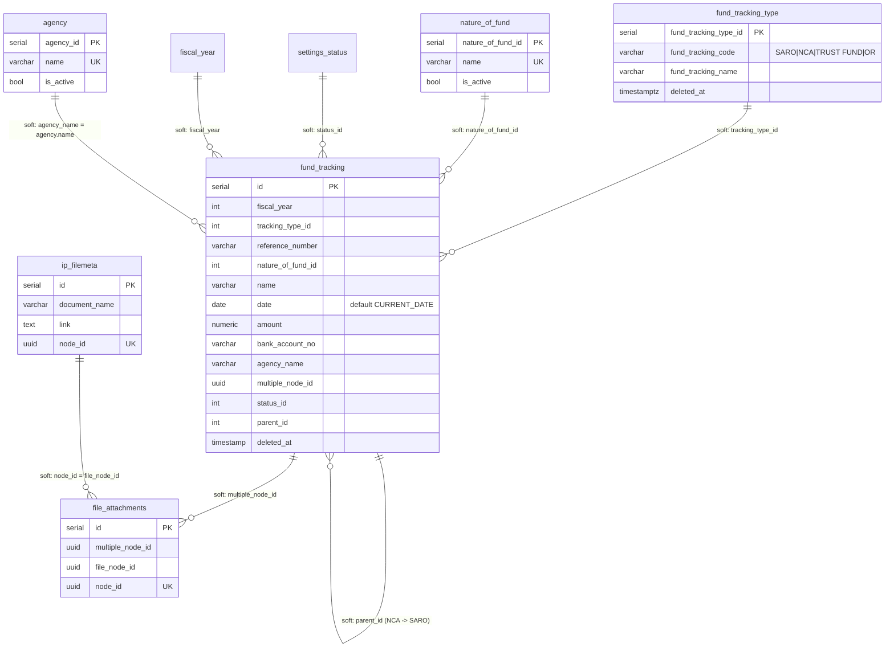
- **Table notes:**
  - fims.fund_tracking (`01 - table/29`): one table holds SARO, NCA, Trust Fund and OR records, told apart by tracking_type_id. It has **no FOREIGN KEYs**, so the service checks references in code (`validateReferences`). Alter 41 dropped `unreleased` and `sub_program_code` and set `date` to default CURRENT_DATE. Other columns: `remarks`, `purpose`, `user_id`, `created_at/updated_at`.
  - fims.fund_tracking_type (`26`): seeded with SARO, NCA, TRUST FUND, OR. Soft delete.
  - fims.nature_of_fund (`27`): seeded with Insertions, Equity, GAAAO, Unprogrammed, SUPPLEMENTAL. The SUPPLEMENTAL value routes records to the Supplemental Funds page.
  - fims.agency (`28`): a pick-list only. fund_tracking stores the agency **name** as text, not agency_id.
  - fims.ip_filemeta / fims.file_attachments (`17`, `18`): a generic attachment store. A record's documents are grouped by `multiple_node_id`.

### Check Registry

- **Status:** Empty placeholder (0-byte page) — `app/pages/check-registry-page.php` is 0 bytes and `views/CheckRegistryPage.php` only includes it.
- **Code:** none — the page file is 0 bytes.
- **Tables:** No tables yet for this page. Related tables do exist: `fims.check_register` (`01 - table/34`, header: "Backs the Check Disbursement Voucher module's 'Check Registry' tab"), `fims.checks` (`28`) and `fims.check_booklets` (`27`). They are used by `CheckProcessingService.php` and `CashPositionService.php`, not by this page.

### Accountable Forms Registry

- **Status:** Empty placeholder (0-byte page) — `app/pages/accountable-forms-registry-page.php` is 0 bytes.
- **Code:** none — the page file is 0 bytes.
- **Tables:** No tables yet. Nearest related table: `fims.official_receipts` / `official_receipt_lines` (`01 - table/40`), which backs the CRDJ tab on the Journals page, not this registry.

## Reports

### FMR

- **Status:** Empty placeholder (0-byte page) — `app/pages/fmr-page.php` is 0 bytes.
- **Code:** none — the page file is 0 bytes.
- **Tables:** No tables yet. Nothing FMR-specific exists in the SQL or the services.

### Remittance List (Deductions)

- **Status:** Empty placeholder (0-byte page) — `app/pages/remittance-list-page.php` is 0 bytes.
- **Code:** none — the page file is 0 bytes.
- **Tables:** No tables yet for the page. Source data a later build would read already exists: `fims.deduction_types` (`01 - table/20`), `fims.disbursement_voucher_deductions` (`21`) and `fims.atc_codes` (`17`).

## Ledgers

### General Ledger

- **Status:** Built — a read-only ledger card for one account, or all accounts, with a running balance. The GL table itself is written by DV/JEV posting.
- **Code:** `views/GeneralLedgerPage.php` → `app/pages/general-ledger-page.php`. Route `app/routes/general_ledger.php`: `GET /general_ledger/ledger` (`fetchGeneralLedger`/`fetchAllGeneralLedgers`). It also uses `/books/all`, `/chart_of_accounts/all`, `/fiscal_year/all`, and print via `GeneralLedgerPrintService`. Service: `app/services/GeneralLedgerService.php`. Posting is `postJev()` (l.106) and `reverseJev()` (l.179).
- **Tables written:** none from this page. fims.general_ledger is written by `postJev`/`reverseJev`, called from DV `changeStatus` (→FOR_TREASURY / FOR_TREASURY→CANCELLED), `changeJevStatus` (→POSTED), and `postStandaloneJev`. **Tables read:** fims.v_journals (general_ledger + journal_entry_vouchers + disbursement_vouchers + chart_of_accounts + books), fims.chart_of_accounts (account_type for debit/credit-normal sign), fims.books, fims.fiscal_year.
- **Status workflow:** none of its own. Rows are insert-only and are never updated. A reversal inserts swapped rows with `reversed_gl_id` set, and the JEV status moves POSTED → REVERSED.

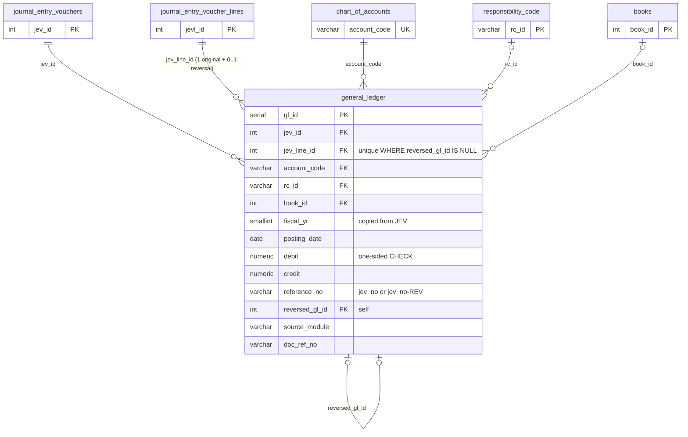

- **Table notes:**
  - `fims.general_ledger` (`01 - table/38`) has one row per posted JEV line. The CHECK constraint `chk_general_ledger_one_sided` allows debit or credit, never both. Alter 30 added `book_id` (FK books). Alter 31 added `source_module` and `doc_ref_no`. The original `sl_code`/`sl_detail_id` FKs to sl_masters/sl_details were removed by alter 37's `DROP TABLE ... CASCADE`, but the columns remain and postJev still copies them from the JEV line.
  - `fims.v_journals` (`05 - views/01`, re-created identically by alter 38) has one row per GL line with jev_no, dv_no, account_title, and book_name. `sl_name` and `sl_detail_name` are hard-coded to NULL.
  - `fims.books` (`01 - table/41`) seeds 5 books: MAIN-OFFICE, CISFA, NGC, MPLC, PPMO. `chart_of_accounts.books` (alter 39) is an unrelated comma-separated text tag (e.g. "MO, CISFA") and is not an FK.

### Subsidiary Ledger

- **Status:** Built (read-only) — An SL is a bottom-level chart_of_accounts row: `parent_account_id IS NOT NULL` and it has no children. There are no SL tables.
- **Code:** `views/SubsidiaryLedgerPage.php` → `app/pages/subsidiary-ledger-page.php`. Routes: `GET /general_ledger/subsidiary-ledger` (`GeneralLedgerService::fetchSubsidiaryLedger`/`fetchAllSubsidiaryLedgers`, l.741/806) and `GET /voucher/sl-codes` (`DisbursementVoucherService::fetchSlCodes`, l.534). `GET /voucher/sl-codes/{sl_code}/details` always returns `[]` (l.561). Print uses `SubsidiaryLedgerPrintService`.
- **Tables written:** none. **Tables read:** fims.v_journals (filtered by `account_code = <SL leaf account>`), fims.chart_of_accounts (self-join on `parent_account_id` for the leaf test and the parent's account_type), fims.books, fims.fiscal_year.
- **Status workflow:** none.

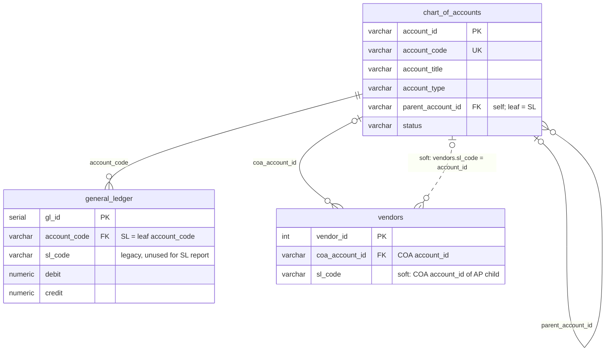

- **Table notes:**
  - `fims.chart_of_accounts` is shared. The SL hierarchy is `parent_account_id` → `account_id` (VARCHAR(10)). Alter 36 added `account_purpose`, and alter 39 added `books`.
  - `fims.sl_masters` and `fims.sl_details` (`01 - table/23/24`) are DROPPED by alter 37. Alter 20 (`sl_masters_set_account_code`) is therefore moot.
  - `fims.vendors`: `03 - alter/50` added `coa_account_id` (FK to COA `account_id`, ON DELETE SET NULL) and `sl_code` (soft link to a COA child `account_id`). The DV readone uses this to credit the vendor's AP sub-ledger account.

### Journals

- **Status:** Built (read-only) — It has four tabs: GJ (from the GL), and CKDJ, ADADJ, and CRDJ (each read from its own source table, not the GL).
- **Code:** `views/JournalsPage.php` → `app/pages/journals-page.php`. Route `app/routes/general_ledger.php`: `GET /general_ledger/journals` (`fetchJournals`, paged, from v_journals), `GET /general_ledger/ckdj` (`fetchCkdj`), `GET /general_ledger/adadj` (`fetchAdadj`), `GET /general_ledger/crdj` (`fetchCrdj`). Service: `GeneralLedgerService`.
- **Tables written:** none. **Tables read:** fims.v_journals, fims.checks, fims.ada_releases, fims.official_receipts, fims.official_receipt_lines, fims.disbursement_vouchers (joined by `dv_no = dv_number`), fims.journal_entry_vouchers (`dv_id`, book_id, jev_no), fims.bank_accounts, fims.chart_of_accounts, fims.books, fims.fiscal_year.
- **Status workflow:** none. It displays `checks.status` and `ada_releases.status` (RELEASED|CANCELLED).

```mermaid
erDiagram
    ada_releases {
        serial ada_id PK
        varchar ada_no UK
        date ada_date
        varchar dv_number "soft: dv_no"
        int bank_account_id FK
        varchar payee
        numeric amount
        varchar status "RELEASED|CANCELLED"
    }
    official_receipts {
        serial receipt_id PK
        varchar or_no UK
        date or_date
        smallint fiscal_yr
        varchar payor_name
        varchar debit_account_code FK
        numeric total_amount
        int book_id FK
    }
    official_receipt_lines {
        serial line_id PK
        int receipt_id FK
        int line_number
        varchar account_code FK
        numeric amount
    }
    checks {
        int check_id PK
        varchar dv_number "soft: dv_no"
        int bank_account_id FK
        numeric amount
    }
    disbursement_vouchers {
        int dv_id PK
    }
    journal_entry_vouchers {
        int jev_id PK
    }
    general_ledger {
        int gl_id PK
    }
    bank_accounts {
        int bank_account_id PK
    }
    chart_of_accounts {
        varchar account_code UK
    }
    books {
        int book_id PK
    }

    official_receipts ||--o{ official_receipt_lines : "receipt_id (cascade)"
    chart_of_accounts ||--o{ official_receipt_lines : account_code
    chart_of_accounts |o--o{ official_receipts : debit_account_code
    books |o--o{ official_receipts : book_id
    bank_accounts |o--o{ ada_releases : bank_account_id
    bank_accounts ||--o{ checks : bank_account_id
    disbursement_vouchers |o..o{ ada_releases : "soft: dv_number"
    disbursement_vouchers |o..o{ checks : "soft: dv_number"
    disbursement_vouchers |o--o{ journal_entry_vouchers : dv_id
    journal_entry_vouchers ||--o{ general_ledger : "jev_id (GJ via v_journals)"
```

- **Table notes:**
  - `fims.ada_releases` (`01 - table/39`) records ADA payments. It has no `book_id`; the book is read through the JEV. No code in `app/` inserts into it.
  - `fims.official_receipts` and `fims.official_receipt_lines` (`01 - table/40`) record collections and are not posted to the GL. Alter 30 added `official_receipts.book_id`. No code in `app/` inserts into either table.
  - CKDJ and ADADJ join `journal_entry_vouchers ON jev.dv_id = d.dv_id` without filtering on `jev_type`.

### Trial Balance

- **Status:** Built (read-only) — per-account debit / credit totals from the `fims.v_trial_balance` view.
- **Code:** `views/TrialBalancePage.php` → `app/pages/trial-balance-page.php`. Route: `GET /general_ledger/trial-balance` (`GeneralLedgerService::fetchTrialBalance`, l.539, with `attachAccountGroups` doing a recursive CTE up `parent_account_id` for the major/sub group headers).
- **Tables written:** none. **Tables read:** fims.v_trial_balance (general_ledger grouped by fiscal_yr, book_id, and account; balance = debit − credit), fims.chart_of_accounts (recursive), fims.books, fims.fiscal_year.
- **Status workflow:** none.

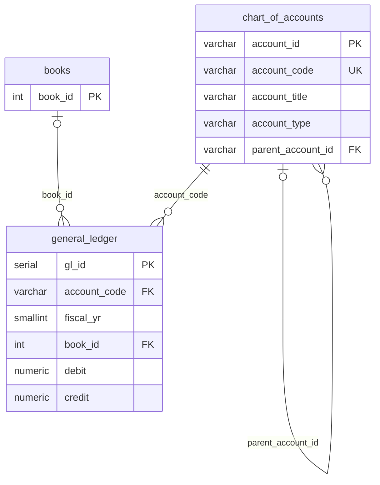

- **Table notes:**
  - `fims.v_trial_balance` (`05 - views/01`) groups by fiscal_yr, book_id, book_name, account_code, account_id, account_title, and account_type. The service re-aggregates across books when no book filter is given. Reversal rows are included, so they net out.

## Accounts Set-up

### Program

- **Status:** Built — The page does CRUD on fims.program.
- **Code:** `app/pages/program-page.php`; `app/routes/program.php` (`GET /program/next-code`, `/program/all`, `/program/list`, `/program/read/{code}`, `POST /program/add`, `PUT /program/update/{code}`, `DELETE /program/delete/{code}`); `app/services/ProgramService.php`.
- **Tables written:** fims.program (hard DELETE). **Tables read:** fims.project (the delete guard counts child projects, `ProgramService.php:167`).
- **Status workflow:** none.

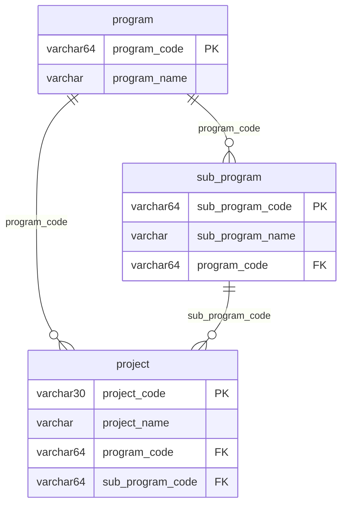
- **Table notes:**
  - fims.program (`01 - table/03`): a natural-key PK (program_code). It has no status or audit columns.
  - fims.project (`04`): alter `01 - project_add_sub_program_code` added `sub_program_code` with an FK. Alter 14 widened `project_code` to VARCHAR(30). Alters 11 and 15 widened program_code and sub_program_code to VARCHAR(64).

### Sub Program

- **Status:** Built — The page does CRUD, plus a batch add of several sub-programs under one program.
- **Code:** `app/pages/sub-program-page.php`; `app/routes/sub_program.php` (`GET /sub_program/next-code|all|list|read/{code}`, `POST /sub_program/add`, `POST /sub_program/add-with-items` (createBatch), `PUT /sub_program/update/{code}`, `DELETE /sub_program/delete/{code}`), plus `GET /program/all`; `app/services/SubProgramService.php`.
- **Tables written:** fims.sub_program. **Tables read:** fims.program.
- **Status workflow:** none.

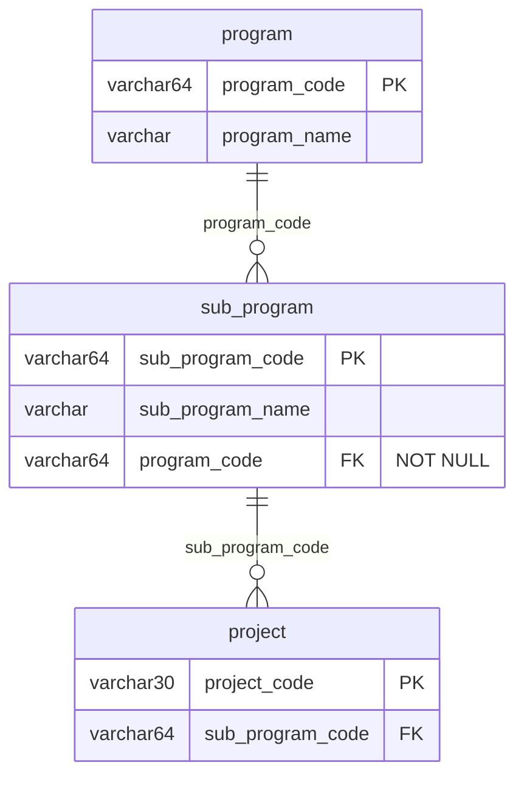
- **Table notes:**
  - fims.sub_program (`01 - table/10`): the child of program. "add-with-items" inserts several sub-programs at once, not projects.

### Chart of Accounts

- **Status:** Built — The page does CRUD, toggles status and filters by region/project scope. A soft delete sets status to Inactive.
- **Code:** `app/pages/chart-of-accounts-page.php`; `app/routes/chart_of_accounts.php` (`GET /chart_of_accounts/all`, `/chart-of-accounts/my-scope|all|regions|projects|list|read/{id}`, `POST /chart-of-accounts/add`, `PUT /chart-of-accounts/update/{id}`, `PATCH /chart-of-accounts/{id}/toggle-status`, `DELETE /chart-of-accounts/delete/{id}`); `app/routes/accounting.php` (`GET /accounting/coa/search`, `/accounting/sl/by-account`, `/accounting/sl/search`, `POST /accounting/sl/create`); services `app/services/ChartOfAccountsService.php`, `app/services/AccountingService.php`.
- **Tables written:** fims.chart_of_accounts. The delete is a soft delete that sets status = 'Inactive' (`ChartOfAccountsService.php:285`). `AccountingService::createChildAccount` inserts SL rows. **Tables read:** fims.responsibility_code (the regions lookup), fims.project (the projects lookup).
- **Status workflow:** `status` is 'Active' or 'Inactive', switched by toggle-status.

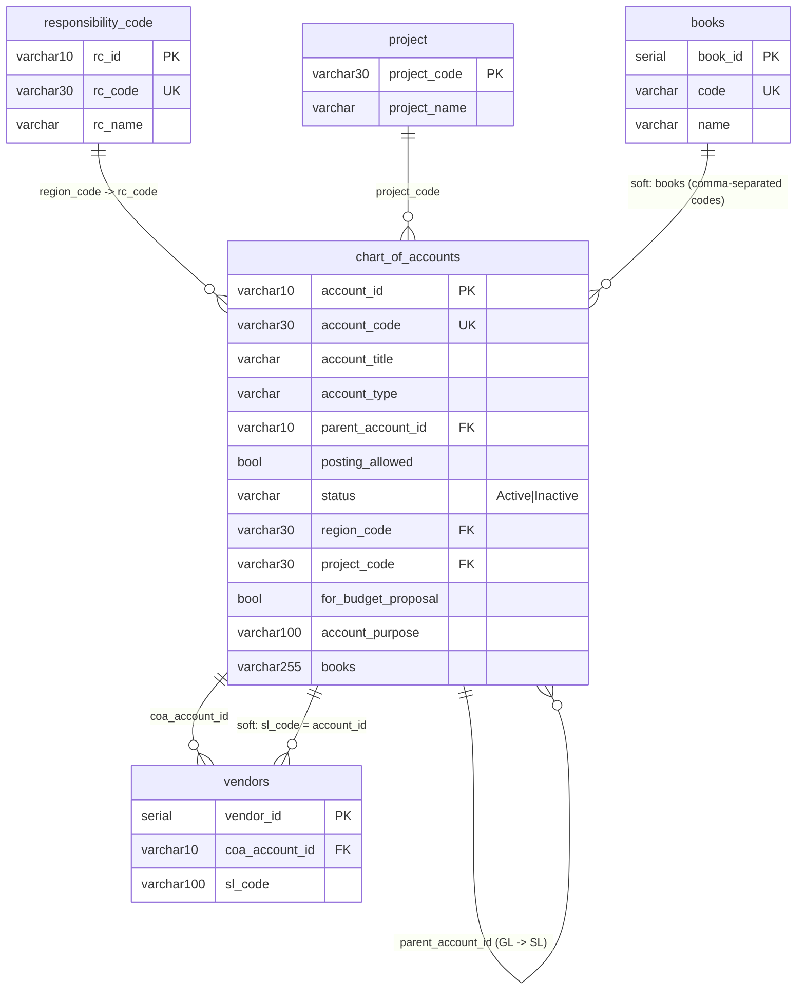
- **Table notes:**
  - fims.chart_of_accounts (`01 - table/06`): a self-referencing tree.
    - **An SL is a leaf child** created by `/accounting/sl/create`. The child gets account_id = MAX(numeric id) + 1, account_code = parent code + `-NN`, posting_allowed = TRUE and the parent's account_type (`AccountingService.php:111-161`).
    - Alter `01 - chart_of_accounts_add_region_project` added `region_code` (FK to responsibility_code.**rc_code**, ON DELETE SET NULL) and `project_code` (FK to project, ON DELETE SET NULL).
    - Alter 12 added `for_budget_proposal` (and seeded it TRUE for a list of codes). Alter 36 added `account_purpose`. Alter 39 added `books` (comma-separated text).
    - Other column: `source_document`.
    - The old `sl_masters` / `sl_details` tables were dropped by alter 37.

### Responsibility Center

- **Status:** Built — The page does CRUD, toggles status and hard-deletes.
- **Code:** `app/pages/responsibility-center-page.php`; `app/routes/responsibility_center.php` (`GET /responsibility-center/all|list|read/{id}`, `POST /responsibility-center/add`, `PUT /responsibility-center/update/{id}`, `PATCH /responsibility-center/{id}/toggle-status`, `DELETE /responsibility-center/delete/{id}`); `app/services/ResponsibilityCenterService.php`.
- **Tables written:** fims.responsibility_code. **Tables read:** fims.responsibility_code (the parent picker).
- **Status workflow:** `status` is 'Active' or 'Inactive'.

```mermaid
erDiagram
    responsibility_code ||--o{ responsibility_code : "parent_rc_id"
    responsibility_code ||--o{ chart_of_accounts : "rc_code = region_code"
    responsibility_code ||--o{ users : "rc_id (uac.users)"
    responsibility_code ||--o{ bank_accounts : "soft: rc_id"
    responsibility_code {
        varchar10 rc_id PK
        varchar30 rc_code UK
        varchar rc_name
        varchar10 parent_rc_id FK
        varchar office_type
        varchar status "Active|Inactive"
        varchar source_document
        bool is_budget_holding_rc
    }
    chart_of_accounts {
        varchar10 account_id PK
        varchar30 region_code FK
    }
    users {
        int user_id PK
        varchar10 rc_id FK
    }
    bank_accounts {
        serial bank_account_id PK
        varchar50 rc_id
    }
```
- **Table notes:**
  - fims.responsibility_code (`01 - table/07`): a self-referencing tree. No alters touch its columns.
  - Alter `09 - users_replace_rc_code_with_rc_id` gave `uac.users` an `rc_id` FK to this table (ON DELETE SET NULL) and dropped `users.rc_code`.
  - budget_allocation.requesting_rc_id also points here (alter 14). That table is out of scope for this file.

### Banks Accounts

- **Status:** Built — The page covers the list, stats, dormancy alerts, create/update, status change and Google Drive document links.
- **Code:** `app/pages/bank-management-page.php` (view `views/BankManagementPage.php`); `app/routes/bank-management.php` (`GET /bank-management/stats|list|dormancy-alerts|lookup/responsibility-centers|lookup/fund-sources|{id}|{id}/documents`, `POST /bank-management/store|{id}/update|{id}/status|{id}/documents/link|{id}/documents/remove`); `app/services/BankManagementService.php`.
- **Tables written:** fims.bank_accounts, fims.bank_account_documents (link insert and hard DELETE), fims.bank_account_audit_log (CREATE / UPDATE / STATUS_CHANGE with before/after JSONB). **Tables read:** fims.responsibility_code. The fund-sources lookup is a `SELECT DISTINCT fund_source` from bank_accounts itself.
- **Status workflow:** `status` is ACTIVE, DORMANT or CLOSED (`BankManagementService.php:86`). `is_active` is kept in sync (TRUE only when ACTIVE). A "dormancy alert" is an ACTIVE account whose last_transaction_date is 300-365 days old.

```mermaid
erDiagram
    bank_accounts ||--o{ bank_account_documents : "bank_account_id"
    bank_accounts ||--o{ bank_account_audit_log : "soft: bank_account_id"
    responsibility_code ||--o{ bank_accounts : "soft: rc_id"
    bank_accounts {
        serial bank_account_id PK
        varchar account_name
        varchar account_number
        varchar bank_name
        varchar account_type
        varchar account_classification
        varchar fund_source "free text"
        varchar50 rc_id
        bool is_main_depository
        numeric current_balance
        date last_transaction_date
        varchar status "ACTIVE|DORMANT|CLOSED"
    }
    bank_account_documents {
        serial document_id PK
        int bank_account_id FK
        varchar link_name
        varchar gdrive_link
        int added_by
    }
    bank_account_audit_log {
        serial log_id PK
        int bank_account_id
        varchar action "CREATE|UPDATE|STATUS_CHANGE"
        jsonb before_data
        jsonb after_data
        int performed_by
    }
    responsibility_code {
        varchar10 rc_id PK
        varchar rc_name
    }
```
- **Table notes:**
  - fims.bank_accounts (`01 - table/26`): base columns are account_name, account_number, bank_name, office_type, department_type, current_balance, is_active, created_by and timestamps.
    - Alter 23 added account_type, account_classification, bank_branch, fund_source, department_id, is_main_depository, date_opened, last_transaction_date and status.
    - Alter 24 dropped the uac.departments FK and renamed department_id to **rc_id VARCHAR(50)**. **No FK was re-added.** The column is wider than responsibility_code.rc_id (VARCHAR(10)).
    - It is also referenced by fund_transfers (real FK) and by cash_position, check_register and bank_transactions (soft links).
  - fims.bank_account_documents (created in alter 23): has a real FK to bank_accounts. Rows are hard-deleted on remove.
  - fims.bank_account_audit_log (created in alter 23): **has no FK constraint**, only an index on bank_account_id.

### Vendors

- **Status:** Built — The page does list, stats, create and update. It has no delete endpoint; status is used instead.
- **Code:** `app/pages/vendors-page.php`; `app/routes/vendor.php` (`GET /vendors/types|all|list|read/{id}`, `POST /vendors/add`, `PUT /vendors/update/{id}`); `app/services/VendorService.php`.
- **Tables written:** fims.vendors. **Tables read:** fims.vendor_types, fims.chart_of_accounts (joined twice: `c` on coa_account_id = GL and `s` on sl_code = SL, `VendorService.php:105-106`).
- **Status workflow:** `status` is ACTIVE or anything else (inactive). A NULL status counts as ACTIVE.

```mermaid
erDiagram
    vendor_types ||--o{ vendors : "vendor_type"
    chart_of_accounts ||--o{ vendors : "coa_account_id (GL)"
    chart_of_accounts ||--o{ vendors : "soft: sl_code = account_id (SL)"
    vendors {
        serial vendor_id PK
        varchar vendor_code UK
        varchar vendor_name
        varchar20 vendor_type FK
        varchar tin
        varchar tax_classification
        bool is_vat_registered
        varchar bank_name
        varchar bank_account_number
        varchar status "ACTIVE default"
        varchar10 coa_account_id FK
        varchar100 sl_code
    }
    vendor_types {
        serial vendor_type_id PK
        varchar20 vendor_type UK
        text description
        bool is_active
    }
    chart_of_accounts {
        varchar10 account_id PK
        varchar30 account_code UK
        varchar account_title
        varchar10 parent_account_id FK
    }
```
- **Table notes:**
  - fims.vendors (`01 - table/08`): the FK on vendor_type points to vendor_types.**vendor_type** (a text natural key), not to its id. Alter `03 - alter/50` added `coa_account_id` (FK to chart_of_accounts.account_id, ON DELETE SET NULL) and `sl_code` VARCHAR(100). `sl_code` has no FK but holds a chart_of_accounts.account_id (the SL child).
  - fims.vendor_types (`07`): seeded with SUPPLIER, CONTRACTOR, CONSULTANT, SERVICE_PROVIDER, EMPLOYEE.

### Fund Source

- **Status:** Empty placeholder (0-byte page) — `app/pages/fund-source-page.php` is 0 bytes.
- **Code:** none — the page file is 0 bytes.
- **Tables:** No tables yet. "Fund source" exists today only as free-text columns: `bank_accounts.fund_source` (alter 23), `disbursement_vouchers.fund_source` and `fund_transfers.fund_source_id` (an INTEGER with no target table). `shared.fund_sources` (from TREASURY) does not exist here (`BankManagementService.php:13-17`, `CashPositionService.php:22`).

### Program Sources

- **Status:** Empty placeholder (0-byte page) — `app/pages/program-sources-page.php` is 0 bytes.
- **Code:** none — the page file is 0 bytes.
- **Tables:** No tables yet. `budget_line_items.program_source_code` and `program_uses` were added in alters 17/18 and dropped again in alter 22.

### Accountable Officer

- **Status:** Empty placeholder (0-byte page) — `app/pages/accountable-officer-page.php` is 0 bytes.
- **Code:** none — the page file is 0 bytes.
- **Tables:** No tables yet. Nothing in `_assets/sql` mentions accountable officers.

### Payroll Setup

- **Status:** Built — the catalogue of payroll items: list with KPIs and filters, add, edit (item code is fixed once saved). No delete: an item used by a payroll can only be set INACTIVE.
- **Code:** `app/pages/payroll-setup-page.php` + `app/pages/form/payroll-form.php`; `app/routes/payroll_setup.php` (`GET /payroll-setup/list|accounts|read/{id}`, `POST /payroll-setup/add`, `PUT /payroll-setup/update/{id}`); `app/services/PayrollSetupService.php`.
- **Tables written:** fims.payroll_items; fims.chart_of_accounts (only when an item is saved with a 5th / 6th-part sub-ledger account that does not exist yet — created with the item, removed again if the item fails). **Tables read:** fims.chart_of_accounts.
- **Status workflow:** `status` ACTIVE | INACTIVE. An item's **category** (EARNING / DEDUCTION / REFUND / EMPLOYER_SHARE) decides how its amounts count and the side it posts to (DEDUCTION = credit, the others = debit).
- **Used by:** Payroll Management — `item_code` is the column name in the payroll import form.

```mermaid
erDiagram
    chart_of_accounts ||--o{ payroll_items : "account_code"
    payroll_items {
        serial payroll_item_id PK
        varchar60 item_code UK "= import column name"
        varchar150 item_name
        varchar20 category "EARNING | DEDUCTION | REFUND | EMPLOYER_SHARE"
        varchar30 account_code FK "nullable until set"
        int sort_order
        varchar20 status "ACTIVE | INACTIVE"
    }
    chart_of_accounts {
        varchar30 account_code UK
        varchar account_title
        bool posting_allowed
    }
```
- **Table notes:**
  - fims.payroll_items (`01 - table/48`): FKs from `03 - alter_table/37` — `account_code` → chart_of_accounts.account_code, `created_by` / `updated_by` → uac.users. Nothing is seeded.

### Payroll Management

- **Status:** Built (import only) — imports the monthly employee payroll (the payroll office's form `_shared/template/MONTHLY-PAYROLL-TEMPLATE.xlsx`) and keeps one summary row per month. Tabs: **Payroll Imports** (preview → import / replace, list with Month, Year, Import Date, Status, Total Payroll Amount = gross and one action — **Create DV** / **View DV**; the month name opens its employee records → items, with Delete Import while no DV uses it), **Year-to-Date Report** (per employee, filters, CSV export), **File Template** (download the blank form; its columns vs Payroll Setup). No DV is created here.
- **Code:** `app/pages/payroll-page.php` (PayrollPage); `app/routes/payroll_management.php` (`GET /payroll-management/list|records/{periodId}|record-items/{id}|ytd|template-columns|template|available|dv-data/{periodId}`, `POST /payroll-management/preview|import`, `DELETE /payroll-management/delete/{periodId}`); `app/services/PayrollManagementService.php`.
- **Tables written:** fims.payroll_periods (one per month, created when missing; `prepared_at` / `prepared_by` = import date / user), fims.payroll_employees (employees not in the directory yet; existing ones unchanged), fims.payroll_records (one per employee per month, category totals), fims.payroll_record_items (one per employee per item with an amount). **Tables read:** fims.payroll_items, fims.chart_of_accounts, fims.disbursement_vouchers + fims.settings_status (DV link), uac.users.
- **Import rules:** each amount column must match an ACTIVE Payroll Setup item code (quotes from the HRIS export ignored); a column with amounts and no item, a repeated employee no. or a non-numeric value stops the import. Inactive items are skipped. A month already imported is replaced only on request, and never while a live DV uses it or the period is LOCKED / CLOSED.
- **Status workflow (summary):** Imported → DV Created (every record linked to a non-cancelled DV) / Partly in a DV. Derived from `payroll_records.disbursement_voucher_id`, not stored.
- **DV link:** the list's **Create DV** opens Disbursement Voucher (`Voucher?payroll={payroll_period_id}`) with a new DV for the month; **View DV** opens its DV (`Voucher?dv={dv_id}`). On the DV form the month sits in the Vendor dropdown's "Payroll (imported months)" group (months no live DV uses); picking it fills claimant, particulars, account, gross, deductions and the accounting entry (Dr expense accounts, Cr deduction accounts, Cr Accounts Payable 2-01-01-010 for the net pay; employer share not included). Saving sets `payroll_records.disbursement_voucher_id`; cancelling or deleting the DV clears it. Choosing None or a vendor instead clears everything the month filled.

```mermaid
erDiagram
    payroll_periods ||--o{ payroll_records : "payroll_period_id"
    payroll_employees ||--o{ payroll_records : "employee_id"
    payroll_records ||--o{ payroll_record_items : "payroll_record_id (cascade)"
    payroll_items ||--o{ payroll_record_items : "payroll_item_id"
    chart_of_accounts ||--o{ payroll_record_items : "account_code (snapshot)"
    disbursement_vouchers ||--o{ payroll_records : "disbursement_voucher_id"
    payroll_periods {
        serial payroll_period_id PK
        smallint fiscal_yr "UK with payroll_month"
        smallint payroll_month "1-12 (13 = year-end)"
        varchar100 period_name
        date period_start_date
        date period_end_date
        varchar20 status "OPEN | LOCKED | CLOSED"
        timestamp prepared_at "import date"
        int prepared_by FK "importer"
    }
    payroll_employees {
        serial employee_id PK
        varchar50 employee_no UK
        varchar last_name
        varchar first_name
        varchar middle_name
        varchar full_name "generated"
        varchar department
        varchar employment_status
    }
    payroll_records {
        serial payroll_record_id PK
        int payroll_period_id FK "UK with employee_id"
        int employee_id FK
        numeric total_earnings
        numeric total_deductions
        numeric total_refunds
        numeric total_employer_share
        numeric gross_amount "generated = total_earnings"
        numeric net_amount "generated = earnings + refunds - deductions"
        varchar20 status "DRAFT on import"
        int disbursement_voucher_id FK "payroll DV"
    }
    payroll_record_items {
        serial payroll_record_item_id PK
        int payroll_record_id FK "UK with payroll_item_id"
        int payroll_item_id FK
        numeric amount
        varchar30 account_code FK "snapshot of the item's account"
    }
    payroll_items {
        serial payroll_item_id PK
        varchar60 item_code UK
        varchar20 category
        varchar30 account_code FK
    }
    disbursement_vouchers {
        serial dv_id PK
        varchar dv_no UK
    }
    chart_of_accounts {
        varchar30 account_code UK
    }
```
- **Table notes:**
  - fims.payroll_periods (`01 - table/44`), fims.payroll_employees (`42`), fims.payroll_records (`45`), fims.payroll_record_items (`49`); FKs from `03 - alter_table/36` and `/37`. `03 - alter_table/38` regenerates `gross_amount` / `net_amount` from the category totals (the old `regular_pay` … `other_income` columns stay, deprecated).
  - `03 - alter_table/36` also added `disbursement_vouchers.payroll_record_id` (FK → payroll_records); this module does not use it — a payroll DV covers a whole month, so the link is kept on the records side.
  - fims.payroll_deduction_types (`43`, 12 seeded rows), fims.payroll_deductions (`46`) and fims.payroll_remittances (`47`) belong to the earlier payroll design; `payroll_record_items` replaces payroll_deductions (see alter 38's clean-up note). The routes in `app/routes/payroll.php` that read them are not registered (the file returns a closure that `app/api.php` never calls).
  - The payroll DV's deductions use fims.deduction_types `PAYROLL_GSIS`, `PAYROLL_PHILHEALTH`, `PAYROLL_PAGIBIG`, `PAYROLL_WTAX`, `PAYROLL_OTHER` (`04 - seed_data/08`); until that seed is run they show under OTHER.

### Fidelity Bond

- **Status:** Empty placeholder (0-byte page) — `app/pages/fidelity-bond-page.php` is 0 bytes.
- **Code:** none — the page file is 0 bytes.
- **Tables:** No tables yet.

## Fund Sourcing

### Fund Sourcing Dashboard

- **Status:** Partial — The SARO/NCA/Trust/Supplemental figures are live. The Fund Transfer / Borrowing card and tab are static sample data (`FSD_STATIC`): the page calls `/fund_transfer/summary` and `/fund_transfer/list`, and **neither route exists**.
- **Code:** `app/pages/fund-sourcing-dashboard-page.php`; `app/routes/fund_tracking.php` (`GET /fund_tracking/dashboard`, `GET /fund_tracking/list`), `/fiscal_year/all`; `app/services/fund_trackingServices.php`.
- **Tables written:** none. **Tables read:** fims.fund_tracking, fims.fund_tracking_type, fims.nature_of_fund, fims.agency, fmd.supplemental_fund_details (for supplemental totals), fims.fiscal_year.
- **Status workflow:** none.

```mermaid
erDiagram
    fund_tracking_type ||--o{ fund_tracking : "soft: tracking_type_id"
    nature_of_fund ||--o{ fund_tracking : "soft: nature_of_fund_id"
    fund_tracking ||--o| supplemental_fund_details : "soft: fund_tracking_id (fmd schema)"
    fund_tracking {
        serial id PK
        int fiscal_year
        int tracking_type_id
        int nature_of_fund_id
        numeric amount
        varchar agency_name
        int parent_id
        timestamp deleted_at
    }
    fund_tracking_type {
        serial fund_tracking_type_id PK
        varchar fund_tracking_code
    }
    nature_of_fund {
        serial nature_of_fund_id PK
        varchar name UK
    }
    supplemental_fund_details {
        int fund_tracking_id UK
        varchar status
        numeric budgetary_requirement
    }
```
- **Table notes:**
  - The dashboard payload (`government_funds`, `special_funds`) is computed from fund_tracking by type and nature (`fund_trackingServices.php` ~1000-1060).
  - No `cross_access_funds` is computed because `treasury.fund_transfers` does not exist (`routes/fund_tracking.php:361`). fims.fund_transfers (FTLA) does exist but is not wired to the dashboard.

### Supplemental Funds

- **Status:** Built — a flat list of fund_tracking rows with nature_of_fund = SUPPLEMENTAL. It reuses `form/saro-processing-form.php` and the 1:1 supplemental details block. That details table has no DDL in the repo.
- **Code:** `app/pages/supplemental-funds-page.php` + `app/pages/form/saro-processing-form.php`; `app/routes/fund_tracking.php` (`list`, `read/{id}`, `add`, `update/{id}`, `delete/{id}`, `GET /fund_tracking/supplemental_status_summary`), `/fund-tracking-type/all`, `/fiscal_year/all`, `/upload/*`; `app/services/fund_trackingServices.php`.
- **Tables written:** fims.fund_tracking, fmd.supplemental_fund_details (upsert, `fund_trackingServices.php:1399`), fims.ip_filemeta, fims.file_attachments. **Tables read:** fims.fund_tracking_type, fims.nature_of_fund, fims.settings_status, shared.v_rc_regions (validates regional_office; no SQL in the repo).
- **Status workflow:** `supplemental_fund_details.status` goes IN_PROCESS → AT_NDRRMC → AT_OP → APPROVED / DENIED. A record with no details row counts as IN_PROCESS (`fund_trackingServices.php:50, 1190-1204`).

```mermaid
erDiagram
    nature_of_fund ||--o{ fund_tracking : "soft: nature_of_fund_id = SUPPLEMENTAL"
    fund_tracking_type ||--o{ fund_tracking : "soft: tracking_type_id (SARO|NCA|OR)"
    fund_tracking ||--o{ fund_tracking : "soft: parent_id"
    fund_tracking ||--o| supplemental_fund_details : "soft: fund_tracking_id (UNIQUE)"
    v_rc_regions ||--o{ supplemental_fund_details : "soft: regional_office = rc_name"
    fund_tracking ||--o{ file_attachments : "soft: multiple_node_id"
    fund_tracking {
        serial id PK
        int fiscal_year
        int tracking_type_id
        varchar reference_number
        int nature_of_fund_id
        numeric amount
        uuid multiple_node_id
        int status_id
        int parent_id
        timestamp deleted_at
    }
    supplemental_fund_details {
        int fund_tracking_id UK
        varchar status "IN_PROCESS|AT_NDRRMC|AT_OP|APPROVED|DENIED"
        varchar regional_office
        numeric budgetary_requirement
        date date_received
        date date_forwarded_ndrrmc
        int days_fmd
        date date_forwarded_op
        int days_ndrrmc
        date date_approved_op
        int days_op
        int days_total
    }
    nature_of_fund {
        serial nature_of_fund_id PK
        varchar name UK
    }
    fund_tracking_type {
        serial fund_tracking_type_id PK
        varchar fund_tracking_code
    }
    v_rc_regions {
        varchar rc_name
    }
    file_attachments {
        serial id PK
        uuid multiple_node_id
    }
```
- **Table notes:**
  - fmd.supplemental_fund_details: the columns are inferred from `SUPPLEMENTAL_FIELDS` in `fund_trackingServices.php:52-64`. **There is no CREATE TABLE in `_assets/sql`.** Its reads are wrapped in try/catch, so the page works without it.
  - shared.v_rc_regions: also missing from the SQL.

### Trust Funds

- **Status:** Built — It shows Trust Fund records, each with its ORs as children (OR.parent_id → Trust Fund). It uses two modals: `form/trust-fund-form.php` and `form/saro-processing-form.php` (held to the OR type).
- **Code:** `app/pages/trust-funds-page.php`, `app/pages/form/trust-fund-form.php`, `app/pages/form/saro-processing-form.php`; `app/routes/fund_tracking.php` (`list`, `read/{id}`, `add`, `update/{id}`, `delete/{id}` (refused while ORs are linked), `POST /fund_tracking/import-trust-fund`), `app/routes/agency.php` (`GET /agency/all`), `/fiscal_year/all`, `/upload/*`; services `fund_trackingServices.php`, `agencyServices.php`.
- **Tables written:** fims.fund_tracking, fims.agency (a new name gets inserted), fims.ip_filemeta, fims.file_attachments. **Tables read:** fims.fund_tracking_type, fims.agency, fims.nature_of_fund, fims.settings_status.
- **Status workflow:** none (`status_id` is optional).

```mermaid
erDiagram
    fund_tracking_type ||--o{ fund_tracking : "soft: tracking_type_id (TRUST FUND|OR)"
    fund_tracking ||--o{ fund_tracking : "soft: parent_id (OR -> Trust Fund)"
    agency ||--o{ fund_tracking : "soft: agency_name = agency.name"
    fund_tracking ||--o{ file_attachments : "soft: multiple_node_id"
    fund_tracking {
        serial id PK
        int fiscal_year
        int tracking_type_id
        varchar reference_number
        varchar name
        numeric amount
        varchar agency_name
        text purpose
        text remarks
        uuid multiple_node_id
        int parent_id
        timestamp deleted_at
    }
    agency {
        serial agency_id PK
        varchar name UK
        bool is_active
    }
    fund_tracking_type {
        serial fund_tracking_type_id PK
        varchar fund_tracking_code
    }
    file_attachments {
        serial id PK
        uuid multiple_node_id
        uuid file_node_id
    }
```
- **Table notes:**
  - fims.fund_tracking: Trust Fund and OR are rows of the same table as SARO/NCA. The MOA party is stored as agency name text.
  - fims.agency (`01 - table/28`): agencies are auto-inserted by the service when a trust fund or import names one that does not exist (`fund_trackingServices.php:480-503`).

### Pricing

- **Status:** Partial — `app/pages/pricing-page.php` is 0 bytes, so the menu shows nothing. The backend and modals do exist: `app/pages/form/pricing-request-form.php`, `app/pages/readone/pricing-request-readone.php`, `app/routes/pricing_requests.php` and `app/services/PricingRequestService.php`. The form expects a `prq_save()` defined in the empty host page.
- **Code:** routes `GET /pricing_requests/all|list|read/{id}`, `POST /pricing_requests/add`, `PUT|POST|PATCH /pricing_requests/update/{id}` (multipart with a `data` JSON field + `doc_file_N`), `GET /pricing_request_attachments/list`, `DELETE /pricing_request_attachments/delete/{id}`; service `PricingRequestService.php`.
- **Tables written:** fims.pricing_requests (hard DELETE in the service; no route exposes it), fims.pricing_request_attachments (soft delete). **Tables read:** fims.project, uac.offices.
- **Status workflow:** `status` is free VARCHAR(50). No CHECK constraint or settings_status link was found. The routing timeline is date_received → FSG → OGM → approved, with day counts.

```mermaid
erDiagram
    project ||--o{ pricing_requests : "project_code"
    offices ||--o{ pricing_requests : "regional_office_id"
    offices ||--o{ pricing_requests : "district_office_id"
    pricing_requests ||--o{ pricing_request_attachments : "pricing_request_id (CASCADE)"
    pricing_requests {
        serial id PK
        varchar30 project_code FK
        varchar type_of_request
        varchar status
        numeric unsold_inventories
        int regional_office_id FK
        int district_office_id FK
        date date_received
        date date_forwarded_fsg
        date date_forwarded_ogm
        date date_approved_ogm
        int total_days
    }
    pricing_request_attachments {
        serial attachment_id PK
        int pricing_request_id FK
        varchar document_name
        varchar storage_key
        varchar external_link
        timestamp deleted_at
    }
    project {
        varchar30 project_code PK
        varchar project_name
    }
    offices {
        int office_id PK
        varchar office_name
    }
```
- **Table notes:**
  - fims.pricing_requests (`01 - table/34`): UNIQUE on (project_code, type_of_request, date_received). Other columns: signed_by, assigned_to, date_received_complete_docs, days_with_fmd/fsg/ogm, remarks, is_active, created_by.
  - fims.pricing_request_attachments (`35`): a CHECK requires storage_key OR external_link. The FK uses ON DELETE CASCADE.

## Administration

### Position Management

- **Status:** Built — custom page + Slim API; PHPMaker CRUD for Positions/PositionCategories also generated but not in the sidebar.
- **Code:** `views/PositionManagement.php` → `app/pages/position-management.php`; routes `app/routes/position-management.php` (`POST/PUT /api/position-management/categories[/{id}]`, `POST/PUT /api/position-management/positions[/{id}]`); service `app/lib/PositionManagementService.php`. PHPMaker models `models/Positions*.php`, `models/PositionCategories*.php` (not linked from the menu).
- **Tables written:** uac.position_categories (insert/update), uac.positions (insert/update, `created_by` set). No deletes. **Tables read:** uac.positions, uac.position_categories.
- **Status workflow:** none.

```mermaid
erDiagram
    uac_position_categories ||--o{ uac_positions : "soft: position_category_id (no FK)"
    uac_positions ||--o{ uac_users : "FK users_position_id_fkey (ON DELETE SET NULL)"
    uac_positions ||--o{ uac_plantilla_items : "soft: position_id"
    uac_position_categories {
        int4 position_category_id PK
        varchar category_name "dup-checked case-insensitively in service"
        text description
        bool is_active
        timestamptz created_at
    }
    uac_positions {
        int4 position_id PK
        int4 position_category_id "soft -> position_categories"
        varchar position_code "unique by service, not by DB"
        varchar position_title
        int4 position_level
        int4 salary_grade "SG 1-33"
        int4 step_increment
        text job_description
        text qualification_standards
        jsonb competency_requirements "not set by the page"
        bool is_active
        int4 created_by "soft -> uac.users"
    }
    uac_users {
        int4 user_id PK
        int4 position_id FK
    }
    uac_plantilla_items {
        int4 plantilla_item_id PK
        int4 department_id "soft"
        int4 position_id "soft"
    }
```
- **Table notes:**
  - uac.position_categories — position classification (First/Second/Third Level…); sequence setval to 8 in the dump implies ~7 seeded categories in the original DB but no seed file in this repo inserts them.
  - uac.positions — generic position templates; `position_code` uniqueness only enforced in `PositionManagementService::validatePositionFields` (an index exists, no UNIQUE). Referenced by `uac.users.position_id` (the only real FK into positions).
  - uac.plantilla_items — shown only for context; no code in this app reads/writes it (listed in the hidden-module list of `app/pages/user-access.php`).

### User Access Management

- **Status:** Built — custom page + Slim API.
- **Code:** `views/UserAccess.php` → `app/pages/user-access.php` (2,474 lines); routes `app/routes/user-access.php` (`POST/PUT /api/user-access/users`, `POST /user-access/permissions`, `POST /user-access/sync-modules`, `POST /user-access/module-caption`, `POST /user-access/module-visibility`, `POST/PUT /user-access/user-levels`, `POST /user-access/assignments`); service `app/lib/UserAccessService.php`. Module list comes from PHPMaker's `$USER_LEVEL_TABLES` (`src/userlevelsettings.php`).
- **Tables written:** uac.users (insert/update: username, email, password_hash, employee_id, name parts, mobile, is_active, rc_id, position_id; `user_level_id` on assignment), uac.user_levels (insert with `MAX+1` id / update), uac.user_level_permissions (upsert `ON CONFLICT (user_level_id, table_name)`; zero rows seeded for every module on new level; sync-modules inserts missing rows), uac.user_level_assignments (insert), uac.permission_module_captions (upsert caption / is_hidden). Also uac.audit_logs indirectly via PHPMaker audit trail (`src/config.php:371-383`). **Tables read:** uac.users, uac.departments, uac.user_offices, uac.offices, uac.user_level_assignments, uac.user_levels, uac.systems, uac.user_level_permissions, uac.permission_module_captions, uac.positions, fims.responsibility_code.
- **Status workflow:** none.

```mermaid
erDiagram
    uac_users ||--o{ uac_user_level_assignments : "soft: user_id"
    uac_user_levels ||--o{ uac_user_level_assignments : "soft: user_level_id"
    uac_systems ||--o{ uac_user_level_assignments : "soft: system_id (nullable)"
    uac_systems ||--o{ uac_user_levels : "soft: system_id"
    uac_user_levels ||--o{ uac_user_level_permissions : "soft: user_level_id (part of PK)"
    uac_user_levels ||--o{ uac_users : "soft: users.user_level_id VARCHAR (CSV-capable)"
    uac_permission_module_captions ||--o{ uac_user_level_permissions : "soft: table_name (unprefixed vs {FIMS}-prefixed)"
    uac_positions ||--o{ uac_users : "FK position_id"
    fims_responsibility_code ||--o{ uac_users : "cross-schema FK: rc_id"
    uac_departments ||--o{ uac_users : "soft: department_id"
    uac_users ||--o{ uac_user_offices : "soft: user_id"
    uac_offices ||--o{ uac_user_offices : "soft: office_id"
    uac_users {
        int4 user_id PK
        varchar username UK
        varchar email UK
        varchar password_hash "bcrypt, lowercased pwd"
        varchar user_level_id "VARCHAR; what the PHPMaker login reads"
        bool is_active
        int4 department_id "soft"
        int4 reports_to_user_id "soft self-ref"
        int4 position_id FK
        varchar rc_id FK "varchar(10) -> fims.responsibility_code"
        varchar employee_id
        bool must_change_password
    }
    uac_user_levels {
        int4 user_level_id PK "not serial; -2/-1/0 reserved"
        varchar name
        text description
        int4 system_id "soft"
    }
    uac_user_level_permissions {
        int4 user_level_id PK
        varchar table_name PK "e.g. {FIMS}users / {FIMS}UserAccess.php"
        int4 permission "bitmask"
    }
    uac_user_level_assignments {
        int4 assignment_id PK
        int4 system_id "soft"
        int4 user_id "soft"
        int4 user_level_id "soft"
        int4 assigned_by "soft -> users"
        timestamp created_at
    }
    uac_permission_module_captions {
        varchar table_name PK "unprefixed key"
        varchar caption
        bool is_hidden
        timestamptz updated_at
    }
    uac_systems {
        int4 system_id PK
        varchar system_code UK
        varchar system_name
        jsonb level_permissions
        bool is_active
    }
    uac_user_offices {
        int4 user_office_id PK
        int4 user_id "soft"
        int4 office_id "soft"
        bool is_primary
        bool is_active
    }
    uac_offices {
        int4 office_id PK
        varchar office_name
    }
    uac_departments {
        int4 department_id PK
        varchar department_name
    }
    uac_positions {
        int4 position_id PK
        varchar position_title
    }
    fims_responsibility_code {
        varchar rc_id PK "varchar(10)"
        varchar rc_code UK
        varchar rc_name
    }
```
- **Table notes:**
  - uac.users — login table (`USER_TABLE_NAME`, `LOGIN_PASSWORD_FIELD_NAME=password_hash`, `USER_LEVEL_FIELD_NAME=user_level_id`, `src/config.php:447-454`). Effective columns after alters: + `position_id` (FK), `employee_id`, `must_change_password` (`00 - uac/02 - alter_table/03`), + `rc_id varchar(10)` FK to fims.responsibility_code and `rc_code` dropped (`01 - fims/03 - alter_table/09`). `profile` (text/JSON) is read by `_shared/auth.php:140`. `department_id` is never set by this page (only read).
  - uac.user_levels — roles; PK is NOT a sequence — `UserAccessService` computes `GREATEST(1, MAX+1)`. Config `USER_LEVEL_TABLE = uac.user_levels` (`src/config.php:430`). Must contain -2 (see Platform section).
  - uac.user_level_permissions — PHPMaker bitmask privileges (`USER_LEVEL_PRIV_TABLE`), composite PK (user_level_id, table_name); table_name carries the `{FIMS}` project prefix.
  - uac.user_level_assignments — this page's per-system role log; the login engine does NOT read it, so `assignUserLevel` also writes `users.user_level_id` (`UserAccessService.php:762-778`). The page unions both sources to display access.
  - uac.permission_module_captions — admin rename/hide override for the module list; key is the unprefixed table name (`normalizeTableKey()`); hiding never deletes permission rows.
  - uac.systems — read for role/assignment labels; `level_permissions` JSONB also read by `_shared/PagePermission.php`.
  - uac.user_offices / uac.offices — read only (primary office label); no writer in this app.
  - fims.responsibility_code — RC dropdown + existence check for `users.rc_id`; this FK makes uac depend on fims (uac alter must run after fims tables).

### User Level Management

- **Status:** Built — but it is a read-only dashboard: menu item `UserManagement` (`views/menu.php:61`) includes `app/pages/security-management.php`, which shows counts/breakdowns, an audit-log browser and quick links; no writes, no route/service.
- **Code:** `views/UserManagement.php` → `app/pages/security-management.php`. Quick links to `UserAccess`, `DepartmentManagement`, `PositionManagement`, `UserLevelsList`, `SystemsList` (PHPMaker controllers `controllers/UserLevelsController.php`, `SystemsController.php`; models `models/UserLevels*.php`, `models/Systems*.php`).
- **Tables written:** none (PHPMaker pages behind the quick links can write uac.user_levels / uac.systems). **Tables read:** uac.users, uac.user_level_assignments, uac.departments, uac.positions, uac.position_categories, uac.user_levels, uac.systems, uac.audit_logs.
- **Status workflow:** none.

```mermaid
erDiagram
    fund_tracking_type ||--o{ fund_tracking : "tracking_type_id (no DB FK)"
    nature_of_fund ||--o{ fund_tracking : "nature_of_fund_id (no DB FK)"
    fund_tracking ||--o{ fund_tracking : "parent_id (self, no DB FK)"
```

| Table | Purpose / notes |
|---|---|
| `fund_tracking` | One row per SARO/NCA/Trust Fund/OR document. `parent_id` links a record to the one it was released/derived from (e.g. an NCA to its SARO); `multiple_node_id` groups rows saved together. No `unreleased` and no `sub_program_code` column (dropped, `03 - alter_table/41`); `date` is the creation day (defaults to `CURRENT_DATE`, stamped by the API). **Declares no FOREIGN KEYs at all** — `fund_trackingServices::validateReferences()` checks every id/code in PHP instead. `agency_name` references `fims.agency` **by name, not id** |
| `fund_tracking_type` | Lookup: `SARO` (Special Allotment Release Order), `NCA` (Notice of Cash Allocation), `TRUST` (Trust Fund), `OR` (Obligations Request). `GAAAO` and `SUPPLEMENTAL` are deliberately **not** here — they're natures of fund, not tracking types |
| `nature_of_fund` | Lookup: Insertions, Equity, GAAAO, Unprogrammed, Supplemental |
| `agency` | Lookup of source agencies (name only); `fund_tracking.agency_name` stores the chosen name as a string, not this table's id |

**Pricing Requests gap:** `PricingRequestService` (Fund Sourcing Division pricing requests, keyed by
`project_code`) targets `fims.pricing_requests` / `fims.pricing_request_attachments`, but **no SQL
file anywhere in this repo creates either table** — see developer guide §7.6. Not drawn above since
there's no schema to diagram yet.

### 2.8 JEV approval → GL/SL posting → Journals & Trial Balance

Drafted 2026-11-14, **implemented the same day**: `fims.general_ledger` (`01 - table/38`),
`journal_entry_vouchers.status_id`/`posted_by`/`posted_at` (`03 - alter_table/29`), their
`journal_entry_voucher` status seed rows (`02 - sample_data/11`), and `fims.v_journals`/
`fims.v_trial_balance` (`05 - views/01` — a new top-level folder for `fims`, mirroring `uac`'s
`03 - views`). Service: `app/services/GeneralLedgerService.php`, called from
`DisbursementVoucherService::changeStatus()`.

> **Extended 2026-11-15 (uncommitted in `_assets/sql/` as of this writing — read from code, not
> re-verified against a fresh install):**
> - **Books of Accounts** — `fims.books` (`01 - table/41`: Main Office, CISFA, NGC, MPLC/PPMO, PPMO)
>   plus `book_id` columns on `journal_entry_vouchers`, `general_ledger`, and `official_receipts`
>   (`03 - alter_table/30`). Book is an **Accounting classification chosen on the DV's Accounting
>   Entries section** (`persistJournalEntry()`'s `$bookId`), *not* a DV-header field — so
>   `disbursement_vouchers` deliberately has no `book_id`; it's tagged on the JEV and copied down to
>   each `general_ledger` row at post time (same snapshot convention as `fiscal_yr`). All four ledger
>   reports scope by it.
> - **Payment JEVs** — `journal_entry_vouchers.jev_type` (`SETUP` default | `PAYMENT`),
>   `source_module` (`ACCOUNTING` | `TREASURY`), `doc_ref_no` (e.g. `CHECK NO. 001`), and matching
>   `source_module`/`doc_ref_no` on `general_ledger` (`03 - alter_table/31`). The old `UNIQUE(dv_id)`
>   became a **partial unique index** `uq_journal_entry_vouchers_dv_id_setup` (`WHERE jev_type =
>   'SETUP'`). `bank_accounts.account_code` (nullable FK → `chart_of_accounts`) maps each bank account
>   to the Cash GL account its outflow credits. See the payment-settlement design note below.
> - **JEV classification** — `journal_entry_vouchers.jev_classification` (`03 - alter_table/32`:
>   `REGULAR` default | `ACCRUAL` | `DEPRECIATION` | `PREPAYMENTS` | `CLOSING`, `CHECK`-constrained).
>   A **business/reporting label, independent of `jev_type`** (which is GL-posting mechanics).
> - **Standalone (no-DV) JEVs** — `journal_entry_vouchers.dv_id` made nullable (`03 - alter_table/33`)
>   so Accounting can book period-end adjusting/closing entries directly, with no Disbursement
>   Voucher. The partial unique index still works (Postgres treats NULLs as distinct). New service
>   methods `createStandaloneJev()`/`updateStandaloneJev()`/`deleteStandaloneJev()`/`postStandaloneJev()`
>   and `/voucher/journal-entry/*` routes back the new Add-JEV form.
> - **JEV-register view** — `fims.v_journal_entry_vouchers` (`05 - views/02`): one row per JEV header
>   with its DV/book/status labels, replacing an inline join; `fims.v_journals`'s DV join was changed
>   to a `LEFT JOIN` so standalone (no-DV) postings still appear.

Route + UI added the same day, as **four separate modules** (General Ledger, Subsidiary Ledger,
Journals, Trial Balance are each their own page — not tabs of one page; see developer guide §8.5 for
the full table of which page/endpoint shows what), all under `app/routes/general_ledger.php`
(every endpoint read-only — posting is never reachable via a route) and a new "Ledgers" sidebar
group. **Verified three times, increasingly end-to-end**:

1. A `BEGIN…ROLLBACK` dry run against the `fims-nha-postgres` docker-compose container (install
   order, the partial unique index rejecting a raw duplicate post, a full post+reverse cycle netting
   an account to exactly 0.00).
2. The migration applied for real to the app's actual database (`host.docker.internal:5432/fims` —
   the separate `fims-nha-postgres` container on port 5433 is *not* what `fims-nha-php` connects to,
   see developer guide §10), all four pages confirmed rendering 200 with no PHP errors, and the
   "Ledgers" menu group appearing on `/MainDashboard`.
3. A full `curl` round-trip with a real session cookie: created a DV, approved it to `FOR_TREASURY`
   (posting fired), confirmed General Ledger / Subsidiary Ledger (a second DV with an `sl_code` on
   its JEV line) / Journals / Trial Balance **all** show it with correctly-signed running balances;
   cancelled it (`reverseJev()` fired) and confirmed both ledger cards net back to exactly `0.00`.

When a DV is approved on the Accounting side (`FOR_ACCOUNTING → FOR_TREASURY`, the transition that
already requires its JEV to exist and balance — see §2.3), the JEV itself is now also
approved/posted in the same DB transaction, and its lines flow into the General Ledger that
Subsidiary Ledger reports, the Journals register, and the Trial Balance all read from.

```mermaid
erDiagram
    vendor_types ||--o{ vendors : "vendor_type"
    vendors ||--o{ purchase_orders : "vendor_id"
    fiscal_year ||--o{ purchase_orders : "fiscal_yr"
    program ||--o{ purchase_orders : "program_code (optional)"
    project ||--o{ purchase_orders : "project_code (optional)"
    purchase_orders ||--|{ purchase_order_items : "po_id (cascade)"
    chart_of_accounts ||--o{ purchase_order_items : "account_code (optional)"
```
- **Table notes:**
  - `purchase_orders` — `po_number` UNIQUE (`PO-YYYY-MM-NNNN`); vendor name / address / TIN are a snapshot copied on save. `expense_class` is free text with its own CHECK list (`PS, MOOE, CAPITAL_OUTLAY, CO, OTHER`), not linked to `fims.expense_class`.
  - `purchase_order_items` — `total_cost` generated (`quantity_ordered * unit_cost`); `(po_id, line_number)` UNIQUE; `account_code` FKs to `chart_of_accounts.account_code` (an alternate key, not the PK).
  - Not used by the IAR Module, whose "PO" is the `po_number` of an RFA in `budget_allocation`.

### Property Records
- **Status:** Built — not in the sidebar (`views/PropertyRecordPage.php` → `app/pages/property-record-page.php`).
- **Code:** `app/routes/property_record.php` (`/property-record/*`), `PropertyRecordService`; external source: the NHA Property Inventory System (PIS) API (`inventory_by_po`) — only a PO that already has an IAR can be searched, only PAR items (PIS `TYPENO` 1) can be saved.
- **Tables written:** `property_records`. **Tables read:** `responsibility_code`, `inspection_acceptance_report` (by `po_number`).
- **Status workflow:** none.

```mermaid
erDiagram
    property_records {
        int property_record_id PK
        varchar po_number UK "the PIS PO number"
        varchar rc_id FK "responsibility_code.rc_id"
        jsonb line_transaction "one PIS item per element"
        int created_by
        timestamp created_at
    }
    responsibility_code ||--o{ property_records : "rc_id"
    inspection_acceptance_report ||--o{ property_records : "soft: po_number"
```
- **Table notes:** `line_transaction` keeps the PIS fields under their own names (`inv_id, TYPENO, GL, PROPNO, SNO, ITEMDESC, DATEACQD, COST, UNIT, RCCODE, PO_NO, …`). The register shown in the list (units, acquisition cost, depreciation) is computed on load, not stored.

### Cash Position and FTLA
Both are built but not in the sidebar (`views/CashPositionPage.php` → `cash-position-page.php`; `views/FtlaPage.php` → `ftla-page.php`). Their tables (`cash_position`, `cash_position_activity_log`, `soa_transactions`, `bank_transactions`; `fund_transfers`) are in [Shared reference tables](#shared-reference-tables).

## Shared reference tables

- **Status:** these are lookups used across modules. None of them has its own sidebar entry, except that Cash Position and FTLA have pages (`views/CashPositionPage.php` → `cash-position-page.php`, `views/FtlaPage.php` → `ftla-page.php`) that are **not in `views/menu.php`**.
- **Code:**
  - Lookup routes, each backed by its own service: `fiscal_year.php` (FiscalYearService), `books.php` (BookService), `budget_category.php` (BudgetCategoryService), `expense_class.php` (ExpenseClassService), `type_of_fund.php` (TypeOfFundService), `component_type.php` (ComponentTypeService).
  - `cash-position.php` → CashPositionService, CashPositionSoaService, CashPositionReportsService.
  - `ftla.php` → FtlaService and FtlaPrintService (`/ftla/list|kpis|bank-accounts|workflow-meta|workflow-steps|{id}|{id}/timeline|{id}/history|{id}/utilization`, `POST /ftla/add|update/{id}|attachment|{id}/print-docx|{id}/print-pdf`).
- **Tables written:**
  - fiscal_year (insert/delete; delete is guarded by budget_req).
  - cash_position, cash_position_activity_log, soa_transactions, bank_transactions (Cash Position).
  - fund_transfers, plus status_change_log through `GlobalService::logStatusChange('fund_transfers', ...)` (FTLA).
- **Tables read:** books, budget_category, expense_class, type_of_fund, component_type, settings_status, bank_accounts, responsibility_code, check_register, checks, disbursement_vouchers (FTLA matches its `dv_numbers` text against DVs), uac.users.
- **Status workflow:**
  - fund_transfers.status is held by a CHECK constraint: DRAFT → FOR_RM_APPROVAL → FOR_REVIEW → FOR_APPROVAL → APPROVED → TRANSMITTED → VALIDATED → SUBMITTED_TO_ACCOUNTING → COMPLETED, plus CANCELLED.
  - fiscal_year.status_id points to settings_status.
- **Mermaid ER diagram**
```mermaid
erDiagram
    settings_status ||--o{ fiscal_year : "status_id"
    bank_accounts ||--o{ fund_transfers : "to_bank_account_id"
    users ||--o{ fund_transfers : "prepared_by/reviewed_by/approved_by/created_by"
    fund_transfers ||--o{ status_change_log : "soft: status_for='fund_transfers', record_id"
    bank_accounts ||--o{ cash_position : "soft: bank_account_id"
    cash_position ||--o{ cash_position_activity_log : "soft: cash_position_id"
    bank_accounts ||--o{ soa_transactions : "soft: bank_account_id"
    bank_accounts ||--o{ bank_transactions : "soft: bank_account_id"
    settings_status {
        serial id PK
        varchar name
        varchar status_for
        varchar color
        jsonb next_actors
    }
    fiscal_year {
        smallint fiscal_yr PK
        int status_id FK
    }
    books {
        serial book_id PK
        varchar30 code UK
        varchar name
    }
    budget_category {
        serial budget_category_id PK
        varchar name
        timestamp deleted_at
    }
    expense_class {
        serial expense_class_id PK
        varchar expense_class_code
        varchar expense_class_name
        timestamptz deleted_at
    }
    type_of_fund {
        serial type_of_fund_id PK
        varchar name
        timestamp deleted_at
    }
    component_type {
        serial component_type_id PK
        varchar name
        timestamp deleted_at
    }
    fund_transfers {
        serial fund_transfer_id PK
        varchar ftla_number UK
        varchar transfer_type
        date transfer_date
        int to_bank_account_id FK
        numeric transfer_amount
        bool is_temporary
        text dv_numbers "soft list of DV nos"
        int laa_id "soft"
        int rfa_id "soft"
        int fund_source_id "soft, no target"
        varchar status "CHECK list"
    }
    status_change_log {
        serial status_change_log_id PK
        varchar status_for
        varchar record_id
        varchar status
        int changed_by FK
    }
    cash_position {
        serial cash_position_id PK
        int bank_account_id
        date position_date
        numeric opening_balance
        numeric total_receipts
        numeric total_disbursements
        numeric closing_balance
        numeric restricted_amount
        numeric available_balance "GENERATED"
        numeric adjustment_amount
        varchar adjustment_direction
        bool reconciled
    }
    cash_position_activity_log {
        serial activity_id PK
        int cash_position_id
        int bank_account_id
        varchar action "CREATE|UPDATE"
    }
    soa_transactions {
        bigserial soa_transaction_id PK
        int bank_account_id
        date transaction_date
        numeric debit_amount
        numeric credit_amount
        uuid upload_batch_id
    }
    bank_transactions {
        bigserial bank_transaction_id PK
        varchar transaction_type "CHECK|COLLECTION|FTLA|INTEREST"
        varchar60 transaction_id UK
        int bank_account_id
        numeric amount
        varchar direction "INFLOW|OUTFLOW"
    }
    bank_accounts {
        serial bank_account_id PK
    }
    users {
        int user_id PK
    }
```
- **Table notes:**
  - fims.settings_status (`01 - table/01`): a generic status catalogue keyed by `status_for`. Alter `21 - settings_status_rename_actors_to_next_actors` renamed `actors` to `next_actors` (JSONB). Alter 40 renamed the "for preview" statuses to "for review" (a data change).
  - fims.fiscal_year (`02`): the PK is the year itself. It has an FK to settings_status.
  - fims.books (`41`): seeded with MAIN-OFFICE, CISFA, NGC, MPLC, PPMO (ids 1-5, upsert). DV, JEV, GL and OR carry a book_id (alter 30).
  - fims.budget_category (`16`), fims.type_of_fund (`13`), fims.component_type (`14`), fims.expense_class (`05`): simple soft-delete lookups seeded by NOT EXISTS inserts.
  - fims.fund_transfers (`34`, FTLA): FKs go to bank_accounts and uac.users (x5). It holds many JSONB columns (supporting_documents, attachments, bank_officers, signatories) and step timestamps. `laa_id`, `rfa_id` and `fund_source_id` have no FK.
  - fims.status_change_log (`35`): a polymorphic history table keyed by (status_for, record_id).
  - fims.cash_position (`35`): UNIQUE (bank_account_id, position_date). `available_balance` is a stored generated column. Alter 26 added restricted_breakdown, adjustment_amount, adjustment_direction, adjustment_details, reference_number and remarks. **There is no FK to bank_accounts.**
  - fims.cash_position_activity_log (`36`), fims.soa_transactions and fims.bank_transactions (`37`): none of them has an FK. bank_transactions.transaction_id is a deterministic natural key.

## Platform & cross-cutting tables

- **Status:** Built (no sidebar page of their own in this app; PHPMaker scaffolds exist for most uac ones).
- **Code:** branding `_shared/DocumentBranding.php` (`ACTIVE_ASSETS_SQL`, `ensurePublished`) called from `app/services/PrintService.php:174`; letterhead `app/services/LetterheadLayoutService.php` + `app/routes/letterhead.php` (`GET/POST/DELETE /letterhead/{doc}`); status log `app/lib/GlobalService.php:440-475` (`logStatusChange` / `getLatestRemarks`) used by BudgetAllocationService, BudgetReqService, DisbursementVoucherService, FtlaService, `app/pages/form/budget-processing-form.php`, `app/pages/readone/budget-preview-readone.php`; uploads `app/services/file_uploadServices.php` + `app/routes/file_upload.php` (`/upload/single-upload`, `/upload/multi-upload`, `/upload/file`); auth helpers `_shared/auth.php`, `_shared/PagePermission.php`; security `src/AdvancedSecurity.php`, `app/api.php`.
- **Tables written:** fims.letterhead_layout (upsert/delete), fims.status_change_log (insert), fims.ip_filemeta + fims.file_attachments (insert), uac.user_levels / uac.user_level_permissions (auto-insert of -2 rows by `AdvancedSecurity::setupUserLevelEx`), uac.audit_logs (PHPMaker audit trail). **Tables read:** uac.document_header_assets, uac.document_asset_types, uac.document_header_slots, fims.letterhead_layout, fims.status_change_log, fims.file_attachments, fims.ip_filemeta, uac.users (rc_id, profile), uac.systems (level_permissions), uac.user_level_permissions, uac.aggregated_audit_logs (view).

```mermaid
erDiagram
    uac_document_asset_types ||--o{ uac_document_header_assets : "FK document_asset_type_id"
    uac_document_header_slots ||--o{ uac_document_header_assets : "FK header_slot_id (NULL = whole-header image)"
    uac_users ||--o{ fims_letterhead_layout : "cross-schema soft: updated_by"
    uac_users ||--o{ fims_status_change_log : "cross-schema FK: changed_by"
    fims_ip_filemeta ||--o{ fims_file_attachments : "soft: file_node_id = ip_filemeta.node_id (UUID)"
    fims_budget_allocation ||--o{ fims_file_attachments : "soft: multiple_node_id (also DV, JEV, fund_tracking)"
    uac_users ||--o{ fims_ip_filemeta : "cross-schema soft: created_by"
    uac_users ||--o{ uac_jwt_sessions : "FK user_id"
    uac_id_format_configs ||--o{ uac_id_sequences : "soft: config_id"
    uac_id_reset_strategies ||--o{ uac_id_format_configs : "soft: reset_strategy"
    uac_document_asset_types {
        int4 document_asset_type_id PK
        varchar category "UK(category,type_code)"
        varchar type_code "HEADER|FOOTER"
        int4 default_render_width
        int4 default_render_height
        bool is_active
    }
    uac_document_header_slots {
        int4 header_slot_id PK
        varchar slot_code UK "LOGO|TITLE|BRAND|SEAL (seeded)"
        varchar part_kind "image|text"
        int4 display_order
        numeric default_column_pct
        varchar default_align
    }
    uac_document_header_assets {
        int4 header_asset_id PK
        varchar asset_code UK
        int4 document_asset_type_id FK
        int4 header_slot_id FK
        varchar scope_system_code "NULL = all"
        varchar scope_document_code "NULL = all"
        varchar part_kind "CHECK payload"
        text image_data "base64, nullable"
        text text_line1
        int4 render_width
        bool is_active "1 active per type+slot+scope"
        int4 created_by "soft -> users"
    }
    fims_letterhead_layout {
        varchar document_code PK "CBA, RFA, LAA, CAF..."
        jsonb layout "items + footer_text"
        int updated_by "soft -> uac.users"
        timestamp updated_at
    }
    fims_status_change_log {
        serial status_change_log_id PK
        varchar status_for "owning table name"
        varchar record_id "owning PK as text, no FK"
        varchar status
        text remarks
        int changed_by FK
        timestamptz changed_at
    }
    fims_ip_filemeta {
        serial id PK
        varchar document_name
        text link "object-storage key or typed link"
        uuid node_id UK
        int created_by "soft"
        timestamp deleted_at "soft delete"
    }
    fims_file_attachments {
        serial id PK
        uuid multiple_node_id "batch id stored on owner"
        uuid file_node_id "-> ip_filemeta.node_id"
        uuid node_id UK
        int created_by "soft"
        timestamp deleted_at
    }
    fims_budget_allocation {
        serial allocation_id PK
        uuid multiple_node_id
    }
    uac_users {
        int4 user_id PK
        varchar rc_id FK
        text profile
    }
    uac_jwt_sessions {
        int4 session_id PK
        char token_hash UK "sha256"
        int4 user_id FK
        varchar system "default LIBIS"
        timestamptz expires_at
        timestamptz revoked_at
    }
    uac_id_format_configs {
        int4 config_id PK
        varchar module_code
        varchar document_type
        varchar reset_strategy "soft -> id_reset_strategies"
        bool partition_by_month "added by alter 01"
    }
    uac_id_sequences {
        int4 sequence_id PK
        int4 config_id "soft"
        int4 current_sequence
    }
    uac_id_reset_strategies {
        varchar strategy_code PK
    }
```
- **Table notes:**
  - uac.document_asset_types — HEADER/FOOTER kinds + render size; no seed row in this repo's SQL (the slot alter's TITLE seed joins on `type_code='HEADER'`, so it inserts nothing until a HEADER type exists).
  - uac.document_header_slots — the four letterhead parts, seeded by `02 - alter_table/02 - document_header_slots.sql` (upsert).
  - uac.document_header_assets — uploaded header/footer parts; partial unique index `uq_dha_active_per_slot_scope`; CHECK `document_header_assets_payload_ck`. Read-only in this app (`DocumentBranding::ensurePublished` mirrors active rows to `_shared/branding/`); the writer UI (`/UAC/HeaderManagement`) is a different system.
  - fims.letterhead_layout — per-document saved default letterhead (JSONB); precedence: print-preview payload > this row > built-in banner (`LetterheadLayoutService.php:31-33`); no row = built-in. Independent of the uac branding tables.
  - fims.status_change_log — shared append-only status audit (`01 - fims/01 - table/35 - fims_status_change_log.sql`); polymorphic (status_for, record_id) with no FK; only real FK is `changed_by → uac.users`. Replaced budget_req.remarks (alter 36); renamed statuses rewritten by alter 40.
  - fims.ip_filemeta / fims.file_attachments — the upload tables: one ip_filemeta row per file, one file_attachments row per file linking it to a batch `multiple_node_id`; owners storing `multiple_node_id`: fims.budget_allocation, fims.disbursement_vouchers (alter 24), fims.journal_entry_vouchers (alter 35), fims.fund_tracking. Both soft-delete via `deleted_at`; no FKs anywhere (UUID soft links).
  - uac.jwt_sessions — JWT registry for LIBIS/other surfaces; only PHPMaker scaffold (`src/Entity/JwtSession.php`) here, no app code uses it.
  - uac.id_format_configs / id_sequences / id_reset_strategies + function `uac.generate_next_id(int4, varchar, date)` — configurable document numbering; not called by any fims-nha code found.
  - uac.systems — module registry; `level_permissions` JSONB read by `_shared/PagePermission.php`.
  - uac.department_systems, user_offices, offices, plantilla_items, psgc — org/geo reference; PHPMaker CRUD only (offices also read by PricingRequestService and FK-targeted by pricing_requests).
  - uac.chat_history / chat_sessions (AI chat), file_shares / file_share_permissions / file_share_activity / shared_folder_access (S3/ONLYOFFICE file sharing) — shared-platform tables; no fims-nha code uses them (file_shares is in the hidden-module list of `app/pages/user-access.php:168`).
  - uac.audit_logs + view uac.aggregated_audit_logs — PHPMaker audit trail and its per-save rollup (main dashboard).
  - **Seed requirement — Anonymous level -2:** `AdvancedSecurity::ANONYMOUS_USER_LEVEL_ID = -2` (`src/AdvancedSecurity.php:11`). `setupUserLevelEx()` (`src/AdvancedSecurity.php:792-801`) INSERTs the -2 row into uac.user_levels (and per-module -2 rows into uac.user_level_permissions) if missing, using `$Language->phrase()`; in API requests `$Language` is null, so every `/api/...` call fails. `app/api.php:146-230` falls back to -2 for unauthenticated JWTs. The UAC structure file DROPs/recreates user_levels and **no seed in `00 - uac/04 - seed_data` inserts -2 (or 0)** — only -1 (`01 - superadmin_user.sql`) and positive role ids (seeds 02/04/06 note "-2/-1/0 are reserved"). The ERD/seed must include `(-2,'Anonymous')` and `(0,'Default')` in uac.user_levels.

## Known gaps & open questions

Found while mapping the modules (2026-11-17). Grouped; each is verified in code or SQL unless marked *(unverified)*.

**Links without a database constraint (soft links)**
- `uac`: the base dump has no FKs. Real FKs after the alters: `users.position_id`, `users.rc_id` → `fims.responsibility_code` (cross-schema, alter `01 - fims/03 - alter_table/09`), `jwt_sessions.user_id`, the two on `document_header_assets`, `notification_reads.notification_id`. Every other `uac` link is soft.
- `budget_allocation.requesting_rc_id / requesting_district_id / category_id / dv_id / multiple_node_id`, `budget_line_items.type_of_fund_id / component_id`, `budget_revision.from/to_budget_line_item_id`, `caf.user_id`, `budget_req_project_attachment.uploaded_by`.
- `fund_tracking` (SARO / NCA / Trust / Supplemental / OR) has **no FKs at all**.
- Tables pointing at `bank_accounts` without an FK: `cash_position`, `cash_position_activity_log`, `soa_transactions`, `bank_transactions`, `bank_account_audit_log`, `check_register`; `check_releases.check_id` too.
- `checks.dv_id` has an FK (alter 21) but the code links a check to its DV by `dv_number` only.
- `vendors.sl_code` (VARCHAR(100), no FK) is joined to `chart_of_accounts.account_id` by `VendorService`.

**Type / value mismatches**
- `uac.departments.rc_id` and `uac.offices.rc_id` are `int4`; `fims.responsibility_code.rc_id` is `varchar(10)` — no FK possible as is.
- `bank_accounts.rc_id` is `varchar(50)` with no FK (alter 24).
- `chart_of_accounts.books` (alter 39) stores the codes `MO, CISFA, NGC, MPLC` from the Chart of Accounts page, but `fims.books.code` is `MAIN-OFFICE, CISFA, NGC, MPLC, PPMO` — "MO" matches nothing.
- `chart_of_accounts.region_code` → `responsibility_code.rc_code` (the only FK to `rc_code` instead of `rc_id`).

**Subsidiary Ledger leftovers** (SLs are now bottom-level accounts in `chart_of_accounts`)
- `journal_entry_voucher_lines.sl_code / sl_detail_id` and `general_ledger.sl_code / sl_detail_id` remain as plain columns (FKs gone with the CASCADE drop in alter 37); the DV form still writes `sl_code`, the SL report keys on `account_code`.
- `01 - table/38` (general_ledger) still declares `REFERENCES fims.sl_masters`; `01 - table/23`, `/24` create the SL tables that alter 37 drops — works only because of install order.
- `v_journals` returns `sl_name`, `sl_detail_name` as NULL; it is defined twice (alter 38 and `05 - views/01`), and the views file's comment says the SL fields are "populated from the Chart of Accounts".

**Tables / columns with no writer**
- `ada_releases`, `official_receipts`, `official_receipt_lines` — nothing in `app/` writes them, so the Journals page's ADADJ and CRDJ tabs are always empty.
- `check_booklets` (and `checks.booklet_id`); `disbursement_vouchers.requesting_department_id` (always NULL); the seeded `APPROVED` JEV status (never set — DV-linked SETUP JEVs have a NULL status until posted); `uac.users.must_change_password` (nothing sets or enforces it).

**Referenced but not created**
- `fmd.supplemental_fund_details` and `shared.v_rc_regions` are read by `app/services/fund_trackingServices.php`; no SQL creates them.
- The Fund Sourcing Dashboard calls `/fund_transfer/summary` and `/fund_transfer/list`, which don't exist (it shows sample data); FTLA's real table is `fund_transfers`.

**Seeds**
- `uac.user_levels` must contain **−2 (Anonymous)** — `AdvancedSecurity` inserts it on the fly, which fails in API requests, so every `/api` call breaks without it — and **0 (Default)**. No seed in `00 - uac/04 - seed_data` inserts either.
- No seed creates the `uac.document_asset_types` HEADER / FOOTER rows (branding falls back to the built-in banner).

**Behaviour to confirm**
- **COB double count:** `budget_line_items.suggested_amount` is both the COB "Approved Amount" and the live balance (CBA approval and revisions change it), so COB's Revised / Available columns re-count those effects — `CobService` says so in its header.
- **CFA cannot be created anywhere:** every page that hosts the memo form (`cba-memo-request-page.php`, `rfa-laa-memo-request-page.php`, and the old `views/BudgetAllocationForm.php` / `views/MemoReqPage.php`, which include `memo-req-page.php`) limits it to CBA / RFA / LAA. The CFA earmark, COB and print logic still exists.
- **CAF:** the server checks neither that `caf.allocation_id` is an RFA nor one CAF per RFA.
- **Journals CKDJ / ADADJ** join every JEV of a DV, so a check appears twice once its PAYMENT JEV exists.
- **IAR "PO"** is the `po_number` of an RFA (`budget_allocation`), not `purchase_orders`; `property_records` links to the IAR by `po_number` only.

**SQL housekeeping (affects anyone reading the SQL)**
- Duplicate alter numbers: 21, 23, 29, 30, 36 (two `36`s: `budget_req_drop_remarks`, `chart_of_accounts_add_account_purpose`).
- Extra folders beside the main ones: `01 - fims/02 - alter_table`, `02 - seed_data`, `03 - alter` (only `50 - add_gl_sl_to_vendors.sql`).
- `budget_req_project_attachment` is created twice (`01 - table/16` and `03 - alter_table/16`).
- Misleading names/comments: `23 - budget_revision_on_budget_reference_number.sql` (changes budget lines), `30 - add_book_to_dv_jev_gl_or.sql`, the `41 - fims_books.sql` header, the `check_releases` header (cites the dropped `rfa_allocation_number`).
- `_assets/sql/README.md` is out of date (file counts / next number).

**Pages**
- Empty (0-byte) placeholders in the sidebar: Ledger, Liquidation Voucher, RFA / LAA Monitoring, Check Registry, Accountable Forms Registry, FMR, Remittance List, Fund Source, Program Sources, Accountable Officer, Pricing (Pricing has a full backend: route, service, form and tables). `ledger-budget-allocation.php` is empty and not in the menu.
- Built but **not in the sidebar**: Purchase Orders, Property Records, Cash Position, FTLA (see [Pages not in the sidebar](#pages-not-in-the-sidebar)).
- The Security Management quick link `UserLevelsList` has a controller route but no view/model *(may be broken)*.

## Related docs

- `system_docs/developerguide/DEVELOPER-GUIDE.md` — architecture, conventions, modules (process flow).
- `system_docs/modules/COB-MONITORING.md`, `system_docs/modules/PRINT-FORMS.md` — module docs.
- `_assets/sql/README.md` — SQL folders and installer.
