# Entity-Relationship Diagrams — FIMS NHA

> **Status:** rewritten 2026-11-09 against the actual schema in `_assets/sql/` and a verified
> dry-run install; §2.3 (Disbursement Vouchers & Journal Entries) added 2026-11-10 once that module
> grew Deductions, multi-row ATC, and Subsidiary Ledger support; §2.4 (Inspection and Acceptance
> Report — IAR) added 2026-11-10; §2.1's `budget_allocation` row and `budget_line_item_earmark`
> table updated 2026-11-16 for the CBA/RFA/LAA memo-request lifecycle (earmark-then-convert against a
> budget line item, plus its soft link to a Disbursement Voucher) built out 2026-11-10/12. The
> previous version of this file
> described a 9-schema, 371-file predecessor architecture (`shared`, `accounting`, `treasury`,
> `regional`, `district`, `integration`, an `ACCOUNTING-BAPD/sql/` tree, `npm run …` wrappers) that
> predates this repo's 2026-11-06 rebuild — none of that exists here. See
> `system_docs/developerguide/DEVELOPER-GUIDE.md` §11 for the full list of docs still carrying that
> old architecture, and `_assets/sql/README.md` for the SQL folder / installer mechanics (not
> duplicated here).

## Scope

Only **two schemas have tables in them today**: `uac` and `fims`. `schema.sql` also creates `fmd`
and `workflow`, but nothing is ever created inside them — leftovers from the predecessor project's
schema plan (see `_assets/sql/README.md` → Database Schemas).

| Schema | Tables (verified live, 2026-11-13) | Covered below |
|---|---|---|
| `uac` | 30 | §1 |
| `fims` | 31 (29 verified live 2026-11-10 + `inspection_acceptance_report` from §2.4 + `budget_line_item_earmark` from §2.1, both installed/exercised locally 2026-11-12) | §2 |
| `fmd` | 0 (schema exists, empty) | — |
| `workflow` | 0 (schema exists, empty) | — |

## How to read these diagrams

Every relationship drawn below (`||--o{`, `||--|{`, `||--o|`) is backed by an actual
`FOREIGN KEY` / `REFERENCES` constraint in the SQL — **not** just a same-named column.

This distinction matters a lot in `uac`: most of its tables were generated by PHPMaker from the
predecessor project's conventions, and outside of four constraints (see §1), every other
`*_id` column that *looks* like a foreign key (`users.department_id`, `departments.office_id`,
`user_level_assignments.user_id`, `plantilla_items.position_id`, …) is a **plain, unenforced
integer** — no constraint exists in the database. Nothing stops an orphaned value. Those links are
called out in prose under each table, not drawn, so the diagrams don't claim integrity guarantees
the schema doesn't actually have. `fims`, built fresh for this rebuild, is the opposite: almost
every relationship is a real, enforced FK — the few exceptions are called out explicitly in §3.

---

## 1. `uac` schema — User Access Control & platform

### 1.1 Identity, organization & permissions

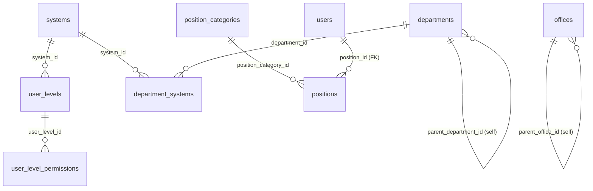

Only `users.position_id -> positions.position_id` is an enforced FK (added in
`02 - alter_table/03 - users_add_position_employee_mustchange.sql`). Everything else in this group
is a conventionally-named, **unenforced** link:

| Table | Purpose | Unenforced links (no DB constraint) |
|---|---|---|
| `systems` | Registry of subsystems (FIMS, …) a user level can be scoped to | — |
| `user_levels` | Named permission levels (e.g. "Department Manager"), optionally scoped to a `system_id` | `system_id` → `systems` |
| `user_level_permissions` | Bitmask (1=View, 2=Add, 4=Edit, 8=Delete) per `(user_level_id, table_name)` | `user_level_id` → `user_levels` |
| `user_level_assignments` | Which user has which level, per system | `user_id` → `users`, `user_level_id` → `user_levels`, `system_id` → `systems` |
| `users` | Login + identity. `user_level_id` is a **comma-separated VARCHAR** (PHPMaker convention), not an FK at all | `department_id` → `departments`, `reports_to_user_id` → `users` (self) |
| `departments` | Org hierarchy; `department_type`/`hierarchy_level` flag org level; `is_budget_unit` flags budget-holding units | `parent_department_id` (self), `office_id` → `offices`, `rc_id` → *intended* `fims.responsibility_code` (see gap in §3) |
| `department_systems` | Which department can access which system, with an `access_level` | `department_id` → `departments`, `system_id` → `systems` |
| `offices` | Physical NHA office locations | `parent_office_id` (self), `rc_id` → *intended* `fims.responsibility_code` (same gap) |
| `user_offices` | A user's office assignments (multi-office support), one flagged `is_primary` | `user_id` → `users`, `office_id` → `offices` |
| `position_categories` | Classification of positions (First/Second/Third Level, Elective, …) | — |
| `positions` | Position **templates** (e.g. "Administrative Assistant III") reusable across departments | `position_category_id` → `position_categories` |
| `plantilla_items` | Authorized staffing slots per department+position, with budget allocation fields | `department_id` → `departments`, `position_id` → `positions` |
| `permission_module_captions` | Admin-editable display caption / hide-flag for a module row in the Permissions Management UI — does not touch `user_level_permissions` itself | — |

### 1.2 Document branding (letterhead/footer composer)

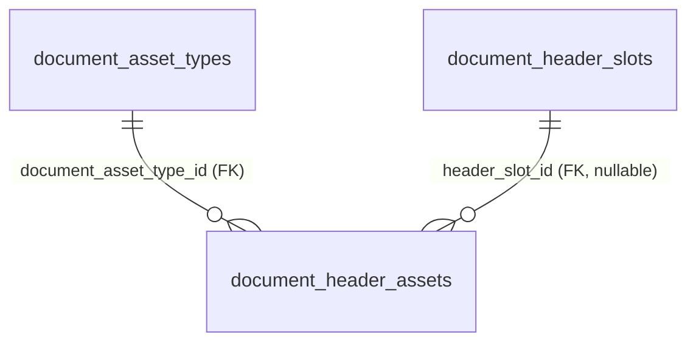

Both relationships here **are** enforced FKs.

| Table | Purpose |
|---|---|
| `document_asset_types` | Kinds of branding asset (`HEADER`, `FOOTER`) and the px size each renders at |
| `document_header_slots` | The 4 managed parts of the NHA letterhead — `LOGO`, `TITLE` (text), `BRAND`, `SEAL` — their left-to-right order and default column width % |
| `document_header_assets` | Uploaded image (or, for `TITLE`, plain text) per slot/scope. `scope_system_code`/`scope_document_code` narrow an asset to one system or document type; `header_slot_id IS NULL` means a legacy whole-header image. A partial unique index enforces **one active asset per `(type, slot, scope)`** |

### 1.3 Collaboration & platform utilities

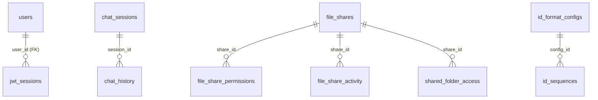

Only `jwt_sessions.user_id -> users.user_id` is enforced. The rest (`chat_history.session_id`,
every `file_share*.share_id`/`user_id`, `id_sequences.config_id`) are unenforced integer links.

| Table | Purpose |
|---|---|
| `jwt_sessions` | Server-side registry of every JWT issued (LIBIS login today) — enables revocation and tamper/discrepancy detection against the token's own claims |
| `chat_sessions` / `chat_history` | AI-assistant chat sessions and their messages, per user |
| `file_shares` / `file_share_permissions` / `file_share_activity` / `shared_folder_access` | S3-backed file sharing: the share itself, per-user permission level, an audit trail, and a "favorites" list |
| `id_format_configs` / `id_sequences` / `id_reset_strategies` | Configurable document-numbering formats (e.g. `PR-FY2025-0001`) and the running counters that back them |
| `notifications` / `notification_reads` | Notification hub (migration `06 - notifications_hub.sql`). `notifications` holds one row per message addressed by `type` (`all`/`system`/`user`/`userlevel`/`office`/`usergroup`) + `target`, with `sender_id` and a unique-when-set `event_key` for de-duping; `notification_reads` records which user has read which notification. Targets are unenforced links, like the other uac tables. See the developer guide §8.6. The table was originally marked "STRICT – DO NOT MODIFY" (PHPMaker-compatible) — the hub adds columns only |
| `audit_logs` | PHPMaker-compatible immutable audit trail (one row per changed field). **Also marked STRICT – DO NOT MODIFY.** `uac.aggregated_audit_logs` is a view that rolls these up one-row-per-save for the dashboard |
| `psgc` | Philippine Standard Geographic Code reference table (regions/provinces/cities) |

---

## 2. `fims` schema — Budgeting, Reference Data & Procurement

### 2.1 Budgeting & reference data

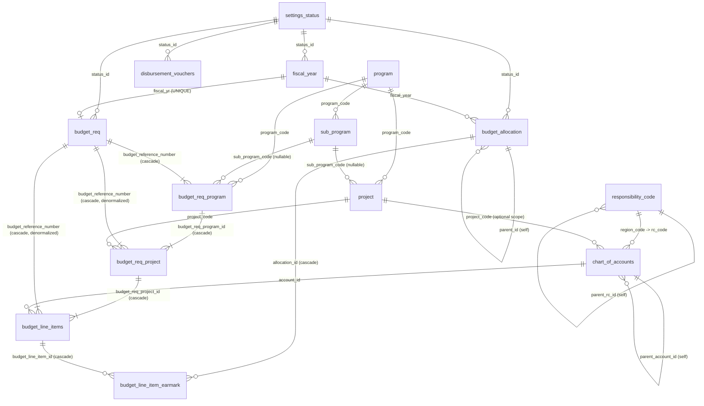

| Table | Purpose / notes |
|---|---|
| `settings_status` | Shared status lookup, scoped per entity via `status_for` (e.g. `'fiscal_year'`, `'budget_req'`). `next_actors` (JSONB; renamed from `actors`) names who acts next on a record that has reached that status |
| `fiscal_year` | One row per fiscal year; PK is the year itself (`SMALLINT`) |
| `program` / `sub_program` / `project` | Budget hierarchy. A project optionally narrows to a `sub_program_code`; a sub-program always belongs to one `program_code` |
| `budget_req` | **One header row per fiscal year** (`UNIQUE(fiscal_yr)`, enforced in `03 - alter_table/04`). Despite the name, it no longer carries an amount, program, or expense class directly — see gap note in §3. Carries `remarks` (nullable `TEXT`, `03 - alter_table/13`): the reason entered when the request was last Returned |
| `budget_req_program` | One Program (optionally + Sub-Program) line added to a `budget_req` header |
| `budget_req_project` | One Project line, nested under a `budget_req_program` row (and, redundantly, under the `budget_req` header directly — see denormalization note below) |
| `budget_line_items` | One chart-of-accounts allocation under a `budget_req_project` row. Carries `proposed_amount`, `suggested_amount`, and the execution-tracking amounts `adjustment` / `obligation` / `disbursement` / `account_payable` (all `NOT NULL DEFAULT 0`). `component_id` / `type_of_fund_id` are present but **have no FK** — see §3. The `program_source_code` / `program_uses` columns that `03 - alter_table/17` and `/18` added were dropped again by `03 - alter_table/22` |
| `budget_revision` | Revises a **budget line** (`budget_line_items` row): changes the From line's amount, or moves the difference to a To line (`to_budget_line_item_id IS NULL` = a plain revision of one line). `from_budget_line_item_id` / `to_budget_line_item_id` hold a `budget_line_items.budget_line_item_id` (`03 - alter_table/23`); `status_id` / `user_id` are plain integers; **none of them has an FK** — not drawn above. The earlier `from_budget_req_id` / `to_budget_req_id` (a budget *request's* id, which no longer exists) are left in place, unused. A line's current amount is `proposed_amount + adjustment`; approving a revision only moves `budget_line_items.adjustment` — the From line goes down, the To line goes up — and never `proposed_amount` |
| `chart_of_accounts` | COA tree (`parent_account_id` self-FK). Optionally scoped to a responsibility center (`region_code -> responsibility_code.rc_code`) and/or a `project_code` |
| `responsibility_code` | RCA (Responsibility Center/Accounting) tree (`parent_rc_id` self-FK). `is_budget_holding_rc` flags units that can hold a budget. `rc_id` is the PK and is `VARCHAR(10)` — see the `uac.departments`/`uac.offices` type-mismatch gap in §3 |
| `type_of_fund` / `component_type` | Small lookup tables (fund source; CO / Other-CO / COE) seeded with a handful of rows. Referenced by `budget_line_items.type_of_fund_id` / `.component_id` **by convention only — no FK exists yet** |
| `budget_allocation` | Memo/PR/PO allocation tracking per fiscal year + requesting RC (the creator's `uac.users.rc_id`) / district, with a `parent_id` self-FK for derived allocations. Built via `CREATE TABLE fims.budget_allocation(); ALTER TABLE ... ADD COLUMN` (see the file for why). `request_referrence_no` (VARCHAR(50) — the spelling is the column's real name) is **generated by the database**: its default is `fims.next_request_referrence_no()`, which takes the next value of a sequence and formats it `RR-001`, `RR-002`, … (it grows past 999, never truncates); unique, never reused (a failed insert leaves a gap). Added, with the existing rows numbered oldest-first, by `03 - alter_table/19`. Most of its columns (`requesting_rc_id` — VARCHAR(50), renamed from `requesting_department_id` in `03 - alter_table/14` — `requesting_district_id`, `program_id`, `sub_program_id`, `project_id`, `category_id`, `user_id`) are **deliberately left unconstrained** — see the comment in `03 - alter_table/08 - budget_allocation_add_fk.sql` for the reasoning per column. `allocation_type` (free-text VARCHAR(20), no CHECK) is the "Memo Request" module's own document type — `CBA` (Certificate of Budget Allocation, the root reservation against a COB), `RFA` (Request for Fund Allotment, draws part of a parent CBA down into an obligation, used under ₱50M) and `LAA` (Letter of Advice of Allotment, same conversion as RFA but ₱50M and above) are the three in active use; `CFA` is named alongside `CBA` in a few guard conditions/comments (e.g. `budget_line_item_earmark`'s header comment, `BudgetLineItemService`'s earmark filters) but never actually produced by the form — treat it as reserved/unimplemented, not a fourth live type. For RFA/LAA, `parent_id` must point at an Approved CBA; `BudgetAllocationService::process()` assigns the final `allocation_number` on last approval, templated by `allocation_type` (`BudgetAllocationService.php` ~L798-814): `CBA` → `CBA <y>-<q><m>-86-<series>`, `RFA` → `<yy><q><m>-<code>-<series>` (`code` 57 for `document_type='COE'`, 87 for `CO`), `LAA` → `LAA <y>-<q><m>-<series>` (no code segment). `dv_id` (added by `03 - alter_table/23 - budget_allocation_add_dv_id.sql`, 2026-11-12) is an RFA row's **soft** link to the one `disbursement_vouchers.dv_id` it currently backs (one DV can draw on several RFA rows, but each RFA row backs only one active DV at a time — enforced by `DisbursementVoucherService`, not a DB FK; see §3) |
| `budget_line_item_earmark` | The CBA/RFA/LAA reservation ledger against `budget_line_items` (added 2026-11-12, `01 - table/26`). One row per Approved `budget_allocation` line "holding" an amount against a line item's balance — reserved only, separate from `budget_line_items.obligation`/`disbursement`/`account_payable`. A line item's still-available balance = `suggested_amount + adjustment - obligation - SUM(amount) WHERE status = 'active'` (the FMD-approved `suggested_amount`, not the requester's `proposed_amount`). `status`: `active` (default, while its CBA stays Approved) → `released` (its CBA was deleted — amount freed back) or `converted` (an RFA/LAA naming this row's allocation as `parent_id` was itself Approved: `BudgetLineItemService::convertEarmarkForRfaApproval()` shrinks — or fully flips — the CBA's own row by the drawn amount, inserts a **separate** `converted` row attributed to the RFA/LAA's own `allocation_id` so each draw stays traceable, and raises `budget_line_items.obligation` by that same amount — the real commitment). `original_amount` (added `03 - alter_table/23 - budget_line_item_earmark_add_original_amount.sql`, 2026-11-12) freezes the amount the row was first created with, since `amount` itself shrinks on every partial RFA/LAA draw — used so "where this COB's balance is held" can show a CBA's originally-approved figure, not its current remainder. Both `budget_line_item_id` and `allocation_id` are enforced FKs, `ON DELETE CASCADE` |
| `ip_filemeta` | One uploaded file (or typed link / reference) of a Supporting Document: `document_name VARCHAR(225)`, `link TEXT` (the object-storage key, or the link), `created_by`, a unique `node_id` UUID (default `gen_random_uuid()`), `created_at` / `updated_at`, soft-delete `deleted_at`. Written by `FileUploadServices` (`01 - table/17`) |
| `file_attachments` | Groups files: one `multiple_node_id` UUID per upload batch, one row per file with that file's `ip_filemeta.node_id` as `file_node_id` (+ its own `node_id`, `created_by`, timestamps, `deleted_at`). The owning record stores the `multiple_node_id` (`budget_allocation.multiple_node_id`). No FKs, by convention (`01 - table/18`) |

**Denormalization, twice:** `budget_line_items` carries both `budget_req_project_id` (the real
parent) and `budget_reference_number` (the grandparent header), and `budget_req_project` carries
both `budget_req_program_id` (the real parent) and `budget_reference_number` (same grandparent).
Both are intentional — see the comments in `03 - alter_table/03` and `03 - alter_table/05` — so
existing header-level joins/counts keep working without walking the full chain. The service layer
keeps both columns in sync on write; nothing in the DB enforces that they agree.

### 2.2 Vendors & procurement

API: `app/routes/vendor.php`, `app/routes/purchase-order.php` (see `app/routes/README.md`).
Pages: `app/pages/po/{page,form,readone}.php`.

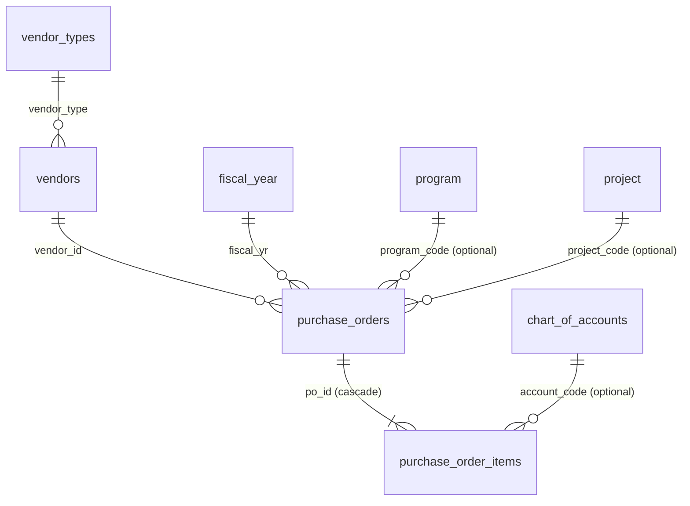

| Table | Purpose / notes |
|---|---|
| `vendor_types` | Valid vendor categories (`SUPPLIER`, `CONTRACTOR`, `CONSULTANT`, `SERVICE_PROVIDER`, `EMPLOYEE` — seeded). `vendor_type` is UNIQUE so `vendors` can FK to it by value |
| `vendors` | Suppliers/contractors/consultants. `vendor_code` is UNIQUE; `vendor_type` is a real FK (by value, not id) |
| `purchase_orders` | One PO. `po_number` UNIQUE (`PO-YYYY-MM-NNNN`). Vendor name/address/TIN are a **snapshot** copied from `vendors` on save, so later vendor edits don't rewrite history. `status`: `DRAFT → SUBMITTED → APPROVED / REJECTED`; `DRAFT`/`SUBMITTED`/`REJECTED` can be `CANCELLED`. `expense_class` here is a free-text column with its own `CHECK (... IN ('PS','MOOE','CAPITAL_OUTLAY','CO','OTHER'))` — **it is not the same vocabulary as, or linked to, `fims.expense_class`** (see §3) |
| `purchase_order_items` | Line items. `total_cost` is generated (`ROUND(quantity_ordered * unit_cost, 2)`); `(po_id, line_number)` is UNIQUE. `account_code` FKs to `chart_of_accounts.account_code` — the **only** FK in this schema that targets an alternate key instead of the primary key |

**Deliberately not ported** from the predecessor project's `fmd.purchase_orders`: parent purchase
request, budget allocation, fund source, fiscal period, workflow engine/payment workflow — none of
those tables exist in `fims`. (Delivery receipts do now exist, but as the separate, PO-number-keyed
IAR module in §2.4 — **not** linked to `purchase_orders`.) Status changes are driven entirely by
`PurchaseOrderService::changeStatus()`, not a workflow engine.

### 2.3 Disbursement Vouchers & Journal Entries

API: `app/routes/voucher.php` (see `app/routes/README.md`). Pages: `app/pages/voucher/{page,form,readone}.php`.
Service: `DisbursementVoucherService`. One generic voucher shape backs every claimant/payment type
(vendor payment, payroll, reimbursement, …) — the paper General Form No. 1 is itself one layout;
what differs is only what gets written into Particulars/Amount.

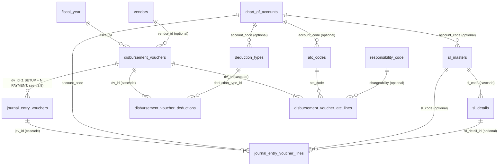

| Table | Purpose / notes |
|---|---|
| `disbursement_vouchers` | One DV header. Pipeline: `DRAFT → FOR_FMD_REVIEW → FOR_ACCOUNTING → FOR_TREASURY → RELEASED` (Originating → FMD checks the obligation → Accounting processes → Treasury releases), or `REJECTED` (notes required) / `CANCELLED` from any non-terminal stage — see `DisbursementVoucherService::TRANSITIONS`/`authorizeTransition()`. `status_id` FKs to `settings_status` (`status_for = 'disbursement_voucher'`, seeded in `02 - sample_data/01 - fims_settings_status.sql`) — same shared-lookup convention as `budget_req`/`budget_allocation`; resolved by name via `DisbursementVoucherService::getStatusIdByName()`, so the pipeline names above are unchanged, only their storage moved off a free-text column (`03 - alter_table/21`). `account_code` is **required**, must be `posting_allowed` — validated in PHP, not a DB FK (the Journal Entry's auto-filled Dr line, see `readone.php`'s `vje_syncAutoLines`, would otherwise be blank). `net_amount` is a **service-computed snapshot** (`gross_amount - total deductions - total withholding tax`), not a generated column — it started as one (`gross - vat - wtax`) but those columns were dropped once deductions/withholding became repeating tables (`03 - alter_table/17`). `budget_amount`/`obligation_amount`/`payments_prior_amount`/`balance_amount` are likewise snapshots, stamped at save time from the selected RFA and recomputed on every `create()`/`update()`/`saveJournalEntry()` call — see the denormalization note below |
| `journal_entry_vouchers` | The accounting entry Accounting prepares during `FOR_ACCOUNTING` (`jev_no` auto-numbered `JEV-{YY}-{MM}-{NNNN}`). Originally **one per DV** (`dv_id` was `UNIQUE`); as of §2.8's 2026-11-15 extension a DV carries **one `SETUP` JEV plus any number of `PAYMENT` JEVs** (`jev_type`), and a JEV can now have **no DV at all** (`dv_id` nullable — standalone period-end entries). The old `UNIQUE(dv_id)` was replaced by a **partial unique index** `uq_journal_entry_vouchers_dv_id_setup` (`WHERE jev_type = 'SETUP'`), so "at most one SETUP JEV per DV" still holds while PAYMENT rows are unconstrained — see §2.8 for the full column set (`jev_type`, `jev_classification`, `source_module`, `doc_ref_no`, `book_id`, `status_id`). `total_debit`/`total_credit` are a snapshot of the lines, must be equal and >0 before `FOR_ACCOUNTING → FOR_TREASURY` is allowed (`changeStatus()`) |
| `journal_entry_voucher_lines` | Debit/credit lines (`UNIQUE(jev_id, line_number)`; exactly one of debit/credit nonzero — validated in PHP, not a CHECK constraint, same convention as `purchase_order_items`). `account_code` is a required FK to `chart_of_accounts` (`posting_allowed` enforced in PHP). `sl_code`/`sl_detail_id` are optional Subsidiary Ledger breakdown columns — not every line needs one |
| `sl_masters` / `sl_details` | Subsidiary Ledger registry, added for the Accounting Entries grid's SL Code/SL Detail columns — this project had **no SL infrastructure at all** before. An `sl_masters` row optionally ties to one `chart_of_accounts` control account (e.g. one Accounts Payable row per major vendor); `sl_details` further splits a master (e.g. by PO/contract) |
| `deduction_types` | Lookup of non-tax deductions a DV's gross can be reduced by (e.g. contractor retention — currently the only seeded row). `account_code` (optional) is the GL account the Accounting Entries grid auto-credits when this type is used — see the auto-fill note below |
| `disbursement_voucher_deductions` | Deduction line items, entered by **Originating** at DV creation/edit (`app/pages/voucher/form.php`), not by Accounting. `deduction_amount` is either `gross_amount * rate / 100` or typed directly when `rate IS NULL` — enforced in PHP |
| `atc_codes` | BIR Alphanumeric Tax Codes (withholding tax classifications). `account_code` (optional) is the liability account (e.g. Due to BIR) the Accounting Entries grid auto-credits |
| `disbursement_voucher_atc_lines` | Withholding tax lines, entered by **Accounting** alongside the Journal Entry (`saveJournalEntry()` saves both together) — replaces an earlier single `disbursement_vouchers.atc_code` column, since one DV can withhold under more than one ATC at once. `withholding_tax` (`tax_base * rate / 100`) is server-computed, never trusted from the client. `chargeability` optionally FKs to `responsibility_code` |

**Journal Entry auto-fill:** the Accounting Entries grid (`readone.php`'s `vje_syncAutoLines()`) generates a Dr line for the DV's own `account_code` (full `gross_amount`), a Cr line per Deduction/ATC row whose type/code has an `account_code` mapped, and a Cr Accounts Payable line for whatever's left — live-synced as Accounting adds/edits ATC rows, until the Journal Entry is saved once (saved lines are then respected as-is, even if more ATC rows are added later). This is why `deduction_types.account_code` / `atc_codes.account_code` exist — they're what makes the auto-fill possible, not just descriptive metadata.

**Snapshots, not live joins:** `budget_amount`/`obligation_amount`/`payments_prior_amount`/`balance_amount`/`net_amount` on `disbursement_vouchers` all reflect the state *as of that voucher's own last save* — same convention as `fims.purchase_orders`' snapshot vendor fields. Several DVs can draw against the same RFA over time (progress payments — see `payments_prior_amount` = sum of `net_amount` from every other active voucher on that RFA, computed at save time); an **earlier** voucher's own stored figures don't retroactively update when a **later** one is saved, matching how a signed paper DV isn't edited after the fact.

**Not enforced by a DB constraint** (validated in `DisbursementVoucherService`, not the schema): `disbursement_vouchers.rfa_allocation_id` (→ `fims.budget_allocation` — that table has no CRUD backend of its own yet) and `disbursement_vouchers.requesting_department_id`.

### 2.4 Inspection and Acceptance Report (IAR)

API: `app/routes/po_dr.php` (`/po-dr/*`). Service: `PoDrService`. Page: `app/pages/iar-module.php` +
`app/pages/form/dr-module-form.php` (PHPMaker page `IarModule`). SQL: `01 - table/25 - fims_inspection_acceptance_report.sql`.

**One table.** One PO number has **one IAR** row, and that row's `line_transaction` (JSONB array) holds the PO's
**delivery receipts (DR)**; each DR holds its account rows (account code, account title, amount) and, from a total of
50,000, the optional items (any number, one line each). The total of a DR may not exceed the PO balance.

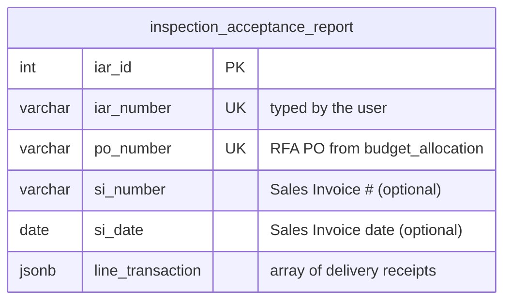

`line_transaction` element (one per delivery receipt):

```json
{ "dr_number": "DR-001", "delivery_date": "2026-11-12", "total_amount": "800000.00",
  "lines": [ { "account_code": "1-06-05-030", "account_title": "Information and Communications Technology Equipment", "amount": "600000.00" },
             { "account_code": "5-02-03-990", "account_title": "Other Supplies and Materials Expenses", "amount": "200000.00" } ],
  "items": [ { "description": "...", "serial_no": "...", "amount": "600000.00", "property_no": "..." } ] }
```

| Table | Purpose / notes |
|---|---|
| `inspection_acceptance_report` | The IAR, one row per PO number. `iar_number` is **typed by the user** (required; `PoDrService` checks it isn't used by another PO) and can be edited later. `po_number` and `iar_number` are both `UNIQUE`. Holds the Sales Invoice # / date (entered once per PO). `line_transaction` is a JSONB array (`CHECK (jsonb_typeof(...) = 'array')`, GIN-indexed) of delivery receipts. `total_amount` of each DR is the sum of its line amounts (computed by the app) and is what counts toward the PO balance. `items` are stored only when the DR total is 50,000 or more. The `dr_number` (unique within the PO) and each item's `serial_no` (unique across all items of all DRs) are checked in PHP — JSONB array elements can't carry a DB unique key — so there are no `po_delivery_receipt` / entry tables and no FK; deleting the row deletes its DRs |

**Pro-forma JEV (not stored separately).** The "Pro-forma" action shows each delivery receipt's
account rows as debits plus one credit of the DR total to `2-01-01-010` Accounts Payable (account titles are the ones stored with the rows) in the accounting
grid (`PoDrService::proforma()`). The Subsidiary Ledger columns are not populated. The Create JEV button
is a placeholder — it does not write to `journal_entry_vouchers` yet.

### 2.5 Property Records

API: `app/routes/property_record.php` (`/property-record/*`). Service: `PropertyRecordService`. Page: `app/pages/property-record-page.php` (PHPMaker page `PropertyRecordPage`). SQL: `01 - table/34 - fims_property_records.sql`.
External source: the NHA Property Inventory System (PIS) API (`inventory_by_po`), searched by PO number — only a PO that already has an IAR can be searched, and only PAR items (PIS `TYPENO` 1) can be saved.

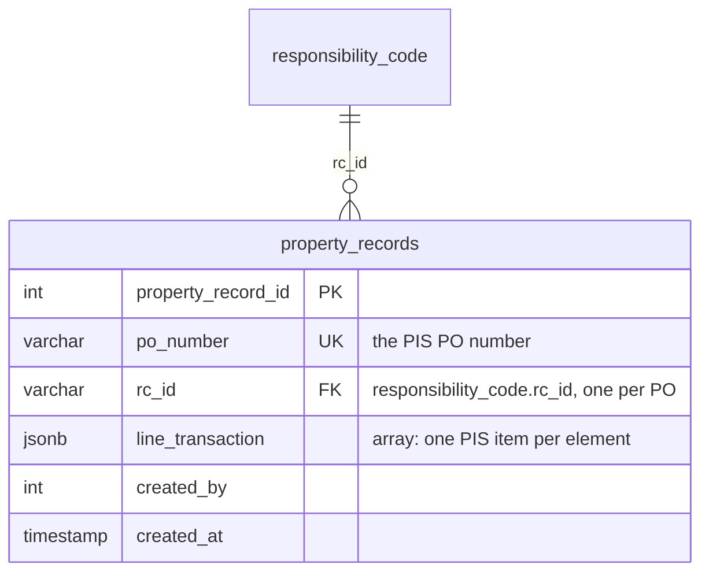

`line_transaction` element (the PIS fields that are kept, under the PIS's own names): `inv_id, TYPENO, GL, accnt_desc, GLCODE_SUB, inv_glcode_sub, PROPNO, SNO, ITEMDESC, MODELNO, DATEACQD, COST, UNIT, SERV, RCCODE, dept_proj_desc, PO_NO, DEPTCD, District`.
The PO date and the IAR number are not stored (they stay in the IAR module; the list joins the IAR by PO number). The register shown in the list (combined units, acquisition cost, depreciation) is computed when the page loads — nothing of it is stored.

### 2.6 Treasury operations: Bank Management, Cash Position, Check Processing

API: `app/routes/bank-management.php`, `cash-position.php`, `check-processing.php`. Services:
`BankManagementService`, `CashPositionService`/`CashPositionSoaService`/`CashPositionReportsService`,
`CheckProcessingService`. Pages: `bank-management-page.php`, `cash-position-page.php`,
`check-disbursement-voucher-page.php`. Ported from the separate `TREASURY` reference project — see
developer guide §8.6 for which TREASURY page/service each one came from and what was deliberately
left unported. **Not independently re-verified live as of this writing** — installed and read from
code, not confirmed against a running dry-run database the way §1/§2.1–§2.5 were.

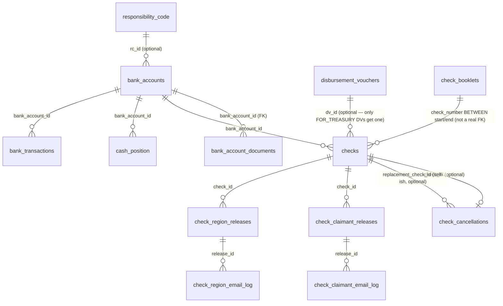

| Table | Purpose / notes |
|---|---|
| `bank_accounts` | One row per disbursing bank account. `fund_source` is free text (no `shared.fund_sources` lookup, unlike TREASURY); `rc_id` (Responsibility Center, unenforced) replaces TREASURY's department-based scoping. `status` (ACTIVE/DORMANT/CLOSED, `03 - alter_table/23`/`24`) is kept in sync with the pre-existing `is_active` boolean |
| `bank_account_documents` | Google-Drive-link attachments per bank account (not uploads) — added alongside the `status`/`rc_id` columns in `03 - alter_table/23` |
| `checks` | One row per issued check — the central table of the Check Disbursement Voucher module. Status progression tracked here backs Check Preparation, and is read by every other check-processing tab. `status` values were uppercased in `03 - alter_table/25` |
| `check_booklets` | One row per received booklet/batch of pre-numbered blank check forms (Check Registry tab). "Received/Issued/Cancelled/Remaining/Stock Status" are **computed from `checks` rows whose `check_number` falls in `[start_check_no, end_check_no]`**, not stored here |
| `check_register` | A **standalone** ledger of every physical blank check form received, ported verbatim from TREASURY's `treasury.check_register` — deliberately decoupled from `checks` (which tracks a check actually prepared/issued) |
| `check_cancellations` | One row per cancelled check (Cancellation & Replacements tab); `replacement_check_id` optionally self-references the newly-prepared replacement `checks` row. The cancelled check's own `checks.status` is separately flipped by the service |
| `check_claimant_releases` / `check_claimant_email_log` | Released-to-Claimants tab (incl. its Unclaimed/Unreleased sub-tab, filtered by `status = 'UNCLAIMED'`) and the email notices sent for it |
| `check_region_releases` / `check_region_email_log` | Released-to-Regions/Departments tab (Check Tracking, Acknowledgment, and "Return Paid DVs" sub-tabs all read this one table) and its email notices. `region_dept` is a free-text snapshot (e.g. "Region 3"), not an FK. Columns for a Google-Drive attachment exist but `CheckProcessingService::saveRegionDriveLink()` is still a stub |
| `cash_position` | One row per bank account per day, ported from TREASURY's `treasury.cash_position`. `available_balance` is a **generated column** (`closing_balance - restricted_amount`). Backs Check Preparation's cash-availability check as well as the Cash Position module itself |
| `cash_position_activity_log` | One row per manual Position-Updates create/update action ("Recent Update Activity" panel) |
| `bank_transactions` / `soa_transactions` | The bank-statement ledger fed by SOA (bank Statement of Account) uploads — `soa_transactions` is the raw parsed upload, `bank_transactions` the resulting ledger rows (`bank_transactions.transaction_id` is a **deterministic string**, not a sequence, so re-uploading the same statement doesn't duplicate rows) |

Reports tab note: `CashPositionReportsService` runs 18 report types off one `report_type` dispatch;
daily/period/working-paper/individual-ledger/new-FY-opening-balance are real against the tables
above, the rest (`cash_flow`, `investment`, `interest_earnings*`, `garnished`, `expropriation*`,
`investment_schedule`) are intentionally stubbed — their source tables (Collections, Investments,
FTLA, Garnished/Expropriation Accounts) don't exist in this schema at all.

### 2.7 Fund Tracking (SARO / NCA / Trust Funds / Supplemental) and small lookups

API: `app/routes/fund_tracking.php`, `fund_tracking_type.php`, `nature_of_fund.php`, `agency.php`.
Service: `fund_trackingServices.php` (+ `fund_tracking_typeServices.php`, `nature_of_fundServices.php`,
`agencyServices.php`). Pages: `saro-registry-page.php`, `supplemental-funds-page.php`,
`trust-funds-page.php`, `fund-sourcing-dashboard-page.php` — all four read the **same** table, filtered
differently (see developer guide §8.7). **Not independently re-verified live**, same caveat as §2.6.

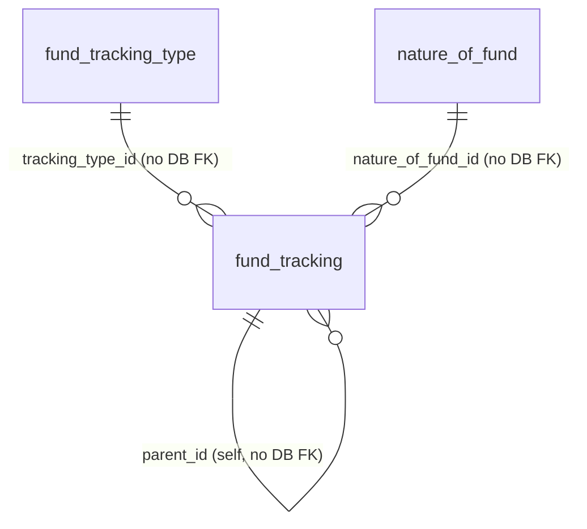

| Table | Purpose / notes |
|---|---|
| `fund_tracking` | One row per SARO/NCA/Trust Fund/OR document. `parent_id` links a record to the one it was released/derived from (e.g. an NCA to its SARO); `multiple_node_id` groups rows saved together. **Declares no FOREIGN KEYs at all** — `fund_trackingServices::validateReferences()` checks every id/code in PHP instead. `agency_name` references `fims.agency` **by name, not id** |
| `fund_tracking_type` | Lookup: `SARO` (Special Allotment Release Order), `NCA` (Notice of Cash Allocation), `TRUST` (Trust Fund), `OR` (Obligations Request). `GAAAO` and `SUPPLEMENTAL` are deliberately **not** here — they're natures of fund, not tracking types |
| `nature_of_fund` | Lookup: Insertions, Equity, GAAAO, Unprogrammed, Supplemental |
| `agency` | Lookup of source agencies (name only); `fund_tracking.agency_name` stores the chosen name as a string, not this table's id |

**Pricing Requests gap:** `PricingRequestService` (Fund Sourcing Division pricing requests, keyed by
`project_code`) targets `fims.pricing_requests` / `fims.pricing_request_attachments`, but **no SQL
file anywhere in this repo creates either table** — see developer guide §7.6. Not drawn above since
there's no schema to diagram yet.

### 2.8 JEV approval → GL/SL posting → Journals & Trial Balance

Drafted 2026-11-14, **implemented the same day**: `fims.general_ledger` (`01 - table/38`),
`journal_entry_vouchers.status_id`/`posted_by`/`posted_at` (`03 - alter_table/29`), their
`journal_entry_voucher` status seed rows (`02 - sample_data/11`), and `fims.v_journals`/
`fims.v_trial_balance` (`05 - views/01` — a new top-level folder for `fims`, mirroring `uac`'s
`03 - views`). Service: `app/services/GeneralLedgerService.php`, called from
`DisbursementVoucherService::changeStatus()`.

> **Extended 2026-11-15 (uncommitted in `_assets/sql/` as of this writing — read from code, not
> re-verified against a fresh install):**
> - **Books of Accounts** — `fims.books` (`01 - table/41`: Main Office, CISFA, NGC, MPLC/PPMO, PPMO)
>   plus `book_id` columns on `journal_entry_vouchers`, `general_ledger`, and `official_receipts`
>   (`03 - alter_table/30`). Book is an **Accounting classification chosen on the DV's Accounting
>   Entries section** (`persistJournalEntry()`'s `$bookId`), *not* a DV-header field — so
>   `disbursement_vouchers` deliberately has no `book_id`; it's tagged on the JEV and copied down to
>   each `general_ledger` row at post time (same snapshot convention as `fiscal_yr`). All four ledger
>   reports scope by it.
> - **Payment JEVs** — `journal_entry_vouchers.jev_type` (`SETUP` default | `PAYMENT`),
>   `source_module` (`ACCOUNTING` | `TREASURY`), `doc_ref_no` (e.g. `CHECK NO. 001`), and matching
>   `source_module`/`doc_ref_no` on `general_ledger` (`03 - alter_table/31`). The old `UNIQUE(dv_id)`
>   became a **partial unique index** `uq_journal_entry_vouchers_dv_id_setup` (`WHERE jev_type =
>   'SETUP'`). `bank_accounts.account_code` (nullable FK → `chart_of_accounts`) maps each bank account
>   to the Cash GL account its outflow credits. See the payment-settlement design note below.
> - **JEV classification** — `journal_entry_vouchers.jev_classification` (`03 - alter_table/32`:
>   `REGULAR` default | `ACCRUAL` | `DEPRECIATION` | `PREPAYMENTS` | `CLOSING`, `CHECK`-constrained).
>   A **business/reporting label, independent of `jev_type`** (which is GL-posting mechanics).
> - **Standalone (no-DV) JEVs** — `journal_entry_vouchers.dv_id` made nullable (`03 - alter_table/33`)
>   so Accounting can book period-end adjusting/closing entries directly, with no Disbursement
>   Voucher. The partial unique index still works (Postgres treats NULLs as distinct). New service
>   methods `createStandaloneJev()`/`updateStandaloneJev()`/`deleteStandaloneJev()`/`postStandaloneJev()`
>   and `/voucher/journal-entry/*` routes back the new Add-JEV form.
> - **JEV-register view** — `fims.v_journal_entry_vouchers` (`05 - views/02`): one row per JEV header
>   with its DV/book/status labels, replacing an inline join; `fims.v_journals`'s DV join was changed
>   to a `LEFT JOIN` so standalone (no-DV) postings still appear.

Route + UI added the same day, as **four separate modules** (General Ledger, Subsidiary Ledger,
Journals, Trial Balance are each their own page — not tabs of one page; see developer guide §8.5 for
the full table of which page/endpoint shows what), all under `app/routes/general_ledger.php`
(every endpoint read-only — posting is never reachable via a route) and a new "Ledgers" sidebar
group. **Verified three times, increasingly end-to-end**:

1. A `BEGIN…ROLLBACK` dry run against the `fims-nha-postgres` docker-compose container (install
   order, the partial unique index rejecting a raw duplicate post, a full post+reverse cycle netting
   an account to exactly 0.00).
2. The migration applied for real to the app's actual database (`host.docker.internal:5432/fims` —
   the separate `fims-nha-postgres` container on port 5433 is *not* what `fims-nha-php` connects to,
   see developer guide §10), all four pages confirmed rendering 200 with no PHP errors, and the
   "Ledgers" menu group appearing on `/MainDashboard`.
3. A full `curl` round-trip with a real session cookie: created a DV, approved it to `FOR_TREASURY`
   (posting fired), confirmed General Ledger / Subsidiary Ledger (a second DV with an `sl_code` on
   its JEV line) / Journals / Trial Balance **all** show it with correctly-signed running balances;
   cancelled it (`reverseJev()` fired) and confirmed both ledger cards net back to exactly `0.00`.

When a DV is approved on the Accounting side (`FOR_ACCOUNTING → FOR_TREASURY`, the transition that
already requires its JEV to exist and balance — see §2.3), the JEV itself is now also
approved/posted in the same DB transaction, and its lines flow into the General Ledger that
Subsidiary Ledger reports, the Journals register, and the Trial Balance all read from.

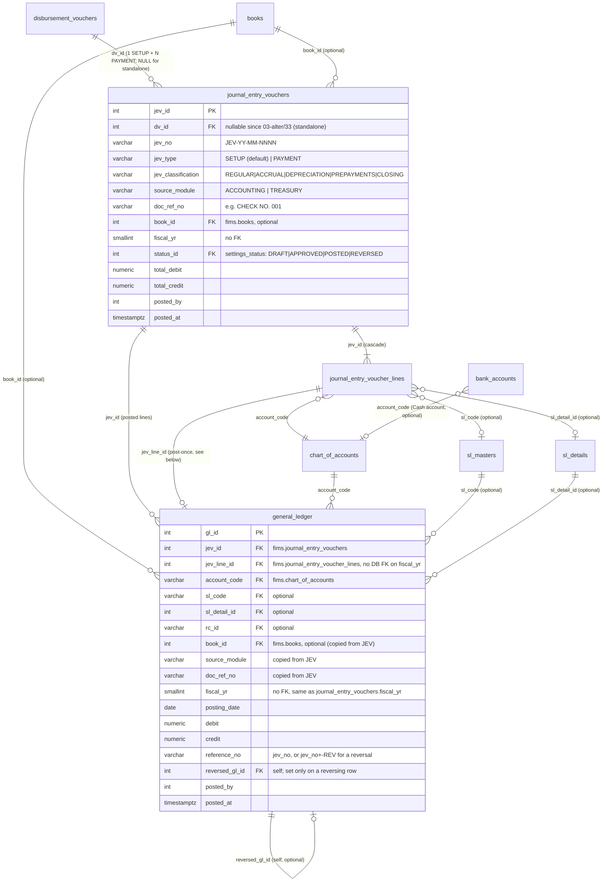

**Trial Balance, the Journals register, and the JEV register are VIEWs, not stored tables** —
consistent with how this repo already prefers computing reports live rather than maintaining a
parallel stored summary (e.g. Cash Position's generated `available_balance` column). `fims.v_journals`
joins the JEV/DV/account/SL/**book** labels onto each posted `general_ledger` line (its DV join is a
`LEFT JOIN` so standalone no-DV postings still show); `fims.v_trial_balance` groups by `fiscal_yr` +
**`book_id`** + `account_code`; `fims.v_journal_entry_vouchers` (new in `05 - views/02`) gives one row
per JEV **header** with its `jev_type`/`jev_classification`/`source_module`/`doc_ref_no`/book and both
`jev_status`/`dv_status` labels — it backs the JEV register page's list and search.

**Process flow:**

Standard process flowchart (terminators as stadium nodes, processes as rectangles, decisions as
diamonds). The `fims.general_ledger` INSERT is drawn as a data/IO step (parallelogram):


> A JEV row is only ever created by `saveJournalEntry()` at the `FOR_ACCOUNTING` stage — there is no
> auto-created empty JEV on DV add. `sl_code`/`sl_detail_id`/`rc_id` ride straight from the JEV line
> onto each posted `general_ledger` row — there is no separate SL posting step. `postJev()` is
> idempotent (a retried `FOR_ACCOUNTING → FOR_TREASURY` is rejected by the state machine, so no
> double-post); `RELEASED` is terminal, so `FOR_TREASURY → CANCELLED` is the only point a posted JEV
> can still be reversed.

**Standalone (no-DV) JEVs** skip this whole DV pipeline — Accounting prepares a period-end
adjusting/closing entry directly via the Add-JEV form (`createStandaloneJev()`, `dv_id IS NULL`,
always `DRAFT`), then posts it with its own explicit action (`postStandaloneJev()` →
`GeneralLedgerService::postJev()`), since there's no `FOR_ACCOUNTING → FOR_TREASURY` transition to
ride on.

**Design notes (as actually built, differences from the original draft called out):**

- **JEV gets `status_id`**, resolved through `fims.settings_status` with
  `status_for = 'journal_entry_voucher'` — same shared-lookup pattern as
  `disbursement_vouchers.status_id`. **Correction (2026-11-15):** the 2026-11-14 draft collapsed this
  to two statuses (`DRAFT → POSTED`) and dropped `APPROVED`; `APPROVED` is now back in the seed
  (`02 - sample_data/11` seeds all four: `DRAFT`, `APPROVED`, `POSTED`, `REVERSED`, and
  `journal-entry-voucher.php` has a badge for each). **In practice the posting path still writes
  `DRAFT → POSTED` directly** — `postJev()`'s own docstring says "flips it DRAFT → APPROVED → POSTED"
  but the code sets `status_id` to `POSTED` in one step; no code path currently writes the `APPROVED`
  row. It exists in the lookup/UI for the lifecycle's sake, not as an observed intermediate state.
- **Posting is triggered by the existing `FOR_ACCOUNTING → FOR_TREASURY` transition**, not a separate
  "approve JEV" action — `DisbursementVoucherService::changeStatus()` now wraps its own status
  update **and** `GeneralLedgerService::postJev()` in one `BEGIN…COMMIT`/`ROLLBACK` (that method
  wasn't transactional before this change; it is now).
- **`general_ledger.jev_line_id` is unique only among *original* postings** — a **partial unique
  index** (`WHERE reversed_gl_id IS NULL`), not a plain `UNIQUE` constraint as first drafted. A plain
  `UNIQUE` would have made reverseJev() impossible: a reversing row legitimately re-states the same
  `jev_line_id` with debit/credit swapped. `postJev()` is still idempotent — re-running it against an
  already-`POSTED` JEV is a no-op success.
  `fiscal_yr` has no FK (same looseness as `journal_entry_vouchers.fiscal_yr` itself).
- **Reversal only fires on `FOR_TREASURY → CANCELLED`**, not "a `RELEASED` DV later cancelled" as the
  draft said — `DisbursementVoucherService::TRANSITIONS` makes `RELEASED` terminal (nothing moves out
  of it), so `FOR_TREASURY → CANCELLED` is the *only* transition where a DV can be cancelled after
  its JEV was already posted. `reverseJev()` inserts one offsetting `general_ledger` row per original
  line (debit/credit swapped, `reversed_gl_id` pointing back) and flips the JEV to `REVERSED` — never
  deletes a posted row, same "never delete, link instead" convention as
  `check_cancellations.replacement_check_id`.
- **SL (Subsidiary Ledger) and Responsibility Center need no new table** —
  `journal_entry_voucher_lines.sl_code`/`sl_detail_id`/`rc_id` already exist (§2.3); posting just
  copies them onto the `general_ledger` row so SL-level reports can filter `general_ledger` directly
  instead of re-joining back to the JEV.

**Design notes — 2026-11-15 extension:**

- **Payment settlement is a second JEV, not an edit** (`03 - alter_table/31`). The SETUP JEV
  Accounting posts at `FOR_ACCOUNTING → FOR_TREASURY` typically raises Accounts Payable (Cr
  `2-01-01-010`); nothing used to settle it when Treasury actually paid — AP sat forever at its
  setup-time balance and Cash never moved. `CheckProcessingService::prepareCheck()` now calls
  `GeneralLedgerService::postPaymentJev()` right after the DV is `RELEASED`, which **inserts a distinct
  `journal_entry_vouchers` row** (`jev_type = 'PAYMENT'`, `source_module = 'TREASURY'`,
  `doc_ref_no = 'CHECK NO. …'`, its own JEV number) — Dr Accounts Payable / Cr the **bank account's
  mapped Cash account** (`bank_accounts.account_code`) — and posts it through the same `postJev()`. A
  bank account with no `account_code` mapped **errors out** (doesn't guess); a SETUP JEV that never
  routed through AP (paid straight from Cash) is a clean **no-op, not an error**. This is why `dv_id`
  is no longer plain-`UNIQUE` — one DV legitimately has a SETUP JEV *and* one or more PAYMENT JEVs.
- **`jev_type` (SETUP/PAYMENT) and `jev_classification` (REGULAR/ACCRUAL/…) are orthogonal**
  (`03 - alter_table/32`). `jev_type` is GL-posting mechanics — it's what the partial unique index and
  `postPaymentJev()` key off to tell Accounting's setup entry from Treasury's settlement entry for the
  same DV. `jev_classification` is a business/reporting label; a SETUP or PAYMENT JEV can carry any
  classification, and nothing about posting behavior changes with it. It defaults to `REGULAR` so every
  pre-existing JEV backfills cleanly.
- **Book is tagged on the JEV, never on the DV** (`03 - alter_table/30`). An earlier cut put `book_id`
  on `disbursement_vouchers` and copied it down, but that framed it as an Originating-time decision
  when it's really Accounting's call when they prepare the Journal Entry — so `disbursement_vouchers`
  has **no `book_id`**; it's set in `persistJournalEntry()` and copied onto each `general_ledger` row
  at post time (snapshot, not a live join — same as `fiscal_yr`). `fims.checks`/`ada_releases` need no
  book column of their own: CKDJ/ADADJ read it through the JEV they join to. `fims.books` **replaced an
  earlier attempt** to reuse `fims.type_of_fund` as the "Book" dimension — that was the wrong axis
  (fund cluster, not office/program entity); `type_of_fund` stays as-is for `budget_line_items`.
- **Standalone JEVs reuse the whole posting machinery** (`03 - alter_table/33`). `dv_id` is nullable
  so `createStandaloneJev()` can write a `DRAFT` JEV with no DV; the partial unique index
  (`WHERE jev_type = 'SETUP'`) tolerates any number of them because Postgres never treats two NULLs as
  equal. `postStandaloneJev()` is just a thin wrapper over `GeneralLedgerService::postJev()` — the
  standalone equivalent of the DV transition that fires posting. `fims.v_journals`'s DV join became a
  `LEFT JOIN` for exactly this reason (an INNER JOIN would have hidden every standalone posting).

---

## 3. Cross-schema links & known gaps

| From | To | Enforced? | Note |
|---|---|---|---|
| `uac.users.region_code` | `fims.responsibility_code.rc_code` | **Yes** (FK) | Scopes a user to one RCA code for Chart-of-Accounts row-level security; `NULL` = unrestricted. Superadmin (`user_level_id` containing `-1`) always bypasses it regardless |
| `uac.departments.rc_id` | `fims.responsibility_code.rc_id` | **No — can't be**: type mismatch | `departments.rc_id` is `int4`; `responsibility_code.rc_id` is `VARCHAR(10)`. The column exists ("Responsibility Center Code for financial tracking") but cannot physically FK to the table it's named after. Same issue on `uac.offices.rc_id` |
| `fims.expense_class` | *(nothing)* | — | Seeded with `CO`/`PS`/`MOOE`/`EO` but **no longer referenced by any FK** — `budget_req.expense_class_id` (its only consumer) was dropped in `03 - alter_table/02 - budget_req_remove_expense_class_flow.sql`. `purchase_orders.expense_class` is a separate, differently-valued free-text column, not a link to this table. Orphaned lookup table; confirm nothing reads it before dropping |
| `fims.budget_line_items.component_id` / `.type_of_fund_id` | `fims.component_type` / `fims.type_of_fund` | No | Named and seeded to match, but no FK constraint exists yet (see table comment in `03 - alter_table/06`) |
| `fims.budget_revision.from_budget_line_item_id` / `.to_budget_line_item_id` | `fims.budget_line_items.budget_line_item_id` | No | New in `03 - alter_table/23`; no FK, so nothing stops a dangling value — a Draft request's Program edit deletes and re-creates its lines — and a revision whose line is gone (or that was filed before budget lines were revised) still lists, with the line's details blank. The legacy `from_budget_req_id` / `to_budget_req_id` columns point at nothing |
| `fims.budget_allocation.{program,sub_program,project}_id` | `fims.{program,sub_program,project}` | No — can't be | Those tables are keyed by `*_code VARCHAR`, not an integer id; `budget_allocation` stores integers. Intentionally unconstrained per `03 - alter_table/08` |
| `fims.disbursement_vouchers.rfa_allocation_id` | `fims.budget_allocation.allocation_id` | No | `fims.budget_allocation` has no CRUD backend of its own yet (see §2.1); `DisbursementVoucherService::fetchRfaOptions()`/`fetchRfaDetail()` are a read-only lookup over it, no FK |
| `fims.budget_allocation.dv_id` | `fims.disbursement_vouchers.dv_id` | No | The reverse link (which DV an RFA row is currently drawn into). Same "no CRUD backend yet" reasoning as the row above; `DisbursementVoucherService` enforces the one-RFA-backs-one-active-DV-at-a-time rule in PHP, not the schema. LAA rows never populate this — only RFA is wired into the DV module so far |
| `fims.disbursement_vouchers.requesting_department_id` | `uac.departments.department_id` | No | Snapshotted from the selected RFA at save time, same unconstrained convention as the RFA link itself |
| `fims.disbursement_vouchers.account_code` | `fims.chart_of_accounts.account_code` | No | Required and `posting_allowed`-checked in `DisbursementVoucherService::prepare()`, not a DB FK — mirrors `purchase_order_items.account_code`'s "FK targets an alternate key" exception in §2.2, except here there's no FK at all, only the PHP check |
| `fims.checks.dv_id` | `fims.disbursement_vouchers.dv_id` | No | Only a `FOR_TREASURY` DV can get a check prepared against it (`CheckProcessingService::saveCheck()`), checked in PHP, no DB FK — see §2.6 |
| `fims.property_records.po_number` | `fims.inspection_acceptance_report.po_number` | No | Joined at read time (with or without the `PO-` prefix); a PO must have an IAR before it can be searched / saved. `line_transaction[].inv_id` is unique across all rows — checked in PHP (JSONB cannot carry a key) |
| `fims.inspection_acceptance_report.po_number` | `fims.purchase_orders.po_number` | No | Picked from the Budget Allocation, not typed: `PoDrService` only accepts a `po_number` of a `fims.budget_allocation` row with `allocation_type = 'RFA'` (checked in PHP, see DEVELOPER-GUIDE §8.4). It does **not** reference `purchase_orders` — the PO module has no data yet — and there is no DB FK to `budget_allocation.po_number` either (it is not unique there) |
| `fims.inspection_acceptance_report.line_transaction[].lines[].account_code` | `fims.chart_of_accounts.account_code` | No | Inside a JSONB array, so there can be no FK: `PoDrService::clean()` checks that each code exists in the chart of accounts and stores the account title next to it (a later title change in the chart does not rewrite it) |
| `fims.fund_tracking.{tracking_type_id,nature_of_fund_id,sub_program_code,agency_name,status_id,parent_id}` | `fund_tracking_type` / `nature_of_fund` / `sub_program` / `agency` (by name) / `settings_status` / `fund_tracking` (self) | No | `fims.fund_tracking` declares no FOREIGN KEYs at all; `validateReferences()` checks every id/code in PHP — see §2.7 |
| `fims.pricing_requests` / `fims.pricing_request_attachments` | *(no table exists)* | — | `PricingRequestService` targets both, but no SQL file in this repo creates either — see §2.7 / developer guide §7.6. Every `/pricing_requests/*` endpoint SQL-errors against a fresh install |

None of the above are bugs to silently "fix" by adding a constraint — several are deliberate
(per the cited comments). Treat this table as a map of where the schema's actual guarantees stop,
not a to-do list.

---

## Related docs

- `_assets/sql/README.md` — SQL folder layout, installer mechanics (`install_system.js`), where to
  put a new table/alter/seed file. Not duplicated here.
- `system_docs/developerguide/DEVELOPER-GUIDE.md` — overall architecture, module inventory, and
  §11's list of other docs that still describe the predecessor project.
- `app/routes/README.md` — per-endpoint API reference for the routes built on top of these tables.
