# Entity-Relationship Diagrams — FIMS NHA (by sidebar module)

> **Status:** rewritten 2026-11-17 against the code in `app/` and the effective database structure in
> `_assets/sql/` (base tables **plus every alter** in `03 - alter_table`, `03 - alter` and `02 - alter_table`).
> Organized the way users see the system: **one section per sidebar group and menu item** (`views/menu.php`),
> each listing the page, routes and services behind it, the tables it writes and reads, its status workflow,
> and an ER diagram of its own tables. Tables shared by many modules are described once, in
> [Shared reference tables](#shared-reference-tables) and [Platform & cross-cutting tables](#platform--cross-cutting-tables).
> The previous version (organized by schema, last updated 2026-11-16) is in git history.

## Scope

| Schema | Tables | Notes |
|---|---|---|
| `fims` | **62** tables + 3 views (`v_journals`, `v_trial_balance`, `v_journal_entry_vouchers`) | 68 tables are created by the SQL, 10 are later dropped (`sl_masters`, `sl_details`, the 4 old check-release tables, `iar_module`, `po_delivery_receipt`, `po_delivery_receipt_entry`; `property_records`' DROP is commented out, so it stays) |
| `uac` | **30** tables + 1 view (`aggregated_audit_logs`) + 1 function (`generate_next_id`) | 24 in the base dump `00 - uac/01 - table/01 - uac_structure_data.sql`, 6 added later. The base dump declares **no foreign keys**; after the alters only 6 real FKs exist (see [Platform](#platform--cross-cutting-tables)) |
| `fmd`, `workflow` | 0 | Schemas exist (`00 - public`), nothing is created in them — but `fmd.supplemental_fund_details` is **read by code without any DDL** (see [Known gaps](#known-gaps--open-questions)) |

## How to read the diagrams

- Each module's diagram shows only **its own core tables** and their relationships, with the **key columns**
  (PK, FKs, status, amounts, business columns) — not every column. Lookups owned by another module appear only
  as an edge.
- Cardinality: `||--o{` one-to-many (optional), `||--|{` one-to-many (at least one).
- **`soft:`** in a relationship label = the column holds the other table's key but there is **no FK constraint**
  (checked only by the service, or not at all). `cross-schema:` = a link between `uac` and `fims`.
- "Tables written / read" come from the services' SQL (`app/services/*.php`), not from the page.
- Status: **Built** (page + API + tables), **Partial**, **Empty placeholder** (the page file is 0 bytes — the
  menu item opens a blank page), **PHPMaker-generated**.

## Sidebar index

| Sidebar group | Menu item | Status |
|---|---|---|
| Dashboard & notifications | [Dashboard](#dashboard) | Built |
| Dashboard & notifications | [Notification reads](#notification-reads) | PHPMaker-generated |
| COB Preparation | [Budget Proposal](#budget-proposal) | Built |
| COB Preparation | [Budget Request](#budget-request) | Built |
| COB Preparation | [Budget Revision](#budget-revision) | Built |
| COB Preparation | [Ledger](#ledger) | Empty placeholder (0-byte page) |
| Budget Process | [Request for Allocation (CBA)](#request-for-allocation-cba) | Built |
| Budget Process | [Request for Allocation (RFA/LAA)](#request-for-allocation-rfalaa) | Built |
| DV Processing | [Disbursement Voucher](#disbursement-voucher) | Built |
| DV Processing | [Liquidation Voucher](#liquidation-voucher) | Empty placeholder (0-byte page) |
| DV Processing | [Journal Entry Voucher](#journal-entry-voucher) | Built |
| DV Processing | [Check Disbursements](#check-disbursements) | Built, with stubs |
| Inventory | [IAR Module](#iar-module) | Partial |
| Monitoring | [COB Monitoring](#cob-monitoring) | Built |
| Monitoring | [RFA / LAA Monitoring](#rfa--laa-monitoring) | Empty placeholder (0-byte page) |
| Registry/NCA | [SARO Registry](#saro-registry) | Built |
| Registry/NCA | [Check Registry](#check-registry) | Empty placeholder (0-byte page) |
| Registry/NCA | [Accountable Forms Registry](#accountable-forms-registry) | Empty placeholder (0-byte page) |
| Reports | [FMR](#fmr) | Empty placeholder (0-byte page) |
| Reports | [Remittance List (Deductions)](#remittance-list-deductions) | Empty placeholder (0-byte page) |
| Ledgers | [General Ledger](#general-ledger) | Built |
| Ledgers | [Subsidiary Ledger](#subsidiary-ledger) | Built (read-only) |
| Ledgers | [Journals](#journals) | Built (read-only) |
| Ledgers | [Trial Balance](#trial-balance) | Built (read-only) |
| Accounts Set-up | [Program](#program) | Built |
| Accounts Set-up | [Sub Program](#sub-program) | Built |
| Accounts Set-up | [Chart of Accounts](#chart-of-accounts) | Built |
| Accounts Set-up | [Responsibility Center](#responsibility-center) | Built |
| Accounts Set-up | [Banks Accounts](#banks-accounts) | Built |
| Accounts Set-up | [Vendors](#vendors) | Built |
| Accounts Set-up | [Fund Source](#fund-source) | Empty placeholder (0-byte page) |
| Accounts Set-up | [Program Sources](#program-sources) | Empty placeholder (0-byte page) |
| Accounts Set-up | [Accountable Officer](#accountable-officer) | Empty placeholder (0-byte page) |
| Fund Sourcing | [Fund Sourcing Dashboard](#fund-sourcing-dashboard) | Partial |
| Fund Sourcing | [Supplemental Funds](#supplemental-funds) | Built |
| Fund Sourcing | [Trust Funds](#trust-funds) | Built |
| Fund Sourcing | [Pricing](#pricing) | Partial |
| Administration | [Position Management](#position-management) | Built |
| Administration | [User Access Management](#user-access-management) | Built |
| Administration | [User Level Management](#user-level-management) | Built |
| Administration | [Department Management](#department-management) | Built |
| Administration | [Change Password](#change-password) | Built |

## Dashboard & notifications

### Dashboard

- **Status:** Built — `views/MainDashboard.php` includes `app/pages/main-dashboard.php`, which runs its SQL inline (no route/service); it is a UAC/user-activity dashboard, not a budget one.
- **Code:** page `app/pages/main-dashboard.php` (inline `ExecuteScalar` / `ExecuteRowsAssociative` on connection "DB", unqualified table names, lines ~19-235). No API route, no service. Also calls external `ipapi.co` + `api.open-meteo.com` (weather widget) from JS.
- **Tables written:** none. **Tables read:** `uac.users`, `uac.systems`, `uac.user_levels`, `uac.user_level_assignments`, `uac.aggregated_audit_logs` (VIEW over `uac.audit_logs`, `_assets/sql/00 - uac/03 - views/01 - aggregated_audit_logs.sql`).
- **Status workflow:** none.

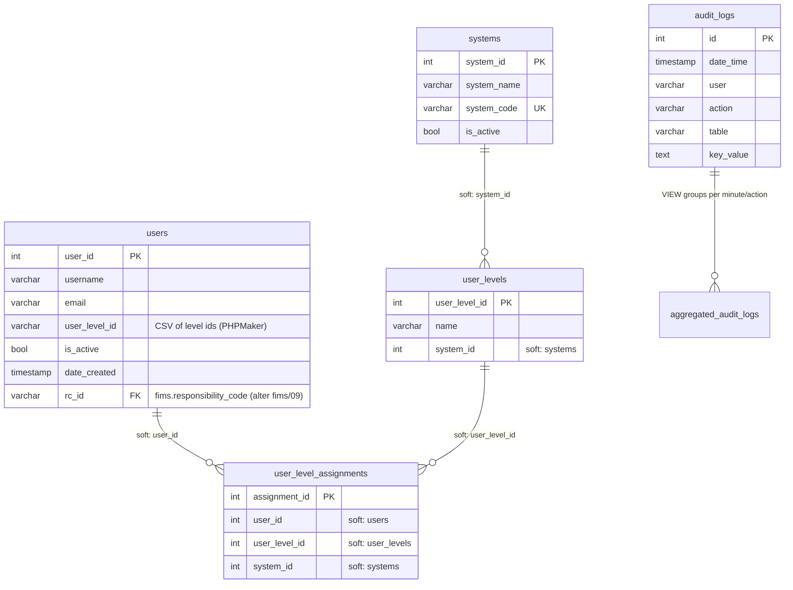
- **Table notes:**
  - `uac.users` — login users; `user_level_id` is a VARCHAR comma list (PHPMaker); `rc_id` added by `01 - fims/03 - alter_table/09 - users_replace_rc_code_with_rc_id.sql` (real FK to fims.responsibility_code); `position_id/employee_id/rc_code/must_change_password` added by `00 - uac/02 - alter_table/03`.
  - `uac.user_levels` / `uac.systems` / `uac.user_level_assignments` — PHPMaker security tables; `00 - uac/01 - table/01 - uac_structure_data.sql` declares **zero** FOREIGN KEYs in uac, so every edge above is soft.
  - `uac.aggregated_audit_logs` — VIEW (not a table): groups `uac.audit_logs` rows by script/user/action/table/key_value/minute; created because PHPMaker scaffolded an entity for it.

### Notification reads

- **Status:** PHPMaker-generated — list/add/edit/view/delete scaffold over `uac.notification_reads`; the real feature is the bell API.
- **Code:** menu `views/menu.php:11` → `NotificationReadsList` (`models/NotificationReads.php`, `UpdateTable = uac.notification_reads`, Dbid `DB`; `models/NotificationReads{List,Add,Edit,View,Delete}.php`). Live code: routes `app/routes/notifications.php` (`GET /notifications/recent`, `GET /notifications/count`, `POST /notifications/mark-read`, `POST /notifications/mark-all-read`, `POST /notifications/send`) → `app/services/NotificationService.php` (also MQTT publish). Legacy `app/lib/NotificationManager.php` is not called anywhere.
- **Tables written:** uac.notification_reads (PHPMaker CRUD; `NotificationService::markRead/markAllRead` insert), uac.notifications (`NotificationService::insert`, `ON CONFLICT (event_key) DO NOTHING`). **Tables read:** uac.notifications, uac.notification_reads, uac.user_level_assignments, uac.user_offices, uac.users (audience resolution).
- **Status workflow:** none.

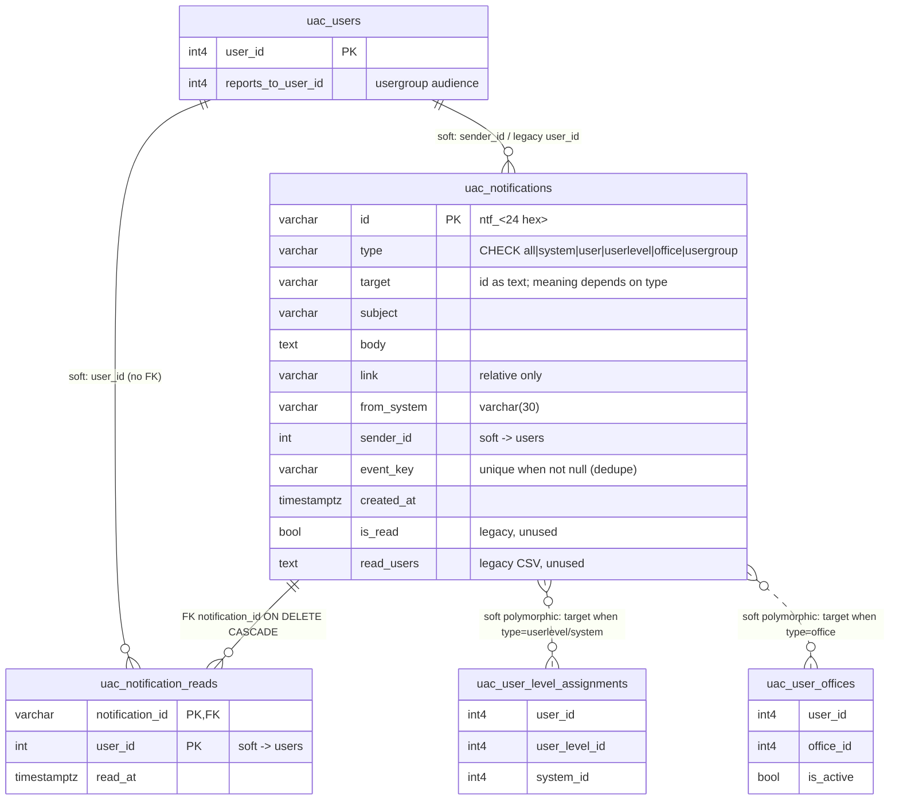
- **Table notes:**
  - uac.notifications — hub table upgraded in place by `00 - uac/02 - alter_table/06 - notifications_hub.sql` (+sender_id, event_key, NOT NULLs, type CHECK, audience index); legacy `timestamp`, `user_id`, `is_read`, `read_users` stay but are unused. The alter aborts if legacy rows with old types exist. `NotificationManager.php` would violate the CHECK (old types) — dead code.
  - uac.notification_reads — per-user read state (composite PK); it is in **uac**, not fims, despite the `{FIMS}notification_reads` permission key (`src/userlevelsettings.php:157-158,285`).

## COB Preparation

### Budget Proposal

- **Status:** Built — FMD-side review list of every Regional/District office's budget request (Budget Processing = endorse, Budget Preview = approve/return).
- **Code:** `views/BudgetPropPage.php` → `app/pages/budget-prop-page.php` (+ `readone/budget-req-readone.php`, `form/budget-req-form.php` [helpers only], `form/budget-processing-form.php`, `readone/budget-preview-readone.php`). Routes: `app/routes/fmd_budget_req.php` (`GET /fmd/budget_req/list` — central-review RC only), `app/routes/budget_req.php` (`GET /budget_req/all`, `/budget_req/grand-total`, `/budget_req/read/{id}`, `PUT /budget_req/endorse/{id}`, `PUT /budget_req/approve/{id}`, `PUT /budget_req/return/{id}`, `DELETE /budget_req/delete/{id}`, `GET /budget_req_project_attachment/list`), plus lookups `/type_of_fund/all`, `/component_type/all`, `/chart_of_accounts/all`. Services: `app/services/BudgetReqService.php` (both routes use it), `app/services/BudgetLineItemService.php::applyProcessing()`, `app/lib/GlobalService.php::logStatusChange()`.
- **Tables written:** `fims.budget_req` (status_id), `fims.budget_line_items` (endorse: `type_of_fund_id`, `component_id`, `suggested_amount`, `account_id`), `fims.status_change_log`; delete cascades the whole tree. **Tables read:** `fims.budget_req_program`, `fims.budget_req_project`, `fims.budget_req_project_attachment`, `fims.settings_status`, `fims.responsibility_code`, `fims.program`, `fims.sub_program`, `fims.project`, `fims.chart_of_accounts`, `fims.type_of_fund`, `fims.component_type`, `fims.fiscal_year`, `uac.users`, `uac.user_levels`.
- **Status workflow:** (`settings_status.status_for='budget_req'`, `BudgetReqService::REVIEW_STEPS`) For Review →(Budget Officer endorses)→ Endorsed →(Budget Head approves)→ Approved; returns go one step back: Endorsed → Returned to Budget Officer, For Review/Returned to Budget Officer → Returned (to the office).

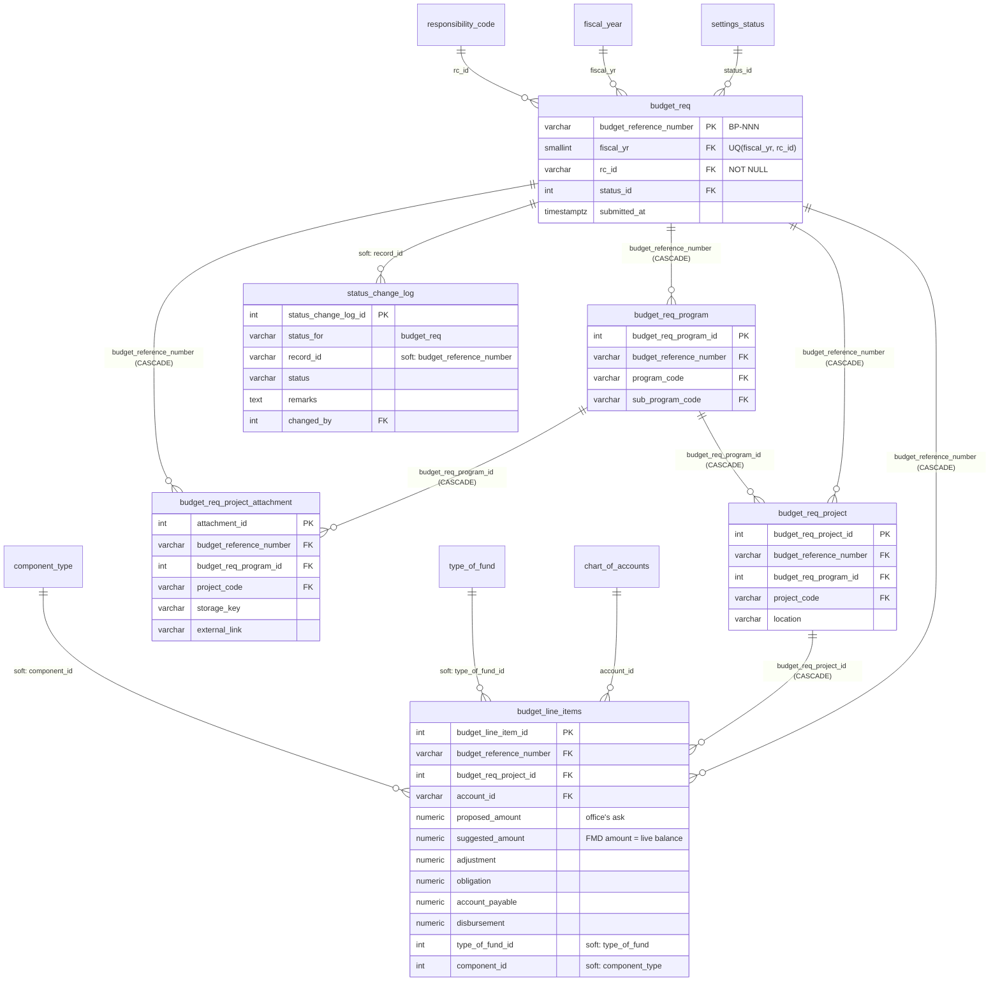
- **Table notes:**
  - `fims.budget_req` — header, one per (fiscal_yr, rc_id) (`03 - alter_table/10`); PK became VARCHAR "BP-NNN" in alter 15; `expense_class_id/program_code/project_code/amount/location` dropped (alters 02, 04); `rc_id` added (10); `submitted_at` added (16); `remarks` added (13) then dropped (36).
  - `fims.budget_req_program` — program (+ optional sub-program) block of a request.
  - `fims.budget_req_project` — project row under a program block; `budget_req_program_id` added by alter 05, `location` by alter 11; keeps its own redundant `budget_reference_number`.
  - `fims.budget_line_items` — COA lines; `requested_amount` renamed `proposed_amount` (03); `adjustment/obligation/disbursement/account_payable/component_id/type_of_fund_id` added (06, **no FK** on component/fund); `suggestion_amount` (07) renamed `suggested_amount` (12); `program_source_code`/`program_uses` added (17/18) and dropped (22). `budget_reference_number` is denormalised (also reachable via project→program).
  - `fims.budget_req_project_attachment` — supporting docs per (program block, project); S3 key or link (base table 16 + duplicate CREATE in `03 - alter_table/16`).
  - `fims.status_change_log` — shared polymorphic audit of status moves (status_for + record_id as text); written by `GlobalService::logStatusChange()`; Return remarks live here.

### Budget Request

- **Status:** Built — originating office's (RC-scoped) create/edit/submit page over the same tables as Budget Proposal.
- **Code:** `views/BudgetReqPage.php` → `app/pages/budget-req-page.php` (+ `readone/budget-req-readone.php`, `form/budget-req-form.php`, `form/budget-processing-form.php`, `readone/budget-preview-readone.php`). Route `app/routes/budget_req.php`: `GET /budget_req/list`, `/budget_req/all`, `/budget_req/read/{id}`, `POST /budget_req/add` (creates header or appends a Program to a Draft), `PUT|POST /budget_req/program/update/{budget_req_program_id}`, `PUT /budget_req/submit-for-review/{id}`, `DELETE /budget_req/delete/{id}`, `DELETE /budget_req/program/delete/{id}`, `GET /budget_req_project_attachment/list`, `DELETE /budget_req_project_attachment/delete/{id}`; lookups `/program/all`, `/sub_program/all`, `/project/all`, `/project/next-code`, `/fiscal_year/all`, `/chart_of_accounts/all?for_budget_proposal=1`. Services: `BudgetReqService`, `BudgetLineItemService::create()`, `ProjectService::findOrCreateByName()`, `GlobalService`.
- **Tables written:** `fims.budget_req`, `fims.budget_req_program`, `fims.budget_req_project`, `fims.budget_line_items` (account_id, proposed_amount, particulars), `fims.budget_req_project_attachment` (+ S3 upload), `fims.project` (typed new project via ProjectService), `fims.status_change_log`. **Tables read:** `fims.settings_status`, `fims.fiscal_year`, `fims.responsibility_code`, `fims.program`, `fims.sub_program`, `fims.project`, `fims.chart_of_accounts`, `uac.users`.
- **Status workflow:** Draft (default on create) → For Review (submit-for-review; locks the request) → then the FMD chain described under Budget Proposal; Returned brings it back to the office.

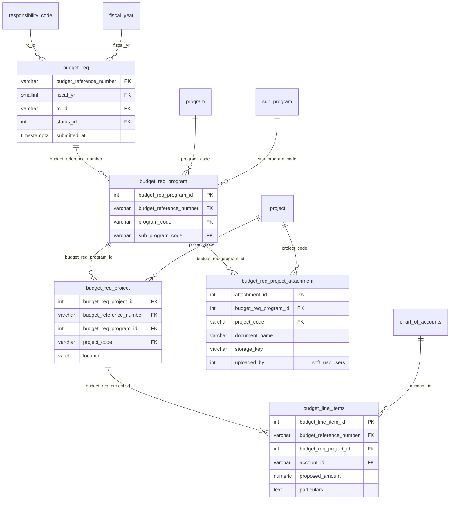
- **Table notes:** same tables as Budget Proposal (see notes there). Office side only writes `proposed_amount`/`particulars`/`account_id`; FMD later fills `suggested_amount`, `type_of_fund_id`, `component_id`. Editing a Draft program deletes and re-creates its project/line-item rows (hence budget_revision has no FK to line items). Attachment↔project link is a composite soft match (`budget_req_program_id`, `project_code`), not an FK to `budget_req_project`.

### Budget Revision

- **Status:** Built — file/edit/approve/decline revisions that move amounts between approved budget lines.
- **Code:** `views/BudgetRevisionPage.php` → `app/pages/budget-revision-page.php` (+ `form/budget-rev-form.php`, `form/budget-rev-review.php`). Route `app/routes/budget_revision.php`: `GET /budget_revision/all|list|read/{id}`, `POST /budget_revision/add`, `PUT /budget_revision/update/{id}`, `PUT /budget_revision/review/{id}`, `DELETE /budget_revision/delete/{id}`; also `GET /budget_req/all` (line picker) and `/fiscal_year/all`. Service `app/services/BudgetRevisionService.php`.
- **Tables written:** `fims.budget_revision`; `fims.budget_line_items` (on approval: `adjustment` and `suggested_amount` of the From and To lines). **Tables read:** `fims.budget_req`, `fims.budget_req_project`, `fims.budget_req_program`, `fims.program`, `fims.project`, `fims.chart_of_accounts`, `fims.responsibility_code`, `fims.settings_status`, `uac.users`.
- **Status workflow:** (`status_for='budget_revision'`, seed `04 - seed_data/08`) Pending → Approved | Declined (soft delete via `deleted_at`).

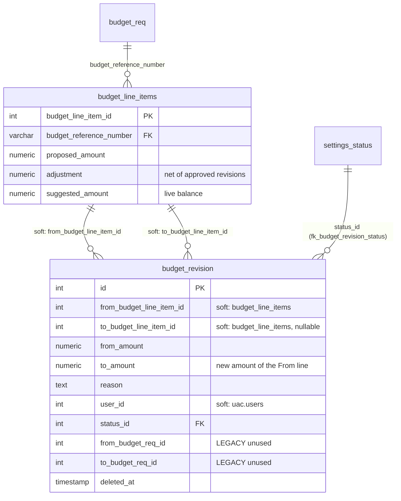
- **Table notes:**
  - `fims.budget_revision` — base `01 - table/05 - budget_rev.sql`; `budget_req_id`→`from_budget_req_id` + `to_budget_req_id` in `02 - alter_table/03` (note: a separate `02 - alter_table` folder); `from/to_budget_line_item_id` added and `from_budget_req_id` made nullable in `03 - alter_table/23 - budget_revision_on_budget_reference_number.sql` (no FK by design: Draft edits recreate lines); `status_id` FK added by `04 - seed_data/08`. Column is `update_at` (sic).
  - `fims.budget_line_items` — approval: From line `adjustment, suggested_amount += to_amount − (proposed+adjustment)`; To line gets the opposite delta; `proposed_amount` never changes.

### Ledger

- **Status:** Empty placeholder (0-byte page) — `views/LedgerPage.php` includes `app/pages/ledger-page.php`, which is 0 bytes.
- **Code:** none — the page file is 0 bytes.
- **Tables:** No tables yet.

## Budget Process

### Request for Allocation (CBA)

- **Status:** Built — `cba-memo-request-page.php` sets `$alloc_type='CBA'` and includes `memo-req-page.php`; CBA-only list + create/edit form + FMD Process modal.
- **Code:** `views/CbaMemoRequestPage.php` → `app/pages/cba-memo-request-page.php` → `app/pages/memo-req-page.php` (+ `form/budget-allocation-form.php`, `readone/memo-process-readone.php`, `form/caf-form.php`, `readone/print-preview-readone.php`). Route `app/routes/budget_allocation.php`: `GET /budget_allocation/departments|statuses|all|list|read/{id}`, `POST /budget_allocation/add`, `PATCH /budget_allocation/update/{id}` (also Submit for Review = PATCH status_id), `PATCH /budget_allocation/process/{id}` (approve/return), `DELETE /budget_allocation/delete/{id}`; `GET /budget_line_item/approved`, `/budget_line_item/approved/type_of_fund`, `/budget_line_item/{id}/earmarks`; lookups `/program/all`, `/sub_program/all`, `/project/all`, `/vendors/all|read`, `/budget_category/all`; `/upload/multi-upload` (attachments); `/print/payload/...`. Services: `BudgetAllocationService.php`, `BudgetLineItemService.php` (earmarks), `ProgramService`/`SubProgramService`/`ProjectService` (typed new entities), `file_uploadServices.php`, `GlobalService::logStatusChange()`, print: `MemoRequestPrintService`, `CbaPrintService`, `CfaPrintService`.
- **Tables written:** `fims.budget_allocation`, `fims.budget_line_item_earmark`, `fims.budget_line_items` (suggested_amount −, obligation +, account_payable + on CBA approval; reversed on delete), `fims.status_change_log`, `fims.file_attachments` + `fims.ip_filemeta`, `fims.program`/`fims.sub_program`/`fims.project` (when typed instead of picked). **Tables read:** `fims.settings_status`, `fims.fiscal_year`, `fims.vendors`, `fims.budget_category`, `fims.responsibility_code`, `uac.users`, `uac.departments`, `uac.user_levels`, `fims.budget_req*`, `fims.chart_of_accounts`, `fims.type_of_fund`.
- **Status workflow:** (`status_for='budget_allocation'`, `BudgetAllocationService::REVIEW_STEPS`) Draft → For Review →(FMD Section Chief)→ For Division Manager →(FMD Division Manager)→ For Department Manager →(FMD Department Manager)→ Approved (allocation_number stamped, earmark created); returns: Returned to Division Manager / Returned to Section Chief / Returned. Earmark status: active → converted | released.

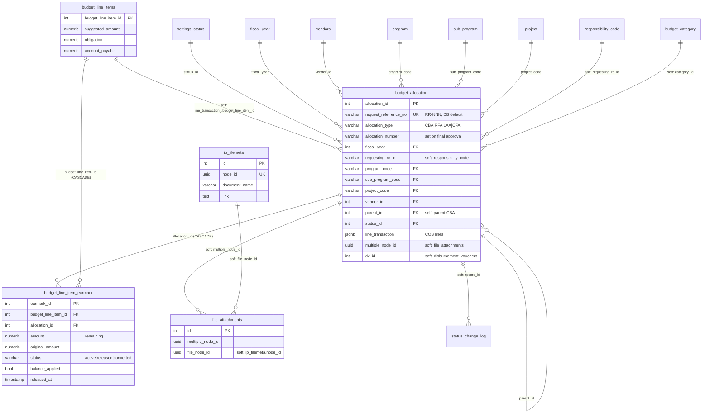

| Table | Purpose / notes |
|---|---|
| `settings_status` | Shared status lookup, scoped per entity via `status_for` (e.g. `'fiscal_year'`, `'budget_req'`). `next_actors` (JSONB; renamed from `actors`) names who acts next on a record that has reached that status |
| `fiscal_year` | One row per fiscal year; PK is the year itself (`SMALLINT`) |
| `program` / `sub_program` / `project` | Budget hierarchy. A project optionally narrows to a `sub_program_code`; a sub-program always belongs to one `program_code` |
| `budget_req` | **One header row per fiscal year** (`UNIQUE(fiscal_yr)`, enforced in `03 - alter_table/04`). Despite the name, it no longer carries an amount, program, or expense class directly — see gap note in §3. Carries `remarks` (nullable `TEXT`, `03 - alter_table/13`): the reason entered when the request was last Returned |
| `budget_req_program` | One Program (optionally + Sub-Program) line added to a `budget_req` header |
| `budget_req_project` | One Project line, nested under a `budget_req_program` row (and, redundantly, under the `budget_req` header directly — see denormalization note below) |
| `budget_line_items` | One chart-of-accounts allocation under a `budget_req_project` row. Carries `proposed_amount`, `suggested_amount`, and the execution-tracking amounts `adjustment` / `obligation` / `disbursement` / `account_payable` (all `NOT NULL DEFAULT 0`). `component_id` / `type_of_fund_id` are present but **have no FK** — see §3. The `program_source_code` / `program_uses` columns that `03 - alter_table/17` and `/18` added were dropped again by `03 - alter_table/22` |
| `budget_revision` | Revises a **budget line** (`budget_line_items` row): changes the From line's amount, or moves the difference to a To line (`to_budget_line_item_id IS NULL` = a plain revision of one line). `from_budget_line_item_id` / `to_budget_line_item_id` hold a `budget_line_items.budget_line_item_id` (`03 - alter_table/23`); `status_id` / `user_id` are plain integers; **none of them has an FK** — not drawn above. The earlier `from_budget_req_id` / `to_budget_req_id` (a budget *request's* id, which no longer exists) are left in place, unused. A line's current amount is `proposed_amount + adjustment`; approving a revision only moves `budget_line_items.adjustment` — the From line goes down, the To line goes up — and never `proposed_amount` |
| `chart_of_accounts` | COA tree (`parent_account_id` self-FK). Optionally scoped to a responsibility center (`region_code -> responsibility_code.rc_code`) and/or a `project_code` |
| `responsibility_code` | RCA (Responsibility Center/Accounting) tree (`parent_rc_id` self-FK). `is_budget_holding_rc` flags units that can hold a budget. `rc_id` is the PK and is `VARCHAR(10)` — see the `uac.departments`/`uac.offices` type-mismatch gap in §3 |
| `type_of_fund` / `component_type` | Small lookup tables (fund source; CO / Other-CO / COE) seeded with a handful of rows. Referenced by `budget_line_items.type_of_fund_id` / `.component_id` **by convention only — no FK exists yet** |
| `budget_allocation` | Memo/PR/PO allocation tracking per fiscal year + requesting RC (the creator's `uac.users.rc_id`) / district, with a `parent_id` self-FK for derived allocations. Built via `CREATE TABLE fims.budget_allocation(); ALTER TABLE ... ADD COLUMN` (see the file for why). `request_referrence_no` (VARCHAR(50) — the spelling is the column's real name) is **generated by the database**: its default is `fims.next_request_referrence_no()`, which takes the next value of a sequence and formats it `RR-001`, `RR-002`, … (it grows past 999, never truncates); unique, never reused (a failed insert leaves a gap). Added, with the existing rows numbered oldest-first, by `03 - alter_table/19`. Most of its columns (`requesting_rc_id` — VARCHAR(50), renamed from `requesting_department_id` in `03 - alter_table/14` — `requesting_district_id`, `program_id`, `sub_program_id`, `project_id`, `category_id`, `user_id`) are **deliberately left unconstrained** — see the comment in `03 - alter_table/08 - budget_allocation_add_fk.sql` for the reasoning per column. `allocation_type` (free-text VARCHAR(20), no CHECK) is the "Memo Request" module's own document type — `CBA` (Certificate of Budget Allocation, the root reservation against a COB), `RFA` (Request for Fund Allotment, draws part of a parent CBA down into an obligation, used under ₱50M) and `LAA` (Letter of Advice of Allotment, same conversion as RFA but ₱50M and above) are the three in active use; `CFA` is named alongside `CBA` in a few guard conditions/comments (e.g. `budget_line_item_earmark`'s header comment, `BudgetLineItemService`'s earmark filters) but never actually produced by the form — treat it as reserved/unimplemented, not a fourth live type. For RFA/LAA, `parent_id` must point at an Approved CBA; `BudgetAllocationService::process()` assigns the final `allocation_number` on last approval, templated by `allocation_type` (`BudgetAllocationService.php` ~L798-814): `CBA` → `CBA <y>-<q><m>-86-<series>`, `RFA` → `<yy><q><m>-<code>-<series>` (`code` 57 for `document_type='COE'`, 87 for `CO`), `LAA` → `LAA <y>-<q><m>-<series>` (no code segment). `dv_id` (added by `03 - alter_table/23 - budget_allocation_add_dv_id.sql`, 2026-11-12) is an RFA row's **soft** link to the one `disbursement_vouchers.dv_id` it currently backs (one DV can draw on several RFA rows, but each RFA row backs only one active DV at a time — enforced by `DisbursementVoucherService`, not a DB FK; see §3) |
| `budget_line_item_earmark` | The CBA/RFA/LAA reservation ledger against `budget_line_items` (added 2026-11-12, `01 - table/26`). One row per Approved `budget_allocation` line "holding" an amount against a line item's balance — reserved only, separate from `budget_line_items.obligation`/`disbursement`/`account_payable`. A line item's still-available balance = `suggested_amount + adjustment - obligation - SUM(amount) WHERE status = 'active'` (the FMD-approved `suggested_amount`, not the requester's `proposed_amount`). `status`: `active` (default, while its CBA stays Approved) → `released` (its CBA was deleted — amount freed back) or `converted` (an RFA/LAA naming this row's allocation as `parent_id` was itself Approved: `BudgetLineItemService::convertEarmarkForRfaApproval()` shrinks — or fully flips — the CBA's own row by the drawn amount, inserts a **separate** `converted` row attributed to the RFA/LAA's own `allocation_id` so each draw stays traceable, and raises `budget_line_items.obligation` by that same amount — the real commitment). `original_amount` (added `03 - alter_table/23 - budget_line_item_earmark_add_original_amount.sql`, 2026-11-12) freezes the amount the row was first created with, since `amount` itself shrinks on every partial RFA/LAA draw — used so "where this COB's balance is held" can show a CBA's originally-approved figure, not its current remainder. Both `budget_line_item_id` and `allocation_id` are enforced FKs, `ON DELETE CASCADE` |
| `ip_filemeta` | One uploaded file (or typed link / reference) of a Supporting Document: `document_name VARCHAR(225)`, `link TEXT` (the object-storage key, or the link), `created_by`, a unique `node_id` UUID (default `gen_random_uuid()`), `created_at` / `updated_at`, soft-delete `deleted_at`. Written by `FileUploadServices` (`01 - table/17`) |
| `file_attachments` | Groups files: one `multiple_node_id` UUID per upload batch, one row per file with that file's `ip_filemeta.node_id` as `file_node_id` (+ its own `node_id`, `created_by`, timestamps, `deleted_at`). The owning record stores the `multiple_node_id` (`budget_allocation.multiple_node_id`). No FKs, by convention (`01 - table/18`) |

**Denormalization, twice:** `budget_line_items` carries both `budget_req_project_id` (the real
parent) and `budget_reference_number` (the grandparent header), and `budget_req_project` carries
both `budget_req_program_id` (the real parent) and `budget_reference_number` (same grandparent).
Both are intentional — see the comments in `03 - alter_table/03` and `03 - alter_table/05` — so
existing header-level joins/counts keep working without walking the full chain. The service layer
keeps both columns in sync on write; nothing in the DB enforces that they agree.

### 2.2 Vendors & procurement

API: `app/routes/vendor.php`, `app/routes/purchase-order.php` (see `app/routes/README.md`).
Pages: `app/pages/po/{page,form,readone}.php`.

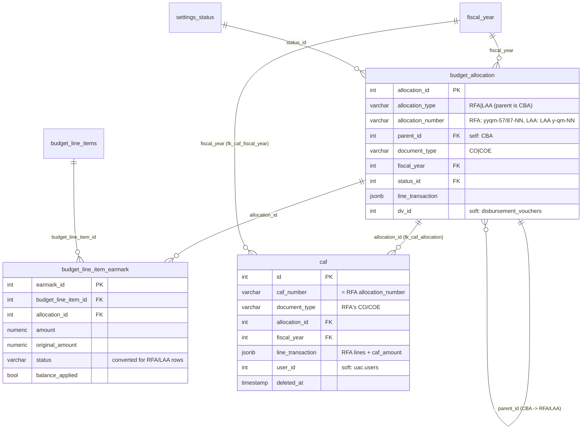
- **Table notes:**
  - `fims.budget_allocation` — see CBA. RFA/LAA rows point to their CBA through `parent_id`; `dv_id` (alter 23) is set from the DV side (`DisbursementVoucherService`), DV's own `rfa_allocation_id/number` were dropped (alter 26).
  - `fims.caf` — `01 - table/38 - fims_caf.sql`; FKs to budget_allocation and fiscal_year added by `03 - alter_table/30 - caf_add_fk.sql`; `line_transaction` JSONB = each RFA line copied + `caf_amount`; UI creates CAFs only from RFA rows, but `CafService` does not enforce allocation_type = 'RFA' or one CAF per RFA.
  - `fims.budget_line_item_earmark` — see CBA; COB columns `rfa_approved` / `laa_issued` sum the 'converted' rows attributed to RFA/LAA allocation_ids.

## DV Processing

### Disbursement Voucher

- **Status:** Built — Full CRUD, the 9-status pipeline, the Accounting Entries (SETUP JEV) editor, ATC and deduction lines, RFA linking, and "Prepare Payment JEV" are all wired to real SQL.
- **Code:** `views/Voucher.php` → `app/pages/voucher.php` (list) + `app/pages/voucher/form.php` (create/edit) + `app/pages/voucher/readone.php` (view, Accounting Entries, status actions). Route `app/routes/voucher.php`: `GET /voucher/list|all|fiscal-years|dv-number|atc-codes|deduction-types|sl-codes|sl-codes/{sl_code}/details|rfa/all|rfa/read/{id}|read/{id}`, `POST /voucher/add`, `PUT /voucher/update/{id}`, `POST /voucher/{id}/status`, `POST /voucher/{id}/journal-entry` (save the SETUP JEV, ATC lines, and deductions), `POST /voucher/{id}/prepare-payment-jev`, `POST /voucher/journal-entry/{id}/jev-status`, `DELETE /voucher/delete/{id}`. Service: `app/services/DisbursementVoucherService.php`, which calls `GeneralLedgerService::postJev()/reverseJev()/createPaymentJev()`. Print: `DvPrintService`/`JevPrintService` through `/print-preview-readone`.
- **Tables written:** fims.disbursement_vouchers, fims.disbursement_voucher_deductions, fims.disbursement_voucher_atc_lines, fims.journal_entry_vouchers, fims.journal_entry_voucher_lines, fims.budget_allocation (only `dv_id`, in `linkRfas()`), fims.general_ledger (indirectly, through postJev/reverseJev), fims.status_change_log (JEV status only, through `GlobalService::logStatusChange`). **Tables read:** fims.settings_status (`status_for='disbursement_voucher'` and `'journal_entry_voucher'`), fims.vendors (joins `vendors.sl_code` → `chart_of_accounts.account_id` for the vendor AP sub-ledger), fims.chart_of_accounts (also the source of the SL list: leaf accounts with `parent_account_id`), fims.responsibility_code, fims.fiscal_year, fims.books, fims.atc_codes, fims.deduction_types, fims.budget_allocation (`allocation_type='RFA'`), fims.budget_category, fims.budget_line_items (the account of the RFA's first line), fims.checks (the latest non-cancelled check by `dv_number`, for the payment JEV), fims.bank_accounts (`account_code`, the Cr Cash line), fims.file_attachments (by `multiple_node_id`), fims.v_journal_entry_vouchers, uac.users (`rc_id` for stage authorization).
- **Status workflow:** `DRAFT → FOR_FMD_REVIEW (RC 013) → FOR_ACCOUNTING (RC 012, Section Chief saves a balanced JEV) → FOR_DIVISION_MANAGER (012) → FOR_DEPARTMENT_MANAGER (012) → FOR_TREASURY (014; this step POSTS the SETUP JEV to the GL) → RELEASED` (set by Check Disbursements `saveCheck`). Any non-terminal status can go to `REJECTED` (reason required) or `CANCELLED`. `FOR_TREASURY→CANCELLED` reverses the GL entries. `REJECTED→CANCELLED` only. Source: `DisbursementVoucherService::TRANSITIONS` (l.100) and `STAGE_HOLDER_RC`. Seeds: `02 - sample_data/01 - fims_settings_status.sql`.

- **Table notes:**
  - `fims.disbursement_vouchers` (`01 - table/16`) is the voucher header. Alter 11 added the FKs to fiscal_year and vendors. Alter 13 added `atc_code`, then alter 17 dropped `vat_rate/vat_amount/wtax_rate/wtax_amount/atc_code` and turned `net_amount` from a generated column into a service-computed snapshot. Alter 16 added `payments_prior_amount`. Alter 21 replaced the free-text `status` column with `status_id`, an FK to settings_status. Alter 24 added `multiple_node_id`. Alter 26 dropped `rfa_allocation_id/rfa_allocation_number`. Alter 34 added `division_reviewed_by/at` and `department_approved_by/at`. The per-stage actor columns remain: `submitted_*`, `fmd_approved_*`, `accounting_processed_*`, `treasury_released_*`, `rejected_*`. `requesting_department_id` is always written NULL (service l.280). `expense_class` is derived from `account_code`. There is no `book_id` column, by design (see the header of alter 30).
  - `fims.disbursement_voucher_deductions` (`01 - table/21`) holds the non-tax deductions (e.g. RETENTION). The whole set is replaced on save (`replaceDeductions`).
  - `fims.deduction_types` (`01 - table/20`) is the lookup. Seeds include RETENTION, plus `04 - seed_data/08` (other/recoupment/penalty/VAT). Alter 18 added `account_code`, an FK to COA, used as the default credit account.
  - `fims.disbursement_voucher_atc_lines` (`01 - table/22`) holds the BIR withholding lines, which Accounting prepares together with the JEV. `chargeability` is an FK to responsibility_code. These lines replaced the dropped single `dv.atc_code`.
  - `fims.atc_codes` (`01 - table/17`) is the lookup. Alter 18 added `account_code` (default `2-02-01-010`). Alter 25 widened `description` to TEXT, added `tax_type` (EWT/OPT/WG), and seeded the full BIR list.
  - `fims.journal_entry_vouchers` (`01 - table/18`) is the JEV header. It started as 1:1 with the DV. Alter 29 added `status_id/posted_by/posted_at`. Alter 30 added `book_id`. Alter 31 dropped the UNIQUE on `dv_id`, added `jev_type` (SETUP|PAYMENT), `source_module`, and `doc_ref_no`, and created the partial unique index `(dv_id) WHERE jev_type='SETUP'`. Alter 32 added `jev_classification` (CHECK: REGULAR|ACCRUAL|DEPRECIATION|PREPAYMENTS|CLOSING). Alter 33 made `dv_id` nullable (standalone JEVs). Alter 35 added `multiple_node_id`. A PAYMENT JEV is created by `GeneralLedgerService::createPaymentJev()` (Dr AP `2-01-01-010` / Cr the bank's `account_code`) at FOR_SECTION_CHIEF.
  - `fims.journal_entry_voucher_lines` (`01 - table/19`) holds the JEV lines. Alter 17 added `sl_code/sl_detail_id` with FKs to sl_masters/sl_details. Alter 37 (`DROP ... CASCADE`) dropped those FKs, but the columns remain and are still written. Alter 27 added `rc_id`, an FK to responsibility_code.
  - `fims.budget_allocation` is shared and covered elsewhere. Alter 23 added `dv_id` as a soft link with no FK. One RFA points to at most one active DV. A DV can cite many RFAs. The link is maintained by `linkRfas()` and cleared on DV delete.

### Liquidation Voucher

- **Status:** Empty placeholder (0-byte page) — `app/pages/liquidation-voucher-page.php` is 0 bytes (`views/LiquidationVoucherPage.php` includes it). Only a print form exists: `app/services/LvPrintService.php`, which prints from a payload and says "There is no LV module in this repo yet".
- **Code:** `views/LiquidationVoucherPage.php` → `app/pages/liquidation-voucher-page.php` (empty). No route, no service.
- **Tables:** No tables yet.

### Journal Entry Voucher

- **Status:** Built — a JEV register for every JEV (SETUP, PAYMENT, and standalone), plus create/edit/delete of standalone (no-DV) JEVs and their review/post chain.
- **Code:** `views/JournalEntryVoucher.php` → `app/pages/journal-entry-voucher.php`. Route `app/routes/voucher.php`: `GET /voucher/journal-entries` (from v_journal_entry_vouchers), `GET /voucher/journal-entry/{id}`, `POST /voucher/journal-entry/add`, `PUT /voucher/journal-entry/update/{id}`, `DELETE /voucher/journal-entry/delete/{id}`, `POST /voucher/journal-entry/{id}/post`, `POST /voucher/journal-entry/{id}/jev-status`. It also uses `/books/all`, `/chart_of_accounts/all`, `/voucher/fiscal-years`, `/upload/multi-upload`, and `/voucher/read/{id}` for DV-linked rows. Service: `DisbursementVoucherService` (`fetchJevList`, `create/update/delete/postStandaloneJev`, `changeJevStatus`), which calls `GeneralLedgerService::postJev()`.
- **Tables written:** fims.journal_entry_vouchers, fims.journal_entry_voucher_lines, fims.general_ledger (on POSTED), fims.status_change_log. **Tables read:** fims.v_journal_entry_vouchers (view over journal_entry_vouchers + disbursement_vouchers + books + settings_status×2), fims.chart_of_accounts, fims.books, fims.fiscal_year, fims.responsibility_code, fims.settings_status, fims.file_attachments.
- **Status workflow:** (`status_for='journal_entry_voucher'`, seeds in `02 - sample_data/11`) values are DRAFT, APPROVED, FOR_SECTION_CHIEF, FOR_DIVISION_MANAGER, FOR_DEPARTMENT_MANAGER, POSTED, REVERSED. PAYMENT and standalone JEVs follow `DRAFT → FOR_SECTION_CHIEF → FOR_DIVISION_MANAGER → FOR_DEPARTMENT_MANAGER → POSTED` (`changeJevStatus`, l.1870; PAYMENT JEVs start at FOR_SECTION_CHIEF). SETUP JEVs ride the DV chain: they become POSTED on DV→FOR_TREASURY and REVERSED on FOR_TREASURY→CANCELLED. APPROVED is seeded but no code writes it.

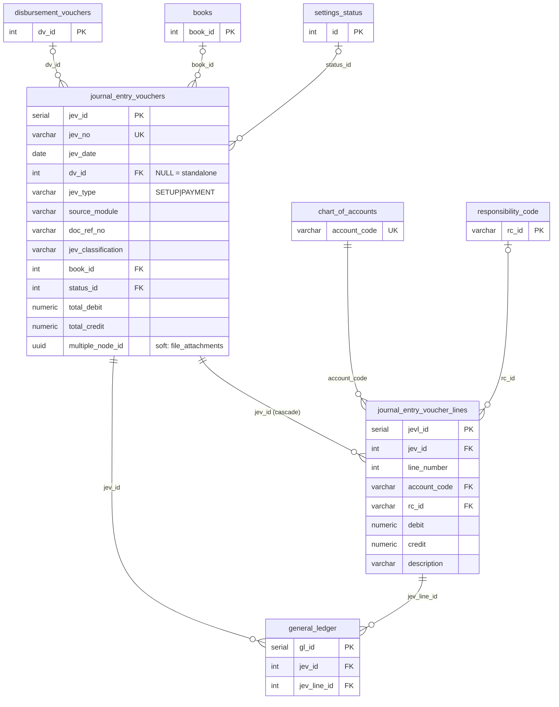

- **Table notes:**
  - `fims.journal_entry_vouchers` and `fims.journal_entry_voucher_lines`: see the Disbursement Voucher section. Standalone JEVs have `dv_id` NULL and `jev_type` SETUP, and are inserted with `status_id` = DRAFT. DV-linked SETUP JEVs are inserted by `persistJournalEntry` without a `status_id` (NULL until postJev sets POSTED).
  - `fims.v_journal_entry_vouchers` (`05 - views/02`) is the read-only register view and includes `jev_status`, `dv_status`, and `jev_classification`.

### Check Disbursements

- **Status:** Built, with stubs — Check preparation, registry (blank stock), releases (unified, with real SMTP), cancellation/replacement, and inventory/RAF are wired. `getSubsidyReport`, `getReleaseDocuments`, and `saveDriveLink` are stubs ("schema migration pending").
- **Code:** `views/CheckDisbursements.php` → `app/pages/check-disbursement-voucher-page.php`. Route `app/routes/check-processing.php` (`/check-processing/...`): `preparation/{bank-accounts,dvs-for-prep,checks,unused-checks/{bankId},cash-availability,check/{id},check/{id}/history,check/{id}/mark-printed,check/{id}/set-status,save}`, `registry/{list,summary,series-list,booklets,add-batch,update-status,{id}}`, `releases/{save,unclaimed,email-log,departments,pending/{deptId},acknowledgment-list,dv-monitoring,bulk-send-notice,bulk-resend-email/{logId},{id}/send-notice|follow-up|set-claimant|acknowledge|update-status|mark-stale|record-dv-return}`, `cancellation/{kpis,lookups,list,cancel,replace,{id},{id}/history}`, `raf/{summary,years,list}`, `print-agent-package`. Service: `app/services/CheckProcessingService.php`. `saveCheck` calls `DisbursementVoucherService::changeStatus(dv,'RELEASED')`.
- **Tables written:** fims.checks, fims.check_register, fims.check_cancellations, fims.check_releases, fims.check_release_email_log, fims.cash_position (`saveCheck` deducts from today's row or inserts one), fims.disbursement_vouchers (status → RELEASED, through the DV service). **Tables read:** fims.bank_accounts, fims.disbursement_vouchers (only FOR_TREASURY rows for preparation), fims.settings_status, fims.budget_allocation + fims.program (program names of a DV's RFAs), fims.cash_position (available_balance), uac.departments.
- **Status workflow:** `checks.status` goes `PREPARED → RELEASED → ENCASHED | OUTSTANDING → STALE`, with `CANCELLED`/`VOIDED` also possible (alter 25 uppercased the values). Release status changes are pushed onto the check (RELEASED or ACKNOWLEDGED → RELEASED, UNCLAIMED → STALE). `check_releases.status` is `PENDING → NOTIFIED → RELEASED → ACKNOWLEDGED`, or `UNCLAIMED`. `check_register.current_status` is one of `UNUSED|ISSUED|ENCASHED|OUTSTANDING|CANCELLED|VOIDED|SPOILED|STALE` (`REGISTER_STATUSES`). Preparing a check moves the DV from FOR_TREASURY to RELEASED.

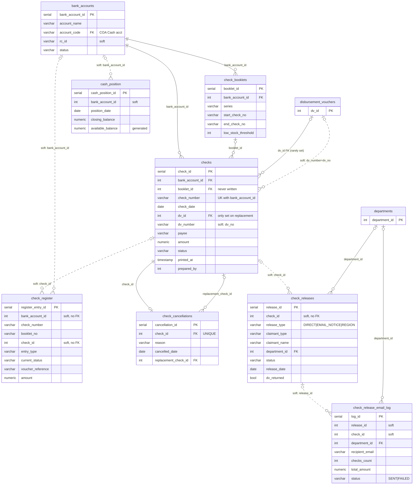

- **Table notes:**
  - `fims.checks` (`01 - table/28`) is one row per issued check. Alter 21 added FKs to bank_accounts, check_booklets, and disbursement_vouchers. Alter 25 uppercased the status values (default PREPARED). Alter 27 added `printed_at`. `saveCheck` writes only `dv_number` (soft) and leaves `dv_id`/`booklet_id` NULL. `dv_id` is copied only when a replacement is created.
  - `fims.check_booklets` (`01 - table/27`) has its FK added by alter 21 but is never written. The service comment (l.2040) says RAF is computed from check_register instead.
  - `fims.check_register` (`01 - table/34`) is the blank check stock ported from TREASURY. It has no FKs, and its unique key is `(bank_account_id, check_number, COALESCE(booklet_no,''))`. Preparing a check flips the matching UNUSED row to ISSUED and sets its `check_id`.
  - `fims.check_cancellations` (`01 - table/29`) is 1:1 with the cancelled check. `replacement_check_id` points to the new check. Both FKs were added by alter 21.
  - `fims.check_releases` and `fims.check_release_email_log` (`01 - table/38`) are the unified replacement for check_claimant_releases, check_region_releases, and their email logs, which alter 29 (`drop_old_split_release_tables`) drops. The only FK is `department_id` → uac.departments. `check_id`/`release_id` are soft.
  - `fims.bank_accounts` (`01 - table/26`) is shared with Bank Management. Alter 23 added management fields plus bank_account_documents and bank_account_audit_log. Alter 24 renamed `department_id` to `rc_id` VARCHAR(50) with no FK. Alter 31 added `account_code`, an FK to COA (the Cash account for the payment JEV).
  - `fims.cash_position` (`01 - table/35`) is owned by Cash Position. Here it is only read for sufficiency and written as a deduction. `available_balance` is a generated column (`closing_balance - restricted_amount`).
  - `fims.ada_releases` and `fims.official_receipts` are not touched by this module. They are read only by the Journals page (ADADJ/CRDJ).

## Inventory

### IAR Module

- **Status:** Partial — The "Deliveries" tab (PO → DR, IAR, SI, pro-forma JEV) is built. The "Infrastructure" tab shows "coming soon" (`iar-module.php` l.147–150).
- **Code:** `views/IarModule.php` → `app/pages/iar-module.php`. Route `app/routes/po_dr.php`: `GET /po-dr/list|pos|accounts|read|proforma`, `POST /po-dr/add`, `PUT /po-dr/update`, `DELETE /po-dr/delete`. Service: `app/services/PoDrService.php`. Print: `IarPrintService` and the pro-forma JEV print through `/print-preview-readone`.
- **Tables written:** fims.inspection_acceptance_report (only this one). **Tables read:** fims.budget_allocation (`allocation_type='RFA'`, `deleted_at IS NULL`, `po_number`, `line_transaction[].requested_amount` = PO amount, `requesting_rc_id`, `vendor_id`, `created_at` as PO date), fims.responsibility_code, fims.vendors, fims.chart_of_accounts (DR entry accounts, plus the AP `2-01-01-010` title for the pro-forma). It does **not** read fims.purchase_orders.
- **Status workflow:** none. There is no status column. The rules are: DR total ≤ PO balance (PO amount − other DRs), `dr_number` is unique within the PO, serial numbers are unique across all DRs, and items are kept only when the DR total is ≥ 50,000.

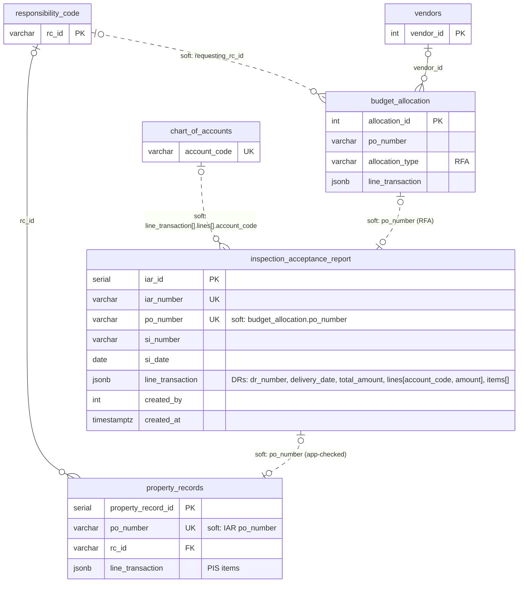

- **Table notes:**
  - `fims.inspection_acceptance_report` (`01 - table/25`) has one row per PO. `iar_number` and `po_number` are each UNIQUE. A CHECK requires `line_transaction` to be an array, and there is a GIN index on it. No alters apply.
  - The pro-forma JEV (`GET /po-dr/proforma`) is computed (Dr DR accounts / Cr AP `2-01-01-010`) and is **not** saved to journal_entry_vouchers.
  - `fims.property_records` (`01 - table/34`) belongs to the separate Property Record page (`PropertyRecordService`). It links to the IAR only by `po_number` and an app-side check ("PO is not in the IAR module"). IAR items carry `property_no`/`par_no` text but there is no reverse link.
  - `fims.purchase_orders` and `fims.purchase_order_items` (`01 - table/09`) exist but are not used by this module. Despite its name, "PO" here means an RFA's `budget_allocation.po_number`.

## Monitoring

### COB Monitoring

- **Status:** Built — read-only monitoring of Approved budget requests vs. memo-request drawdowns, with tree views and PDF/XLSX report.
- **Code:** `views/CobPage.php` → `app/pages/cob-page.php` (+ `readone/cob-readone.php`, `readone/cob-report-readone.php`). Route `app/routes/cob.php`: `GET /cob/filters`, `/cob/summary`, `/cob/rollup`, `/cob/read/{id}`, `/cob/report` (json/pdf/xlsx). Services `app/services/CobService.php`, `app/services/CobReportService.php` (Dompdf + `XlsxWriter.php`), RC scope via `GlobalService::resolveBudgetReqRcFilter()`.
- **Tables written:** none. **Tables read:** `fims.budget_req`, `fims.budget_req_program`, `fims.budget_req_project`, `fims.budget_line_items`, `fims.budget_req_project_attachment`, `fims.budget_line_item_earmark`, `fims.budget_allocation`, `fims.settings_status`, `fims.program`, `fims.sub_program`, `fims.project`, `fims.type_of_fund`, `fims.component_type`, `fims.chart_of_accounts`, `fims.responsibility_code` (self-join to parent for region), `uac.users` (scope).
- **Status workflow:** none written; only `budget_req` rows with status 'Approved' (status_for='budget_req') are included; earmarks of soft-deleted allocations excluded.

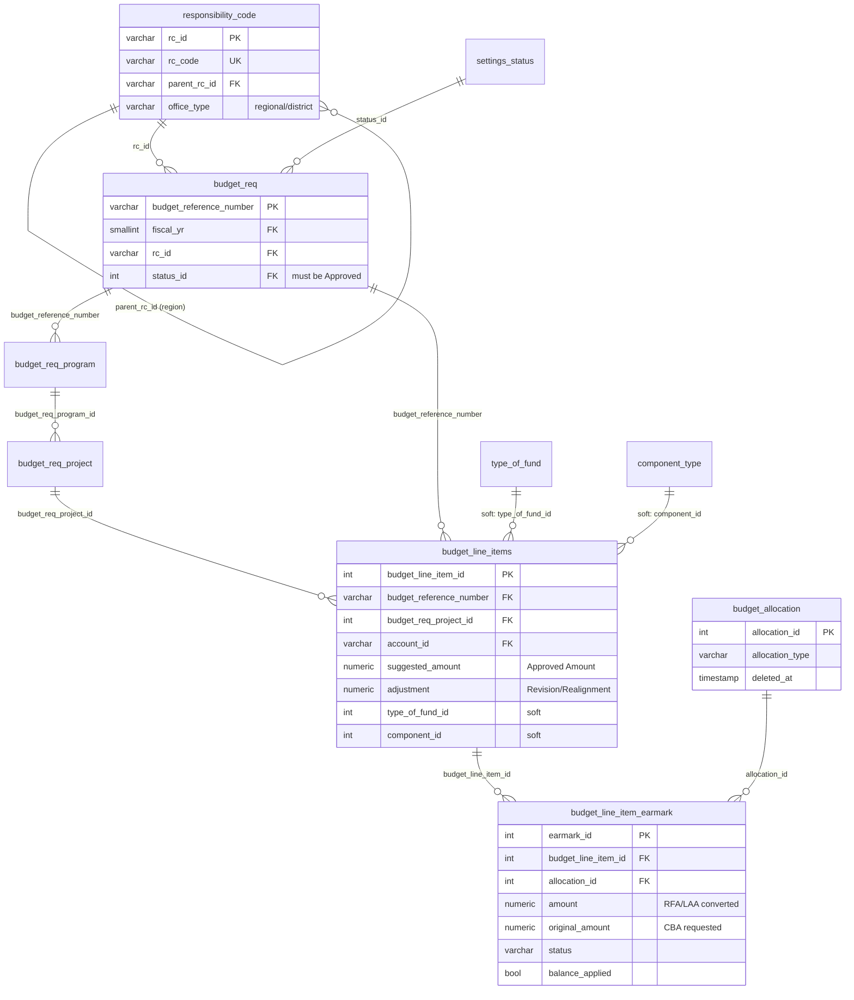
- **Table notes:** no own tables. Per line: approved = `suggested_amount`; revision = `adjustment`; revised = suggested+adjustment; cba_requested = Σ`original_amount` of CBA/CFA earmarks with `balance_applied` and status active/converted; rfa_approved / laa_issued = Σ`amount` of 'converted' rows of RFA / LAA allocations; available = revised − cba; remaining = revised − rfa − laa (`CobService::earmarkSql()`/`lineAmountExprs()`). Attachments joined by (`budget_req_program_id`, `project_code`) for a count.

### RFA / LAA Monitoring

- **Status:** Empty placeholder (0-byte page) — `views/RfaLaaMonitoringPage.php` includes `app/pages/rfa-laa-monitoring-page.php`, which is 0 bytes.
- **Code:** none — the page file is 0 bytes.
- **Tables:** No tables yet.

## Registry/NCA

### SARO Registry

- **Status:** Built — The 77 KB page has SARO and NCA tabs (a tree of each SARO with its NCAs) and uses the shared `form/saro-processing-form.php` modal.
- **Code:** `app/pages/saro-registry-page.php` (view `views/SaroRegistryPage.php`) + `app/pages/form/saro-processing-form.php`; routes `app/routes/fund_tracking.php` (`GET /fund_tracking/list`, `GET /fund_tracking/read/{id}`, `POST /fund_tracking/add`, `PATCH /fund_tracking/update/{id}`, `DELETE /fund_tracking/delete/{id}`, `GET /fund_tracking/fund_sourcing_determination`, `POST /fund_tracking/import`), `app/routes/fund_tracking_type.php` (`GET /fund-tracking-type/all`), `app/routes/fiscal_year.php` (`/fiscal_year/all`), upload `POST /upload/file`, `/upload/multi-upload`; services `app/services/fund_trackingServices.php` (FundTrackingServices), `fund_tracking_typeServices.php`, `file_uploadServices.php`.
- **Tables written:** fims.fund_tracking (soft delete via deleted_at), fims.ip_filemeta, fims.file_attachments (supporting docs), fims.agency (it auto-inserts an agency name if missing, `fund_trackingServices.php:503`). **Tables read:** fims.fund_tracking_type, fims.nature_of_fund, fims.agency, fims.settings_status, fims.fiscal_year, fmd.supplemental_fund_details (no SQL in the repo).
- **Status workflow:** none on this page. `status_id` is an optional settings_status id. The list filters to type SARO/NCA and leaves out nature_of_fund = SUPPLEMENTAL.

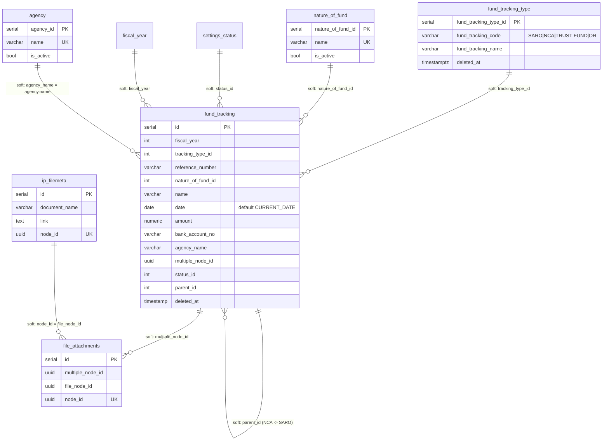
- **Table notes:**
  - fims.fund_tracking (`01 - table/29`): one table holds SARO, NCA, Trust Fund and OR records, told apart by tracking_type_id. It has **no FOREIGN KEYs**, so the service checks references in code (`validateReferences`). Alter 41 dropped `unreleased` and `sub_program_code` and set `date` to default CURRENT_DATE. Other columns: `remarks`, `purpose`, `user_id`, `created_at/updated_at`.
  - fims.fund_tracking_type (`26`): seeded with SARO, NCA, TRUST FUND, OR. Soft delete.
  - fims.nature_of_fund (`27`): seeded with Insertions, Equity, GAAAO, Unprogrammed, SUPPLEMENTAL. The SUPPLEMENTAL value routes records to the Supplemental Funds page.
  - fims.agency (`28`): a pick-list only. fund_tracking stores the agency **name** as text, not agency_id.
  - fims.ip_filemeta / fims.file_attachments (`17`, `18`): a generic attachment store. A record's documents are grouped by `multiple_node_id`.

### Check Registry

- **Status:** Empty placeholder (0-byte page) — `app/pages/check-registry-page.php` is 0 bytes and `views/CheckRegistryPage.php` only includes it.
- **Code:** none — the page file is 0 bytes.
- **Tables:** No tables yet for this page. Related tables do exist: `fims.check_register` (`01 - table/34`, header: "Backs the Check Disbursement Voucher module's 'Check Registry' tab"), `fims.checks` (`28`) and `fims.check_booklets` (`27`). They are used by `CheckProcessingService.php` and `CashPositionService.php`, not by this page.

### Accountable Forms Registry

- **Status:** Empty placeholder (0-byte page) — `app/pages/accountable-forms-registry-page.php` is 0 bytes.
- **Code:** none — the page file is 0 bytes.
- **Tables:** No tables yet. Nearest related table: `fims.official_receipts` / `official_receipt_lines` (`01 - table/40`), which backs the CRDJ tab on the Journals page, not this registry.

## Reports

### FMR

- **Status:** Empty placeholder (0-byte page) — `app/pages/fmr-page.php` is 0 bytes.
- **Code:** none — the page file is 0 bytes.
- **Tables:** No tables yet. Nothing FMR-specific exists in the SQL or the services.

### Remittance List (Deductions)

- **Status:** Empty placeholder (0-byte page) — `app/pages/remittance-list-page.php` is 0 bytes.
- **Code:** none — the page file is 0 bytes.
- **Tables:** No tables yet for the page. Source data a later build would read already exists: `fims.deduction_types` (`01 - table/20`), `fims.disbursement_voucher_deductions` (`21`) and `fims.atc_codes` (`17`).

## Ledgers

### General Ledger

- **Status:** Built — a read-only ledger card for one account, or all accounts, with a running balance. The GL table itself is written by DV/JEV posting.
- **Code:** `views/GeneralLedgerPage.php` → `app/pages/general-ledger-page.php`. Route `app/routes/general_ledger.php`: `GET /general_ledger/ledger` (`fetchGeneralLedger`/`fetchAllGeneralLedgers`). It also uses `/books/all`, `/chart_of_accounts/all`, `/fiscal_year/all`, and print via `GeneralLedgerPrintService`. Service: `app/services/GeneralLedgerService.php`. Posting is `postJev()` (l.106) and `reverseJev()` (l.179).
- **Tables written:** none from this page. fims.general_ledger is written by `postJev`/`reverseJev`, called from DV `changeStatus` (→FOR_TREASURY / FOR_TREASURY→CANCELLED), `changeJevStatus` (→POSTED), and `postStandaloneJev`. **Tables read:** fims.v_journals (general_ledger + journal_entry_vouchers + disbursement_vouchers + chart_of_accounts + books), fims.chart_of_accounts (account_type for debit/credit-normal sign), fims.books, fims.fiscal_year.
- **Status workflow:** none of its own. Rows are insert-only and are never updated. A reversal inserts swapped rows with `reversed_gl_id` set, and the JEV status moves POSTED → REVERSED.

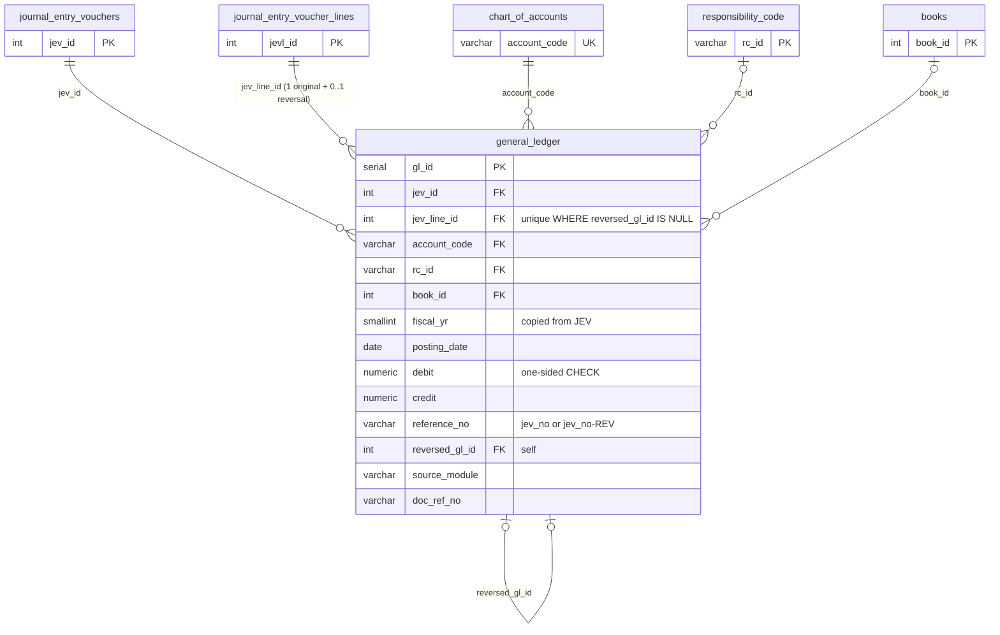

- **Table notes:**
  - `fims.general_ledger` (`01 - table/38`) has one row per posted JEV line. The CHECK constraint `chk_general_ledger_one_sided` allows debit or credit, never both. Alter 30 added `book_id` (FK books). Alter 31 added `source_module` and `doc_ref_no`. The original `sl_code`/`sl_detail_id` FKs to sl_masters/sl_details were removed by alter 37's `DROP TABLE ... CASCADE`, but the columns remain and postJev still copies them from the JEV line.
  - `fims.v_journals` (`05 - views/01`, re-created identically by alter 38) has one row per GL line with jev_no, dv_no, account_title, and book_name. `sl_name` and `sl_detail_name` are hard-coded to NULL.
  - `fims.books` (`01 - table/41`) seeds 5 books: MAIN-OFFICE, CISFA, NGC, MPLC, PPMO. `chart_of_accounts.books` (alter 39) is an unrelated comma-separated text tag (e.g. "MO, CISFA") and is not an FK.

### Subsidiary Ledger

- **Status:** Built (read-only) — An SL is a bottom-level chart_of_accounts row: `parent_account_id IS NOT NULL` and it has no children. There are no SL tables.
- **Code:** `views/SubsidiaryLedgerPage.php` → `app/pages/subsidiary-ledger-page.php`. Routes: `GET /general_ledger/subsidiary-ledger` (`GeneralLedgerService::fetchSubsidiaryLedger`/`fetchAllSubsidiaryLedgers`, l.741/806) and `GET /voucher/sl-codes` (`DisbursementVoucherService::fetchSlCodes`, l.534). `GET /voucher/sl-codes/{sl_code}/details` always returns `[]` (l.561). Print uses `SubsidiaryLedgerPrintService`.
- **Tables written:** none. **Tables read:** fims.v_journals (filtered by `account_code = <SL leaf account>`), fims.chart_of_accounts (self-join on `parent_account_id` for the leaf test and the parent's account_type), fims.books, fims.fiscal_year.
- **Status workflow:** none.

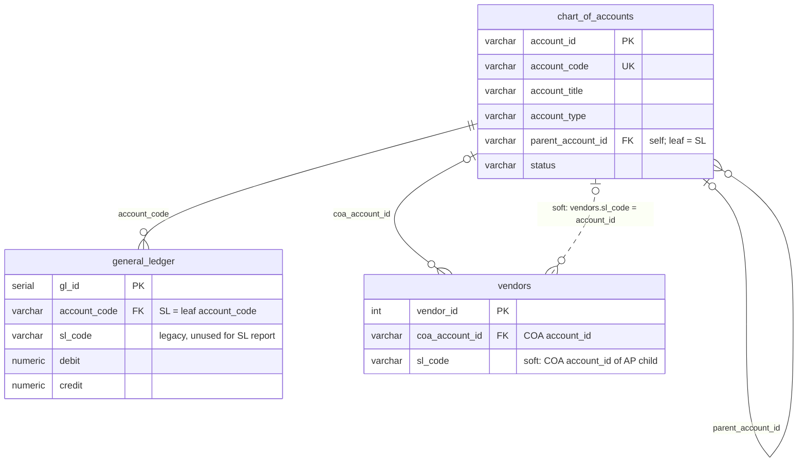

- **Table notes:**
  - `fims.chart_of_accounts` is shared. The SL hierarchy is `parent_account_id` → `account_id` (VARCHAR(10)). Alter 36 added `account_purpose`, and alter 39 added `books`.
  - `fims.sl_masters` and `fims.sl_details` (`01 - table/23/24`) are DROPPED by alter 37. Alter 20 (`sl_masters_set_account_code`) is therefore moot.
  - `fims.vendors`: `03 - alter/50` added `coa_account_id` (FK to COA `account_id`, ON DELETE SET NULL) and `sl_code` (soft link to a COA child `account_id`). The DV readone uses this to credit the vendor's AP sub-ledger account.

### Journals

- **Status:** Built (read-only) — It has four tabs: GJ (from the GL), and CKDJ, ADADJ, and CRDJ (each read from its own source table, not the GL).
- **Code:** `views/JournalsPage.php` → `app/pages/journals-page.php`. Route `app/routes/general_ledger.php`: `GET /general_ledger/journals` (`fetchJournals`, paged, from v_journals), `GET /general_ledger/ckdj` (`fetchCkdj`), `GET /general_ledger/adadj` (`fetchAdadj`), `GET /general_ledger/crdj` (`fetchCrdj`). Service: `GeneralLedgerService`.
- **Tables written:** none. **Tables read:** fims.v_journals, fims.checks, fims.ada_releases, fims.official_receipts, fims.official_receipt_lines, fims.disbursement_vouchers (joined by `dv_no = dv_number`), fims.journal_entry_vouchers (`dv_id`, book_id, jev_no), fims.bank_accounts, fims.chart_of_accounts, fims.books, fims.fiscal_year.
- **Status workflow:** none. It displays `checks.status` and `ada_releases.status` (RELEASED|CANCELLED).

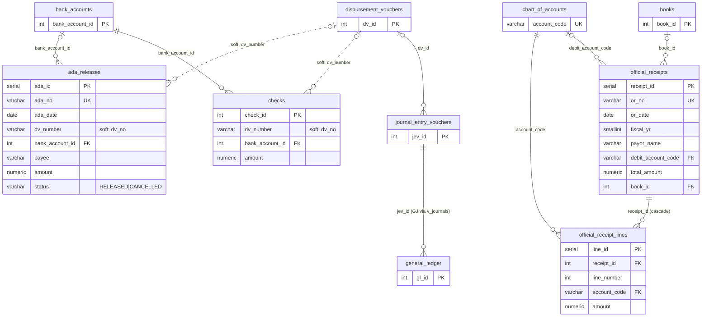

- **Table notes:**
  - `fims.ada_releases` (`01 - table/39`) records ADA payments. It has no `book_id`; the book is read through the JEV. No code in `app/` inserts into it.
  - `fims.official_receipts` and `fims.official_receipt_lines` (`01 - table/40`) record collections and are not posted to the GL. Alter 30 added `official_receipts.book_id`. No code in `app/` inserts into either table.
  - CKDJ and ADADJ join `journal_entry_vouchers ON jev.dv_id = d.dv_id` without filtering on `jev_type`.

### Trial Balance

- **Status:** Built (read-only) — per-account debit / credit totals from the `fims.v_trial_balance` view.
- **Code:** `views/TrialBalancePage.php` → `app/pages/trial-balance-page.php`. Route: `GET /general_ledger/trial-balance` (`GeneralLedgerService::fetchTrialBalance`, l.539, with `attachAccountGroups` doing a recursive CTE up `parent_account_id` for the major/sub group headers).
- **Tables written:** none. **Tables read:** fims.v_trial_balance (general_ledger grouped by fiscal_yr, book_id, and account; balance = debit − credit), fims.chart_of_accounts (recursive), fims.books, fims.fiscal_year.
- **Status workflow:** none.

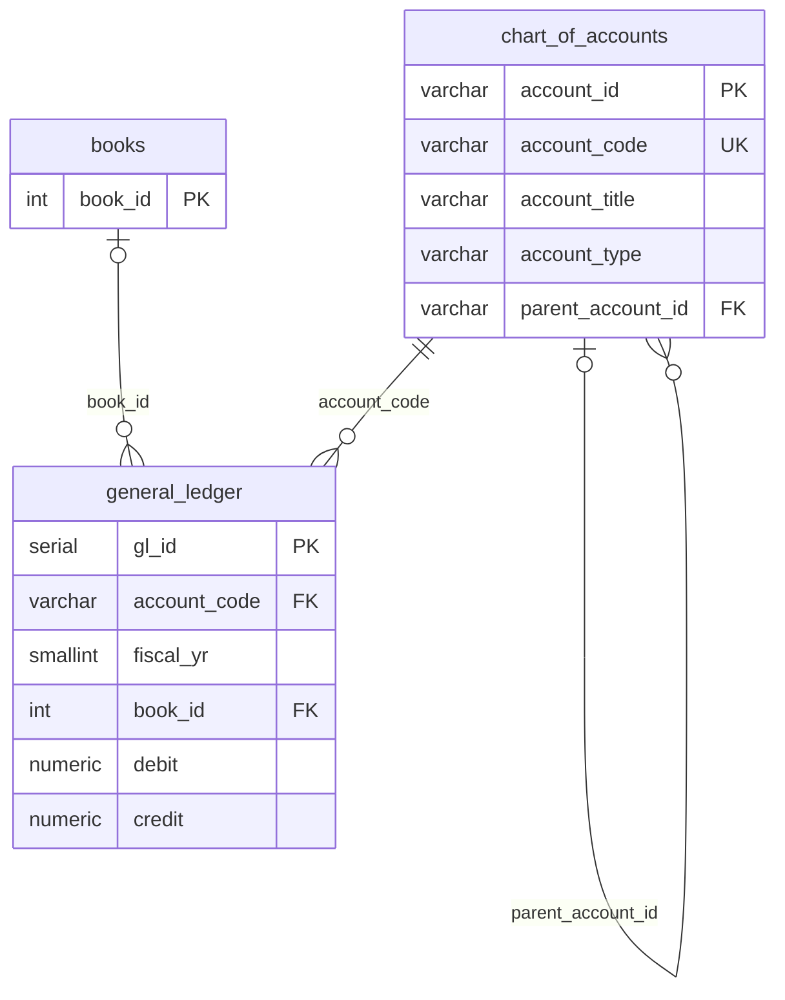

- **Table notes:**
  - `fims.v_trial_balance` (`05 - views/01`) groups by fiscal_yr, book_id, book_name, account_code, account_id, account_title, and account_type. The service re-aggregates across books when no book filter is given. Reversal rows are included, so they net out.

## Accounts Set-up

### Program

- **Status:** Built — The page does CRUD on fims.program.
- **Code:** `app/pages/program-page.php`; `app/routes/program.php` (`GET /program/next-code`, `/program/all`, `/program/list`, `/program/read/{code}`, `POST /program/add`, `PUT /program/update/{code}`, `DELETE /program/delete/{code}`); `app/services/ProgramService.php`.
- **Tables written:** fims.program (hard DELETE). **Tables read:** fims.project (the delete guard counts child projects, `ProgramService.php:167`).
- **Status workflow:** none.

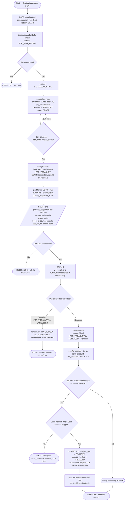

> A JEV row is only ever created by `saveJournalEntry()` at the `FOR_ACCOUNTING` stage — there is no
> auto-created empty JEV on DV add. `sl_code`/`sl_detail_id`/`rc_id` ride straight from the JEV line
> onto each posted `general_ledger` row — there is no separate SL posting step. `postJev()` is
> idempotent (a retried `FOR_ACCOUNTING → FOR_TREASURY` is rejected by the state machine, so no
> double-post); `RELEASED` is terminal, so `FOR_TREASURY → CANCELLED` is the only point a posted JEV
> can still be reversed.

**Standalone (no-DV) JEVs** skip this whole DV pipeline — Accounting prepares a period-end
adjusting/closing entry directly via the Add-JEV form (`createStandaloneJev()`, `dv_id IS NULL`,
always `DRAFT`), then posts it with its own explicit action (`postStandaloneJev()` →
`GeneralLedgerService::postJev()`), since there's no `FOR_ACCOUNTING → FOR_TREASURY` transition to
ride on.

**Design notes (as actually built, differences from the original draft called out):**

- **JEV gets `status_id`**, resolved through `fims.settings_status` with
  `status_for = 'journal_entry_voucher'` — same shared-lookup pattern as
  `disbursement_vouchers.status_id`. **Correction (2026-11-15):** the 2026-11-14 draft collapsed this
  to two statuses (`DRAFT → POSTED`) and dropped `APPROVED`; `APPROVED` is now back in the seed
  (`02 - sample_data/11` seeds all four: `DRAFT`, `APPROVED`, `POSTED`, `REVERSED`, and
  `journal-entry-voucher.php` has a badge for each). **In practice the posting path still writes
  `DRAFT → POSTED` directly** — `postJev()`'s own docstring says "flips it DRAFT → APPROVED → POSTED"
  but the code sets `status_id` to `POSTED` in one step; no code path currently writes the `APPROVED`
  row. It exists in the lookup/UI for the lifecycle's sake, not as an observed intermediate state.
- **Posting is triggered by the existing `FOR_ACCOUNTING → FOR_TREASURY` transition**, not a separate
  "approve JEV" action — `DisbursementVoucherService::changeStatus()` now wraps its own status
  update **and** `GeneralLedgerService::postJev()` in one `BEGIN…COMMIT`/`ROLLBACK` (that method
  wasn't transactional before this change; it is now).
- **`general_ledger.jev_line_id` is unique only among *original* postings** — a **partial unique
  index** (`WHERE reversed_gl_id IS NULL`), not a plain `UNIQUE` constraint as first drafted. A plain
  `UNIQUE` would have made reverseJev() impossible: a reversing row legitimately re-states the same
  `jev_line_id` with debit/credit swapped. `postJev()` is still idempotent — re-running it against an
  already-`POSTED` JEV is a no-op success.
  `fiscal_yr` has no FK (same looseness as `journal_entry_vouchers.fiscal_yr` itself).
- **Reversal only fires on `FOR_TREASURY → CANCELLED`**, not "a `RELEASED` DV later cancelled" as the
  draft said — `DisbursementVoucherService::TRANSITIONS` makes `RELEASED` terminal (nothing moves out
  of it), so `FOR_TREASURY → CANCELLED` is the *only* transition where a DV can be cancelled after
  its JEV was already posted. `reverseJev()` inserts one offsetting `general_ledger` row per original
  line (debit/credit swapped, `reversed_gl_id` pointing back) and flips the JEV to `REVERSED` — never
  deletes a posted row, same "never delete, link instead" convention as
  `check_cancellations.replacement_check_id`.
- **SL (Subsidiary Ledger) and Responsibility Center need no new table** —
  `journal_entry_voucher_lines.sl_code`/`sl_detail_id`/`rc_id` already exist (§2.3); posting just
  copies them onto the `general_ledger` row so SL-level reports can filter `general_ledger` directly
  instead of re-joining back to the JEV.

**Design notes — 2026-11-15 extension:**

- **Payment settlement is a second JEV, not an edit** (`03 - alter_table/31`). The SETUP JEV
  Accounting posts at `FOR_ACCOUNTING → FOR_TREASURY` typically raises Accounts Payable (Cr
  `2-01-01-010`); nothing used to settle it when Treasury actually paid — AP sat forever at its
  setup-time balance and Cash never moved. `CheckProcessingService::prepareCheck()` now calls
  `GeneralLedgerService::postPaymentJev()` right after the DV is `RELEASED`, which **inserts a distinct
  `journal_entry_vouchers` row** (`jev_type = 'PAYMENT'`, `source_module = 'TREASURY'`,
  `doc_ref_no = 'CHECK NO. …'`, its own JEV number) — Dr Accounts Payable / Cr the **bank account's
  mapped Cash account** (`bank_accounts.account_code`) — and posts it through the same `postJev()`. A
  bank account with no `account_code` mapped **errors out** (doesn't guess); a SETUP JEV that never
  routed through AP (paid straight from Cash) is a clean **no-op, not an error**. This is why `dv_id`
  is no longer plain-`UNIQUE` — one DV legitimately has a SETUP JEV *and* one or more PAYMENT JEVs.
- **`jev_type` (SETUP/PAYMENT) and `jev_classification` (REGULAR/ACCRUAL/…) are orthogonal**
  (`03 - alter_table/32`). `jev_type` is GL-posting mechanics — it's what the partial unique index and
  `postPaymentJev()` key off to tell Accounting's setup entry from Treasury's settlement entry for the
  same DV. `jev_classification` is a business/reporting label; a SETUP or PAYMENT JEV can carry any
  classification, and nothing about posting behavior changes with it. It defaults to `REGULAR` so every
  pre-existing JEV backfills cleanly.
- **Book is tagged on the JEV, never on the DV** (`03 - alter_table/30`). An earlier cut put `book_id`
  on `disbursement_vouchers` and copied it down, but that framed it as an Originating-time decision
  when it's really Accounting's call when they prepare the Journal Entry — so `disbursement_vouchers`
  has **no `book_id`**; it's set in `persistJournalEntry()` and copied onto each `general_ledger` row
  at post time (snapshot, not a live join — same as `fiscal_yr`). `fims.checks`/`ada_releases` need no
  book column of their own: CKDJ/ADADJ read it through the JEV they join to. `fims.books` **replaced an
  earlier attempt** to reuse `fims.type_of_fund` as the "Book" dimension — that was the wrong axis
  (fund cluster, not office/program entity); `type_of_fund` stays as-is for `budget_line_items`.
- **Standalone JEVs reuse the whole posting machinery** (`03 - alter_table/33`). `dv_id` is nullable
  so `createStandaloneJev()` can write a `DRAFT` JEV with no DV; the partial unique index
  (`WHERE jev_type = 'SETUP'`) tolerates any number of them because Postgres never treats two NULLs as
  equal. `postStandaloneJev()` is just a thin wrapper over `GeneralLedgerService::postJev()` — the
  standalone equivalent of the DV transition that fires posting. `fims.v_journals`'s DV join became a
  `LEFT JOIN` for exactly this reason (an INNER JOIN would have hidden every standalone posting).

---

## 3. Cross-schema links & known gaps

| From | To | Enforced? | Note |
|---|---|---|---|
| `uac.users.region_code` | `fims.responsibility_code.rc_code` | **Yes** (FK) | Scopes a user to one RCA code for Chart-of-Accounts row-level security; `NULL` = unrestricted. Superadmin (`user_level_id` containing `-1`) always bypasses it regardless |
| `uac.departments.rc_id` | `fims.responsibility_code.rc_id` | **No — can't be**: type mismatch | `departments.rc_id` is `int4`; `responsibility_code.rc_id` is `VARCHAR(10)`. The column exists ("Responsibility Center Code for financial tracking") but cannot physically FK to the table it's named after. Same issue on `uac.offices.rc_id` |
| `fims.expense_class` | *(nothing)* | — | Seeded with `CO`/`PS`/`MOOE`/`EO` but **no longer referenced by any FK** — `budget_req.expense_class_id` (its only consumer) was dropped in `03 - alter_table/02 - budget_req_remove_expense_class_flow.sql`. `purchase_orders.expense_class` is a separate, differently-valued free-text column, not a link to this table. Orphaned lookup table; confirm nothing reads it before dropping |
| `fims.budget_line_items.component_id` / `.type_of_fund_id` | `fims.component_type` / `fims.type_of_fund` | No | Named and seeded to match, but no FK constraint exists yet (see table comment in `03 - alter_table/06`) |
| `fims.budget_revision.from_budget_line_item_id` / `.to_budget_line_item_id` | `fims.budget_line_items.budget_line_item_id` | No | New in `03 - alter_table/23`; no FK, so nothing stops a dangling value — a Draft request's Program edit deletes and re-creates its lines — and a revision whose line is gone (or that was filed before budget lines were revised) still lists, with the line's details blank. The legacy `from_budget_req_id` / `to_budget_req_id` columns point at nothing |
| `fims.budget_allocation.{program,sub_program,project}_id` | `fims.{program,sub_program,project}` | No — can't be | Those tables are keyed by `*_code VARCHAR`, not an integer id; `budget_allocation` stores integers. Intentionally unconstrained per `03 - alter_table/08` |
| `fims.disbursement_vouchers.rfa_allocation_id` | `fims.budget_allocation.allocation_id` | No | `fims.budget_allocation` has no CRUD backend of its own yet (see §2.1); `DisbursementVoucherService::fetchRfaOptions()`/`fetchRfaDetail()` are a read-only lookup over it, no FK |
| `fims.budget_allocation.dv_id` | `fims.disbursement_vouchers.dv_id` | No | The reverse link (which DV an RFA row is currently drawn into). Same "no CRUD backend yet" reasoning as the row above; `DisbursementVoucherService` enforces the one-RFA-backs-one-active-DV-at-a-time rule in PHP, not the schema. LAA rows never populate this — only RFA is wired into the DV module so far |
| `fims.disbursement_vouchers.requesting_department_id` | `uac.departments.department_id` | No | Snapshotted from the selected RFA at save time, same unconstrained convention as the RFA link itself |
| `fims.disbursement_vouchers.account_code` | `fims.chart_of_accounts.account_code` | No | Required and `posting_allowed`-checked in `DisbursementVoucherService::prepare()`, not a DB FK — mirrors `purchase_order_items.account_code`'s "FK targets an alternate key" exception in §2.2, except here there's no FK at all, only the PHP check |
| `fims.checks.dv_id` | `fims.disbursement_vouchers.dv_id` | No | Only a `FOR_TREASURY` DV can get a check prepared against it (`CheckProcessingService::saveCheck()`), checked in PHP, no DB FK — see §2.6 |
| `fims.property_records.po_number` | `fims.inspection_acceptance_report.po_number` | No | Joined at read time (with or without the `PO-` prefix); a PO must have an IAR before it can be searched / saved. `line_transaction[].inv_id` is unique across all rows — checked in PHP (JSONB cannot carry a key) |
| `fims.inspection_acceptance_report.po_number` | `fims.purchase_orders.po_number` | No | Picked from the Budget Allocation, not typed: `PoDrService` only accepts a `po_number` of a `fims.budget_allocation` row with `allocation_type = 'RFA'` (checked in PHP, see DEVELOPER-GUIDE §8.4). It does **not** reference `purchase_orders` — the PO module has no data yet — and there is no DB FK to `budget_allocation.po_number` either (it is not unique there) |
| `fims.inspection_acceptance_report.line_transaction[].lines[].account_code` | `fims.chart_of_accounts.account_code` | No | Inside a JSONB array, so there can be no FK: `PoDrService::clean()` checks that each code exists in the chart of accounts and stores the account title next to it (a later title change in the chart does not rewrite it) |
| `fims.fund_tracking.{tracking_type_id,nature_of_fund_id,agency_name,status_id,parent_id}` | `fund_tracking_type` / `nature_of_fund` / `agency` (by name) / `settings_status` / `fund_tracking` (self) | No | `fims.fund_tracking` declares no FOREIGN KEYs at all; `validateReferences()` checks every id/code in PHP — see §2.7 |
| `fims.pricing_requests` / `fims.pricing_request_attachments` | *(no table exists)* | — | `PricingRequestService` targets both, but no SQL file in this repo creates either — see §2.7 / developer guide §7.6. Every `/pricing_requests/*` endpoint SQL-errors against a fresh install |

None of the above are bugs to silently "fix" by adding a constraint — several are deliberate
(per the cited comments). Treat this table as a map of where the schema's actual guarantees stop,
not a to-do list.

---

## Related docs

- `system_docs/developerguide/DEVELOPER-GUIDE.md` — architecture, conventions, modules (process flow).
- `system_docs/modules/COB-MONITORING.md`, `system_docs/modules/PRINT-FORMS.md` — module docs.
- `_assets/sql/README.md` — SQL folders and installer.
