# FIMS NHA — System Process Flow

**Step-by-step walkthrough, from set-up to the posted ledgers — for SQA testing and CPA review**

> **Status:** written 2026-11-17, updated 2026-11-24 (DV: optional SARO, PO→IAR warning, "Return" label, DV print in GL codes with RFA obligation / TOTAL / up to 18 rows, payroll deductions amount-only; RFA / LAA printing resumed; payroll DV checked against its RFA: gross + employer share, Approved RFA, same fiscal year, Personnel Services line; Budget Amendment, CBA / RFA / LAA printing for FMD only, GL and SL prints, one Budget Proposal page for offices and FMD, Payroll sidebar group, FTLA release, Collections journalizing, GL roll-up; earlier: per-agency remittance DVs, automatic payment JEV, Payroll
> Management YTD / File Template, print notes) from the current code (`app/`) and the status chains in its services. Follows the
> sidebar modules (`views/menu.php`). Tables behind each step: `system_docs/ERD/README.md`.
> PDF version: `system_docs/process-flow/PROCESS-FLOW.pdf` — the flowcharts of this file, one process per page in
> order, in the ITBS process-flow layout (letterhead, process title, flowchart). The walkthrough tables are in this
> file only.

## How to use this document

- **Follow the sections in order.** Each section uses what the sections before it created: a CBA needs an approved
  COB, an RFA needs an approved CBA, a Disbursement Voucher needs an approved RFA, and so on. The line **Needs:** at
  the top of each section says what must exist first.
- Each section has a **walkthrough table** — Step, *Log in as*, *Where* (sidebar → page), *Do this*, *Expected
  result* — followed by its **flowchart**.
- **Expected result** is what to check on screen: the status shown, a number assigned, an amount that changes. A
  result that differs is a finding.
- Rows marked **(alternative)** are the "No" branch of the flowchart: test them too, then continue from the step they
  point back to.
- **Reading the flowcharts:** rounded box = start / end; STEP box = line 1 the step, line 2 *who acts and on which
  page*, bullets = what is done and the resulting status; diamond = a decision; a **No** branch goes to a correction
  box and back to the step that redoes the work; dotted arrows are side processes.

## Before you start — accounts needed

Approvals are checked in two ways: memo requests and budget requests check the user's **user level** (role name);
Disbursement Vouchers and Journal Entry Vouchers check the user's **office** (Responsibility Center). Each tester
account needs both set correctly (Section 1, step 2).

| Role (user level) | Office (Responsibility Center) | Acts in sections |
|---|---|---|
| System Administrator | any | 1 |
| Requesting office user | a Regional / District office | 3, 5, 6, 8 |
| Budget Officer | Financial Management Department — FMD (RC 013) | 3 |
| Budget Head | FMD (RC 013) | 3 |
| FMD Section Chief | FMD (RC 013) | 5, 6 |
| FMD Division Manager | FMD (RC 013) | 5, 6 |
| FMD Department Manager | FMD (RC 013) | 5, 6 |
| FMD user (Fund Sourcing) | FMD (RC 013) | 2, 8 (FMD review of the DV) |
| Accounting Section Chief | Accounting Department (RC 012) | 8, 8B, 10 |
| Accounting Division Manager | Accounting Department (RC 012) — a different account from the Section Chief | 8, 10 |
| Accounting Department Manager | Accounting Department (RC 012) — a different account from the two above | 8, 10 |
| Treasury Officer | Treasury Department (RC 014) | 8B, 9 |
| Payroll officer | any office given access to Payroll Setup (Accounts Set-up) and the Payroll group (Payroll Management, Remittance) | 1, 8A |
| Any user (read-only checks) | any | 11 |

## Contents

0. [End-to-end overview](#0-end-to-end-overview)
1. [Set-up and administration](#1-set-up-and-administration)
2. [Fund sources (registry)](#2-fund-sources-registry)
3. [Budget preparation (COB)](#3-budget-preparation-cob)
4. [Budget amendment (optional)](#4-budget-amendment-optional)
5. [Request for Allocation — CBA](#5-request-for-allocation--cba)
6. [Request for Allocation — RFA / LAA and CAF](#6-request-for-allocation--rfa--laa-and-caf)
7. [Deliveries and IAR](#7-deliveries-and-iar)
8. [Disbursement Voucher](#8-disbursement-voucher)
8A. [Payroll — import and payroll DV](#8a-payroll--import-and-payroll-dv)
8B. [Payroll deductions — remittance](#8b-payroll-deductions--remittance)
9. [Check release and payment entry](#9-check-release-and-payment-entry)
10. [Adjusting entries (Journal Entry Voucher)](#10-adjusting-entries-journal-entry-voucher)
11. [Verification — ledgers and monitoring](#11-verification--ledgers-and-monitoring)
12. [Not built yet and known limitations](#12-not-built-yet-and-known-limitations)

## 0. End-to-end overview

The whole cycle on one page. Sections 1 to 11 below go through each box in this order.

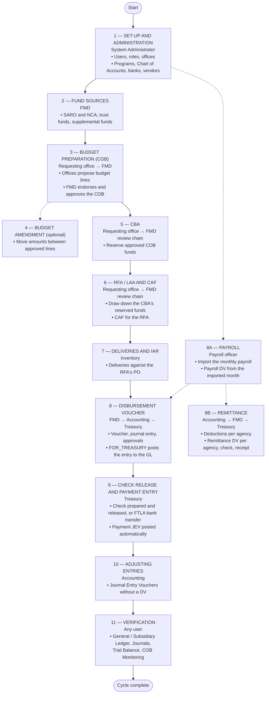

## 1. Set-up and administration

**Needs:** nothing — this comes first. **Sidebar:** Administration, Accounts Set-up.

| Step | Log in as | Where (sidebar → page) | Do this | Expected result |
|---|---|---|---|---|
| 1 | System Administrator | Administration → Position Management | Add the position categories and positions | They are listed |
| 2 | System Administrator | Administration → User Access Management | Create one user per role in *Before you start*; set each user's user level, position and Responsibility Center | Each user can log in and sees only the menus of that role |
| 3 | System Administrator | Administration → User Level Management | Review the roles and their permissions | Each role has access to its modules |
| 4 | System Administrator | Administration → Department Management | Check the departments and budget units | Org hierarchy is correct |
| 5 | System Administrator | Accounts Set-up → Program, then Sub Program | Add a program and its sub-programs | Listed under the program |
| 6 | System Administrator | Accounts Set-up → Chart of Accounts | Check the GL accounts and their bottom-level (SL) accounts are Active; set their Books | Accounts show as Active |
| 7 | System Administrator | Accounts Set-up → Responsibility Center | Check FMD (013), Accounting (012), Treasury (014) and the requesting offices are Active | Listed as Active |
| 8 | System Administrator | Accounts Set-up → Banks Accounts | Add the disbursing bank account and tag its Cash account (GL account code, e.g. 1-01-02-020) | Status ACTIVE; Cash account shown |
| 9 | System Administrator | Accounts Set-up → Vendors | Add a vendor with its assigned Chart of Accounts account | Vendor is ACTIVE and can be picked in an RFA |
| 10 | Payroll officer | Accounts Set-up → Payroll Setup | Add one payroll item per amount column of the payroll import form: item code = the column name (e.g. BASIC_SALARY), category (Earning / Deduction / Refund / Employer Share) and its account | Items ACTIVE; Payroll Management → File Template shows those columns as set up |
| 11 | Each new user | Change Password | Change the initial password | Password updated |

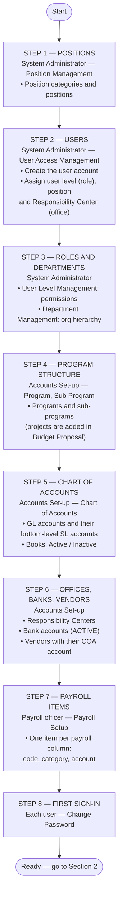

## 2. Fund sources (registry)

**Needs:** Section 1. **Sidebar:** Registry/NCA, Fund Sourcing. Independent of the budget cycle; recorded as fund
documents arrive.

| Step | Log in as | Where (sidebar → page) | Do this | Expected result |
|---|---|---|---|---|
| 1 | FMD user | Registry/NCA → SARO Registry (SARO tab) | Add a SARO: number, date, agency, nature of fund, amount | Listed in the SARO tab |
| 2 | FMD user | Registry/NCA → SARO Registry (NCA tab) | Add an NCA under that SARO | Shown under its SARO |
| 3 | FMD user | Fund Sourcing → Trust Funds | Add a trust fund, then its Official Receipts | ORs listed under the trust fund |
| 4 | FMD user | Fund Sourcing → Supplemental Funds | Add a supplemental fund request | Status IN_PROCESS |
| 5 | FMD user | Fund Sourcing → Supplemental Funds | Move it AT_NDRRMC → AT_OP → APPROVED (or DENIED) | Status updates at each move |
| 6 | FMD user | Fund Sourcing → Fund Sourcing Dashboard | Review the totals | SARO, NCA, trust and supplemental totals include the new records |

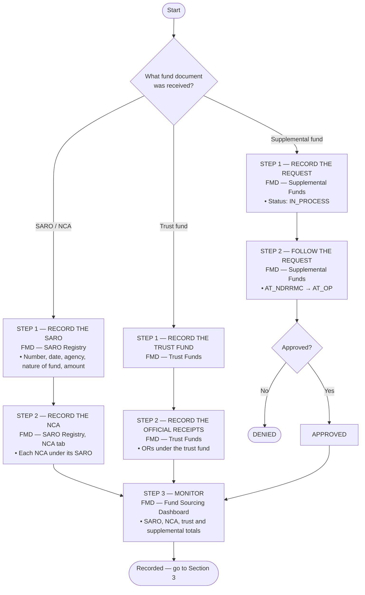

## 3. Budget preparation (COB)

**Needs:** Section 1. **Sidebar:** COB Preparation → Budget Proposal — one page for both: each office sees and edits its
own request; FMD sees every office's request (one row per request, plus **View Proposal** for the whole fiscal year).
The separate FMD Budget Proposal page was removed.
**Statuses:** Draft, For Review, Endorsed, Approved, Returned, Returned to Budget Officer.

| Step | Log in as | Where (sidebar → page) | Do this | Expected result |
|---|---|---|---|---|
| 1 | Requesting office user | COB Preparation → Budget Proposal | Create the request for the fiscal year; add a Program, its Projects, and budget lines (Chart of Accounts account + proposed amount); attach documents; save | Status Draft — still editable |
| 2 | Requesting office user | Budget Proposal | Submit for Review | Status For Review — request locked |
| 3 | Budget Officer (FMD) | COB Preparation → Budget Proposal → row Actions → **Budget Processing** | Open the request: set the suggested amount, type of fund and component per line → Endorse | Status Endorsed |
| 3a | Budget Officer (alternative) | Budget Proposal | Return with remarks | Status Returned — office edits and repeats step 2 |
| 4 | Budget Head (FMD) | Budget Proposal → row Actions → **Budget Review** | Approve | Status Approved; the row then has no Actions for the Budget Head |
| 4a | Budget Head (alternative) | Budget Preview | Return with remarks | Status Returned to Budget Officer — repeat step 3 |
| 5 | Any user | Monitoring → COB Monitoring | Find the office and fiscal year | Lines shown; Approved Amount = the suggested amount |

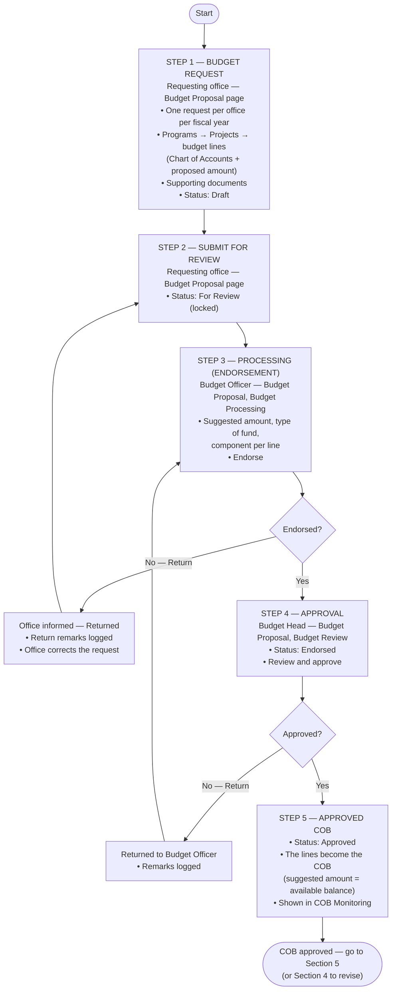

## 4. Budget amendment (optional)

**Needs:** an approved COB (Section 3). **Sidebar:** COB Preparation → Budget Amendment (the page was called Budget
Revision; the records are still budget revisions).
**Statuses:** Saved → Submitted → Approved (or Declined).

| Step | Log in as | Where (sidebar → page) | Do this | Expected result |
|---|---|---|---|---|
| 1 | Budget office user | COB Preparation → Budget Amendment | Add a revision: From budget line, new amount, reason — or, on the Realignment tab, From line, To line and the amount to transfer, reason | Status Saved — still editable (Actions → Edit) |
| 1a | Budget office user | Budget Amendment | Actions → Process on the saved request | Status Submitted — it can no longer be edited |
| 2 | Reviewer | Budget Amendment | Review → Approve (Submitted requests only) | Status Approved; a transaction is recorded for each line (From goes down, To goes up) — COB Monitoring's Revision / Realignment column adds them up (− in red on the budget that gave funds up, + in green on the one that received them) |
| 2a | Reviewer (alternative) | Budget Amendment | Review → Decline | Status Declined; no amounts change |
| 3 | Any user | Monitoring → COB Monitoring | Open the revised lines | Revision / Realignment column shows the change (red −, green +) |

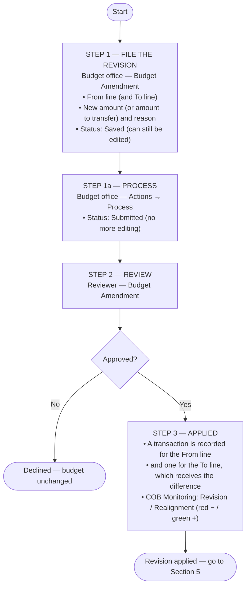

## 5. Request for Allocation — CBA

**Needs:** an approved COB (Section 3). **Sidebar:** Budget Process → Request for Allocation (CBA). FMD reviews from
the same list with **Process**. **Statuses:** Draft, For Review, For Division Manager, For Department Manager,
Approved, Returned, Returned to Section Chief, Returned to Division Manager.

| Step | Log in as | Where (sidebar → page) | Do this | Expected result |
|---|---|---|---|---|
| 1 | Requesting office user | Budget Process → Request for Allocation (CBA) | New: pick approved COB budget lines, requested amount per line, program / project, category, description; attach documents; save | Status Draft — Print Preview available |
| 2 | Requesting office user | Request for Allocation (CBA) | Submit for Review | Status For Review |
| 3 | FMD Section Chief | Request for Allocation (CBA) → Process | Approve | Status For Division Manager |
| 3a | FMD Section Chief (alternative) | Process | Return with remarks | Status Returned — office edits and repeats step 2 |
| 4 | FMD Division Manager | Process | Approve | Status For Department Manager |
| 4a | FMD Division Manager (alternative) | Process | Return | Status Returned to Section Chief — repeat step 3 |
| 5 | FMD Department Manager | Process | Approve | Status Approved; a CBA number is assigned |
| 5a | FMD Department Manager (alternative) | Process | Return | Status Returned to Division Manager — repeat step 4 |
| 6 | FMD user or administrator (print); any user (COB Monitoring) | Request for Allocation (CBA) → Print; Monitoring → COB Monitoring | Print the CBA (FMD and administrators only — others have no Print, and the API refuses them); open the COB lines | CBA column = the CBA amount; Available reduced by it |

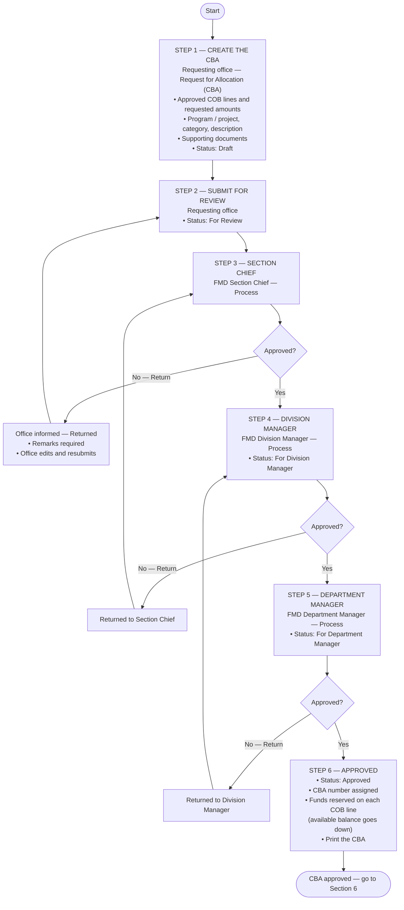

## 6. Request for Allocation — RFA / LAA and CAF

**Needs:** an approved CBA (Section 5). **Sidebar:** Budget Process → Request for Allocation (RFA/LAA). Same review
chain and statuses as the CBA.

| Step | Log in as | Where (sidebar → page) | Do this | Expected result |
|---|---|---|---|---|
| 1 | Requesting office user | Budget Process → Request for Allocation (RFA/LAA) | New RFA (or LAA): link the approved parent CBA; for an RFA the vendor, PR and PO numbers and amounts; amount per budget line; save | Status Draft |
| 2 | Requesting office user | Request for Allocation (RFA/LAA) | Submit for Review | Status For Review |
| 3–5 | FMD Section Chief → Division Manager → Department Manager | Process | Approve at each step (returns work as in Section 5) | Status Approved; RFA / LAA number assigned |
| 5b | FMD Department Manager (alternative) | Process | Approve an amount larger than the CBA's remaining reserved balance | Approval blocked — lower the amount or link another CBA |
| 6 | FMD user (a superadmin is exempt from the restrictions) | Approved RFA row → Actions → Create CAF | Create the Certificate as to Availability of Funds — only an FMD user can, only for an RFA whose status is Approved, and only while that RFA has no CAF yet (the action disappears once it has one) | CAF saved; Print CAF available |
| 7 | FMD user or administrator (print); any user (COB Monitoring) | Print; Monitoring → COB Monitoring | Print the RFA / LAA (FMD and administrators only) and the CAF; open the COB lines. An RFA / LAA drawing from several CBAs prints the summed amounts — an RFA shows the first block's project, an LAA no project | RFA / LAA column increased; Remaining reduced |

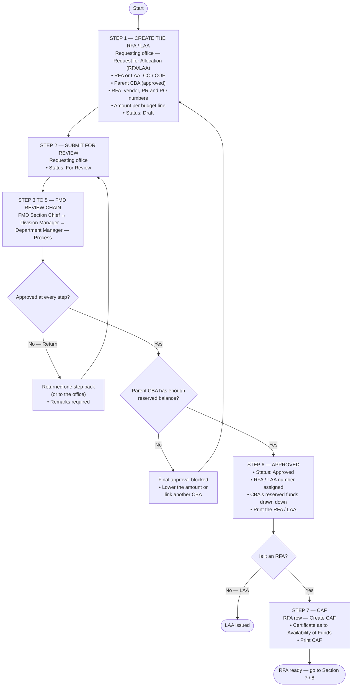

## 7. Deliveries and IAR

**Needs:** an approved RFA with a PO number (Section 6). **Sidebar:** Inventory → IAR Module (Deliveries tab).
For purchases; skip for payments without deliveries.

| Step | Log in as | Where (sidebar → page) | Do this | Expected result |
|---|---|---|---|---|
| 1 | Inventory user | Inventory → IAR Module (Deliveries) | Select the PO number of the RFA | PO amount and remaining balance shown |
| 2 | Inventory user | IAR Module | Add the delivery receipt: DR number, date, amount, accounts; items with serial / property numbers (₱50,000 and up) | Delivery saved |
| 2a | Inventory user (alternative) | IAR Module | Enter a DR above the PO balance, or a repeated DR / serial number | Rejected with a message |
| 3 | Inventory user | IAR Module | Enter the IAR number and sales invoice number / date | IAR recorded for the PO |
| 4 | Inventory user | IAR Module → pro-forma JEV | Print JEV | Dr delivery accounts / Cr Accounts Payable |
| 5 | Inventory user | IAR Module | Repeat step 2 until the PO is fully delivered | Remaining balance reaches zero |

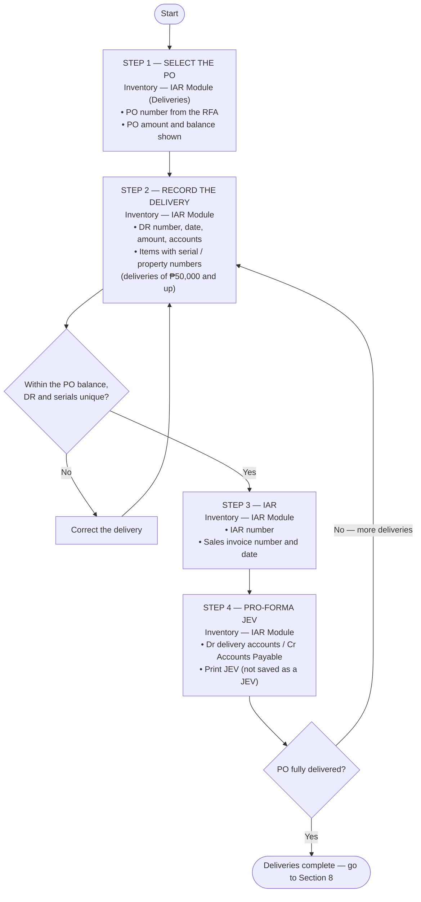

## 8. Disbursement Voucher

**Needs:** an approved RFA (Section 6); for purchases, the deliveries (Section 7). **Sidebar:** DV Processing →
Disbursement Voucher. **Statuses:** DRAFT, FOR_FMD_REVIEW, FOR_ACCOUNTING, FOR_DIVISION_MANAGER,
FOR_DEPARTMENT_MANAGER, FOR_TREASURY, RELEASED, REJECTED, CANCELLED. Only the office holding the voucher can move it.

| Step | Log in as | Where (sidebar → page) | Do this | Expected result |
|---|---|---|---|---|
| 1 | Requesting office user | DV Processing → Disbursement Voucher | New DV: claimant / payee, particulars, gross amount; link the approved RFA(s); optionally the **SARO** its bank account comes from (one per DV — Check Preparation then fills that bank account in); a PO number without an IAR shows a warning; deductions and withholding taxes (ATC); attach documents; save. The accounting entries (Section D) are not on the create form — Accounting enters them in step 4 | Status DRAFT |
| 1a | Requesting office user (alternative) | New DV | Enter an amount above the RFA's remaining balance, or deductions above the amount | Not saved — the reason is shown. Only an **Approved** RFA can be picked or saved on any DV. Remittance DVs carry no RFA (Section 8B); payroll DVs have their own RFA check (Section 8A step 5d) |
| 2 | Requesting office user | Disbursement Voucher | Submit to FMD | Status FOR_FMD_REVIEW |
| 3 | FMD user (RC 013) | Disbursement Voucher → view | Move to the next stage | Status FOR_ACCOUNTING |
| 3a | FMD user (alternative) | view | **Return** with a reason (the button was "Reject") | Status REJECTED (shown as RETURNED) — it can only be cancelled; a new DV is needed |
| 4 | Accounting Section Chief (RC 012) | Disbursement Voucher → Accounting Entries | **Choose the Book** (required); enter the balanced journal entry: accounts, SL accounts, responsibility centers; move to the next stage (the entries are saved automatically on forward) | Status FOR_DIVISION_MANAGER |
| 4a | Accounting Section Chief (alternative) | Accounting Entries | Forward with no Book chosen, or debits ≠ credits | Refused — choose the Book / balance the entry first |
| 5 | Accounting Division Manager (RC 012) — **a different user** from step 4 | view | Move to the next stage | Status FOR_DIVISION_MANAGER → FOR_DEPARTMENT_MANAGER |
| 5a | (alternative) | view | The same user who acted in step 4 tries to forward again | Refused — each Accounting level must be a different user |
| 6 | Accounting Department Manager (RC 012) — a different user from steps 4 and 5 | view | Approve | Status FOR_TREASURY; its journal entry is POSTED |
| 7 | Any user | Disbursement Voucher → Print; DV Processing → Journal Entry Voucher | Print the DV; find its journal entry | The SETUP JEV shows POSTED. The DV print's Accounting Entries show **GL codes only** — SL lines summed into their 4-part GL (e.g. 2-02-01-020-10 → 2-02-01-020), one row per GL; OBLIGATION = the RFA number on the debit lines; the last row is the TOTAL of debits and credits; over 10 lines the grid is redrawn with smaller rows so up to 18 lines fit on the form (past 18, the last row reads SEE ATTACHED and the attachment page lists them all) |

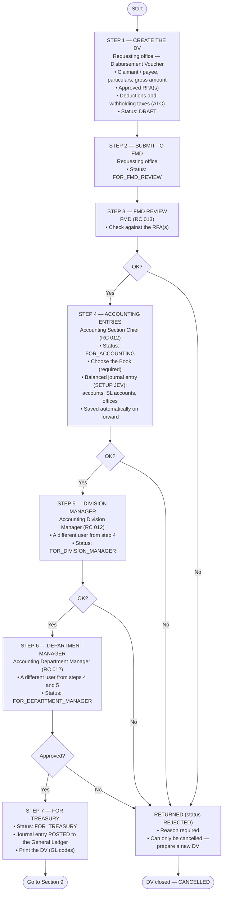

> A DV can also be **cancelled** at any open stage by the office holding it or its creator. Cancelling at
> FOR_TREASURY reverses the posted General Ledger entry — test it on a separate DV.

## 8A. Payroll — import and payroll DV

**Needs:** Section 1 (payroll items in Payroll Setup) and an RFA for the payroll (Section 6). **Sidebar:** Payroll →
Payroll Management, DV Processing → Disbursement Voucher. **Payroll month status:** Imported → DV Created
(back to Imported when the DV is cancelled or deleted). The payroll DV then follows Section 8 from step 2.

| Step | Log in as | Where (sidebar → page) | Do this | Expected result |
|---|---|---|---|---|
| 1 | Payroll officer | Payroll Management → File Template | Follow the steps card; check the readiness banner (every amount column set up in Payroll Setup); look up a column in the amount-columns list (search box); Download Import Form; fill one row per employee (employee no., names and the amounts) | The file has the payroll office's columns and no employee rows |
| 2 | Payroll officer | Payroll Management → Payroll Imports → Import Payroll | Pick the month and year, choose the file, Preview | Employees, gross, deductions, refunds, net and employer share shown; nothing saved yet |
| 2a | Payroll officer (alternative) | Import Payroll → Preview | A file with a column not set up in Payroll Setup, a repeated employee no. or a text amount | "Cannot import yet" with the reason — add the item in Payroll Setup / fix the file, then Preview again |
| 3 | Payroll officer | Import Payroll | Import | Month listed: Import Date, status Imported, Total Payroll Amount = gross |
| 3a | Payroll officer (alternative) | Import Payroll | Import the same month again | Asked to replace it; Replace Import replaces the month |
| 4 | Payroll officer | Payroll Management → Year-to-Date Report | Pick the Fiscal Year and Month (Whole Year or one month) — the report loads by itself (no Generate button) | One row per month: employees, gross, deductions, refunds, net pay, employer share, with totals; they agree with the file. The month name in Payroll Imports is plain text (no records window) |
| 4a | Payroll officer | Year-to-Date Report → **Export CSV** | Export for the same filter | CSV with one row per employee: Emp No., Last / First / Middle name, Department, Months, Gross Pay, Deductions, Refunds, Net Pay, Employer Share, and a TOTAL row |
| 5 | Requesting office user | Payroll Management → Payroll Imports → **Create DV** on the month | Disbursement Voucher opens a New DV for the month (Vendor or Payroll = "Payroll — month"); pick the RFA; save | Claimant, particulars, amount, deductions and the balanced accounting entry were filled; DV DRAFT; the month shows **DV Created** and its button becomes **View DV**. On save the server re-reads the Amount and deductions from the imported month (edits to them are ignored). On the payroll DV (form, view and at Accounting) each deduction shows its name and amount only — no Rate box (the import has none), no remove / "+ TYPE" buttons |
| 5d | Requesting office user (alternative) | New DV (payroll) | Pick an RFA that is not Approved, is for another fiscal year than the payroll month, has no Personnel Services line (5-01-…), or whose remaining balance is below the payroll's **gross + employer share** | Not saved — the reason is shown (e.g. "The January 2026 payroll needs 96,850.36 (gross 84,568.00 + employer share 12,282.36) but the selected RFA(s) have only 50,000.00 remaining.") |
| 5a | Requesting office user (alternative) | New DV | Change Vendor or Payroll back to None | Every field the payroll filled is cleared |
| 5b | Payroll officer (alternative) | Payroll Imports | Replace the month while it has a DV | Refused — "used by Disbursement Voucher …". An import cannot be deleted from the page |
| 5c | Any user | Payroll Imports → **View DV** | Open the month's DV | The DV's view opens in Disbursement Voucher |
| 6 | (Section 8) | Disbursement Voucher | Submit and process the payroll DV as in Section 8, steps 2–7 | FOR_TREASURY; the payroll entry is posted |
| 6a | Office holding the DV (alternative) | Disbursement Voucher | Cancel the payroll DV | The month is back to Imported and can be used by a new DV |

The payroll DV's accounting entry: Dr each earnings account (e.g. Salaries and Wages, PERA), Cr each deduction
account (Due to BIR, GSIS, Pag-IBIG, PhilHealth, other payables), Cr Accounts Payable for the net pay. The
employer share is not on the payroll DV. The payroll's RFA also covers the government share: the remittance DVs
(Section 8B) need no RFA of their own — so the RFA's "paid" for a payroll DV is its gross + employer share (for any
other DV, its gross amount).

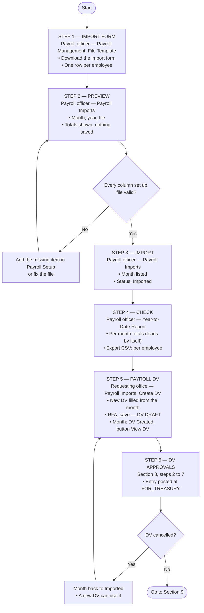

## 8B. Payroll deductions — remittance

**Needs:** Section 8A (an imported payroll month). The payroll DV does **not** have to exist first — the remittance DVs
are separate DVs. For the check: Section 9's set-up — blank checks registered and cash recorded for the bank (Cash
Position). **Sidebar:** Payroll → Remittance; DV Processing → Disbursement Voucher, Disbursement Preparation.
**Month status:** Pending (no agency has a DV) → In process → Remitted (every agency paid) → Confirmed (every agency
confirmed). **Agency status:** Pending → DV in process → Remitted → Confirmed. There is **no Schedule step**. Each
agency is paid through **its own remittance DV** (claimant = the agency) and needs **no RFA** — the government share is
budgeted with the payroll; the payroll DV and its RFA are only shown for reference.

| Step | Log in as | Where (sidebar → page) | Do this | Expected result |
|---|---|---|---|---|
| 1 | Any user with access | Payroll → Remittance | Filter by year / month / status; click a month row to expand it | One row per month with its status and the hint "N employees · Payroll DV … · RFA …". Only one month is open at a time — opening another closes the first |
| 2 | Any user with access | Remittance → open month → click an agency name | Check the agency's detail | One row per agency (GSIS, BIR, PhilHealth, Pag-IBIG, Other Payables): employee share, government share, total to remit; the detail lists the items and each employee's amounts. NHA receivables show "Collected by NHA" and have no button |
| 3 | Accounting Section Chief (RC 012) | Remittance → open month → **Create DV** on an agency | The New DV opens filled for that agency only: claimant = the agency, amount = total to remit, particulars naming the payroll DV / RFA; the card reads "Belongs to payroll DV … · RFA … — no RFA needed on this DV". Vendor / PO, address, RFA and deductions are hidden. Save | DV DRAFT; the agency row shows **DV in process** with the DV no.; the month becomes **In process** |
| 3a | Non-Accounting user (alternative) | Remittance | Look for Create DV | Not shown — "Only Accounting Department staff can create remittance DVs" |
| 3b | Accounting (alternative) | Remittance | Create DV again on an agency that already has a live DV | Not offered / refused — one remittance DV per agency per month |
| 4 | (Section 8) | Disbursement Voucher | Submit; FMD; Accounting Section Chief chooses the Book → Division Manager → Department Manager | FOR_TREASURY; the entry posts — Dr the agency's "Due to …" payable (+ Dr the government-share expense) / Cr Accounts Payable |
| 4a | Office holding the DV (alternative) | Disbursement Voucher | Cancel the remittance DV | The agency goes back to **Pending** and Create DV is offered again |
| 5 | Treasury Officer (RC 014) | DV Processing → Disbursement Preparation → Prepare Check | Pick the remittance DV and the bank (the next blank check fills in) | Check PREPARED; the DV becomes RELEASED; the **payment JEV is created and posted automatically** (Dr Accounts Payable / Cr Cash in Bank); the agency row shows **Remitted** with the check no. |
| 5a | Treasury (alternative) | Prepare Check | The bank has no cash recorded | Refused — "Insufficient cash"; record it in Cash Position first |
| 6 | Treasury or Accounting | Remittance → **Confirm Receipt** on the agency | Agency receipt / confirmation no. and date | Agency **Confirmed**; when every agency is confirmed the month is Confirmed |
| 6a | Treasury or Accounting (alternative) | Remittance | Confirm before the DV is released | Refused — only a Remitted agency can be confirmed |

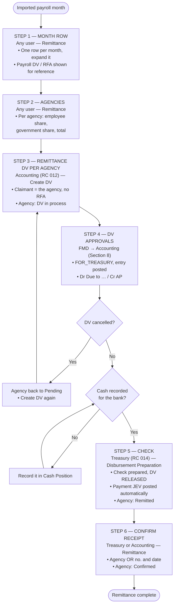

## 9. Check release and payment entry

**Needs:** a DV at FOR_TREASURY (Section 8). **Sidebar:** DV Processing → Disbursement Preparation (Treasury),
Disbursement Voucher and Journal Entry Voucher (Accounting); FTLA (page `FtlaPage`, not in the sidebar). A DV is released
**either by check (steps 1–5) or by FTLA bank transfer (steps 6–8)** — never both. **Check:** PREPARED → RELEASED → ENCASHED /
OUTSTANDING → STALE, or CANCELLED / VOIDED. **Release:** PENDING → NOTIFIED → RELEASED → ACKNOWLEDGED, or UNCLAIMED.

| Step | Log in as | Where (sidebar → page) | Do this | Expected result |
|---|---|---|---|---|
| 1 | Treasury Officer (RC 014) | DV Processing → Disbursement Preparation | Prepare the check for the DV: bank account, check number | Check PREPARED; the DV becomes RELEASED; the **payment JEV is created and POSTED automatically** (Dr Accounts Payable / Cr Cash in Bank; the Cash line uses the bank's Cash SL account when one is tagged) — there is no separate Prepare Payment JEV step |
| 1a | Treasury Officer (alternative) | Prepare Check | The bank's Cash account is not tagged | Refused — "no Cash account mapped". Tag it in Bank Management → Tag Account Code: pick the Cash in Bank GL account (e.g. 1-01-02-020) and, if used, its SL in the GL / SL picker |
| 2 | Treasury Officer | Disbursement Preparation → releases | Create the release and notify the payee | Release PENDING → NOTIFIED (email sent) |
| 3 | Treasury Officer | Disbursement Preparation → releases | Release the check to the payee; record the acknowledgment | RELEASED → ACKNOWLEDGED |
| 3a | Treasury Officer (alternative) | releases | Mark it unclaimed | UNCLAIMED; the check becomes STALE |
| 4 | Any user | DV Processing → Journal Entry Voucher | Find the DV's payment JEV; **View** (opens the print preview) | Payment JEV POSTED; the print shows the journal (CKDJ) |
| 5 | Any user | Ledgers → Journals (CKDJ tab) | Find the check | Check listed in the Check Disbursements Journal |
| 6 | Treasury Officer (RC 014) | FTLA → Register | Bank-transfer release instead of a check: from / to bank accounts, and the DV no. on each debit row (only FOR_TREASURY DVs not already on a check or another FTLA are offered) | FTLA DRAFT |
| 6a | Treasury Officer (alternative) | FTLA / Prepare Check | Use a DV already on an FTLA for a check, or the reverse | Not offered / refused — one release per DV |
| 7 | Treasury | FTLA | Move it through For RM Approval → For Review → For Approval → Approved → Transmitted to Bank → Validated (bank confirmed) | Status Validated |
| 8 | Treasury | FTLA | Submit to Accounting | **One combined payment JEV posted** for every DV on the FTLA (Dr Accounts Payable per DV / Cr Cash); every listed DV becomes RELEASED; the JEV print shows **ADADJ** |

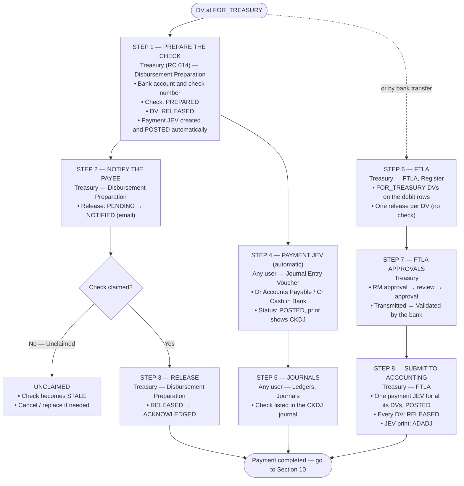

## 10. Adjusting entries (Journal Entry Voucher)

**Needs:** Section 1 (accounts and books). **Sidebar:** DV Processing → Journal Entry Voucher (**+ Add JEV**). For
entries without a DV: accruals, depreciation, prepayments, closing. **Statuses:** DRAFT, FOR_SECTION_CHIEF,
FOR_DIVISION_MANAGER, FOR_DEPARTMENT_MANAGER, POSTED. Only Accounting can move it; there is no return step.

| Step | Log in as | Where (sidebar → page) | Do this | Expected result |
|---|---|---|---|---|
| 1 | Accounting Section Chief (RC 012) | DV Processing → Journal Entry Voucher → + Add JEV | Book, fiscal year, date, classification, particulars, attachments; debit / credit lines (accounts, SL accounts, responsibility centers); save | Status DRAFT |
| 1a | Accounting Section Chief (alternative) | + Add JEV | Save with debits ≠ credits or fewer than 2 lines | Not saved — "Debits and credits must balance" |
| 2 | Accounting Section Chief | Journal Entry Voucher | Move forward | Status FOR_SECTION_CHIEF → FOR_DIVISION_MANAGER |
| 3 | Accounting Division Manager | Journal Entry Voucher | Move forward | Status FOR_DEPARTMENT_MANAGER |
| 4 | Accounting Department Manager | Journal Entry Voucher | Post | Status POSTED |
| 5 | Any user | Journal Entry Voucher → **View** | Opens the JEV in the print preview (there is no separate Print item); print it | Printed JEV matches the entry. The journal box is blank for a General Journal entry ("GJ" is only the list category); payment JEVs show CKDJ (check) or ADADJ (ADA / FTLA) |
| 6 | Accounting Section Chief | Registry → Collections and Deposits → a report → **Journalize** (Collection or Deposit leg) | Check the pre-filled lines; submit | A DRAFT JEV is created for that leg (each leg only once) and follows steps 2–4 |

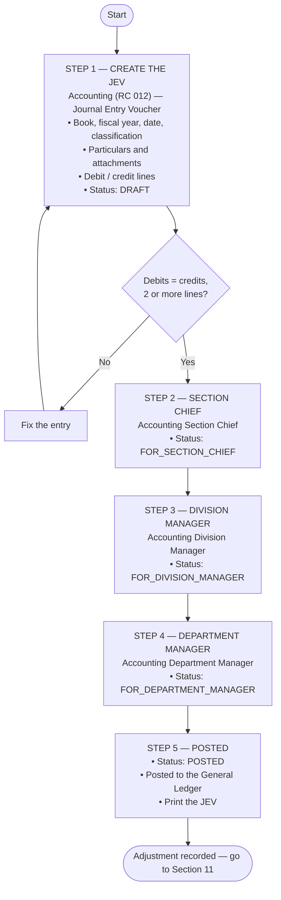

## 11. Verification — ledgers and monitoring

**Needs:** Sections 3 to 10. **Sidebar:** Ledgers, Monitoring. Read-only pages: check that every posted entry and
every approved amount from the earlier sections shows up correctly.

| Step | Log in as | Where (sidebar → page) | Do this | Expected result |
|---|---|---|---|---|
| 1 | Any user | Ledgers → General Ledger | Pick an account used in Sections 8–10 and the fiscal year | Every posted entry listed with its JEV / DV, debit, credit and running balance — an SL account's postings are included in its GL account (SL code shown on the line); click the GL code for each SL's own postings. Pick the account in the Account search; the header **Print ▾**: under **General Ledger** it lists only the book and fiscal year sheets that have data for that account (e.g. "Main Office — FY 2026") — click one to print it, no filters needed; under **Subsidiary Ledger** it lists the sheets where an SL under the account has data, and prints one SUBSIDIARY LEDGER sheet per SL (bank + account no. for a bank account's SL; Date · Particulars · Folio · JEV# · Debits · Credits · Balance; Beginning and Ending balance). General Ledger (pick one Book and one Fiscal Year) gives the **NHA Form No. 11** sheet: Fund = the book, Jan 1 Beginning Balance (the book's Opening Balance), per month one line per journal (CKDJ Disbursements, CRDJ Collections and Deposits, ADADJ Advice to Debit Account Disb., GJ Various Adjustments), the Closing Entry, and the Dec 31 Ending Balance — which agrees with the Trial Balance |
| 2 | Any user | Ledgers → General Ledger → click the GL code | Find the SL (bottom-level) account used | Its postings and running balance in the SL popup; the popup's **Print SL** prints the same SUBSIDIARY LEDGER sheets. The Subsidiary Ledger page is no longer in the sidebar (it still opens at `SubsidiaryLedgerPage`) |
| 3 | Any user | Ledgers → Journals | Open the GJ and CKDJ tabs | GJ: posted journal entries; CKDJ: the checks from Section 9 |
| 4 | Any user | Ledgers → Trial Balance | Pick the fiscal year and book | Total debits = total credits; the figures include the year's Opening Balances |
| 5 | Any user | Monitoring → COB Monitoring | Open the office and fiscal year from Section 3 | Approved, Revision, CBA, RFA, LAA, Available and Remaining agree with Sections 3–6; PDF and Excel reports download |

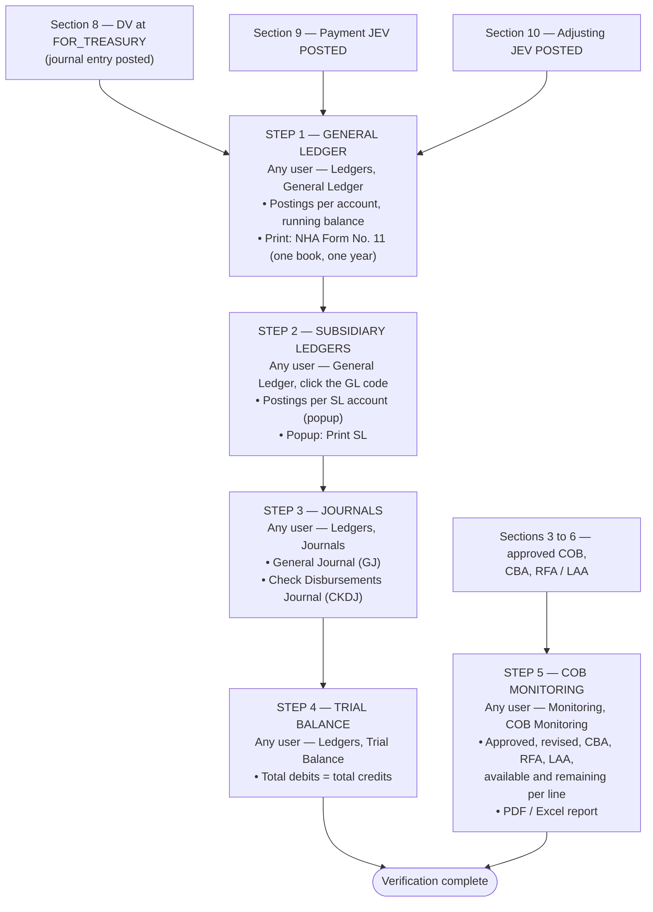

## 12. Not built yet and known limitations

**Sidebar items that open an empty page** (no process to test yet):

| Sidebar group | Menu item |
|---|---|
| DV Processing | Liquidation Voucher, Remittance List (Deductions) |
| Registry/NCA | Accountable Forms Registry |
| Inventory | Construction In Progress, Property and Equipment for Distribution, Merchandise Inventory, Fixed Assets |
| Reports | FMR |
| Fund Sourcing | Pricing (the request form and API exist; the page is empty) |

**Known limitations — expected behaviour today, not test failures:**

- **CFA** (Certified Funds Available) cannot be created: both memo request pages offer only CBA or RFA / LAA.
- **ADA and Cash Receipts journals** (Journals → ADADJ, CRDJ): an FTLA covering several DVs posts one payment JEV with
  no single DV, so it may not resolve in the ADADJ tab; Collections JEVs (Section 10, step 6) are ordinary journal
  entries — their print shows no CRDJ journal line yet.
- **Fund Sourcing Dashboard** — the Fund Transfer / Borrowing card shows sample data.
- **COB Monitoring** — the Approved Amount is also the live balance, so Revised and Available can count a CBA or a
  revision twice; confirm the figures by hand (see `system_docs/ERD/README.md`, Known gaps).
- **Journals CKDJ** can list a check twice once its Payment JEV exists.
- **Journal Entry Vouchers** have no return step; a **rejected DV** can only be cancelled.
- **RFA / LAA print, several CBAs**: printing is back on (no longer paused); an RFA / LAA that draws from several
  CBAs prints the summed amounts, with only the first block's project on an RFA (none on an LAA) — a per-project
  layout is still to be agreed with the budget team.
- **DV print**: the form's Accounting Entries hold up to 18 lines plus the TOTAL row (past 10 the grid is
  redrawn with smaller rows); a DV with more than 18 lines prints "SEE ATTACHED" on the last row and lists every
  line on the attachment page. FPA and
  OBJECT CODE are not filled yet.
- **DV / JEV print signatories** (prepared / reviewed / approved by) are not filled in yet.
- **Remittance List (Deductions)** report for the agencies is not built; the Remittance page and the YTD CSV are the
  current sources.
- **Payroll DV deductions** show as one "Other" line until the payroll deduction types are seeded
  (`04 - seed_data/08`); the accounting entry is right either way.
- Pages that work but are **not in the sidebar**: Purchase Orders, FTLA, Subsidiary Ledger (its postings and print
  are covered by the General Ledger's SL popup).
- **Subsidiary Ledger print:** a bank account shows on its SL sheet only once the bank account is linked to its own SL
  account (Bank Management → GL / SL picker); the TOP SHEET schedule (every SL with its balance) is not built.
  **Collections** print as CRDJ on the GL sheet only once journalized from Collections.
