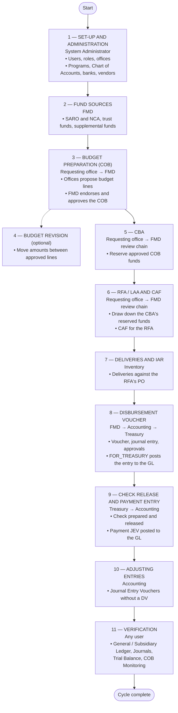
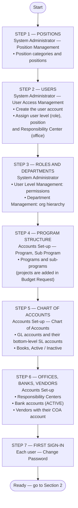
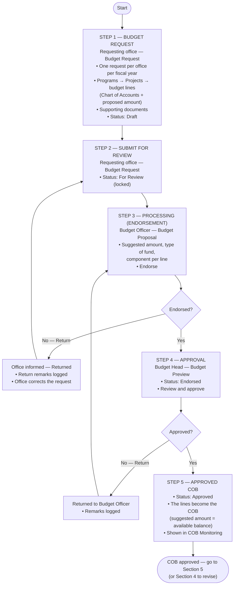
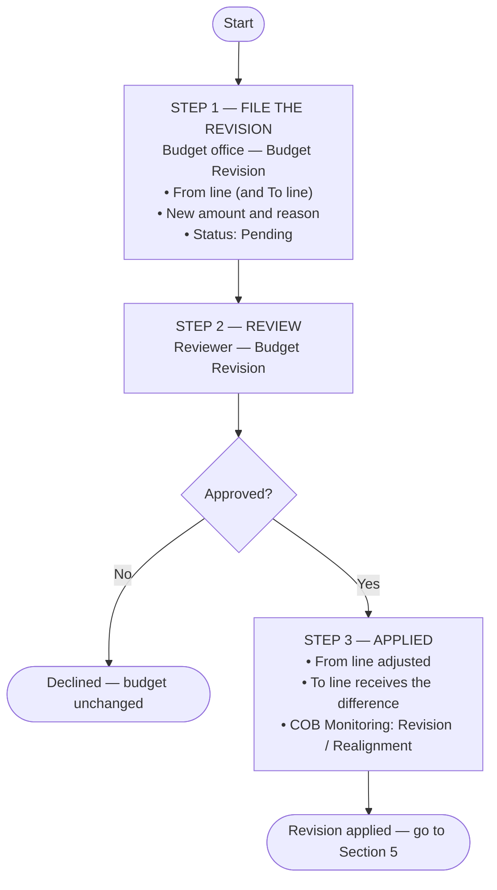
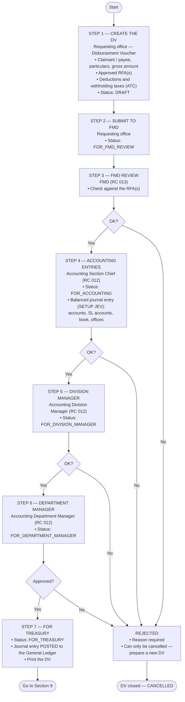
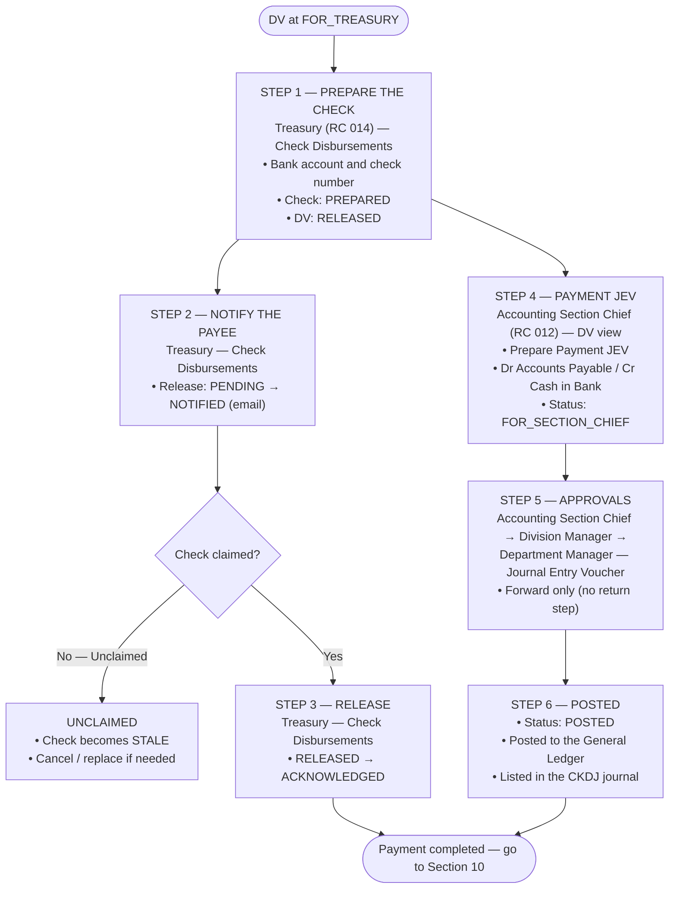
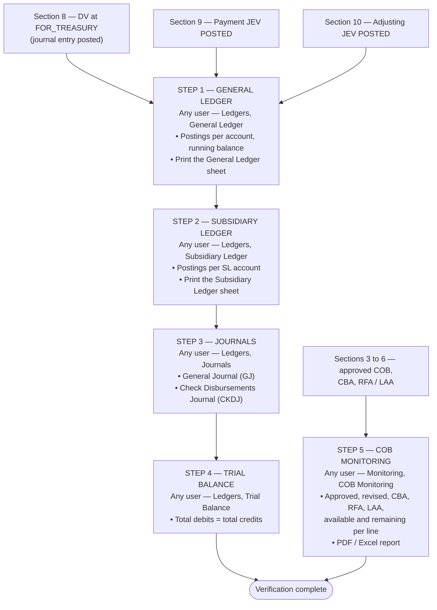

# FIMS NHA — System Process Flow

**Step-by-step walkthrough, from set-up to the posted ledgers — for SQA testing and CPA review**

> **Status:** written 2026-11-17 from the current code (`app/`) and the status chains in its services. Follows the
> sidebar modules (`views/menu.php`). Tables behind each step: `system_docs/ERD/README.md`.
> PDF version: `system_docs/process-flow/PROCESS-FLOW.pdf` — the flowcharts of this file, one process per page in
> order, in the ITBS process-flow layout (letterhead, process title, flowchart). The walkthrough tables are in this
> file only.

## How to use this document

- **Follow the sections in order.** Each section uses what the sections before it created: a CBA needs an approved
  COB, an RFA needs an approved CBA, a Disbursement Voucher needs an approved RFA, and so on. The line **Needs:** at
  the top of each section says what must exist first.
- Each section has a **walkthrough table** — Step, *Log in as*, *Where* (sidebar → page), *Do this*, *Expected
  result* — followed by its **flowchart**.
- **Expected result** is what to check on screen: the status shown, a number assigned, an amount that changes. A
  result that differs is a finding.
- Rows marked **(alternative)** are the "No" branch of the flowchart: test them too, then continue from the step they
  point back to.
- **Reading the flowcharts:** rounded box = start / end; STEP box = line 1 the step, line 2 *who acts and on which
  page*, bullets = what is done and the resulting status; diamond = a decision; a **No** branch goes to a correction
  box and back to the step that redoes the work; dotted arrows are side processes.

## Before you start — accounts needed

Approvals are checked in two ways: memo requests and budget requests check the user's **user level** (role name);
Disbursement Vouchers and Journal Entry Vouchers check the user's **office** (Responsibility Center). Each tester
account needs both set correctly (Section 1, step 2).

| Role (user level) | Office (Responsibility Center) | Acts in sections |
|---|---|---|
| System Administrator | any | 1 |
| Requesting office user | a Regional / District office | 3, 5, 6, 8 |
| Budget Officer | Financial Management Department — FMD (RC 013) | 3 |
| Budget Head | FMD (RC 013) | 3 |
| FMD Section Chief | FMD (RC 013) | 5, 6 |
| FMD Division Manager | FMD (RC 013) | 5, 6 |
| FMD Department Manager | FMD (RC 013) | 5, 6 |
| FMD user (Fund Sourcing) | FMD (RC 013) | 2, 8 (FMD review of the DV) |
| Accounting Section Chief | Accounting Department (RC 012) | 8, 9, 10 |
| Accounting Division Manager | Accounting Department (RC 012) | 8, 9, 10 |
| Accounting Department Manager | Accounting Department (RC 012) | 8, 9, 10 |
| Treasury Officer | Treasury Department (RC 014) | 9 |
| Any user (read-only checks) | any | 11 |

## Contents

0. [End-to-end overview](#0-end-to-end-overview)
1. [Set-up and administration](#1-set-up-and-administration)
2. [Fund sources (registry)](#2-fund-sources-registry)
3. [Budget preparation (COB)](#3-budget-preparation-cob)
4. [Budget revision (optional)](#4-budget-revision-optional)
5. [Request for Allocation — CBA](#5-request-for-allocation--cba)
6. [Request for Allocation — RFA / LAA and CAF](#6-request-for-allocation--rfa--laa-and-caf)
7. [Deliveries and IAR](#7-deliveries-and-iar)
8. [Disbursement Voucher](#8-disbursement-voucher)
9. [Check release and payment entry](#9-check-release-and-payment-entry)
10. [Adjusting entries (Journal Entry Voucher)](#10-adjusting-entries-journal-entry-voucher)
11. [Verification — ledgers and monitoring](#11-verification--ledgers-and-monitoring)
12. [Not built yet and known limitations](#12-not-built-yet-and-known-limitations)

## 0. End-to-end overview

The whole cycle on one page. Sections 1 to 11 below go through each box in this order.

## 1. Set-up and administration

**Needs:** nothing — this comes first. **Sidebar:** Administration, Accounts Set-up.

| Step | Log in as | Where (sidebar → page) | Do this | Expected result |
|---|---|---|---|---|
| 1 | System Administrator | Administration → Position Management | Add the position categories and positions | They are listed |
| 2 | System Administrator | Administration → User Access Management | Create one user per role in *Before you start*; set each user's user level, position and Responsibility Center | Each user can log in and sees only the menus of that role |
| 3 | System Administrator | Administration → User Level Management | Review the roles and their permissions | Each role has access to its modules |
| 4 | System Administrator | Administration → Department Management | Check the departments and budget units | Org hierarchy is correct |
| 5 | System Administrator | Accounts Set-up → Program, then Sub Program | Add a program and its sub-programs | Listed under the program |
| 6 | System Administrator | Accounts Set-up → Chart of Accounts | Check the GL accounts and their bottom-level (SL) accounts are Active; set their Books | Accounts show as Active |
| 7 | System Administrator | Accounts Set-up → Responsibility Center | Check FMD (013), Accounting (012), Treasury (014) and the requesting offices are Active | Listed as Active |
| 8 | System Administrator | Accounts Set-up → Banks Accounts | Add the disbursing bank account | Status ACTIVE |
| 9 | System Administrator | Accounts Set-up → Vendors | Add a vendor with its assigned Chart of Accounts account | Vendor is ACTIVE and can be picked in an RFA |
| 10 | Each new user | Change Password | Change the initial password | Password updated |

## 2. Fund sources (registry)

**Needs:** Section 1. **Sidebar:** Registry/NCA, Fund Sourcing. Independent of the budget cycle; recorded as fund
documents arrive.

| Step | Log in as | Where (sidebar → page) | Do this | Expected result |
|---|---|---|---|---|
| 1 | FMD user | Registry/NCA → SARO Registry (SARO tab) | Add a SARO: number, date, agency, nature of fund, amount | Listed in the SARO tab |
| 2 | FMD user | Registry/NCA → SARO Registry (NCA tab) | Add an NCA under that SARO | Shown under its SARO |
| 3 | FMD user | Fund Sourcing → Trust Funds | Add a trust fund, then its Official Receipts | ORs listed under the trust fund |
| 4 | FMD user | Fund Sourcing → Supplemental Funds | Add a supplemental fund request | Status IN_PROCESS |
| 5 | FMD user | Fund Sourcing → Supplemental Funds | Move it AT_NDRRMC → AT_OP → APPROVED (or DENIED) | Status updates at each move |
| 6 | FMD user | Fund Sourcing → Fund Sourcing Dashboard | Review the totals | SARO, NCA, trust and supplemental totals include the new records |

## 3. Budget preparation (COB)

**Needs:** Section 1. **Sidebar:** COB Preparation → Budget Request (office), Budget Proposal (FMD).
**Statuses:** Draft, For Review, Endorsed, Approved, Returned, Returned to Budget Officer.

| Step | Log in as | Where (sidebar → page) | Do this | Expected result |
|---|---|---|---|---|
| 1 | Requesting office user | COB Preparation → Budget Request | Create the request for the fiscal year; add a Program, its Projects, and budget lines (Chart of Accounts account + proposed amount); attach documents; save | Status Draft — still editable |
| 2 | Requesting office user | Budget Request | Submit for Review | Status For Review — request locked |
| 3 | Budget Officer (FMD) | COB Preparation → Budget Proposal | Open the request → Processing: set the suggested amount, type of fund and component per line → Endorse | Status Endorsed |
| 3a | Budget Officer (alternative) | Budget Proposal | Return with remarks | Status Returned — office edits and repeats step 2 |
| 4 | Budget Head (FMD) | Budget Proposal → Budget Preview | Approve | Status Approved |
| 4a | Budget Head (alternative) | Budget Preview | Return with remarks | Status Returned to Budget Officer — repeat step 3 |
| 5 | Any user | Monitoring → COB Monitoring | Find the office and fiscal year | Lines shown; Approved Amount = the suggested amount |

## 4. Budget revision (optional)

**Needs:** an approved COB (Section 3). **Sidebar:** COB Preparation → Budget Revision.
**Statuses:** Pending, Approved, Declined.

| Step | Log in as | Where (sidebar → page) | Do this | Expected result |
|---|---|---|---|---|
| 1 | Budget office user | COB Preparation → Budget Revision | Add a revision: From budget line, To line (when moving money), new amount, reason | Status Pending — still editable |
| 2 | Reviewer | Budget Revision | Review → Approve | Status Approved; the From and To lines' amounts change |
| 2a | Reviewer (alternative) | Budget Revision | Review → Decline | Status Declined; no amounts change |
| 3 | Any user | Monitoring → COB Monitoring | Open the revised lines | Revision / Realignment column shows the change |

## 5. Request for Allocation — CBA

**Needs:** an approved COB (Section 3). **Sidebar:** Budget Process → Request for Allocation (CBA). FMD reviews from
the same list with **Process**. **Statuses:** Draft, For Review, For Division Manager, For Department Manager,
Approved, Returned, Returned to Section Chief, Returned to Division Manager.

| Step | Log in as | Where (sidebar → page) | Do this | Expected result |
|---|---|---|---|---|
| 1 | Requesting office user | Budget Process → Request for Allocation (CBA) | New: pick approved COB budget lines, requested amount per line, program / project, category, description; attach documents; save | Status Draft — Print Preview available |
| 2 | Requesting office user | Request for Allocation (CBA) | Submit for Review | Status For Review |
| 3 | FMD Section Chief | Request for Allocation (CBA) → Process | Approve | Status For Division Manager |
| 3a | FMD Section Chief (alternative) | Process | Return with remarks | Status Returned — office edits and repeats step 2 |
| 4 | FMD Division Manager | Process | Approve | Status For Department Manager |
| 4a | FMD Division Manager (alternative) | Process | Return | Status Returned to Section Chief — repeat step 3 |
| 5 | FMD Department Manager | Process | Approve | Status Approved; a CBA number is assigned |
| 5a | FMD Department Manager (alternative) | Process | Return | Status Returned to Division Manager — repeat step 4 |
| 6 | Any user | Request for Allocation (CBA) → Print; Monitoring → COB Monitoring | Print the CBA; open the COB lines | CBA column = the CBA amount; Available reduced by it |

## 6. Request for Allocation — RFA / LAA and CAF

**Needs:** an approved CBA (Section 5). **Sidebar:** Budget Process → Request for Allocation (RFA/LAA). Same review
chain and statuses as the CBA.

| Step | Log in as | Where (sidebar → page) | Do this | Expected result |
|---|---|---|---|---|
| 1 | Requesting office user | Budget Process → Request for Allocation (RFA/LAA) | New RFA (or LAA): link the approved parent CBA; for an RFA the vendor, PR and PO numbers and amounts; amount per budget line; save | Status Draft |
| 2 | Requesting office user | Request for Allocation (RFA/LAA) | Submit for Review | Status For Review |
| 3–5 | FMD Section Chief → Division Manager → Department Manager | Process | Approve at each step (returns work as in Section 5) | Status Approved; RFA / LAA number assigned |
| 5b | FMD Department Manager (alternative) | Process | Approve an amount larger than the CBA's remaining reserved balance | Approval blocked — lower the amount or link another CBA |
| 6 | Requesting office or FMD user | RFA row → Actions → Create CAF | Create the Certificate as to Availability of Funds | CAF saved; Print CAF available |
| 7 | Any user | Print; Monitoring → COB Monitoring | Print the RFA / LAA and the CAF; open the COB lines | RFA / LAA column increased; Remaining reduced |

## 7. Deliveries and IAR

**Needs:** an approved RFA with a PO number (Section 6). **Sidebar:** Inventory → IAR Module (Deliveries tab).
For purchases; skip for payments without deliveries.

| Step | Log in as | Where (sidebar → page) | Do this | Expected result |
|---|---|---|---|---|
| 1 | Inventory user | Inventory → IAR Module (Deliveries) | Select the PO number of the RFA | PO amount and remaining balance shown |
| 2 | Inventory user | IAR Module | Add the delivery receipt: DR number, date, amount, accounts; items with serial / property numbers (₱50,000 and up) | Delivery saved |
| 2a | Inventory user (alternative) | IAR Module | Enter a DR above the PO balance, or a repeated DR / serial number | Rejected with a message |
| 3 | Inventory user | IAR Module | Enter the IAR number and sales invoice number / date | IAR recorded for the PO |
| 4 | Inventory user | IAR Module → pro-forma JEV | Print JEV | Dr delivery accounts / Cr Accounts Payable |
| 5 | Inventory user | IAR Module | Repeat step 2 until the PO is fully delivered | Remaining balance reaches zero |

## 8. Disbursement Voucher

**Needs:** an approved RFA (Section 6); for purchases, the deliveries (Section 7). **Sidebar:** DV Processing →
Disbursement Voucher. **Statuses:** DRAFT, FOR_FMD_REVIEW, FOR_ACCOUNTING, FOR_DIVISION_MANAGER,
FOR_DEPARTMENT_MANAGER, FOR_TREASURY, RELEASED, REJECTED, CANCELLED. Only the office holding the voucher can move it.

| Step | Log in as | Where (sidebar → page) | Do this | Expected result |
|---|---|---|---|---|
| 1 | Requesting office user | DV Processing → Disbursement Voucher | New DV: claimant / payee, particulars, gross amount; link the approved RFA(s); deductions and withholding taxes (ATC); attach documents; save | Status DRAFT |
| 2 | Requesting office user | Disbursement Voucher | Submit to FMD | Status FOR_FMD_REVIEW |
| 3 | FMD user (RC 013) | Disbursement Voucher → view | Move to the next stage | Status FOR_ACCOUNTING |
| 3a | FMD user (alternative) | view | Reject with a reason | Status REJECTED — it can only be cancelled; a new DV is needed |
| 4 | Accounting Section Chief (RC 012) | Disbursement Voucher → Accounting Entries | Enter the balanced journal entry: accounts, SL accounts, book, responsibility centers; save; move to the next stage | Status FOR_DIVISION_MANAGER |
| 5 | Accounting Division Manager (RC 012) | view | Move to the next stage | Status FOR_DEPARTMENT_MANAGER |
| 6 | Accounting Department Manager (RC 012) | view | Approve | Status FOR_TREASURY; its journal entry is POSTED |
| 7 | Any user | Disbursement Voucher → Print; DV Processing → Journal Entry Voucher | Print the DV; find its journal entry | The SETUP JEV shows POSTED |

> A DV can also be **cancelled** at any open stage by the office holding it or its creator. Cancelling at
> FOR_TREASURY reverses the posted General Ledger entry — test it on a separate DV.

## 9. Check release and payment entry

**Needs:** a DV at FOR_TREASURY (Section 8). **Sidebar:** DV Processing → Check Disbursements (Treasury),
Disbursement Voucher and Journal Entry Voucher (Accounting). **Check:** PREPARED → RELEASED → ENCASHED /
OUTSTANDING → STALE, or CANCELLED / VOIDED. **Release:** PENDING → NOTIFIED → RELEASED → ACKNOWLEDGED, or UNCLAIMED.

| Step | Log in as | Where (sidebar → page) | Do this | Expected result |
|---|---|---|---|---|
| 1 | Treasury Officer (RC 014) | DV Processing → Check Disbursements | Prepare the check for the DV: bank account, check number | Check PREPARED; the DV becomes RELEASED |
| 2 | Treasury Officer | Check Disbursements → releases | Create the release and notify the payee | Release PENDING → NOTIFIED (email sent) |
| 3 | Treasury Officer | Check Disbursements → releases | Release the check to the payee; record the acknowledgment | RELEASED → ACKNOWLEDGED |
| 3a | Treasury Officer (alternative) | releases | Mark it unclaimed | UNCLAIMED; the check becomes STALE |
| 4 | Accounting Section Chief (RC 012) | Disbursement Voucher → view → Prepare Payment JEV | Prepare the payment entry (Dr Accounts Payable / Cr Cash in Bank) | Payment JEV at FOR_SECTION_CHIEF |
| 5 | Accounting Section Chief → Division Manager → Department Manager | DV Processing → Journal Entry Voucher | Move it forward at each level | FOR_DIVISION_MANAGER → FOR_DEPARTMENT_MANAGER → POSTED |
| 6 | Any user | Ledgers → Journals (CKDJ tab) | Find the check | Check listed in the Check Disbursements Journal |

## 10. Adjusting entries (Journal Entry Voucher)

**Needs:** Section 1 (accounts and books). **Sidebar:** DV Processing → Journal Entry Voucher (**+ Add JEV**). For
entries without a DV: accruals, depreciation, prepayments, closing. **Statuses:** DRAFT, FOR_SECTION_CHIEF,
FOR_DIVISION_MANAGER, FOR_DEPARTMENT_MANAGER, POSTED. Only Accounting can move it; there is no return step.

| Step | Log in as | Where (sidebar → page) | Do this | Expected result |
|---|---|---|---|---|
| 1 | Accounting Section Chief (RC 012) | DV Processing → Journal Entry Voucher → + Add JEV | Book, fiscal year, date, classification, particulars, attachments; debit / credit lines (accounts, SL accounts, responsibility centers); save | Status DRAFT |
| 1a | Accounting Section Chief (alternative) | + Add JEV | Save with debits ≠ credits or fewer than 2 lines | Not saved — "Debits and credits must balance" |
| 2 | Accounting Section Chief | Journal Entry Voucher | Move forward | Status FOR_SECTION_CHIEF → FOR_DIVISION_MANAGER |
| 3 | Accounting Division Manager | Journal Entry Voucher | Move forward | Status FOR_DEPARTMENT_MANAGER |
| 4 | Accounting Department Manager | Journal Entry Voucher | Post | Status POSTED |
| 5 | Any user | Journal Entry Voucher → Print | Print the JEV | Printed JEV matches the entry |

## 11. Verification — ledgers and monitoring

**Needs:** Sections 3 to 10. **Sidebar:** Ledgers, Monitoring. Read-only pages: check that every posted entry and
every approved amount from the earlier sections shows up correctly.

| Step | Log in as | Where (sidebar → page) | Do this | Expected result |
|---|---|---|---|---|
| 1 | Any user | Ledgers → General Ledger | Pick an account used in Sections 8–10 and the fiscal year | Every posted entry listed with its JEV / DV, debit, credit and running balance; Print gives the General Ledger sheet |
| 2 | Any user | Ledgers → Subsidiary Ledger | Pick the SL (bottom-level) account used | Its postings and running balance; Print gives the Subsidiary Ledger sheet |
| 3 | Any user | Ledgers → Journals | Open the GJ and CKDJ tabs | GJ: posted journal entries; CKDJ: the checks from Section 9 |
| 4 | Any user | Ledgers → Trial Balance | Pick the fiscal year and book | Total debits = total credits |
| 5 | Any user | Monitoring → COB Monitoring | Open the office and fiscal year from Section 3 | Approved, Revision, CBA, RFA, LAA, Available and Remaining agree with Sections 3–6; PDF and Excel reports download |

## 12. Not built yet and known limitations

**Sidebar items that open an empty page** (no process to test yet):

| Sidebar group | Menu item |
|---|---|
| COB Preparation | Ledger |
| DV Processing | Liquidation Voucher |
| Monitoring | RFA / LAA Monitoring |
| Registry/NCA | Check Registry, Accountable Forms Registry |
| Reports | FMR, Remittance List (Deductions) |
| Accounts Set-up | Fund Source, Program Sources, Accountable Officer |
| Fund Sourcing | Pricing (the request form and API exist; the page is empty) |

**Known limitations — expected behaviour today, not test failures:**

- **CFA** (Certified Funds Available) cannot be created: both memo request pages offer only CBA or RFA / LAA.
- **ADA and Cash Receipts journals** (Journals → ADADJ, CRDJ) are always empty: nothing records ADA releases or
  official receipts yet.
- **Fund Sourcing Dashboard** — the Fund Transfer / Borrowing card shows sample data.
- **COB Monitoring** — the Approved Amount is also the live balance, so Revised and Available can count a CBA or a
  revision twice; confirm the figures by hand (see `system_docs/ERD/README.md`, Known gaps).
- **Journals CKDJ** can list a check twice once its Payment JEV exists.
- **Journal Entry Vouchers** have no return step; a **rejected DV** can only be cancelled.
- Pages that work but are **not in the sidebar**: Purchase Orders, Property Records, Cash Position, FTLA.
